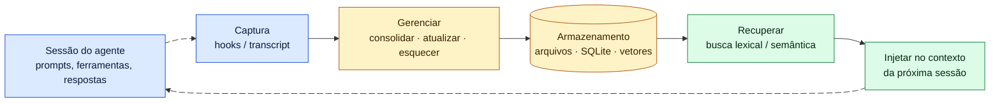
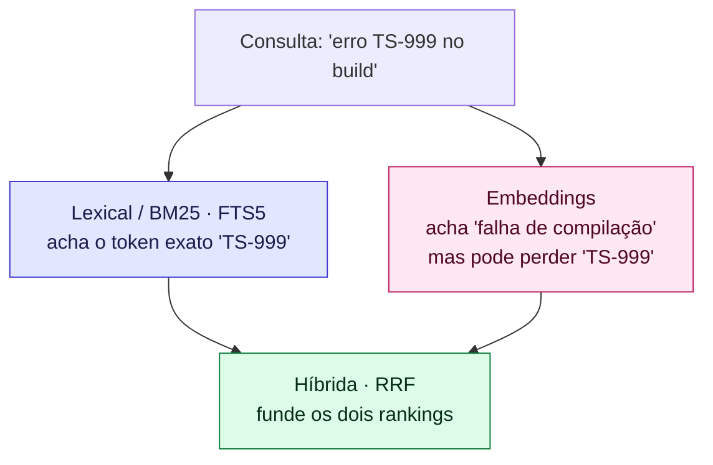
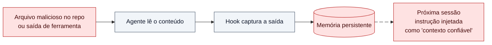

# 01 — Memória de longo prazo para agentes de código: conceitos e estado da arte

> **Estudo (pt-BR) — 2026-10-14.** Base teórica para avaliar `akitaonrails/ai-memory` e `thedotmack/claude-mem`.
> Cada afirmação traz uma citação `[n]`. Todas as fontes da bibliografia foram baixadas em 2026-10-14 e cada
> citação literal foi conferida contra o texto bruto da fonte. Marcações *(inferência)* são raciocínio deste
> estudo, não fatos citados.

← [Índice](README.md) | [02 — ai-memory →](02-ai-memory.md)

---

## 1. O problema em uma frase

Um modelo de linguagem **não lembra nada entre uma chamada e outra**: "Large language models don't retain memory
between completions" [19]. Tudo o que um agente "sabe" sobre o seu projeto precisa ser **colocado de volta na
janela de contexto** a cada sessão. Uma ferramenta de memória para agentes resolve três perguntas:

| Pergunta | Nome técnico | Exemplo concreto |
|---|---|---|
| O que guardar? | **Captura / escrita** | "O teste `X` falha se o Redis não estiver de pé" |
| Como organizar e envelhecer? | **Consolidação, atualização, esquecimento** | Juntar 40 observações repetidas em 1 página; descartar o que ficou obsoleto |
| O que devolver ao agente, e quanto? | **Recuperação e injeção** | Na próxima sessão, injetar só as 5 notas relevantes, não as 4 000 |

Du (2026) resume isso como um ciclo **escrever → gerenciar → ler** ("write–manage–read loop") [6].

---

## 2. Taxonomia: os quatro tipos de memória (CoALA)

O artigo **CoALA** (Sumers et al., 2023) é a referência de taxonomia. Ele descreve "a language agent with modular
memory components" [1] e importa quatro tipos de memória da ciência cognitiva [2]:

| Tipo | Definição literal [2] | No mundo de agentes de código | ai-memory | claude-mem |
|---|---|---|---|---|
| **Working** (trabalho) | "maintains active and readily available information … for the current decision cycle" | A janela de contexto atual | — (é do harness) | — (é do harness) |
| **Episódica** | "stores experience from earlier decision cycles" | "Ontem tentamos X e falhou" | Observações capturadas + handoffs | Observações e resumos de sessão gerados por LLM |
| **Semântica** | "stores an agent's knowledge about the world and itself" | "Este repo usa pnpm e Vitest" | Páginas do wiki + perfil cross-project | Observações do tipo `decision`, `discovery` |
| **Procedural** | "implicit knowledge stored in the LLM weights, and explicit knowledge written in the agent's code" | CLAUDE.md, regras, skills | Páginas `_rules/` e `procedures/` (auto-improve) | Modos (`plugin/modes/*.json`) |

Os surveys mais recentes deixam de lado a divisão simples "curto × longo prazo":

- **"Memory in the Age of AI Agents"** (dez/2025, 47 autores) classifica memória por **forma** ("token-level,
  parametric, and latent memory"), por **função** ("factual, experiential, and working memory") e por **dinâmica**.
  Também separa explicitamente memória de agente de "retrieval augmented generation (RAG), and context engineering" [4].
- **"Rethinking Memory in LLM based Agents"** (2025) define seis operações: "Consolidation, Updating, Indexing,
  Forgetting, Retrieval, and Condensation" [5]. Elas servem de checklist para avaliar qualquer ferramenta
  (seção 6).
- **LangMem** separa escrever memória **no caminho quente** (durante a conversa, o que adiciona latência) de
  escrever **em background** (depois da conversa) [12].

---

## 3. Os sistemas que definiram o campo

| Sistema | Ideia central | Parentesco com as ferramentas estudadas |
|---|---|---|
| **Generative Agents** (Park et al., 2023) [7][8] | Um **memory stream** em linguagem natural. A recuperação pontua cada memória por **recência + importância + relevância**, e a **reflexão** gera pensamentos de nível mais alto | Recência com decaimento: "Our decay factor is 0.995" [8]. O ai-memory também envelhece memória por tempo e por uso |
| **MemGPT → Letta** (Packer et al., 2023) [9] | Contexto virtual estilo sistema operacional: pagina dados entre "different memory tiers" | A **progressive disclosure** do claude-mem é uma forma de paginação |
| **Letta MemFS** (atual) [10] | Memória em Markdown com frontmatter YAML: "Every memory edit is committed to the MemFS git repository" | **O análogo mais próximo do ai-memory** (wiki Markdown versionado em git) *(inferência)* |
| **Mem0** (2025) [11] | Pipeline de LLM que "dynamically extract[s], consolidat[es], and retriev[es] salient information" | **O análogo mais próximo do claude-mem** (um LLM extrai observações) *(inferência)* |
| **A-MEM** (2025) [13] | Notas estilo **Zettelkasten**, com ligações e "memory evolution" | Os links de entidades e o grafo do ai-memory |
| **Zep / Graphiti** (2025) [14] | **Grafo de conhecimento temporal** | — |

> **Cuidado com números de vendor.** O Mem0 reporta "26% relative improvements … over OpenAI" e "91% lower p95
> latency" [11]. O Zep reporta "94.8% vs 93.4%" contra o MemGPT [14]. **Os dois resultados são autorreportados**,
> medidos em benchmarks de *chat*, não de código.

---

## 4. Como os vendors de agentes de código resolveram memória (out/2026)

| Vendor | Mecanismo | Limite | Fonte |
|---|---|---|---|
| **Claude Code** | `CLAUDE.md` (escrito por você) + **auto memory** (escrito pelo Claude) em `~/.claude/projects/<proj>/memory/` | "The first 200 lines of `MEMORY.md`, or the first 25KB" | [15] |
| **Claude API** | **Memory tool** client-side ("Claude requests file operations, and your application executes them") + **context editing** | Você controla o armazenamento | [16][17] |
| **OpenAI Codex** | `AGENTS.md` concatenado da raiz até o diretório atual | `project_doc_max_bytes` = 32 KiB | [21] |
| **Padrão AGENTS.md** | "README for agents", mantido pela Agentic AI Foundation / Linux Foundation | "The closest AGENTS.md to the edited file wins" | [22] |
| **Cursor** | Rules (`.cursor/rules`, user, team, AGENTS.md) | O recurso automático **Memories** "was intentionally removed starting from version 2.1.x" | [19][20] |

**Lição dos vendors.** Os grandes convergiram para **arquivos Markdown simples carregados no início da sessão, com
teto de tamanho**. A memória extraída automaticamente por LLM se mostrou menos estável: o Cursor removeu a sua.
A memória nativa do Claude Code é **local à máquina** ("Auto memory is machine-local") [15]. Essa é exatamente a
lacuna que as duas ferramentas estudadas atacam: levar a memória para outro harness, outra máquina e outra pessoa.

O padrão **handoff por arquivos** vem da própria Anthropic. Um agente de longa duração mantém "a claude-progress.txt
file", e cada nova sessão deve "Read the git logs and progress files to get up to speed" [18]. O ai-memory
transforma esse padrão em protocolo tipado *(inferência)*.

---

## 5. Conceitos que decidem a qualidade de uma memória

### 5.1 Context rot: mais contexto não é melhor

- O estudo **Context Rot** da Chroma testou "18 LLMs". A conclusão: "model performance varies significantly as input
  length changes, even on simple tasks" [24].
- **"Lost in the Middle"**: o desempenho "is often highest when relevant information occurs at the beginning or end
  of the input context" e "significantly degrades" quando a informação está no meio [25].
- **Consequência prática:** uma ferramenta que despeja toda a memória no prompt **piora** o agente. A memória tem
  de ser **seletiva** e **econômica em tokens**.

### 5.2 Context engineering, compactação e progressive disclosure

A Anthropic define **context engineering** como "the set of strategies for curating and maintaining the optimal set
of tokens" [23]. Para tarefas longas, ela cita três técnicas:

| Técnica | O que é | Quem usa |
|---|---|---|
| **Compaction** | "summarizing its contents" quando a janela está quase cheia | O harness (Claude Code `/compact`) |
| **Structured note-taking / agentic memory** | "the agent regularly writes notes" | As duas ferramentas |
| **Just-in-time / progressive disclosure** | o agente "incrementally discover[s] relevant context through exploration" | claude-mem (busca em 3 camadas) e ai-memory (ferramentas MCP de busca/leitura) |

### 5.3 Busca: BM25 × embeddings × híbrida

- Segundo a Anthropic, embeddings "can miss crucial exact matches" (o exemplo é o código de erro "TS-999"). Combinar
  embeddings contextuais com BM25 "reduced the top-20-chunk retrieval failure rate by 49%" [27].
- **Lacuna da literatura:** não encontramos um estudo primário de BM25 × embeddings **específico para memória de
  agentes de código**. Identificadores, caminhos e mensagens de erro *provavelmente* favorecem busca lexical
  *(inferência)*.
- **ai-memory:** lexical primeiro (FTS5 + entidades + vizinhos no grafo, fundidos por RRF), com vetores **locais
  ligados por padrão** (all-MiniLM-L6-v2, sem enviar dados; desligável com `embedding_provider = "none"`).
  **claude-mem:** vetorial primeiro (Chroma), com o SQLite FTS5 só completando o que veio vazio (ver
  [04](04-claude-mem.md)).

### 5.4 Esquecer também é uma função

- **MemoryBank** usa um mecanismo "inspired by the Ebbinghaus Forgetting Curve theory" para "forget and reinforce
  memory based on time elapsed and the relative significance" [26].
- A documentação do memory tool da Anthropic recomenda: "Periodically delete memory files that haven't been
  accessed in a long time" [16].
- **ai-memory** implementa decaimento reforçado pelo uso e sem LLM, mas **na prática só o tier episódico é
  removido** (`sweep.rs:1189-1191`); páginas semânticas e procedurais acumulam. **claude-mem** não tem decaimento ou
  expiração; ele acumula e deduplica.

---

## 6. Segurança da memória: a memória é superfície de ataque

| Ameaça | Evidência | Por que importa aqui |
|---|---|---|
| **Envenenamento de memória** | AgentPoison: "average attack success rate higher than 80%" com "poison rate less than 0.1%" [28] | Poucas entradas envenenadas bastam |
| **Injeção só por interação** | MINJA: "MINJA enables any user to influence agent memory" [29] | Não é preciso acesso ao banco |
| **Prompt injection indireto** | OWASP LLM01: "Indirect prompt injections occur when an LLM accepts input from external sources, such as websites or files" [30] | Toda ferramenta que captura saída de ferramentas é vetor |
| **Fraquezas de vetores/embeddings** | OWASP LLM08: envenenamento de dados e "unauthorized access to embeddings containing sensitive information" [31] | Afeta o Chroma do claude-mem |
| **Memory & Context Poisoning (ASI06)** | Blog OWASP: "memory should be treated as part of the attack surface". O caso **MemoryTrap** no Claude Code foi corrigido na v2.1.50, que "removed user memories from the system prompt" [34] | Caso real em agente de código |
| **Servidor local via DNS rebinding** | Spec MCP: servidores "MUST validate the `Origin` header … to prevent DNS rebinding attacks" [35]. As boas práticas pedem "Require an authorization token" [36] | As duas ferramentas sobem um servidor HTTP local |
| **Ferramenta local sem auth** | MCP Inspector, CVE-2025-49596, CVSS v4 9.4: "lack of authentication between the Inspector client and proxy" [37] | Precedente concreto de RCE em ferramenta local de desenvolvimento |

> **Nota de rigor.** A numeração "T1 Memory Poisoning" do guia OWASP Agentic **não foi confirmada** em fonte
> primária: o PDF exige formulário de download [32][33]. Usamos a ASI06, confirmada pelo blog do líder da
> entrada [34].

---

## 7. Benchmarks de memória de longo prazo e seus limites

| Benchmark | O que mede | Limite para o nosso caso |
|---|---|---|
| **LongMemEval** (ICLR 2025) [38] | "five core long-term memory abilities", "500 meticulously curated questions". Assistentes comerciais mostram uma "30% accuracy drop" | Mede chat, não código |
| **LoCoMo** (ACL 2024) [39] | Conversas de "300 turns and 9K tokens on avg., over up to 35 sessions" | Mede chat, não código |

**Nenhum benchmark público mede memória de agente de código**: lembrar decisões do repo, fazer handoff entre
harnesses, detectar fato obsoleto depois de um refactor. Por isso, a comparação deste estudo
([06](06-comparativo.md)) usa **critérios de engenharia verificáveis no código**, não um placar.

---

## 8. Checklist derivado da literatura (usado nos capítulos seguintes)

| # | Critério | Origem |
|---|---|---|
| C1 | A fonte de verdade é legível e auditável por humanos? | Letta MemFS [10], vendors [15][21] |
| C2 | A captura depende de LLM (custo, egresso, não determinismo)? | Mem0 [11], LangMem hot path/background [12] |
| C3 | A recuperação é híbrida e econômica em tokens? | Contextual Retrieval [27], context rot [24][25], progressive disclosure [23] |
| C4 | Existe esquecimento ou decaimento? | MemoryBank [26], operações [5], memory tool [16] |
| C5 | O conteúdo injetado é tratado como não confiável? | OWASP LLM01/ASI06 [30][34], AgentPoison [28] |
| C6 | O servidor local tem bind em loopback, auth e validação de `Origin`? | MCP [35][36], CVE-2025-49596 [37] |
| C7 | A memória sobrevive à troca de harness, máquina e pessoa? | Lacuna dos vendors [15][20] |

---

## Bibliografia

Todas as entradas: **verificadas, baixadas em 2026-10-14**. As 110 citações literais da pesquisa foram conferidas
de novo pelo thread principal contra as cópias brutas das fontes: 108 casaram por busca exata; [6] (LaTeX
`\emph{write--manage--read}`) e [7] (citação com reticências) foram confirmadas por grep manual.

1. Sumers, Yao, Narasimhan, Griffiths. *Cognitive Architectures for Language Agents* (CoALA). arXiv:2309.02427. https://arxiv.org/abs/2309.02427
2. Idem, texto completo §4.1. https://ar5iv.labs.arxiv.org/html/2309.02427
3. Zhang et al. *A Survey on the Memory Mechanism of Large Language Model based Agents*. arXiv:2404.13501. https://arxiv.org/abs/2404.13501
4. Hu, Liu, Yue et al. *Memory in the Age of AI Agents*. arXiv:2512.13564. https://arxiv.org/abs/2512.13564
5. Du, Huang, Zheng et al. *Rethinking Memory in LLM based Agents*. arXiv:2505.00675. https://arxiv.org/abs/2505.00675
6. Pengfei Du. *Memory for Autonomous LLM Agents*. arXiv:2603.07670. https://arxiv.org/abs/2603.07670
7. Park et al. *Generative Agents*. arXiv:2304.03442. https://arxiv.org/abs/2304.03442
8. Idem, texto completo. https://ar5iv.labs.arxiv.org/html/2304.03442
9. Packer et al. *MemGPT: Towards LLMs as Operating Systems*. arXiv:2310.08560. https://arxiv.org/abs/2310.08560
10. Letta. *MemFS*. https://docs.letta.com/concepts/memfs
11. Chhikara et al. *Mem0*. arXiv:2504.19413. https://arxiv.org/abs/2504.19413
12. LangChain. *LangMem conceptual guide*. https://langchain-ai.github.io/langmem/concepts/conceptual_guide/
13. Xu et al. *A-MEM: Agentic Memory for LLM Agents*. arXiv:2502.12110. https://arxiv.org/abs/2502.12110
14. Rasmussen et al. *Zep: A Temporal Knowledge Graph Architecture for Agent Memory*. arXiv:2501.13956. https://arxiv.org/abs/2501.13956
15. Anthropic. *How Claude remembers your project*. https://code.claude.com/docs/en/memory
16. Anthropic. *Memory tool*. https://platform.claude.com/docs/en/agents-and-tools/tool-use/memory-tool
17. Anthropic. *Context editing*. https://platform.claude.com/docs/en/build-with-claude/context-editing
18. Justin Young (Anthropic). *Effective harnesses for long-running agents*, 2025-11-26. https://www.anthropic.com/engineering/effective-harnesses-for-long-running-agents
19. Cursor. *Rules*. https://cursor.com/docs/context/rules
20. Cursor staff, fórum, 2025-11-25. https://forum.cursor.com/t/are-my-memories-gone/144057
21. OpenAI. *AGENTS.md* (Codex). https://learn.chatgpt.com/docs/agent-configuration/agents-md
22. AGENTS.md. https://agents.md/
23. Anthropic. *Effective context engineering for AI agents*, 2025-09-29. https://www.anthropic.com/engineering/effective-context-engineering-for-ai-agents
24. Hong, Troynikov, Huber (Chroma). *Context Rot*, 2025-07-14. https://www.trychroma.com/research/context-rot
25. Liu et al. *Lost in the Middle*. arXiv:2307.03172. https://arxiv.org/abs/2307.03172
26. Zhong et al. *MemoryBank*. arXiv:2305.10250. https://arxiv.org/abs/2305.10250
27. Anthropic. *Introducing Contextual Retrieval*, 2024-09-19. https://www.anthropic.com/engineering/contextual-retrieval
28. Chen et al. *AgentPoison*. arXiv:2407.12784. https://arxiv.org/abs/2407.12784
29. Dong et al. *MINJA*. arXiv:2503.03704. https://arxiv.org/abs/2503.03704
30. OWASP. *LLM01:2025 Prompt Injection*. https://genai.owasp.org/llmrisk/llm01-prompt-injection/
31. OWASP. *LLM08:2025 Vector and Embedding Weaknesses*. https://genai.owasp.org/llmrisk/llm082025-vector-and-embedding-weaknesses/
32. OWASP. *Agentic AI – Threats and Mitigations* (só a página do recurso; o PDF não foi verificado). https://genai.owasp.org/resource/agentic-ai-threats-and-mitigations/
33. OWASP. *Top 10 for Agentic Applications for 2026* (só a página do recurso). https://genai.owasp.org/resource/owasp-top-10-for-agentic-applications-for-2026/
34. Idan Habler (Cisco). *Memory Is a Feature. It Is Also an Attack Surface*, blog OWASP, 2026-05-13. https://genai.owasp.org/blog/memory-is-a-feature-it-is-also-an-attack-surface/
35. MCP. *Transports* (spec 2025-06-18). https://modelcontextprotocol.io/specification/2025-06-18/basic/transports
36. MCP. *Security Best Practices*. https://modelcontextprotocol.io/specification/2025-06-18/basic/security_best_practices
37. GHSA-7f8r-222p-6f5g / CVE-2025-49596 (MCP Inspector). https://github.com/modelcontextprotocol/inspector/security/advisories/GHSA-7f8r-222p-6f5g
38. Wu et al. *LongMemEval*. arXiv:2410.10813. https://arxiv.org/abs/2410.10813
39. Maharana et al. *LoCoMo*. arXiv:2402.17753. https://arxiv.org/abs/2402.17753

---

← [Índice](README.md) | [02 — ai-memory →](02-ai-memory.md)
