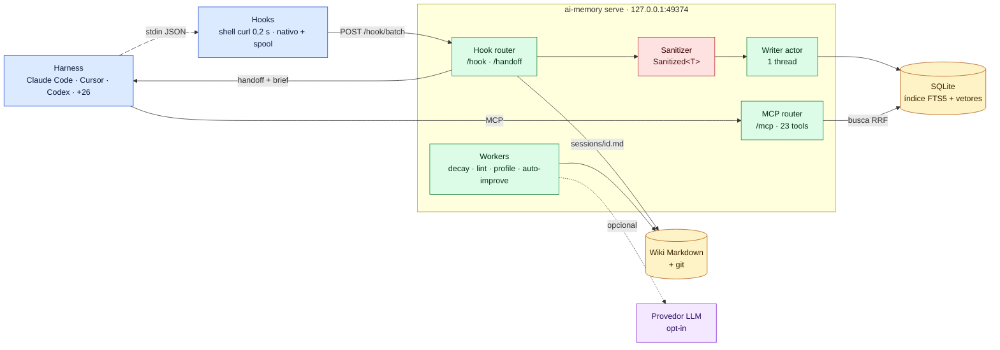
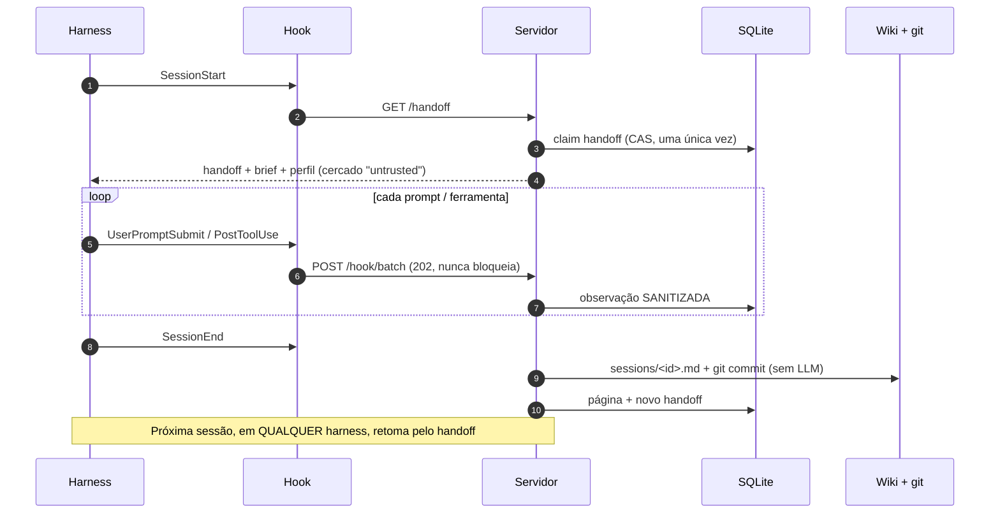

# 02 — ai-memory (akitaonrails): conceitos, arquitetura e vantagens em projetos agênticos

> **Estudo (pt-BR) — 2026-10-14.** Repositório: https://github.com/akitaonrails/ai-memory, analisado no commit
> `705aba70bc1a3ce6349194135206fb622ca55749` (v3.0.0, MIT). A leitura foi estática e somente leitura: nada foi
> executado. Referências `arquivo:linha` são relativas à raiz do repositório. Benchmarks marcados *(doc)* são
> autorreportados pelo projeto e **não foram re-executados**.
>
> **Diagramas interativos (archify):** [arquitetura](html/ai-memory-arquitetura.html) ·
> [ciclo de sessão](html/ai-memory-sessao.html)

← [01 — Conceitos](01-conceitos-memoria-agentes.md) | [03 — ai-memory: segurança →](03-ai-memory-seguranca.md)

---

## 1. Em uma frase

**O ai-memory é um servidor local (um binário Rust) que grava o que seus agentes fazem num wiki Markdown versionado
em git e devolve isso, com um handoff, na próxima sessão — em qualquer harness, máquina ou pessoa — sem precisar de
LLM.**

| Ficha | Valor |
|---|---|
| Linguagem | Rust (11 crates, cerca de 440 mil linhas incluindo testes) |
| Licença | MIT |
| Criado / versão | 2026-05-21 / v3.0.0 (2026-10-13), cerca de 134 releases em 5 meses |
| Popularidade | 9 266 estrelas, 148 contribuidores (paginado) |
| Testes | cerca de 6 050 funções de teste, 8 workflows de CI |
| Runtime | 1 processo; SQLite embutido; libgit2 vendorizada; inferência de embeddings em Rust puro (candle) |
| Dependência de LLM | **nenhuma por padrão** |

---

## 2. Conceitos centrais (conferidos no código)

| Conceito | O que é, em linguagem simples | Evidência |
|---|---|---|
| **Wiki Markdown = fonte de verdade** | A memória é um diretório de arquivos `.md` comuns, versionado em git. Dá para abrir no Obsidian, dar `grep`, editar à mão | `crates/ai-memory-wiki/src/git.rs:383` (`commit_all`) |
| **Índice derivado** | O SQLite é um índice **reconstruível** a partir dos arquivos (`reindex`). Se ele corromper, nada se perde | `crates/ai-memory-store/migrations/` (80 migrações) |
| **Página nunca editada no lugar** | Cada mudança cria uma nova versão (`supersedes`), com auditoria | `migrations/V01__init.sql:23-51` |
| **Handoff tipado, claim-once** | Ao fim da sessão nasce um "bilhete de passagem". A próxima sessão o reivindica **exatamente uma vez**, via compare-and-set no SQL | `ops.rs:4638-4642`; `router.rs:1514-1523` |
| **Brief de sessão** | No SessionStart: handoff + resumo do projeto (4 000 caracteres por padrão) + digest do perfil, dentro de cercas "untrusted" | `router.rs:2216-2231` |
| **Perfil cross-project** | Aprende preferências recorrentes ("uso pnpm", "testes em `tests/`") vistas em vários projetos e as sugere como padrão em repos novos | `crates/ai-memory-consolidate/src/profile.rs:1212,1899` |
| **Consolidação sem LLM** | No SessionEnd gera `sessions/<id>.md` **por regras**: primeiro prompt como título, arquivos tocados, contagem de ferramentas | `crates/ai-memory-hooks/src/synth.rs:1-72` |
| **Decaimento (esquecimento)** | `saliência·e^(−λ·idade) + σ·ln(1+acessos)·e^(−μ·dias_sem_acesso)`. Memória usada decai **mais devagar**. Só o tier **episódico** é removido de fato | `crates/ai-memory-store/src/decay.rs:93-103`; `sweep.rs:1189-1191` |
| **Busca híbrida** | FTS5 (bm25) + entidades + grafo de links + observações + vetores locais, fundidos por **RRF k=60** | `reader.rs:2465,5979,6222-6330` |
| **Fronteira de privacidade tipada** | O writer só aceita `Sanitized<NewObservation>`. O compilador impede gravar observação sem passar pelo sanitizador | `sanitize.rs:355-386`; `writer.rs:1485-1509` |
| **Recursos LLM opcionais** | Reescrita de páginas, auto-improve, "dream", reranking, resposta sintetizada. 10 provedores | `crates/ai-memory-cli/src/config.rs:3019-3033` |

### 2.1 Como o "RRF" junta as buscas (exemplo)

Imagine a consulta `"erro de migração do Postgres"`:

| Stream | 1º lugar | 2º lugar |
|---|---|---|
| FTS5 bm25 (palavras exatas) | `gotchas/pg-migrate.md` | `sessions/abc.md` |
| Vetores (sentido) | `decisions/db-choice.md` | `gotchas/pg-migrate.md` |
| Grafo (páginas ligadas) | `gotchas/pg-migrate.md` | — |

O RRF dá a cada página `Σ 1/(60 + posição)`. Como `gotchas/pg-migrate.md` aparece bem nos três streams, ela
vence. A fusão **não exige calibrar scores** entre métodos diferentes, e é por isso que o RRF é o padrão da
indústria para busca híbrida.

---

## 3. Arquitetura

### 3.1 Ciclo de uma sessão

### 3.2 Componentes (crates)

| Crate | Responsabilidade |
|---|---|
| `ai-memory-core` | Tipos de domínio, sanitizador, perfis, níveis de auth (sem I/O) |
| `ai-memory-store` | SQLite: writer único, pool de leitura, migrações, decaimento, busca híbrida, usuários e grants |
| `ai-memory-wiki` | Escrita atômica de Markdown, frontmatter, commits git, watcher |
| `ai-memory-mcp` | 23 ferramentas MCP, rotas admin, middleware de auth |
| `ai-memory-hooks` | Schemas de payload, política de captura, `/hook`, `/handoff`, resumo por regras |
| `ai-memory-llm` | Provedores LLM/embeddings, embedder local candle, reranker, OIDC |
| `ai-memory-consolidate` | Consolidador, auto-improve, sweep, dream, lint, perfil, bootstrap |
| `ai-memory-web` | UI web `/web` (opt-in) |
| `ai-memory-workstream` | `ai-memory run`: lançador gerenciado que importa transcripts nativos |
| `ai-memory-cli` | Binário `ai-memory` com cerca de 70 subcomandos |

---

## 4. Integração com harnesses (contada no código, não no README)

O README promete "more than twenty harnesses". **Contamos 29 no código** (24 `AgentKind` em
`crates/ai-memory-core/src/ids.rs:240-265` mais 5 clientes só-MCP), então a promessa se confirma.

| Tipo de integração | Quantos | Exemplos |
|---|---|---|
| Hooks de ciclo de vida escritos pelo instalador | 20 | Claude Code (9 eventos), Codex, **Cursor**, Gemini CLI, OpenCode, Pi, Kiro, Copilot CLI… |
| Bloco para colar à mão | 1 | Hermes |
| Só MCP (sem captura automática) | 6 | Claude Desktop, VS Code Copilot, Zed… |
| Só via `ai-memory run` | 1 | Crush |
| Bridge de terceiros | 1 | GrizzyBot |
| Plugins de marketplace | 2 | Claude Code e Codex (cada um com 7 skills) |

Os detalhes de **Claude Code e Cursor** (eventos usados, como o contexto volta para o agente, limitações) estão em
[07 — Integração com Cursor e Claude Code](07-integracao-cursor-claude-code.md).

---

## 5. Vantagens para projetos agênticos

| # | Vantagem | Por que importa | Evidência |
|---|---|---|---|
| 1 | **Continuidade entre harnesses** | Você sai do Claude Code no meio da tarefa, abre o Codex ou o Cursor, e o handoff diz onde parou, o que falhou e o que está aberto. **No Cursor**, a injeção automática usa um envelope que o Cursor não documenta; até um teste canário confirmar, recupere o handoff via MCP ([07 §3.2](07-integracao-cursor-claude-code.md#32-ai-memory-no-cursor-fluxo-real)) | `router.rs:1514-1523`; `ops.rs:4638`; `hook.rs:612-633` |
| 2 | **Memória auditável por humanos** | Markdown em git dá diff, revisão em PR e revert. Uma entrada envenenada pode ser **vista e revertida** | `git.rs:383` |
| 3 | **Custo zero de LLM por padrão** | Captura, busca, handoff e decaimento funcionam sem API key. Nada sai da máquina | `docs/ARCHITECTURE.md:900-901`; `config.rs:3019` |
| 4 | **Nunca bloqueia o agente** | Ingestão responde `202`; o hook shell tem timeout de 0,2 s; o hook nativo grava num spool local | `router.rs:741-753`; `_lib.sh:927` |
| 5 | **Busca forte sem LLM** | LongMemEval-S hit@5 = 0,951 só com FTS *(doc; mede acerto de recuperação, não sucesso em tarefa de código)* | `docs/benchmarks/longmemeval-s-3.0.0-release.md` |
| 6 | **Modo time incluso** | Argon2id, API keys, OIDC, ACL por projeto, atribuição e audit log, sem tier pago | `project_authz.rs`; `ops.rs:5237-5275` |
| 7 | **Esquecimento real** | O decaimento por uso evita que a memória vire um lixão que causa context rot | `decay.rs:93-103` |
| 8 | **Engenharia de segurança acima da média** | `unsafe` proibido, SQL parametrizado, cercas "untrusted", sem telemetria | ver [03](03-ai-memory-seguranca.md) |

## 6. Limitações e custos

| # | Limitação | Evidência |
|---|---|---|
| 1 | **Resumo sem LLM é raso**: título, arquivos e contagens; o stream de entidades fica vazio | `synth.rs:72` (`entities: Vec::new()`) |
| 2 | **Ligar qualquer LLM ativa o auto-improve sem revisão** (`require_approval = false`) | `templates/config.default.toml:199-212` |
| 3 | Writer único: cerca de 700 escritas/s *(doc)*; um servidor por diretório de dados; sem HA | `writer.rs:824`; `docs/deploy.md:276-292` |
| 4 | Decaimento só atua no tier episódico; páginas semânticas e procedurais acumulam | `sweep.rs:1189-1191` |
| 5 | Busca vetorial por força bruta (linear no número de páginas) | `reader.rs:4916-5010` |
| 6 | Paridade de recursos varia por harness: alguns não têm SessionEnd, outros são só-MCP | §4 |
| 7 | Superfície enorme e churn alto: cerca de 70 subcomandos, 80 migrações, major nova a cada 6 semanas | `docs/upgrading-to-3.0.md` |

## 7. Afirmações do projeto que não se confirmaram no código

| Afirmação | Veredito | Evidência |
|---|---|---|
| Crate store usa "sqlite-vec" (`crates/ai-memory-store/Cargo.toml:10`) | **Falsa** (metadado antigo): os vetores são BLOB com produto escalar por força bruta | `docs/vector-backend-policy.md:3-5` |
| "An audit log records every mutation" | **Exagerada**: inserções de observação e início/fim de sessão não auditam | `ops.rs:2799-2846` |
| Tier Working com "hard-drop on session end"; Procedural com decaimento | **Não implementado**: só o episódico é removido | `sweep.rs:1189-1191` |
| "Nothing is hard-deleted" | **Exagerada**: páginas com TTL e tombstones antigos saem do banco (o git guarda o Markdown já commitado) | `sweep.rs:11-20` |
| "Omit the EMBEDDING lines for zero-LLM … FTS5" (Docker) | **Enganosa**: omitir ativa embeddings **locais** e um download de cerca de 87 MB do huggingface.co | `config.rs:2737-2741` |
| "Three opt-in paths" de dados para fora | **Incompleta**: omite `llm_provider`, `bootstrap`, OAuth e webhooks | ver [03 §2](03-ai-memory-seguranca.md#2-egresso-o-que-sai-da-máquina-quando-e-para-quem) |
| "More than twenty harnesses" | **Confirmada** (29) | §4 |
| "23 MCP tools" | **Confirmada** | `server.rs` |

---

← [01 — Conceitos](01-conceitos-memoria-agentes.md) | [03 — ai-memory: segurança →](03-ai-memory-seguranca.md)
