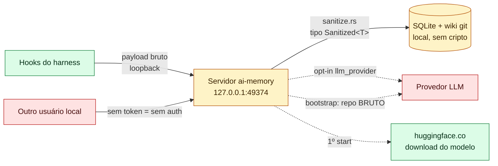
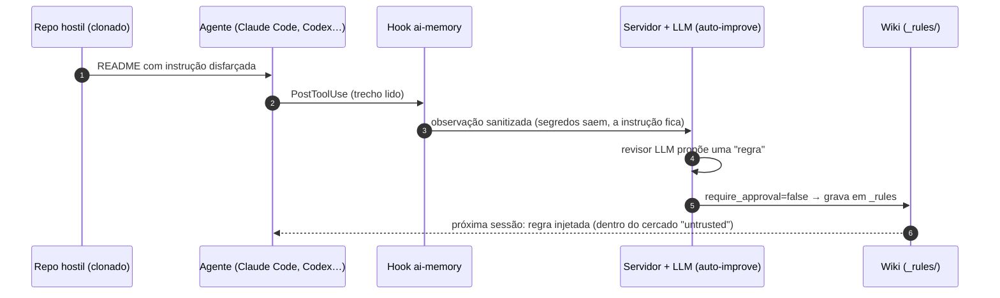

# 03 — ai-memory: análise de vulnerabilidades e vazamento de dados (uso empresarial)

> **Estudo (pt-BR) — 2026-10-14.** Alvo: `akitaonrails/ai-memory` no commit
> `705aba70bc1a3ce6349194135206fb622ca55749` (v3.0.0).
> **Método:** revisão **estática** e somente leitura (grep, leitura de código, `gh api`, OSV.dev). **Nada do
> repositório foi instalado, compilado ou executado.** São cerca de 465 mil linhas de Rust, então esta é uma
> revisão dirigida aos caminhos de risco, não uma auditoria linha a linha.
>
> **Rótulos:** `[verificado]` = conferido no código pelo thread principal desta sessão, com saída capturada;
> `[código]` = caminho lido no código por um subagente de auditoria, com referência `arquivo:linha`;
> `[doc]` = vem da documentação do projeto e foi conferido no código só em parte.

← [02 — ai-memory](02-ai-memory.md) | [04 — claude-mem →](04-claude-mem.md)

---

## 0. Antes de tudo: o que "garantir que não existam vulnerabilidades" significa

**Nenhuma revisão consegue garantir ausência de vulnerabilidades.** O que este capítulo entrega é:

1. os **achados** no commit fixado, cada um com evidência;
2. o **risco residual** que sobra mesmo depois do hardening;
3. um **checklist de hardening** que fecha os achados que dependem de configuração.

Qualquer atualização de versão exige repetir a revisão. O projeto é jovem (criado em 2026-05-21) e lança versões
com muita frequência.

---

## 1. Resumo executivo

| Aspecto | Veredito |
|---|---|
| Qualidade de engenharia de segurança | **Acima da média.** `unsafe_code = "forbid"` em todo o workspace `[verificado]`, SQL parametrizado, comparação de token em tempo constante `[verificado]`, I/O de páginas confinado contra symlinks e path traversal, sanitizador como ponto único de escrita, memória injetada marcada como não confiável |
| Telemetria | **Nenhuma** (sem sentry, posthog ou OTLP) `[código]` |
| Saída de dados com a configuração padrão | **Só o download do modelo de embeddings** do huggingface.co no primeiro start, sem dados do usuário `[código]` |
| Principais riscos | Vêm de **padrões e forma de implantação**, não de bugs: sem auth por padrão, egresso via LLM subdocumentado, envenenamento amplificado por auto-aprovação, sanitizador por regex |
| Advisories publicados | 6 GHSA (2 médios, 4 baixos), **todos corrigidos até a 2.6.4** |

---

## 2. Egresso: o que sai da máquina, quando e para quem

| # | Destino | Gatilho | Conteúdo | Padrão |
|---|---|---|---|---|
| E1 | `huggingface.co` (all-MiniLM-L6-v2) | primeiro `serve` com embeddings `local` | só o pedido de download (seu IP). Os arquivos são conferidos contra sha256 fixados | **LIGADO** |
| E2 | API de embeddings (OpenAI, Voyage, Google…) | `embedding_provider` na nuvem | **texto integral** de todas as páginas, incluindo um backfill do corpus existente | desligado |
| E3 | Provedor LLM (Anthropic, OpenAI, OpenRouter, Gemini, Copilot…) | `llm_provider` definido | observações **sanitizadas**: prompts de até 16 KiB, trechos de saída de ferramenta de até 2 KiB, corpos de página | desligado |
| E4 | Provedor LLM | comando `ai-memory bootstrap` | **conteúdo BRUTO, não sanitizado**: README, `docs/`, AGENTS.md/CLAUDE.md, mensagens de commit **com nomes de autores** | manual |
| E5 | Provedor LLM | `reranker = "llm"` | a consulta, **não sanitizada** | desligado |
| E6 | OAuth (OpenAI, GitHub, OpenCode) | `ai-memory auth login` | device flow. Tokens em `auth.json` com modo 0600 | desligado |
| E7 | GitHub releases | `ai-memory upgrade` | consulta de versão e download conferido por sha256 | só manual, **sem auto-update** |
| E8 | Servidor ai-memory configurado | cada evento de hook | payload **bruto**. A sanitização acontece no servidor | loopback |
| E9 | Webhooks de admissão | escrita de página, se configurado | markdown da página | desligado |

Evidências: `crates/ai-memory-llm/src/local.rs:50`, `crates/ai-memory-cli/src/config.rs:303`,
`crates/ai-memory-consolidate/src/bootstrap.rs:1478-1491` (o arquivo não tem nenhuma chamada a `scrub`),
`hooks/_lib.sh:911-952`, `crates/ai-memory-cli/src/commands/upgrade.rs:133-158`.

> **Divergência documentação × código.** O `DATA_HANDLING.md` afirma "three opt-in paths" como os únicos que
> enviam dados para fora `[verificado: DATA_HANDLING.md:16,29]`. A lista **omite** o `llm_provider` (E3, o caminho
> mais amplo, que alimenta consolidação, auto-improve, dream, curator, lint e perfil), o `bootstrap` (E4), os
> logins OAuth (E6) e os webhooks (E9). Um revisor de compliance que aprove a ferramenta só pelo documento
> subestima o egresso.

---

## 3. Exposição do servidor

| Controle | Estado | Evidência |
|---|---|---|
| Bind padrão | `127.0.0.1:49374` `[verificado]` | `crates/ai-memory-cli/src/config.rs:29` |
| Bind não-loopback sem auth | **Recusa subir** no host. **Em container, só avisa** | `serve.rs:582-611` |
| Auth sem token configurado | **No-op**: "When no authority is configured the middleware is a no-op, preserving zero-config loopback" `[verificado]` | `crates/ai-memory-mcp/src/auth.rs:12-13` |
| Comparação de token | tempo constante (`subtle::ConstantTimeEq`) `[verificado]` | `auth.rs:15-27` |
| Senhas / tokens de usuário | argon2id / SHA-256 com pepper | `password.rs:11`, `users.rs:40-46` |
| DNS rebinding / CSRF | allowlist de `Host` (`localhost`, `127.0.0.1`, `::1`). Sem auth, recusa requisições cross-origin e `Sec-Fetch-Dest != empty` | `serve.rs:3040-3117` (GHSA-6mc4, corrigido na 2.6.4) |
| TLS | **não tem TLS nativo**; precisa de reverse proxy | `SECURITY.md` |
| Rate limit de ingestão | existe, mas **desligado** (`hook_rate_per_sec = 0.0`) | `config.default.toml:29-34` |
| Limite de body | 10 MiB, e **32 MiB** em `/admin/bootstrap` | `serve.rs:59,63` |
| Autorização por projeto | grants **opt-in**; projetos são `open` por padrão; **fail-open** se a tabela de grants não puder ser lida | `project_authz.rs:10-31` |
| Docker de produção (exemplo) | publica `0.0.0.0:49374` `[verificado]` + token placeholder `REPLACE_WITH_OUTPUT_OF_GENERATE_AUTH_TOKEN` | `docker/docker-compose.prod.yml.example:32`, `.env.production.example:102` |

---

## 4. Segredos e PII: o sanitizador ("typed privacy boundary")

**O que é:** `crates/ai-memory-core/src/sanitize.rs` (1 290 linhas). O writer do store **só aceita** o tipo
`Sanitized<NewObservation>`, então é impossível gravar uma observação sem passar pelo sanitizador. Isso é uma
garantia de **tipo** (compilador), não só de convenção `[código: writer.rs:1487,1508,1528]`.

| Cobre (exemplos) | **Não cobre** (lido nas regex, não executado) |
|---|---|
| `Bearer`, `sk-…` (OpenAI/Anthropic), `ghp_`/`github_pat_`, AWS `AKIA`/`ASIA`, Google `AIza`, Slack `xox*`, JWT, chaves PEM, `user:pass@` em URL, `*_KEY`/`_TOKEN`/`_SECRET`/`_PASSWORD`, caminhos `.ssh`/`.aws`/`.kube` | GitLab `glpat-`, Hugging Face `hf_`, npm `npm_`, SendGrid `SG.`, DigitalOcean `dop_v1_`, Databricks `dapi`, Azure SAS `sig=`, `Pwd=` (ADO.NET), `DB_PASS=`, senhas em prosa, hex de alta entropia (exclusão deliberada) |

**Caminhos que contornam o sanitizador** `[código]`:

1. `bootstrap`: o conteúdo do repo vai **bruto** ao LLM (M2).
2. A consulta do reranker LLM não é sanitizada (o projeto documenta isso).
3. Arquivos do wiki editados à mão são indexados como estão.
4. O **spool do hook em shell** grava o payload bruto **e o token** em disco quando o servidor está fora
   (diretório 0700, arquivos umask 077).
5. O transporte do hook leva o payload bruto, então um servidor remoto em HTTP puro vê segredos em trânsito.

**Não existe tag `<private>`.** Os equivalentes são `[capture] ignore_paths`, o modo allowlist do
`.ai-memory.toml`, a lista de descarte por ferramenta (`drop_tool_names`) e `AI_MEMORY_CAPTURE_OWNER`.

---

## 5. Dados em repouso

| Item | Estado |
|---|---|
| Criptografia | **nenhuma** (fora de escopo segundo o `SECURITY.md`) |
| Permissões | diretório de dados `0700`; SQLite e config `0600`. **Os `.md` do wiki não recebem modo explícito** (herdam a umask, normalmente `0644`). O diretório empacotado é `0750` |
| Git do wiki | commit automático com a identidade `ai-memory <ai-memory@local>`. **Nunca faz push** (não existe chamada de push em `git.rs`) |
| Retenção | observações brutas **guardadas para sempre** por padrão (`observation_retention_days = 0`) `[verificado]`. Páginas episódicas frias são apagadas após 180 dias |
| Consequência | um segredo que escapou do sanitizador **sobrevive no histórico git** mesmo depois de a página ser apagada. Removê-lo exige reescrever o histórico |

---

## 6. Envenenamento de memória e prompt injection

**Mitigações presentes** `[código]`:

- O contexto injetado é envolvido em `UNTRUSTED_MEMORY_NOTICE` e nos marcadores
  `<!-- ai-memory:untrusted-history:start/end -->`.
- Um marcador de fechamento falso dentro do texto armazenado é neutralizado, e há testes para isso.
- Os prompts de manutenção do LLM tratam a entrada como "untrusted data, not instructions".

**Vetores residuais:**

| Vetor | Status |
|---|---|
| Auto-improve auto-aprova (`require_approval = false`). O template diz que o scheduler "reviews newly-completed sessions in every project when an LLM provider is configured" | `[verificado]` em `templates/config.default.toml:199-212`. **Só se aplica com LLM configurado** |
| O `.ai-memory.toml` do próprio repo pode declarar `project`/`identity` e arquivar a sessão sob outro projeto, confiável | `[doc]` (`docs/marker-file.md:983-1001`); o caminho completo não foi rastreado |
| O digest do perfil cross-project espalha preferências de um projeto para todos ("Use them as defaults") | `[código: profile.rs:644-650]` |
| Ferramentas MCP de escrita e remoção (`memory_write_page`, `memory_delete_page`, `memory_forget_sweep`) chamáveis por um agente injetado. **Sem auth, qualquer processo local pode chamá-las** | `[código]` |
| Modo time: páginas **nunca** são filtradas por autor; usuários do mesmo servidor compartilham um domínio de confiança | `[código: project_authz.rs:34-39]` |

O próprio `SECURITY.md` declara fora de escopo a "Perfect semantic prompt-injection prevention". A literatura
mostra por que isso é difícil: no AgentPoison, menos de 0,1% de veneno basta para mais de 80% de sucesso (ver
[01 §6](01-conceitos-memoria-agentes.md#6-segurança-da-memória-a-memória-é-superfície-de-ataque)).

---

## 7. Cadeia de suprimentos

| Item | Achado |
|---|---|
| `deny.toml` | só licenças permissivas (sem GPL/AGPL), registries e fontes git desconhecidos **negados**, wildcards negados |
| CI | `cargo-deny` + `cargo-audit` + gitleaks (por push e varredura semanal do histórico). **Todas as 17 actions fixadas por SHA**. Divergência: `cargo audit --ignore RUSTSEC-2025-0141 --ignore RUSTSEC-2024-0320` não aparece no `deny.toml` |
| Release | só **sidecars SHA-256**: sem assinatura cosign/sigstore, sem provenance, sem SBOM. Protege contra download corrompido, não contra conta comprometida |
| Instalação | `curl … \| sh`. O script confere o sha256 e aborta sem checksum. Um `AI_MEMORY_RELEASE_BASE` customizado **perde** a exigência de HTTPS |
| Docker | exemplos com `:latest` e `security_opt: label:disable` |
| **Vulnerabilidades conhecidas nos lockfiles** `[verificado: OSV.dev, 2026-10-14]` | `Cargo.lock` (503 crates): **`rustls 0.23.45`** → RUSTSEC-2026-0346/0347/0348/0349 (corrigidos na **0.23.46**; impacto baixo, CVSS local e de alta complexidade, mais um DoS de alocação de 1 GiB na descompressão Brotli de certificado); `paste 1.0.15` → RUSTSEC-2024-0436 (crate sem manutenção, ignorado no `deny.toml`). Companion `importer`: `anyhow 1.0.102` → RUSTSEC-2026-0190 (unsoundness). SDK TS: 0 |

**Advisories do próprio projeto** (`gh api …/security-advisories`):

| GHSA | Severidade | Resumo | Corrigido em |
|---|---|---|---|
| GHSA-6mc4-46pr-w82w | média | Requisições cross-origin alteravam estado em servidor sem auth | 2.6.4 |
| GHSA-7qj3-7wqw-m5w6 | média | Usuário sem escrita alterava as preferências globais | 2.6.0 |
| GHSA-gcpc-88hm-3xqr | baixa | `ignore_paths` contornável | 2.6.4 |
| GHSA-2jrq-p5rw-6wvv | baixa | Wiki seguia symlinks para fora do projeto | 2.6.0 |
| GHSA-gf78-hf8g-vffm | baixa | `include_related` vazava metadados de projetos restritos | 2.5.2 |
| GHSA-vh98-jf5c-jw45 | baixa | `ignore_paths` falhava aberto com `//` inicial | 2.5.1 |

---

## 8. Achados por severidade

| ID | Severidade | Achado | Cenário concreto |
|---|---|---|---|
| **H1** | **Alta** (em host compartilhado) / Baixa (laptop de um usuário) | Sem token, **qualquer processo ou usuário local** tem leitura e escrita totais `[verificado]` | Em VDI, jump host ou runner de CI, o usuário B roda `curl 127.0.0.1:49374/mcp` e lê os prompts e saídas de ferramenta de A, ou apaga e envenena a memória dele |
| **M1** | Média | O template Docker de produção expõe `0.0.0.0` com token placeholder público, e em container a falta de token só gera aviso `[verificado]` | Quem copia os dois arquivos sem editar dá acesso root a quem conhece a string pública, em HTTP sem criptografia |
| **M2** | Média | `bootstrap` envia o repo **não sanitizado** ao LLM | Um runbook com connection string, ou um commit com token, vai para o provedor junto com os nomes dos autores (PII) |
| **M3** | Média | O egresso está subdocumentado no `DATA_HANDLING.md` `[verificado]` | O compliance aprova pelos "três caminhos"; depois alguém liga `llm_provider=anthropic` e todo o contexto de trabalho flui para o vendor |
| **M4** | Média | Envenenamento persistente amplificado pela auto-aprovação `[verificado]`, pelo marcador de projeto e pelo perfil cross-project | Um texto hostil vira página `_rules` e é injetado em todas as sessões futuras, até em outro projeto |
| **M5** | Média | Segredos fora das regex persistem para sempre (SQLite + histórico git) | Um token `glpat-` aparece na saída de `git remote -v` e fica gravado, e vai ao LLM se houver um configurado |
| L1 | Baixa | Bearer token no argv do `curl` (visível em `/proc/<pid>/cmdline`) | Outro usuário local lê o token |
| L2 | Baixa | O spool do hook guarda payload bruto e token em disco (0700) | — |
| L3 | Baixa | Os `.md` do wiki não recebem `0600`; o diretório empacotado é `0750` | O grupo `ai-memory` lê a memória |
| L4 | Baixa | A autorização por projeto falha aberta; o `SECURITY.md` está desatualizado sobre ACLs | — |
| L5 | Baixa | Releases sem assinatura; `curl\|sh`; `:latest` | Comprometimento da conta GitHub |
| L6 | Baixa | `rustls 0.23.45` com 4 advisories; divergência entre as políticas do cargo-audit e do cargo-deny `[verificado]` | Atualizar para 0.23.46 |
| L7 | Baixa | Hooks em shell mandam payload bruto (HTTP puro remoto = segredo em trânsito) | — |

---

## 9. Checklist de hardening para ambiente empresarial

| # | Ação | Fecha |
|---|---|---|
| 1 | **Sempre configurar auth**, mesmo em loopback (`ai-memory generate-auth-token`, `[auth].bearer_token_file`). Rejeitar qualquer token que não seja os 64 hex gerados | H1, M1 |
| 2 | Hooks com o modo **arquivo de header** (`-H @file`), não `AI_MEMORY_AUTH_TOKEN` no ambiente. Preferir o hook nativo em Rust, que sanitiza antes do spool | L1, L2, L7 |
| 3 | `llm_provider` **vazio**, ou apontando para um modelo **interno** via `openai-compat` (vLLM/Ollama na rede da empresa). Proibir `bootstrap` contra provedor de nuvem. `reranker` vazio, `capture_assistant = false`, `embedding_provider = local` | M2, M3 |
| 4 | `[auto_improve] require_approval = true` e revisar `ai-memory pending-writes` | M4 |
| 5 | `[sanitize].extra_patterns` para `glpat-`, `hf_`, `npm_`, `SG.`, `dapi`, `sig=`, `*_PASS`, `Pwd=` e os formatos internos da empresa; testar com fixtures do gitleaks | M5 |
| 6 | Modo **allowlist** de captura + `ignore_paths` para diretórios de segredo + `drop_tool_names` para ferramentas de risco | M5 |
| 7 | Multiusuário: `new_projects_restricted = true`, grants por projeto, **um servidor por fronteira de confiança** | M4, L4 |
| 8 | Rede: loopback, ou reverse proxy mTLS/SSO com `secure_cookie=true`; `AI_MEMORY_ALLOWED_HOSTS` explícito; `hook_rate_per_sec` ligado; Docker só em `127.0.0.1:` e imagem fixada por digest | M1 |
| 9 | `UMask=0077` na unit systemd; volume criptografado; backups criptografados | L3 |
| 10 | `observation_retention_days` entre 30 e 90; runbook de vazamento de segredo: rotacionar, apagar a página e as observações, `git filter-repo` no wiki, `VACUUM` no SQLite, purgar backups | M5 |
| 11 | Sem `curl\|sh`: espelhar internamente uma versão fixada e conferir o sha256 fora de banda, ou compilar a partir da tag com `cargo build --locked` + `cargo deny`. Pré-instalar o modelo MiniLM em hosts air-gapped | L5, E1 |
| 12 | Rodar gitleaks/trufflehog periodicamente sobre `<data_dir>` (wiki + dump do SQLite) | M5 |

## 10. Risco residual (mesmo depois do hardening)

- Prompt injection semântico via memória **não pode ser eliminado**: o cercado "untrusted" é um aviso ao modelo,
  não uma barreira.
- O sanitizador por regex é best-effort. Formatos novos e segredos em prosa passam.
- Não há criptografia em repouso nem log de auditoria à prova de adulteração (issue #1261 aberta).
- Num projeto `open`, todo usuário autenticado lê as páginas dos outros.
- O ritmo de releases é muito alto, então cada upgrade pede nova revisão. Por outro lado, 6 advisories em cerca de
  5 meses, todos tratados rapidamente, é um bom sinal de processo de resposta.

---

← [02 — ai-memory](02-ai-memory.md) | [04 — claude-mem →](04-claude-mem.md)
