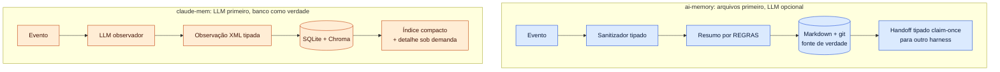

# 06 — Comparativo: ai-memory × claude-mem

> **Estudo (pt-BR) — 2026-10-14.** Compara `akitaonrails/ai-memory` @ `705aba7` (v3.0.0) e
> `thedotmack/claude-mem` @ `fef3402` (v13.39.0). Cada nota aponta a evidência nos capítulos
> [02](02-ai-memory.md)–[05](05-claude-mem-seguranca.md) e [07](07-integracao-cursor-claude-code.md).
>
> **Leia as notas com a ressalva certa:**
>
> - **Elas são juízo de engenharia sobre evidência de código.** Nenhuma das ferramentas foi instalada ou executada,
>   e não existe benchmark público de memória para agentes de código
>   (ver [01 §7](01-conceitos-memoria-agentes.md#7-benchmarks-de-memória-de-longo-prazo-e-seus-limites)).
> - **As notas de usabilidade e ROI são as mais frágeis.** Elas pedem o piloto descrito no §5.
> - **Revisão adversarial:** a primeira versão deste capítulo (4,00 × 2,50) foi contestada por um revisor
>   adversarial (*rubber-duck*), e as objeções procedentes foram incorporadas. A ordem se manteve; a margem caiu.

← [05 — claude-mem: segurança](05-claude-mem-seguranca.md) | [07 — Integração Cursor e Claude Code →](07-integracao-cursor-claude-code.md)

---

## 1. A diferença de filosofia

| Critério da literatura ([01 §8](01-conceitos-memoria-agentes.md#8-checklist-derivado-da-literatura-usado-nos-capítulos-seguintes)) | ai-memory | claude-mem |
|---|---|---|
| C1 Fonte de verdade legível por humanos | **Sim**: Markdown em git | Não: SQLite + vetores |
| C2 Captura depende de LLM | **Não** (opcional) | **Sim**: 1 chamada por evento de ferramenta, exceto as ferramentas ignoradas (Codex em lotes de 8) |
| C3 Recuperação híbrida e econômica | FTS5 + entidades + grafo + vetores, RRF k=60; brief de 4 000 caracteres. Sem LLM, o stream de entidades fica **vazio** | Chroma primeiro + FTS5 só completa; **progressive disclosure em 3 camadas** (melhor desenho de orçamento de tokens) |
| C4 Esquecimento | **Parcial**: só o tier episódico decai; observações brutas guardadas para sempre por padrão | Não (só dedup) |
| C5 Injeção marcada como não confiável | **Sim** (cercas `untrusted-history`) | **Não** |
| C6 Servidor local | Auth disponível, mas **desligada por padrão**; allowlist de Host; bloqueio cross-origin; recusa bind não-loopback sem auth | Worker padrão **sem auth**, CORS aberto a `localhost:*`, Host check. Existe um **runtime servidor beta** com API keys e audit log (não auditado aqui) |
| C7 Sobrevive a troca de harness, máquina e pessoa | ~20 harnesses com captura (29 no total, 6 só-MCP); handoff tipado; servidor compartilhável; modo time | 12 com captura (17 no total, 4 só-MCP); store local compartilhado entre hosts; sync via CMEM Pro pago ou runtime servidor beta |

---

## 2. Scorecard (0–5, maior é melhor)

| Critério | Peso | ai-memory | claude-mem | Evidência decisiva (dos dois lados) |
|---|---|---|---|---|
| **Retorno (ROI)**: valor da memória ÷ custo recorrente, nos padrões | 20% | 3 | 3 | **ai-memory:** custo zero de LLM e handoff entre harnesses, mas resumo raso sem LLM (`entities: Vec::new()`). Com LLM ligado o valor sobe, o custo aparece e o auto-improve entra sem revisão. **claude-mem:** memória semântica rica, mas 1 chamada de LLM por ferramenta na cota do plano (a latência de 5–30 s é atraso até a memória ficar disponível, não bloqueio) |
| **Usabilidade no Claude Code** | 15% | 3 | **4** | **claude-mem:** 1 comando, viewer ao vivo, busca em 3 camadas; o Read Gate nega leituras grandes (a eval do próprio projeto mostra +20% de custo no Opus num caso). **ai-memory:** plugin de marketplace + `ai-memory setup` com detecção de agentes e UI `/web`, mas cerca de 70 subcomandos e conceitos novos. *Juízo sem teste prático* |
| **Usabilidade no Cursor** | 15% | **3** | 2 | **ai-memory:** 8 eventos, captura todas as ferramentas e faz merge com backup no `hooks.json`; a injeção no `sessionStart` usa o envelope errado (não verificado em runtime), com contorno via MCP. **claude-mem:** **nenhuma injeção automática** na instalação padrão, **sobrescreve** `~/.cursor/hooks.json`, não captura Read/Grep, e o plugin roda `npx -y` sem versão fixa a cada hook ([07 §3](07-integracao-cursor-claude-code.md#3-cursor-ide)) |
| **Desacoplamento de harness** | 20% | **4** | 3 | **ai-memory:** ~20 com captura, handoff tipado entre harnesses, nenhum provedor privilegiado. **claude-mem:** 12 com captura, store comum por `platform_source`, mas provedor padrão = cota Claude, fallback de cota = Claude, e o Read Gate só existe no Claude Code |
| **Segurança / não vazamento** | 20% | **3** | 2 | **ai-memory, contra:** H1 sem auth por padrão (mesma classe do F2), M1 template Docker `0.0.0.0` com token placeholder, M2 `bootstrap` envia o repo cru ao LLM, M3 `DATA_HANDLING.md` subdeclara o egresso, M4 auto-improve sem revisão, L5 release sem assinatura. **A favor:** sem telemetria, sem egresso de dados por padrão, `unsafe` proibido, cercas "untrusted", CI com deny/audit/gitleaks e actions por SHA. **claude-mem, contra:** tool I/O ao LLM por padrão (mesmo processador do Claude Code, mas é uma **cópia extra persistida** e pode ir para a conta pessoal), fallback de cota para a Anthropic mesmo com Ollama, PostHog ON contradizendo o `SECURITY.md`, `autoUpdate: true` com bundles minificados e lockfile ignorado. **A favor:** observador sem ferramentas, Host check, CSRF bloqueado, SQL parametrizado, DOMPurify |
| **Maturidade e governança** | 10% | 3 | 3 | **ai-memory:** 5 meses, ~9,3 mil estrelas, **v3.0.0 lançada em 2026-10-13/14** (major do dia), ~68% dos commits de 1 autor, assistido por IA; mas 6 GHSAs publicados e corrigidos. **claude-mem:** 13 meses, ~100 mil estrelas, comunidade grande; mas ~71% das contribuições de 1 autor, **0 GHSAs**, release feita de um laptop por um agente. O churn é equivalente (~27 × ~28 releases/mês) |
| **Total ponderado** | | **3,20** | **2,80** | |

### Sensibilidade

| Cenário de pesos | ai-memory | claude-mem | Quem vence |
|---|---|---|---|
| Pesos acima | 3,20 | 2,80 | ai-memory |
| Pesos iguais (6 critérios) | 3,17 | 2,83 | ai-memory |
| **Só ROI + usabilidade no Claude Code** (dev solo, só Claude Code) | 3,00 | **3,50** | **claude-mem** |
| Só ROI + as duas usabilidades | 3,00 | 3,00 | empate |
| Só segurança + desacoplamento | 3,50 | 2,50 | ai-memory |

**Leitura:** a vantagem do ai-memory é **real, mas estreita**. Ela vem de segurança, desacoplamento e uso no Cursor.
Para quem só usa o Claude Code e não tem restrição de dados, o claude-mem vence.

---

## 3. Recomendação por cenário

| Cenário | Recomendação | Pré-condições |
|---|---|---|
| **Empresa que exige não vazar informação interna** | **ai-memory** endurecido | O checklist de [03 §9](03-ai-memory-seguranca.md#9-checklist-de-hardening-para-ambiente-empresarial) inteiro: auth sempre; `llm_provider` vazio ou interno; **proibir `bootstrap`** contra a nuvem; `require_approval = true`; regex extras. Fixar uma versão e esperar a 3.0.x estabilizar. Também é possível endurecer o claude-mem ([05 §8](05-claude-mem-seguranca.md#8-checklist-de-hardening-para-ambiente-empresarial)), mas o desenho dele **envia conteúdo por padrão**, então são mais defaults a desligar e domínios a bloquear |
| **Time que alterna Claude Code e Cursor** | **ai-memory** | Teste canário do handoff Claude Code → Cursor; até lá, regra no Cursor mandando chamar `memory_handoff_accept` ([07 §3.2](07-integracao-cursor-claude-code.md#32-ai-memory-no-cursor-fluxo-real)) |
| **Dev solo, só Claude Code, código não sensível** | **claude-mem** | Telemetria desligada (`DO_NOT_TRACK=1`), consciência do custo de LLM na cota, `CLAUDE_MEM_QUOTA_FALLBACK_PROVIDER` explícito |
| **Ambiente air-gapped** | **ai-memory** | Pré-instalar o modelo MiniLM ou usar `embedding_provider = "none"`. O claude-mem também roda offline (Ollama + `CLAUDE_MEM_CHROMA_ENABLED=false` + fallback `off`), mas depende de um modelo local cumprir o contrato XML estrito |
| **Host multiusuário (VDI, bastion, devcontainer compartilhado)** | **ai-memory**, e só com: token em **arquivo de header** (fora do argv), `UMask=0077`, `new_projects_restricted = true` | **Não usar o claude-mem**: qualquer usuário local reescreve as settings e desvia o tool I/O (F2) |

---

## 4. O que nenhum dos dois resolve

- **Prompt injection semântico via memória** continua possível nos dois. A cerca do ai-memory reduz o risco, mas
  não o elimina.
- **Redação por regex** é best-effort nos dois.
- **Sem criptografia em repouso** nos dois.
- **Mantenedor único e churn altíssimo** nos dois. Fixe a versão, espelhe internamente e re-audite a cada upgrade.
- **Dependências com advisories conhecidos** `[verificado: OSV.dev]`: `rustls 0.23.45` no ai-memory (corrigido na
  0.23.46) e `shell-quote 1.9.0` CRÍTICO no claude-mem (alcançável, mas não explorável como RCE no caminho usado).
- **Cursor:** nenhum dos dois usa o `additional_context` do `sessionStart`, que é o mecanismo documentado de
  injeção ([07 §1](07-integracao-cursor-claude-code.md#1-matriz-2--2-resumo)).

## 5. Piloto recomendado antes de padronizar

Num repositório descartável, rode cada ferramenta por 2–4 semanas em Claude Code **e** Cursor e meça:

| Métrica | Como medir |
|---|---|
| Tempo de instalação e de configuração do hardening | cronômetro + checklist |
| Tokens injetados por sessão | contexto do SessionStart (Claude Code) e regra/MCP (Cursor) |
| O Cursor recebe contexto automaticamente? | handoff canário criado no Claude Code e aberto no Cursor |
| Contexto errado ou obsoleto injetado | revisão manual de 20 sessões |
| Custo de LLM / cota consumida | painel do provedor |
| Tempo para retomar uma tarefa interrompida | trocar de harness no meio da tarefa |

É esse piloto que transforma as notas de usabilidade e ROI de juízo em medição.

---

← [05 — claude-mem: segurança](05-claude-mem-seguranca.md) | [07 — Integração Cursor e Claude Code →](07-integracao-cursor-claude-code.md)
