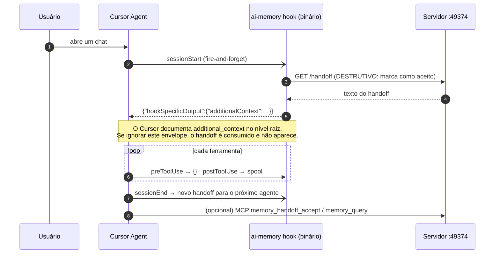
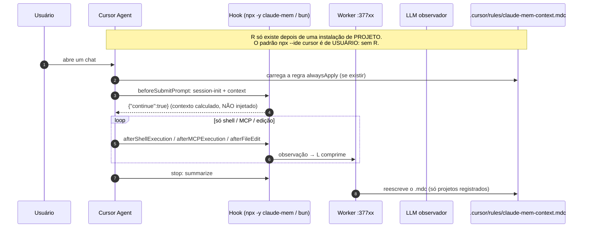

# 07 — Integração com Cursor IDE e Claude Code

> **Estudo (pt-BR) — 2026-10-14.** Como `ai-memory` @ `705aba7` e `claude-mem` @ `fef3402` se ligam ao
> **Claude Code** e ao **Cursor IDE**, conferido contra os contratos oficiais de hooks espelhados neste repositório:
> [`claude-code/hooks/claude-hook-reference-doc.md`](../claude-code/hooks/claude-hook-reference-doc.md) e
> [`cursor/hooks/hooks-guide.md`](../cursor/hooks/hooks-guide.md) (ambos espelhados em 2026-10-11).
> Análise **estática**: nenhuma das ferramentas foi instalada ou executada. `[verificado]` = conferido no código ou
> na doc pelo thread principal; `[código]` = lido por subagente com `arquivo:linha`; `[inferido]` = conclusão de
> código + doc que **precisa de um teste em runtime**.
>
> **Diagramas interativos (archify):** [ai-memory no Cursor](html/ai-memory-cursor.html) ·
> [claude-mem no Cursor](html/claude-mem-cursor.html) · arquiteturas com os dois harnesses separados:
> [ai-memory](html/ai-memory-arquitetura.html) · [claude-mem](html/claude-mem-arquitetura.html)

← [06 — Comparativo](06-comparativo.md) | [08 — Plano do fork empresarial →](08-plano-fork-empresarial.md)

---

## 1. Matriz 2 × 2 (resumo)

| | **Claude Code** | **Cursor IDE** |
|---|---|---|
| **ai-memory** | **Instalação:** plugin (`/plugin marketplace add akitaonrails/ai-memory`) ou `ai-memory install-hooks --agent claude-code --apply` (aceita `--scope project`). **9 eventos**, só captura (nunca bloqueia). **Injeção:** `SessionStart` → `hookSpecificOutput.additionalContext` (handoff + brief), **formato documentado** ✅. **MCP:** stdio `mcp-bridge`, 23 tools | **Instalação:** `ai-memory install-hooks --agent cursor --apply` faz **merge** em `~/.cursor/hooks.json` (só nível de usuário; `--scope project` é recusado); `install-mcp --client cursor` grava `{"url":"http://127.0.0.1:49374/mcp"}`. **8 eventos.** **Injeção:** ⚠️ devolve o envelope do **Claude Code** no `sessionStart` do Cursor, que documenta `additional_context` no nível raiz. **Não verificado se o Cursor lê**, e o `GET /handoff` é destrutivo |
| **claude-mem** | **Instalação:** plugin (`/plugin marketplace add thedotmack/claude-mem`) ou `npx claude-mem install`. **8 eventos** + **File Read Gate** (pode **negar** `Read` ≥ 32 KB). **Injeção:** `SessionStart` → timeline de observações ✅, e um timeline por arquivo no `PreToolUse`. **MCP:** stdio, 19 tools visíveis | **Instalação:** plugin `claude-mem-cursor` (hooks rodam **`npx -y claude-mem`** sem versão fixa) ou `npx claude-mem install --ide cursor`, que **sobrescreve** `~/.cursor/hooks.json`. **5 eventos** (só shell, MCP, edição e stop). **Injeção:** ⚠️ **nenhuma automática** na instalação padrão; uma regra `.cursor/rules/claude-mem-context.mdc` só é escrita para projetos registrados por uma instalação **em nível de projeto**, e só depois de um resumo |

> **Achado principal `[verificado]`.** O `sessionStart` do Cursor **suporta** injeção de contexto pelo campo
> `additional_context` no nível raiz da resposta (`cursor/hooks/hooks-guide.md:1341,1354`: "Additional context to
> add to the conversation's initial system context"). **Nenhuma das duas ferramentas usa esse campo:**
>
> - o **ai-memory** devolve `{"hookSpecificOutput":{"hookEventName":"SessionStart","additionalContext":…}}` para
>   todo agente que não seja Antigravity ou Copilot (`crates/ai-memory-cli/src/commands/hook.rs:612-633`), o que
>   inclui o Cursor;
> - o adaptador Cursor do **claude-mem** só devolve `{ continue: … }` (`src/cli/adapters/cursor.ts:55-57`), e o
>   `cursor-hooks/PARITY.md` ainda diz que o Cursor não tem SessionStart (documento de dez/2025, desatualizado).

---

## 2. Claude Code

### 2.1 ai-memory × Claude Code

| Aspecto | Detalhe | Evidência |
|---|---|---|
| Instalação | (1) plugin de marketplace (`git-subdir`, `ref: v3.0.0`); (2) `install-hooks --agent claude-code --apply` → `~/.claude/settings.json` ou `--scope project` → `.claude/settings.local.json`; (3) `install-mcp` → `~/.claude.json`; (4) `ai-memory setup` faz tudo e cria um **serviço systemd/launchd de usuário** | `plugins/claude-code/README.md:24-36`; `install_hooks.rs:50-65`; `setup.rs:1-24` |
| Eventos | SessionStart, UserPromptSubmit, PreToolUse, PostToolUse, PreCompact, Stop, SessionEnd, SubagentStart, SubagentStop | `render_shared.rs:37-49` |
| Injeção | handoff + brief + perfil via `hookSpecificOutput.additionalContext` | `hook.rs:612-633` |
| Segurança do launcher | o plugin só aceita `ai_memory_bin` **absoluto**, então um repo não consegue plantar um binário | `plugins/claude-code/scripts/ai-memory-hook:61-82` |
| Memória nativa | **não toca** no auto memory; um bloco em CLAUDE.md/AGENTS.md só com `install-instructions` explícito. Os fatos podem ficar duplicados (`MEMORY.md` + wiki) | `install_instructions.rs:113-160` |
| Restringir a repositórios | **modo allowlist** (`--capture-mode allowlist`): só captura repos com `.ai-memory.toml`; o descarte acontece **dentro do hook**, antes do spool ou da rede | `docs/marker-file.md:320-349` |
| Falha | fail-open: "always returns Ok and always writes a JSON object to stdout" | `hook.rs:640-642` |

### 2.2 claude-mem × Claude Code

| Aspecto | Detalhe | Evidência |
|---|---|---|
| Instalação | plugin de marketplace, ou `npx claude-mem install` (copia o plugin, marca `enabledPlugins` em `~/.claude/settings.json` e registra o marketplace com **`autoUpdate: true`** `[verificado]`) | `src/npx-cli/commands/install.ts:171-216` |
| Eventos | Setup, SessionStart (×3), UserPromptSubmit, PreToolUse (**File Read Gate**), PostToolUse, PostToolUseFailure, Stop, SessionEnd | `plugin/hooks/hooks.json` |
| Injeção | timeline no SessionStart (pulado em `resume`, para preservar o prompt cache) + timeline por arquivo no PreToolUse | `src/cli/handlers/context.ts:68-120`; `file-context.ts:385-425` |
| Comportamento que muda o agente | o PreToolUse **síncrono** em todo Read/Bash/Grep/Glob (até 3 s) e um `permissionDecision: deny` para leituras grandes de arquivos com histórico | `file-context.ts:22-43` |
| Memória nativa | o instalador **oferece** desligar o auto memory (`CLAUDE_CODE_DISABLE_AUTO_MEMORY=1`); o padrão é manter ligado | `install.ts:219-285` |
| Restringir a repositórios | só **denylist** (`CLAUDE_MEM_EXCLUDED_PROJECTS`); não há modo allowlist | `SettingsDefaultsManager.ts:514` |
| Controle corporativo | `allowManagedHooksOnly` nas managed settings do Claude Code desliga os hooks de plugin das duas ferramentas | `claude-code/hooks/claude-hook-reference-doc.md:269-278` |

---

## 3. Cursor IDE

### 3.1 Eventos de hook do Cursor × o que cada ferramenta usa

| Evento do Cursor | Pode injetar contexto? | ai-memory | claude-mem |
|---|---|---|---|
| `sessionStart` | **Sim**, via `additional_context` | ✅ usa, mas ⚠️ com o envelope do Claude | ❌ não usa |
| `sessionEnd` | — | ✅ cria o handoff | ❌ |
| `beforeSubmitPrompt` | Não | ✅ captura o prompt | ✅ `session-init` + `context` (calcula o contexto, mas **não injeta**) |
| `preToolUse` | permissão | ✅ captura e responde `{}` | ❌ |
| `postToolUse` / `postToolUseFailure` | Sim (`additional_context`) | ✅ captura | ❌ → **Read/Grep/Write nativos não são capturados** |
| `afterShellExecution` / `afterMCPExecution` / `afterFileEdit` | — | (coberto por `postToolUse`) | ✅ única captura |
| `preCompact` | — | ✅ | ❌ |
| `stop` | — | ✅ | ✅ resumo (deriva o caminho do transcript JSONL do Cursor) |
| `subagentStart/Stop`, `afterAgentResponse` | — | ❌ | ❌ |

### 3.2 ai-memory no Cursor: fluxo real

| Limitação | Detalhe | Rótulo |
|---|---|---|
| Envelope errado no `sessionStart` | o Cursor documenta `additional_context` no nível raiz; a página "third-party hooks" do Cursor só mapeia `hookSpecificOutput` para **PreToolUse**. O próprio código avisa que buscar o handoff para um agente que descarta a saída "silently los[es] the handoff" (`hook.rs:1051-1056`) | `[verificado]` no código e na doc; **efeito em runtime `[inferido]`** |
| A documentação do projeto afirma que funciona | "Cursor's `sessionStart` hook fetches and prepends it" (`docs/mcp-install.md:1745-1747`) | `[código]` |
| Corrida com a primeira chamada do modelo | o `sessionStart` do Cursor é fire-and-forget; o hook pode levar até cerca de 6 s (3 s de drain + 3 s de handoff) | `[inferido]` |
| Cloud agents | `sessionStart`/`sessionEnd` não disparam em cloud agents do Cursor (`hooks-guide.md:79-86`) | `[código]` |
| Sem instalação por projeto | `--scope project` é recusado para o Cursor (`install_hooks.rs:614-620`) | `[código]` |
| Sem texto final do assistente | `--capture-assistant` é rejeitado para o Cursor; `afterAgentResponse` não é usado | `[código]` |
| Risco no hook de permissão | o `preToolUse` responde `{}`. Se o Cursor passar a exigir o campo `permission`, **todas as ferramentas seriam bloqueadas** ("a response that doesn't match the hook's schema blocks the action", `hooks-guide.md:196`) | `[inferido]` |
| Hooks importados do Claude Code | o Cursor carrega hooks de `~/.claude/settings.json` por padrão ("Include Third-Party Plugins…"). O ai-memory detecta isso pelo `cursor_version` e **descarta a cópia duplicada** (issue #721) | `[código]` |

**Contorno até haver correção:** no Cursor, peça ao agente (ou ponha numa regra `.cursor/rules`) que chame
`memory_handoff_list` / `memory_handoff_accept` via MCP no início do chat. Antes de depender do handoff automático,
**faça um teste canário**: crie um handoff no Claude Code, abra o Cursor e confira se o contexto aparece.

### 3.3 claude-mem no Cursor: fluxo real

| Limitação | Detalhe | Rótulo |
|---|---|---|
| **Sem injeção automática no padrão** | `updateCursorContextForProject` retorna logo se o projeto não estiver em `~/.claude-mem/cursor-projects.json` (`CursorHooksInstaller.ts:40-44`: `if (!entry) return;`). Só a instalação em nível de **projeto** registra | `[verificado]` |
| **Sobrescreve `~/.cursor/hooks.json`** | `writeFileSync(hooksJsonPath, …)` (`CursorHooksInstaller.ts:192`), apagando hooks que você já tinha; o uninstall apaga o arquivo inteiro | `[verificado]` |
| **`npx -y` sem versão fixa a cada evento** | `"command": "npx -y claude-mem hook cursor …"` no plugin `claude-mem-cursor` (`claude-mem-cursor/hooks/hooks.json`): baixa do npm o que estiver em `latest`, a cada hook, sem async | `[verificado]` |
| MCP remoto pré-registrado | o plugin declara `claude-mem-remote` → `https://cmem.ai/api/mcp` (sem efeito sem token) | `[código]` |
| Captura parcial | Read/Grep/Write nativos do Cursor **não** são capturados (sem `postToolUse`) | `[código]` |
| Sem Read Gate no Cursor | não há `beforeReadFile` | `[código]` |
| Regra commitável | o `.mdc` cai na árvore de trabalho; sem `.gitignore` ele é commitado e compartilhado | `[código]` |
| Resolver de MCP inseguro fora do Claude Code | sem `CLAUDE_PLUGIN_ROOT`, o resolver cai em `$CWD/plugin/scripts/mcp-server.cjs` e `$CWD/scripts/mcp-server.cjs`, ou seja, um repositório clonado poderia fornecer o código | `[inferido]` |
| Read Gate dentro do Cursor? | se o Cursor importar **plugins** do Claude Code (não documentado), o `deny` do Read Gate é exatamente o formato que o Cursor mapeia para `permission`, e leituras grandes seriam negadas no Cursor | `[inferido]`, verificar em Customize → Hooks |

---

## 4. Memória nativa × as ferramentas

| | Claude Code nativo | Cursor nativo | ai-memory acrescenta | claude-mem acrescenta |
|---|---|---|---|---|
| Instruções estáticas | CLAUDE.md, `.claude/rules` | `.cursor/rules/*.mdc`, AGENTS.md | bloco opcional em CLAUDE.md/AGENTS.md mandando chamar `memory_query` | `.mdc` gerado (Cursor, projeto); CLAUDE.md por pasta (desligado) |
| Memória aprendida | auto memory `MEMORY.md` (200 linhas / 25 KB, **local à máquina**) | **nenhuma**: Memories removido na 2.1.x | wiki + handoff **entre harnesses e máquinas** | observações por LLM; compartilhamento entre hosts via `CLAUDE_MEM_SESSION_START_INCLUDE_ALL_SOURCES` |
| Conflito | — | — | roda em paralelo ao auto memory, sem dedup | pode desligar o auto memory (opt-in); o `.mdc` disputa orçamento com as suas regras |

**Leitura prática.** No **Cursor**, que não tem memória aprendida nativa, qualquer uma das duas ferramentas acrescenta
valor, **mas nenhuma entrega hoje injeção automática confiável na configuração padrão**. O ai-memory chega mais
perto: tem 8 eventos, captura todas as ferramentas e o handoff fica recuperável por MCP. O claude-mem depende de uma
instalação de projeto pouco documentada e captura menos.

---

## 5. Checklist de adoção (Cursor + Claude Code numa empresa)

| # | ai-memory | claude-mem |
|---|---|---|
| 1 | Distribuir hooks pelas **managed settings** (Claude Code) e pelo hooks.json **enterprise** do Cursor (`/etc/cursor/hooks.json`), com o binário e o token por usuário provisionados | Usar o target `enterprise` do worker CLI (`bun worker-service.cjs cursor install enterprise`). **Não usar o plugin `claude-mem-cursor`** (`npx -y` sem versão + MCP remoto `cmem.ai`) |
| 2 | `--capture-mode allowlist` + `.ai-memory.toml` só nos repos aprovados | `CLAUDE_MEM_EXCLUDED_PROJECTS` para os repos proibidos (é uma denylist: o padrão captura tudo) |
| 3 | Teste canário do handoff Claude Code → Cursor; até lá, regra Cursor mandando chamar `memory_handoff_accept` | Instalação de **projeto** no Cursor para ter a regra `.mdc`; colocar `.cursor/rules/claude-mem-context.mdc` no `.gitignore` |
| 4 | Fazer backup de `~/.cursor/hooks.json` (o instalador faz merge e cria backup) | **Fazer backup de `~/.cursor/hooks.json` antes**: ele é sobrescrito, e o uninstall o apaga |
| 5 | Conferir em Cursor → Customize → Hooks se as cópias importadas do Claude Code foram descartadas | Conferir em Cursor → Customize → Hooks se o Read Gate do plugin Claude Code está ativo dentro do Cursor |

---

← [06 — Comparativo](06-comparativo.md) | [08 — Plano do fork empresarial →](08-plano-fork-empresarial.md)
