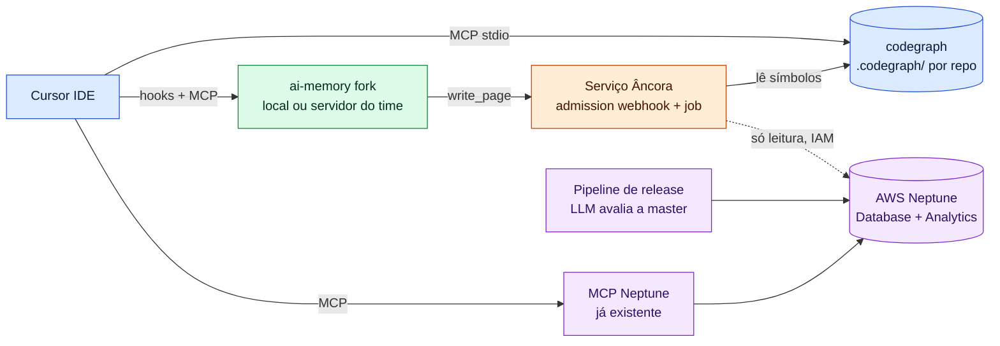
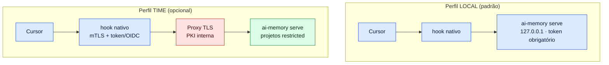
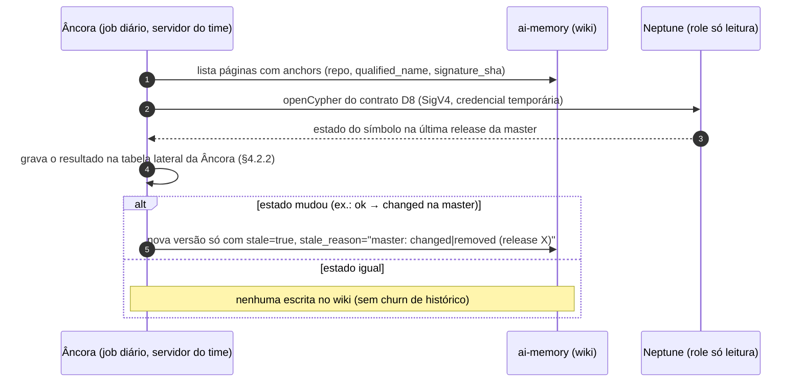
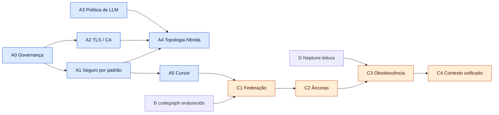

# 08 — Plano: fork empresarial do ai-memory para Cursor, com codegraph e AWS Neptune

> **Plano (pt-BR) — 2026-10-14.** Proposta de implementação para uma empresa que quer usar o
> [`akitaonrails/ai-memory`](https://github.com/akitaonrails/ai-memory) (base: commit `705aba7`, v3.0.0) em
> projetos internos com o **Cursor IDE**, junto do [`colbymchenry/codegraph`](https://github.com/colbymchenry/codegraph)
> (base: commit `3f714bc`, v1.6.2) e do **AWS Neptune** que a empresa já usa como *second brain*.
>
> **Base de evidência.** Cada item cita o achado que o motiva nos capítulos [03](03-ai-memory-seguranca.md)
> (segurança), [07](07-integracao-cursor-claude-code.md) (Cursor) e neste capítulo (`arquivo:linha` no código dos
> projetos). Análise **estática**: nada foi executado. Itens marcados *(inferido)* dependem de teste em runtime.
> Fatos sobre o Neptune vêm de documentação oficial da AWS baixada em 2026-10-14 (§6 e bibliografia).

> **Diagramas interativos (archify):** [arquitetura alvo](html/plano-arquitetura-alvo.html) ·
> [ciclo de vida da âncora](html/plano-ancora.html) · [handoff em duas fases no Cursor](html/plano-cursor-handoff.html)

← [07 — Integração Cursor e Claude Code](07-integracao-cursor-claude-code.md) | [09 — codegraph →](09-codegraph.md)

---

## 0. Premissas decididas com o usuário

| # | Decisão | Consequência no plano |
|---|---|---|
| P1 | **Topologia híbrida**: servidor ai-memory local por dev por padrão + servidor central opcional por time | Dois perfis de configuração endurecidos (§2.5) |
| P2 | **LLM**: só interno (OpenAI-compatible na rede da empresa) **ou** vendor sob contrato ZDR, como opções | Política de egresso com allowlist de provedores; padrão = nenhum LLM até o operador escolher (§2.4) |
| P3 | **Integração com codegraph**: ponte incremental | Federação via MCP primeiro, depois um serviço "âncora" que liga memórias a símbolos (§4) |
| P4 | **Neptune Database + Neptune Analytics** já existem como second brain, populados a partir da `master` de todos os repositórios (a cada release, um LLM avalia as mudanças e atualiza o grafo) | O Neptune é **só fonte de consulta** via o MCP que a empresa já tem; **nada é publicado nele** pelo ai-memory nem pela ponte (§5) |
| P5 | Devs alcançam o Neptune pela VPN/VPC | Consulta direta das estações, com IAM; sem proxy obrigatório |
| P6 | **Suporte a CA corporativa** (inspeção TLS, PKI interna) é requisito | Épico próprio cobrindo todos os caminhos de rede dos três componentes (§2.3) |

---

## 1. Arquitetura alvo: três escopos, cada um no seu papel

| Escopo | Pergunta que responde | Ferramenta | Verdade de qual código? | Escreve onde |
|---|---|---|---|---|
| **Código** | "Como o código *é agora*, nesta branch?" | codegraph (local, `.codegraph/` por repo) | working copy do dev | só local |
| **Trabalho** | "O que *este dev/time* decidiu, tentou, deixou aberto?" | ai-memory (fork) | sessões do agente | wiki Markdown + git (local ou servidor do time) |
| **Organização** | "O que *a empresa* sabe sobre o sistema?" | AWS Neptune (já existente) | estado da `master` a cada release | pipeline de release existente (não muda) |



**Regra de ouro da integração:** cada componente continua dono do seu dado. A ponte **lê** do codegraph e do
Neptune e **escreve só metadados** (âncoras e marcas de obsolescência) no frontmatter das páginas do ai-memory,
pelo mecanismo oficial de admission webhooks. Nenhum dos dois projetos upstream precisa mudar para isso.

---

## 2. Parte A — o fork do ai-memory

Cada item tem: **o que muda**, **por quê** (achado), **onde** (código atual) e **critério de aceite**.

### 2.1 A0 — Governança do fork

| ID | Mudança | Por quê | Aceite |
|---|---|---|---|
| A0.1 | Fork fixado em uma tag 3.0.x estabilizada; branch `enterprise` com patches rebaseados sobre tags do upstream; política de sync mensal + sync imediato em GHSA | v3.0.0 saiu em 2026-10-13/14; churn de ~27 releases/mês ([06 §2](06-comparativo.md#2-scorecard-05-maior-é-melhor)) | Documento de sync; diff do fork ≤ alguns arquivos por patch |
| A0.2 | Build reprodutível (`cargo build --locked`) no CI interno; **assinatura** dos binários (cosign/sigstore) + **SBOM** (CycloneDX) + provenance | Upstream só publica sidecar SHA-256, sem assinatura (L5) | Release interna verificável com `cosign verify`; SBOM anexado |
| A0.3 | Atualizar `rustls` para ≥ 0.23.46 e `anyhow` (companion importer) para ≥ 1.0.103; alinhar `cargo-audit --ignore` com o `deny.toml` | OSV.dev: RUSTSEC-2026-0346..0349, RUSTSEC-2026-0190 `[verificado]`; política divergente (L6) | `cargo deny check` e `cargo audit` sem ignores não documentados |
| A0.4 | Distribuição só por espelho interno (artefato assinado), sem `curl \| sh` de `latest`; imagens Docker fixadas por digest | `install.sh` de `latest`; `:latest` nos composes (L5) | MDM instala a versão assinada; CI bloqueia `:latest` |

### 2.2 A1 — Seguro por padrão

| ID | Mudança | Por quê | Onde hoje | Aceite |
|---|---|---|---|---|
| A1.1 | **Auth obrigatória mesmo em loopback**: sem token configurado o servidor não sobe (perfil enterprise) | Middleware é no-op sem autoridade (H1) `[verificado]` | `crates/ai-memory-mcp/src/auth.rs:12-13`; `serve.rs:582-611` | Teste: `serve` sem token → erro de inicialização |
| A1.2 | Validar o token: rejeitar o placeholder `REPLACE_WITH_OUTPUT_OF_GENERATE_AUTH_TOKEN` e tokens com menos de 256 bits; container também **falha fechado** | Só `recovery_token` tem tamanho mínimo; em container a falta de token só gera aviso (M1) | `config.rs:3156`; `serve.rs:604-606`; `docker/.env.production.example:102` | Teste de unidade para placeholder e token curto |
| A1.3 | Hooks enviam o token só por **arquivo de header** (`-H @file`) e o spool **nunca grava o token** | Token no argv do `curl` (L1); spool guarda token + payload bruto (L2) | `hooks/_lib.sh:929,971,1088-1117,1193` | `ps`/`/proc/*/cmdline` sem token; spool sem campo de auth |
| A1.4 | **`bootstrap` passa pelo sanitizador** antes do LLM e fica bloqueado para provedores fora da allowlist | Envia repo cru + autores ao LLM (M2) | `crates/ai-memory-consolidate/src/bootstrap.rs:1478-1491` (nenhum `scrub`) | Teste: segredo plantado num README não chega ao provedor mock |
| A1.5 | `auto_improve.require_approval = true` por padrão, e páginas `_rules/`/`procedures/` exigem aprovação humana sempre | Auto-aprovação vira envenenamento persistente (M4) `[verificado]` | `templates/config.default.toml:211-212` | Proposta fica em `pending-writes` até `approve` |
| A1.6 | **Captura por allowlist** como padrão do perfil enterprise (só repos com `.ai-memory.toml` aprovado) e o marcador não pode redirecionar `project`/`identity` para fora dos projetos registrados do usuário | Repo hostil pode arquivar a sessão em projeto confiável (M4, *inferido*) | `docs/marker-file.md:320-349,983-1001`; `crates/ai-memory-cli/src/marker.rs:167-172` | Teste: marcador com `identity` de outro projeto é ignorado |
| A1.7 | Sanitizador: padrões extras (`glpat-`, `hf_`, `npm_`, `SG.`, `dop_v1_`, `dapi`, `sig=`, `Pwd=`, `*_PASS`) + **detecção por entropia** opcional + formatos internos da empresa; corpus de teste com fixtures do gitleaks | Regex não cobre esses formatos (M5) | `crates/ai-memory-core/src/sanitize.rs:66-265` | Fixtures do gitleaks: 0 vazamentos nos formatos listados |
| A1.8 | Admission webhook **`validate-no-secrets`** (gitleaks/trufflehog) que rejeita a escrita de página | Defesa em profundidade, sem tocar no núcleo | `docs/admission-webhooks.md` (mecanismo existente) | Página com segredo é rejeitada com motivo auditado |
| A1.9 | Permissões: `.md` do wiki com `0600`, diretórios `0700`, `UMask=0077` nas units systemd empacotadas | Wiki herda umask (L3); unit sem UMask | `crates/ai-memory-wiki/src/atomic.rs`; `packaging/systemd/ai-memory.service` | `stat` em instalação limpa |
| A1.10 | Retenção: `observation_retention_days = 90` no perfil enterprise + comando de **expurgo de segredo** (página + observações + reescrita do histórico git + `VACUUM`) | Observações guardadas para sempre; segredo sobrevive no git (M5) | `config.default.toml:135`; `wiki.rs:883` | Runbook testado: segredo some do disco e do histórico |
| A1.11 | Autorização por projeto **falha fechada** se a tabela de grants não puder ser lida; `new_projects_restricted = true` no servidor do time | Fail-open (L4) | `crates/ai-memory-store/src/project_authz.rs:27-31` | Teste com banco corrompido → 403 |
| A1.12 | Rate limit de ingestão ligado e limite de body de `/admin/bootstrap` igual ao geral | Limiter desligado; 32 MiB no bootstrap | `config.default.toml:29-34`; `serve.rs:63` | Carga sintética → 429 |
| A1.13 | Corrigir `DATA_HANDLING.md` e `SECURITY.md` do fork: listar **todos** os caminhos de egresso (E1–E9) e as ACLs por projeto | Documentação subdeclara egresso (M3) e está desatualizada sobre ACLs | `DATA_HANDLING.md:16,29` | Revisão de compliance aprova o documento |
| A1.14 | **Kill switch de egresso**: `[egress] allow = ["llm.interno.empresa", …]`; qualquer host fora da lista falha fechado e gera evento de auditoria | Defesa contra configuração errada de provedor | novo módulo em `ai-memory-llm` | Teste: provedor fora da lista → erro, sem conexão aberta |
| A1.15 | Audit log à prova de adulteração (cadeia de hash) + export para SIEM; auditar também inserção de observação e início/fim de sessão | Audit log não cobre tudo; issue #1261 aberta | `ops.rs:5237-5275` | Verificador de cadeia detecta linha alterada |
| A1.16 | **Digest de perfil cross-project** desligado no perfil local (`[profile] enabled = false`) ou com aprovação humana antes de convergir uma preferência | No perfil de um usuário o padrão `auto` liga o digest, e uma preferência envenenada num projeto se espalha para todos (M4) | `crates/ai-memory-core/src/profile.rs:295-300,644-650`; `docs/cross-project-profile.md:282` | Preferência de um repo hostil não aparece no brief de outro projeto |
| A1.17 | **Allowlist de ferramentas MCP por credencial**: tokens de agente sem ferramentas destrutivas (`memory_delete_page`, `memory_forget_sweep`, `memory_auto_improve`, `memory_consolidate`); essas ficam só para tokens de operador | Com auth ligada, um agente vítima de prompt injection ainda pode apagar ou varrer memória via MCP | `crates/ai-memory-mcp/src/server.rs:3564,5008` | Token de agente recebe 403 em `memory_delete_page` |

### 2.3 A2 — TLS e CA corporativa

O fork precisa funcionar atrás de **inspeção TLS** e com **PKI interna**, nos dois sentidos.

| ID | Caminho de rede | Situação atual | Mudança | Aceite |
|---|---|---|---|---|
| A2.1 | ai-memory → LLM interno, embeddings, OIDC, `upgrade` | Usa `reqwest` com `rustls-tls-native-roots`, ou seja, **lê o trust store do SO** `[verificado: Cargo.toml:171-179]`; `docs/https-via-proxy.md` documenta `SSL_CERT_FILE` | Adicionar `[tls] ca_bundle = "/etc/pki/empresa-ca.pem"` explícito (somado às raízes do SO, nunca substituindo) para hosts sem acesso ao trust store, como containers mínimos | Teste com CA privada: chamada OK com o bundle, `UnknownIssuer` sem ele |
| A2.2 | ai-memory → servidor central (cliente) | **Não há suporte a certificado de cliente** (mTLS) no cliente HTTP `[verificado: nenhuma ocorrência de Identity::from, with_client_auth ou client_auth em crates/; docs/https-via-proxy.md não trata de mTLS]` | `[tls] client_cert`/`client_key` (PEM) no cliente `reqwest` e no `mcp-bridge` | Proxy mTLS rejeita sem certificado e aceita com |
| A2.3 | Hooks shell (`curl`) → servidor | `curl` usa o store do sistema; não há opções de CA ou cert no `_lib.sh` | Preferir o **hook nativo em Rust** (herda A2.1/A2.2); no shell, passar `--cacert`/`--cert`/`--key` a partir da config | Hooks funcionam atrás do proxy mTLS |
| A2.4 | Servidor central (entrada) | Sem TLS nativo; exige reverse proxy (`SECURITY.md`) | Padronizar o proxy (nginx/Envoy/ALB) com **certificado da PKI interna** e **mTLS opcional**; `secure_cookie = true`; HSTS | Teste de conformidade TLS (sem TLS 1.0/1.1) |
| A2.5 | Download do modelo de embeddings (huggingface.co) | Chamada automática no primeiro start (E1) | Perfil enterprise: **modelo pré-instalado** em `<data_dir>/models/` pelo MDM e download desligado | Host sem internet sobe sem erro |
| A2.6 | codegraph (Node) → telemetria e checagem de update | Node lê CAs extras via `NODE_EXTRA_CA_CERTS` (desde v7.3.0) e `--use-system-ca` (desde v23.8.0) `[verificado: nodejs/node doc/api/cli.md:3812,4147]` | Como telemetria e update ficam **desligados** (§3), o codegraph não precisa de rede; documentar `NODE_EXTRA_CA_CERTS` só por precaução | `codegraph` funciona offline |
| A2.7 | MCP do Neptune (SDK AWS) → endpoint via VPN | SDKs da AWS aceitam `AWS_CA_BUNDLE` `[verificado: docs.aws.amazon.com/sdkref feature-gen-config]` | Distribuir o bundle corporativo e `AWS_CA_BUNDLE` pelo MDM | Consulta ao Neptune OK atrás do proxy |
| A2.8 | Cursor IDE | Configuração de proxy/CA do próprio Cursor (fora do fork) | Checklist de MDM | — |

### 2.4 A3 — Política de LLM (interno ou vendor ZDR)

| ID | Mudança | Aceite |
|---|---|---|
| A3.1 | Padrão do perfil enterprise: **nenhum `llm_provider`**. Ativar exige escolher `internal` (endpoint `openai-compat` interno) ou `vendor-zdr` (Anthropic/OpenAI com contrato de retenção zero), e o host precisa estar na allowlist de egresso (A1.14) | Config sem allowlist → servidor recusa iniciar o LLM |
| A3.2 | `reranker = "llm"` e `capture_assistant` proibidos no perfil `vendor-zdr` (a consulta do reranker não é sanitizada) | Teste de configuração |
| A3.3 | Os prompts de manutenção enviados ao LLM passam por uma segunda sanitização logo antes da chamada (não só na ingestão) | Teste com segredo inserido manualmente no wiki |
| A3.4 | Telemetria de custo local por provedor (tokens/dia) exposta em `/admin/metrics` | Painel interno mostra consumo |

### 2.5 A4 — Topologia híbrida



| ID | Mudança | Aceite |
|---|---|---|
| A4.1 | Dois perfis de config versionados (`enterprise-local.toml`, `enterprise-team.toml`) com todos os valores de A1–A3 | `ai-memory doctor --profile enterprise-*` passa |
| A4.2 | Perfil time: **um servidor por fronteira de confiança** (o upstream declara que usuários de um servidor compartilham um domínio de confiança), OIDC/SSO para humanos, API keys por usuário para hooks, `new_projects_restricted = true` | Usuário de outro time recebe 403 |
| A4.3 | Distribuição por MDM: binário assinado, config, CA bundle, hooks do Cursor no caminho **enterprise** (`/etc/cursor/hooks.json`) e Claude Code via managed settings | Estação nova configurada sem passos manuais |
| A4.4 | Local ↔ time: o handoff pessoal fica local; o time só recebe páginas aprovadas (sync via `ai-memory-wikisync` ou publicação explícita) | Nada pessoal aparece no servidor do time sem ação explícita |

### 2.6 A5 — Cursor de primeira classe

| ID | Mudança | Por quê | Onde | Aceite |
|---|---|---|---|---|
| A5.1 | No `sessionStart` do Cursor, devolver `{"additional_context": "<handoff + brief>"}` no nível raiz | O Cursor documenta `additional_context` (`cursor/hooks/hooks-guide.md:1341,1354`); o fork devolve o envelope do Claude `[verificado]` | `crates/ai-memory-cli/src/commands/hook.rs:612-633` (novo ramo para `AgentKind::Cursor`, como já existe para Copilot e Antigravity) | Teste canário: handoff criado no Claude Code aparece no primeiro turno do Cursor |
| A5.2 | **Handoff em duas fases**: o `GET /handoff` passa a *reservar* (estado `reserved`, com lease de N minutos); o primeiro evento real da sessão (prompt ou ferramenta) *confirma* (`accepted`); se a lease expirar, volta a `open` | Hoje o GET é destrutivo e o handoff pode sumir sem aparecer `[verificado: hook.rs:1051-1056]` | `crates/ai-memory-store/migrations/V02__handoffs.sql:18` (adicionar `reserved` ao `CHECK`); `ops.rs:4638-4642` | Teste: sessão que nunca envia prompt não consome o handoff. **Trade-off:** se a lease expira depois que o handoff já foi injetado no Cursor, ele volta a `open` e pode ser entregue de novo (quebra o claim-once); por isso o evento que confirma precisa trazer o **mesmo `session_id`** da reserva, e a lease deve ser maior que o tempo típico até o primeiro prompt |
| A5.3 | `preToolUse` responde `{"permission": "allow"}` em vez de `{}` | Resposta fora do schema bloqueia a ação ("blocks the action", `hooks-guide.md:196`) *(inferido)* | `hook.rs` (saída do pre-tool-use para Cursor) | Teste de contrato contra o schema documentado |
| A5.4 | Capturar a resposta final via `afterAgentResponse` e os limites de subagente via `subagentStart/Stop` | Hoje não usados (07 §3.1) | `render_shared.rs:1293-1307` | Sessão Cursor tem a resposta final e os subagentes separados |
| A5.5 | Instalação **por projeto** (`.cursor/hooks.json`) e no caminho **enterprise**, com merge e backup | `--scope project` recusado para o Cursor | `install_hooks.rs:614-620` | `install-hooks --agent cursor --scope project` funciona |
| A5.6 | Regra `.cursor/rules/ai-memory.mdc` gerada (opcional, gitignored) que instrui o agente a usar `memory_query`/`memory_handoff_accept` como fallback | Cloud agents do Cursor não disparam `sessionStart` (`hooks-guide.md:79-86`) | novo `install-instructions --agent cursor` | Cloud agent recupera o handoff via MCP |
| A5.7 | MCP no Cursor por **stdio** (`ai-memory mcp-bridge`) com token em arquivo e A2.2 (mTLS), em vez de `url` HTTP sem auth | `install-mcp --client cursor` grava `{"url": …}` | `install_mcp.rs:1565-1570` | Nenhum segredo em `~/.cursor/mcp.json` |
| A5.8 | Teste end-to-end no CI: Cursor CLI (ou simulador do contrato de hooks) exercitando todos os eventos usados pelo fork | Nenhum fixture verifica que o Cursor consome o envelope | `crates/ai-memory-hooks/src/payload.rs:1800-1881` | Suite verde em cada release do fork |

---

## 3. Parte B — codegraph endurecido (sem fork, só configuração e espelho)

> **Base desta parte:** a auditoria completa do codegraph v1.6.2 nos capítulos [09](09-codegraph.md) e
> [10](10-codegraph-seguranca.md). Nenhum achado Crítico ou Alto para laptops de um usuário com Cursor; seis
> Médios (F1–F6). O checklist completo está em [10 §5](10-codegraph-seguranca.md#5-checklist-de-hardening-cursor--ca-corporativa--sem-telemetria).

| ID | Mudança | Fecha | Aceite |
|---|---|---|---|
| B1 | Versão fixada no **espelho npm interno**, com todos os pacotes de plataforma, `CODEGRAPH_NO_DOWNLOAD=1`; proibir `install.sh`, `install.ps1` e `codegraph upgrade` (este roda `curl …/main/install.sh \| sh`) | F3, F9, F13 | `codegraph --version` = versão aprovada; nenhum download em captura de rede |
| B2 | `codegraph telemetry off` por usuário + `DO_NOT_TRACK=1` + `CODEGRAPH_NO_UPDATE_CHECK=1` no SO e no `env` do `mcp.json`; bloquear `getcodegraph.com` no proxy | F4, F8 | `codegraph telemetry status` → off; nenhuma conexão de saída |
| B3 | `~/.cursor/mcp.json` gerido pelo MDM (modo `0600`, bloco `env` acima) em vez do instalador, porque reinstalar apaga o `env` | F10 | Entrada sobrevive a uma reinstalação simulada |
| B4 | Só a ferramenta `explore`; aprovação por chamada no Cursor; a regra de federação (C1) declara a saída do codegraph **não confiável** e manda desconfiar de `projectPath` sugerido pelo repositório | F1, F2 | Red team: README hostil pedindo outro `projectPath` não é seguido sem aprovação |
| B5 | Indexar só repositórios autorizados; repos de terceiros em outro usuário do SO ou container | F1, F7 | — |
| B6 | `.codegraph*` em `.dockerignore`, backups e artefatos de CI; `umask 077` e `TMPDIR` por usuário em hosts compartilhados; não usar a UI | F5, F6, F11 | Imagem Docker de teste sem `.codegraph/` |
| B7 | Propor upstream: restringir `projectPath` às raízes do workspace, cercar a saída como dados não confiáveis, verificar `SHA256SUMS` nos instaladores | F1, F2, F3 | Issues abertas/acompanhadas |

## 4. Parte C — a ponte "Âncora" (ai-memory × codegraph)

### 4.1 O problema que ela resolve

Uma memória como *"não chame `PaymentService.refund` sem idempotency key"* fica **errada em silêncio** quando
alguém renomeia, move ou reescreve `refund`. Nenhuma das ferramentas detecta isso hoje: o ai-memory não conhece o
código e o codegraph não conhece as decisões.

### 4.2 Fases

| Fase | Entrega | Custo | Valor |
|---|---|---|---|
| **C1. Federação** | Cursor com os 3 MCPs (ai-memory, codegraph, Neptune) + uma regra `.cursor/rules/contexto.mdc` que define **quando usar cada um**: `codegraph_*` para estrutura, `memory_query` para decisões e histórico, Neptune para conhecimento organizacional | Dias | Imediato; sem código novo |
| **C2. Âncoras** | Serviço *Âncora* como **admission webhook** do ai-memory: em `write_page`, extrai identificadores citados no corpo, resolve no índice do codegraph e grava `anchors:` no frontmatter | Semanas | Toda memória passa a apontar para símbolos reais |
| **C3. Obsolescência** | Job periódico (ou disparado pelo sync do codegraph) que recalcula o hash de cada símbolo ancorado e marca `stale: true` + motivo; páginas obsoletas recebem um aviso no brief e caem no ranking | Semanas | Ataca diretamente a memória obsoleta |
| **C4. Contexto unificado** | Um `context-budget` único para o início da sessão: brief do ai-memory + "blast radius" (`codegraph_impact`) dos arquivos do handoff, dentro de um teto de tokens | Semanas | Menos context rot ([01 §5.1](01-conceitos-memoria-agentes.md#51-context-rot-mais-contexto-não-é-melhor)) |

### 4.2.1 Onde a Âncora roda (por perfil) e qual é o contrato com o codegraph

O índice `.codegraph/` existe **só na estação do dev**. Um servidor de time não enxerga a branch de ninguém:

| Perfil | Onde roda | Nível branch (codegraph) | Nível master (Neptune) |
|---|---|---|---|
| **Local** | Sidecar local, ao lado do `ai-memory serve` | Sim: consulta o codegraph da própria estação | Sim: credencial temporária do dev (D2) |
| **Time** | Dois papéis: **(a)** sidecar na estação resolve as âncoras e as envia como metadado pela API autenticada do servidor do time; **(b)** job no servidor do time faz **só** a checagem no nível master | Só na estação (a); o servidor não verifica branch | Sim (b): role de serviço só leitura |

**Contrato com o codegraph:** a Âncora usa o **CLI ou as ferramentas MCP** do codegraph (`codegraph_search`,
`codegraph_node`, versão fixada), **nunca** o SQLite em `.codegraph/` diretamente. O `schema.sql` é interno e o
projeto muda com frequência; ler a tabela `nodes` direto quebraria a cada release.

### 4.2.2 Como a obsolescência é gravada sem poluir o histórico

No ai-memory, **qualquer** mudança de frontmatter gera uma nova versão da página (`supersedes`), um commit git e
uma linha de auditoria. Um job diário que reescrevesse `stale:` em todas as páginas inundaria o histórico. Regras:

| Regra | Detalhe |
|---|---|
| Estado em tabela lateral | O resultado de cada verificação (`ok/moved/changed/removed`, quando, contra qual commit/release) fica numa **tabela própria da Âncora**, não na página |
| Escrever na página só na transição | O frontmatter `stale:` só muda quando o estado **muda** (ex.: `ok` → `changed`), gerando uma única versão nova com motivo |
| Credencial própria e estreita | A Âncora usa um token com permissão apenas de escrita de metadado de âncora (A1.17), auditado separadamente |
| Modos de falha dos webhooks | **Âncora = não bloqueante e fail-open** (enriquece; se cair, a página é gravada sem âncora e reprocessada depois). **`validate-no-secrets` = bloqueante e fail-closed** (se cair, nenhuma página é gravada). Se a Âncora fosse bloqueante, uma queda dela pararia toda escrita |

### 4.3 Formato da âncora

O ID de nó do codegraph é `kind:sha256(filePath:kind:name:line)` (`src/extraction/tree-sitter-helpers.ts:18-30`)
`[verificado]`. Como **inclui a linha**, ele muda sempre que o código acima do símbolo se desloca. A âncora
precisa de uma identidade estável:

```yaml
# frontmatter de uma página do ai-memory, escrito pelo webhook Âncora
anchors:
  - repo: github.com/empresa/payments        # identidade de projeto do ai-memory
    file: src/payments/service.ts
    kind: method
    qualified_name: PaymentService.refund     # nodes.qualified_name no codegraph
    signature_sha: 3f1c…                      # sha256 da assinatura + corpo normalizado no momento da escrita
    commit: 9a8b7c6                           # HEAD quando a âncora foi criada
stale: false
stale_reason: null
```

**Resolução no job C3:** procurar `(file, kind, qualified_name)` no índice atual. Se não achar, tentar só
`qualified_name` (o símbolo foi movido). Depois comparar `signature_sha`. O resultado é um de quatro estados:
`ok`, `moved`, `changed`, `removed`.

### 4.4 Obsolescência em dois níveis (com o Neptune)

| Nível | Fonte | Pergunta | Quando roda |
|---|---|---|---|
| Branch | codegraph local | "Este símbolo mudou **no meu código atual**?" | a cada sync do codegraph / início de sessão |
| Master | Neptune (consulta via IAM, só leitura) | "Este símbolo/decisão ainda é verdade **na master**, segundo o second brain?" | job diário no servidor do time |

*Detalhes do lado Neptune em §5.*

---

## 5. Parte D — AWS Neptune como fonte de consulta

> Fatos desta seção vêm de documentação oficial da AWS e do repositório `awslabs/mcp`, baixados em 2026-10-14 e com
> cada citação conferida contra a cópia baixada (bibliografia no fim do capítulo). `(inferido)` marca conclusões de
> desenho.

### 5.1 O que já existe e o que muda

O Neptune **continua exatamente como está**: o pipeline de release avalia a `master` com um LLM e atualiza o grafo.
Nem o fork do ai-memory nem a ponte escrevem nele. O plano só acrescenta **leitores controlados**:

| Leitor | Para quê | Como |
|---|---|---|
| Agente no Cursor | Conhecimento organizacional sob demanda ("quem é dono deste serviço?", "qual a decisão de arquitetura sobre X?") | O MCP do Neptune que a empresa já usa |
| Serviço Âncora (job diário no servidor do time) | Obsolescência **no nível master** (§4.4): o símbolo ou decisão ancorado ainda existe e confere na master? | Consulta openCypher com role IAM **só leitura** |

### 5.2 Database × Analytics: o que importa para este plano

| | Neptune Database | Neptune Analytics |
|---|---|---|
| Linguagens | Gremlin, openCypher, SPARQL [N1] | **Só openCypher** [N19] |
| Busca vetorial | Não há índice vetorial na documentação *(inferido da ausência)* | **Um** índice por grafo, dimensão fixa definida **na criação** (1–65 535) [N13] |
| Rede a partir da estação | VPC (via VPN) por padrão; endpoint público opcional desde o engine 1.4.6.x, com IAM obrigatório [N2] | Endpoint privado + PrivateLink, acessível "from applications that are on premises over VPN and AWS Direct Connect" [N15] |
| Autenticação | IAM/SigV4 **opcional** [N4] | **Sempre** IAM/SigV4 [N14] |
| Auditoria de consultas | CloudTrail só cobre a API de gestão; consultas exigem os **audit logs** do cluster (ARN do chamador + consulta) [N10][N11] | Consultas só com **CloudTrail data events** (custo extra) [N16] |
| Granularidade de acesso | O cluster inteiro; a única chave de condição específica é `neptune-db:QueryLanguage` [N22][N25] | O grafo inteiro; política gerenciada `NeptuneGraphReadOnlyAccess` [N28] |

**Consequência de desenho** *(inferido)*: não existe ACL por vértice ou propriedade. Conteúdo com sensibilidade
diferente precisa ficar em **clusters ou grafos separados**, cada um com sua role.

### 5.3 Itens do plano para o Neptune

| ID | Mudança | Por quê | Aceite |
|---|---|---|---|
| D1 | Role IAM **só leitura** para agentes e para a Âncora: `neptune-db:ReadDataViaQuery` (+ `Get*`/`List*`) no cluster; `NeptuneGraphReadOnlyAccess` no Analytics. **Sem** `WriteDataViaQuery`/`DeleteDataViaQuery` | O MCP oficial do Neptune "will run any query sent to it, which could include both mutating and read-only actions" e não tem modo só leitura; **a IAM é a única barreira** [N29] | Um `MERGE`/`CREATE` vindo do agente falha com AccessDenied (o `MERGE` exige Read + Write [N24]) |
| D2 | Credenciais **temporárias** via IAM Identity Center (`AWS_PROFILE` de SSO) nas estações, distribuídas pelo MDM; nenhuma access key fixa em `~/.cursor/mcp.json` | A AWS recomenda credenciais temporárias e federação [N4] | `~/.cursor/mcp.json` sem segredo; sessão expira |
| D3 | Ligar os **audit logs** do Database e os **CloudTrail data events** do Analytics para as roles de leitura | Sem isso não há trilha de quem consultou o quê [N10][N16] | Consulta de teste aparece no log com o ARN do dev |
| D4 | Se existir conhecimento sensível no second brain, **particionar** em grafos/clusters separados por fronteira (time, domínio) com roles distintas | Granularidade de acesso = cluster/grafo [N22][N28] | Dev do time A recebe AccessDenied no grafo do time B |
| D5 | **Tratar o resultado do Neptune como entrada não confiável** no contexto do agente: a regra `.cursor/rules` de federação e o brief da Âncora envolvem o conteúdo com o mesmo cercado "untrusted" do ai-memory | O conteúdo do second brain é **gerado por LLM** a partir da master: é superfície de injeção como qualquer memória ([01 §6](01-conceitos-memoria-agentes.md#6-segurança-da-memória-a-memória-é-superfície-de-ataque)); o README do MCP AgentCore da AWS diz "Retrieved content … should be treated as untrusted input" [N34] | Teste de red team com instrução plantada num nó |
| D6 | CA corporativa no caminho MCP/SDK: `AWS_CA_BUNDLE` (ver A2.7) | Proxies de inspeção TLS | Consulta OK atrás do proxy |
| D7 | Fixar a versão do MCP do Neptune no espelho interno (se for o `awslabs.amazon-neptune-mcp-server`) e restringir `NEPTUNE_ENDPOINT` ao grafo/cluster autorizado | Mesmo risco de supply chain dos demais MCPs | Versão aprovada no MDM |
| D8 | **Contrato de schema** para a obsolescência no nível master: a Âncora precisa saber como o second brain representa repositório, arquivo, símbolo e decisão. Definir com o dono do pipeline uma consulta openCypher estável (por exemplo, `MATCH (s:Symbol {repo:$repo, qualified_name:$qn}) RETURN s.signature_sha, s.release`) | **Decisão em aberto**: o schema atual do Neptune da empresa não é conhecido por este estudo | Consulta acordada e testada contra uma release |

### 5.4 Fluxo de obsolescência no nível master



### 5.5 Opção futura (fora do escopo decidido): publicar memória aprovada no Neptune

Se um dia a empresa quiser que o second brain **aprenda com o trabalho dos agentes**, o padrão documentado é um
**único job de CI** com role de escrita. Esse job lê o repositório git compartilhado do wiki e faz `UNWIND` +
`MERGE` com `~id` determinísticos (por exemplo `page:<slug>`) [N51][N52], ou usa o bulk loader com IDs explícitos de
relacionamento [N49]. Assim os agentes **nunca** escrevem, o git continua sendo a verdade e o Neptune vira um
modelo de leitura reconstruível. O codegraph **não** deve ser publicado no nível de função, porque muda a cada
commit; no máximo um mapa repositório → módulo. Esse caminho fica registrado aqui porque **não** foi pedido agora.

### 5.6 Bibliografia do Neptune (baixada em 2026-10-14)

| Ref. | Fonte | Trecho conferido |
|---|---|---|
| N1 | https://docs.aws.amazon.com/neptune/latest/userguide/intro.md | Database: Gremlin, openCypher e SPARQL |
| N2 | https://docs.aws.amazon.com/neptune/latest/userguide/neptune-public-endpoints.md | endpoint público com IAM obrigatório (engine 1.4.6.x+) |
| N4 | https://docs.aws.amazon.com/neptune/latest/userguide/iam-auth.md | IAM DB auth; credenciais temporárias recomendadas |
| N10 | https://docs.aws.amazon.com/neptune/latest/userguide/auditing.md | audit logs registram chamador e consulta |
| N11 | https://docs.aws.amazon.com/neptune/latest/userguide/cloudtrail.md | CloudTrail cobre só a API de gestão |
| N13 | https://docs.aws.amazon.com/neptune-analytics/latest/userguide/vector-index.md | um índice vetorial por grafo, dimensão fixa na criação |
| N14 | https://docs.aws.amazon.com/neptune-analytics/latest/userguide/gettingStarted-connecting.md | "All Neptune Analytics graphs are configured to use AWS Identity and Access Management" |
| N15 | https://docs.aws.amazon.com/neptune-analytics/latest/userguide/gettingStarted-connecting-private-link.md | acesso on-premises via VPN e Direct Connect |
| N16 | https://docs.aws.amazon.com/neptune-analytics/latest/userguide/monitoring-cloudtrail-info.md | consultas só com CloudTrail data events |
| N19 | https://docs.aws.amazon.com/neptune-analytics/latest/userguide/query.md | Analytics consulta com openCypher |
| N22 | https://docs.aws.amazon.com/neptune/latest/userguide/iam-data-resources.md | recurso IAM de dados = o cluster inteiro |
| N24 | https://docs.aws.amazon.com/neptune/latest/userguide/iam-data-access-policies.md | `MERGE` exige Read + Write; `SET` exige Delete |
| N25 | https://docs.aws.amazon.com/neptune/latest/userguide/iam-data-condition-keys.md | única chave específica: `neptune-db:QueryLanguage` |
| N28 | https://docs.aws.amazon.com/neptune-analytics/latest/userguide/security-iam-awsmanpol-graph-read-only.md | política gerenciada `NeptuneGraphReadOnlyAccess` |
| N29 | https://github.com/awslabs/mcp/blob/main/src/amazon-neptune-mcp-server/README.md | "This server will run any query sent to it, which could include both mutating and read-only actions" |
| N34 | https://github.com/awslabs/mcp/blob/main/src/amazon-bedrock-agentcore-mcp-server/README.md | "Retrieved content (memory records, gateway responses) should be treated as untrusted input" |
| N49 | https://docs.aws.amazon.com/neptune/latest/userguide/load-api-reference-load.md | sem IDs explícitos de relacionamento o loader não detecta duplicatas |
| N51 | https://docs.aws.amazon.com/neptune/latest/userguide/feature-opencypher-compliance.md | `MERGE` com `~id` customizado |
| N52 | https://docs.aws.amazon.com/neptune/latest/userguide/best-practices-merge-multiple-nodes.md | um `UNWIND` + um `MERGE` |

---|---|---|
| N1 | https://docs.aws.amazon.com/neptune/latest/userguide/feature-overview-db-clusters.html | Database suporta Gremlin, openCypher e SPARQL |
| N2 | https://docs.aws.amazon.com/neptune/latest/userguide/neptune-public-endpoints.html | endpoints públicos com IAM obrigatório |
| N4 | https://docs.aws.amazon.com/neptune/latest/userguide/iam-auth.html | IAM DB auth; credenciais temporárias recomendadas |
| N10, N11 | https://docs.aws.amazon.com/neptune/latest/userguide/auditing.html · …/cloudtrail.html | audit logs registram o chamador e a consulta; CloudTrail cobre gestão |
| N13 | https://docs.aws.amazon.com/neptune-analytics/latest/userguide/vector-index.html | um índice vetorial por grafo, dimensão fixa na criação |
| N14, N15 | https://docs.aws.amazon.com/neptune-analytics/latest/userguide/gettingStarted-connecting.html · …/gettingStarted-connecting-private-link.html | "All Neptune Analytics graphs are configured to use AWS Identity and Access Management"; acesso on-premises via VPN |
| N16 | https://docs.aws.amazon.com/neptune-analytics/latest/userguide/monitoring-cloudtrail-info.html | consultas só com CloudTrail data events |
| N19 | https://docs.aws.amazon.com/neptune-analytics/latest/userguide/query.html | Analytics usa openCypher |
| N22, N24, N25 | https://docs.aws.amazon.com/neptune/latest/userguide/iam-data-access-policies.html · …/iam-data-access-examples.html · …/iam-data-condition-keys.html | recurso = cluster; `MERGE` exige Read + Write; condição `neptune-db:QueryLanguage` |
| N28 | https://docs.aws.amazon.com/neptune-analytics/latest/userguide/security-iam-awsmanpol-graph-read-only.html | `NeptuneGraphReadOnlyAccess` |
| N29 | https://github.com/awslabs/mcp/blob/main/src/amazon-neptune-mcp-server/README.md | "This server will run any query sent to it, which could include both mutating and read-only actions" |
| N34 | https://github.com/awslabs/mcp (AgentCore MCP server README) | "Retrieved content (memory records, gateway responses) should be treated as untrusted input" |
| N49, N51, N52 | https://docs.aws.amazon.com/neptune/latest/userguide/bulk-load-tutorial-format-opencypher.html · …/access-graph-opencypher.html · …/best-practices-merge-multiple-nodes.html | IDs explícitos de relacionamento; `MERGE` com `~id`; um `UNWIND` + `MERGE` |

---

## 6. Roadmap e dependências



| Onda | Conteúdo | Saída verificável |
|---|---|---|
| 1 | A0, A1.1–A1.7, A2.1–A2.5, B1–B3 | Piloto local seguro com 5 devs |
| 2 | A5 (Cursor), A3, C1 (federação), B4–B6 | Canário Claude Code → Cursor passando; regra de federação ativa |
| 3 | A4 (servidor do time), A1.8–A1.15, D (consulta Neptune) | Servidor de time atrás de mTLS com SSO |
| 4 | C2–C4 (Âncora); nível master depende do contrato D8 | Memórias ancoradas e obsolescência detectada no piloto |

## 7. Riscos e decisões em aberto

| Risco | Mitigação |
|---|---|
| Divergência do upstream (dois projetos com churn alto) | Patches pequenos e isolados; preferir pontos de extensão (admission webhooks, config) a mudanças no núcleo; propor A5.1/A5.2 upstream |
| Prompt injection via memória continua possível | Cercas "untrusted" + aprovação humana (A1.5) + webhook de segredos; aceitar como risco residual documentado |
| Custo de operar servidor de time | Começar só com o perfil local (onda 1–2) |
| Âncoras erradas (identificador ambíguo) | Âncora só quando a resolução é única; senão a página fica sem âncora e com aviso |

## 8. Verificação

| Tipo | O quê |
|---|---|
| Testes do fork | Unidade e integração para cada critério de aceite de A1–A5 |
| Contrato Cursor | Simulador dos eventos usados pelo fork, com os schemas de `cursor/hooks/hooks-guide.md` |
| Red team | Repositório hostil (README com instrução, marcador `.ai-memory.toml` forjado, segredos em formatos variados) contra o perfil enterprise |
| Rede | Captura de pacotes na estação: nenhuma conexão fora da allowlist |
| Pentest | Servidor de time atrás do proxy mTLS |

---

← [07 — Integração Cursor e Claude Code](07-integracao-cursor-claude-code.md) | [09 — codegraph →](09-codegraph.md)
