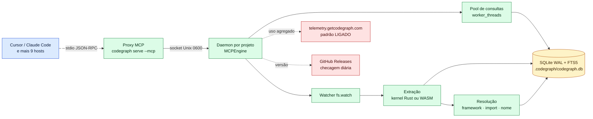

# 09 — codegraph (colbymchenry): conceitos, arquitetura e papel ao lado da memória

> **Estudo (pt-BR) — 2026-10-14.** Repositório: https://github.com/colbymchenry/codegraph, analisado no commit
> `3f714bcc480e372d232f2d5e9b37b84256a205e1` (v1.6.2, MIT). Leitura estática e somente leitura: nada foi
> executado. Referências `arquivo:linha` são relativas à raiz do repositório. Rótulos: `[verificado]` = conferido
> no código pelo thread principal; sem rótulo = lido por subagente com `arquivo:linha`.
>
> **Diagrama interativo (archify):** [arquitetura](html/codegraph-arquitetura.html)

← [08 — Plano do fork empresarial](08-plano-fork-empresarial.md) | [10 — codegraph: segurança →](10-codegraph-seguranca.md)

---

## 1. Em uma frase

**O codegraph monta, por repositório, um grafo dos símbolos do código e das relações entre eles (quem chama quem,
quem importa quem) e o entrega ao agente numa única chamada MCP, com o código-fonte, os caminhos de chamada e o
raio de impacto.** Ele não guarda decisões nem histórico: é um índice derivado e regenerável de "como o código é
agora".

| Ficha | Valor |
|---|---|
| Linguagem | TypeScript sobre Node (bundle com Node 24), mais um kernel opcional em Rust |
| Licença | MIT |
| Criado / versão | 2026-01-18 / v1.6.2 (2026-10-03); 34 versões no CHANGELOG |
| Popularidade | 74 104 estrelas, 50 contribuidores; **1 319 dos 1 451 commits são de um único autor** |
| Testes | 576 arquivos `*.test.ts`; **nenhum CI roda os testes a cada push ou PR** `[verificado: .github/workflows/ só tem release.yml e deploy-site.yml]` |
| LLM | **Nenhum.** Não há chamadas a LLM nem embeddings |

---

## 2. Conceitos centrais

| Conceito | O que é, em linguagem simples | Evidência |
|---|---|---|
| **Grafo de código** | 23 tipos de nó (função, classe, método, rota, componente…) e 13 tipos de aresta (chama, importa, estende, implementa…) | `src/types.ts:22-69` |
| **"Semântico" = estrutural** | O significado vem da árvore sintática (tree-sitter), **não** de embeddings. A busca é FTS5/BM25 do SQLite mais travessia do grafo ("deterministic, no embeddings") | `src/db/queries.ts:1853`; `src/mcp/tools.ts:3926` |
| **Resolução** | Transforma nomes em arestas em três tentativas: regras de framework (36 resolvedores: React, Next, Spring, Django, Rails…), imports, e por último casamento de nomes | `src/resolution/index.ts:1431,1471,1519` |
| **Sintetizadores** | Acrescentam arestas que a análise estática perde: callbacks, roteadores, ponteiros de função em C, ponte Swift↔ObjC | `src/resolution/*-synthesizer.ts` |
| **`codegraph_explore`** | A ferramenta principal: devolve o código dos símbolos relevantes, os caminhos entre eles e o raio de impacto. **Só ela vem ligada por padrão**; as outras 7 exigem `CODEGRAPH_MCP_TOOLS` | `src/mcp/tools.ts:1727,1853` |
| **Frescor** | (1) `sync` compara tamanho, mtime e hash do conteúdo, nunca o git; (2) um watcher (`fs.watch`) reindexa ao salvar, desligado no WSL `/mnt/*`, onde hooks git opcionais fazem o sync; (3) avisos de "arquivos pendentes" nas respostas | `src/extraction/index.ts:3242`; `src/sync/watcher.ts`; `src/sync/watch-policy.ts:53-58` |
| **Kernel Rust** | Módulo napi-rs que só faz o passo de parse e extração (18 linguagens). É opcional: se falhar, cai nas 29 gramáticas WASM embarcadas | `codegraph-kernel/src/lib.rs`; `src/extraction/kernel/loader.ts:1-23` |

### 2.1 Exemplo: o que o agente recebe

Pergunta do agente: *"o que quebra se eu mudar `PaymentService.refund`?"*. Uma única chamada a `codegraph_explore`
devolve, agrupado por arquivo:

```text
src/payments/service.ts   → corpo de PaymentService.refund (verbatim)
src/api/refunds.ts        → RefundController.create → PaymentService.refund   (caminho de chamada)
Blast radius: 4 chamadores em 3 arquivos; 2 testes cobrem o símbolo
```

Sem o codegraph, o agente faria vários `grep` + `Read` para chegar ao mesmo lugar.

---

## 3. Arquitetura



| Componente | O que faz | Evidência |
|---|---|---|
| **Proxy MCP** | Processo que o host (Cursor) inicia por stdio; repassa bytes ao daemon depois de um "hello" que só compara a versão | `src/mcp/proxy.ts:1-19,131-135` `[verificado]` |
| **Daemon** | Um por raiz de projeto, destacado do host; um watcher, um escritor SQLite e várias sessões. Sai após 5 min ocioso (máximo 30 min) | `src/mcp/daemon.ts:1-35` |
| **IPC** | Socket Unix em `.codegraph/daemon.sock`, com o `$TMPDIR` como alternativa; named pipe no Windows. **Não há porta TCP** | `src/mcp/daemon-paths.ts:59,80` `[verificado]` |
| **Pool de consultas** | Workers com conexão de leitura própria (WAL), para aguentar rajadas de subagentes | `src/mcp/query-pool.ts:1-23` |
| **Banco** | `node:sqlite` nativo do Node, WAL, FTS5, em `.codegraph/codegraph.db` | `src/db/sqlite-adapter.ts`; `src/db/schema.sql:20-142` |
| **UI** | Visualizador web em `127.0.0.1:4747`, **escondido atrás de `CODEGRAPH_UI=1`** (ainda não lançado) | `src/ui-server/constants.ts`; `src/bin/viewer-gate.ts` |
| **Instalador** | 11 alvos (Claude Code, Cursor, Codex, opencode, Hermes, Gemini, Antigravity, Kiro, Copilot VS Code/CLI/JetBrains) | `src/installer/targets/registry.ts` |

### 3.1 Integração com Cursor e Claude Code

| | Claude Code | Cursor |
|---|---|---|
| Arquivos escritos | `~/.claude.json` ou `./.mcp.json`; `settings.json` (permissão `mcp__codegraph__*`); bloco em `CLAUDE.md` | `~/.cursor/mcp.json` ou `./.cursor/mcp.json` |
| Extras | `alwaysLoad: true`; hook `UserPromptSubmit` opcional (padrão "sim") que pré-executa o explore em prompts estruturais | **Nenhum hook nem arquivo de instruções**; a regra antiga `.cursor/rules/codegraph.mdc` é apagada se existir (`src/installer/targets/cursor.ts:113-118`) |
| Como o contexto chega | Ferramenta MCP + instruções do servidor + hook de prompt | Só pela ferramenta MCP e pelas instruções do servidor MCP |

---

## 4. Papel ao lado da memória (ai-memory) e do second brain (Neptune)

| | codegraph | ai-memory | Neptune |
|---|---|---|---|
| Responde | "Onde e como X funciona? O que quebra se eu mudar Y?" | "O que decidimos? O que falhou antes?" | "O que a empresa sabe sobre o sistema?" |
| Natureza | Derivado, regenerável, por repositório, **agora** | Curado, durável, entre repositórios e sessões | Curado, organizacional, versão master |
| Regra de convivência | **Nunca guardar estrutura de código na memória**: ela envelhece, e o codegraph a regenera. A memória aponta para símbolos; o codegraph resolve o símbolo para o código atual | Ver a ponte Âncora em [08 §4](08-plano-fork-empresarial.md#4-parte-c--a-ponte-âncora-ai-memory--codegraph) | Só consulta |

---

## 5. Vantagens e limitações

| Vantagens | Evidência |
|---|---|
| Uma chamada substitui laços de `grep`/`Read`, inclusive seguindo despacho dinâmico e rotas de framework | sintetizadores e 36 resolvedores |
| **Nenhum código sai da máquina pelo próprio codegraph**: a telemetria só leva nomes de comandos, linguagens e faixas de contagem (ver [10](10-codegraph-seguranca.md)) | `telemetry-worker/src/index.ts:93-137` |
| Um daemon atende vários agentes e subagentes; avisa quando a resposta pode estar desatualizada | `src/mcp/daemon.ts`; `src/mcp/tools.ts:1404-1440` |

| Limitações | Evidência |
|---|---|
| O próprio README admite que, em sessões longas, ~80% mais contexto fica residente (67 mil × 18 mil tokens) | `README.md:198` |
| Benchmarks (44% mais barato, 62% menos tokens) são do próprio projeto, num único modelo | `README.md:196-238` |
| Só análise estática: o casamento de nomes pode ligar errado; sem informação de tipos em tempo de execução | `src/resolution/name-matcher.ts` |
| Mantenedor praticamente único, churn alto e **sem CI de testes** | `.github/workflows/` |
| Tudo o que o `explore` devolve **entra no contexto do modelo do Cursor** e sai da máquina pelos termos do Cursor: o codegraph aumenta o volume de código por pergunta, não o tipo | inerente |

## 6. Afirmações do projeto que não se confirmaram no código

| Afirmação | Veredito | Evidência |
|---|---|---|
| "no instructions file is written" (`README.md:793`) | **Falsa** `[verificado]`: o instalador escreve um bloco em `CLAUDE.md`, `AGENTS.md` e `GEMINI.md` (não no Cursor) | `src/installer/instructions-template.ts`; `config-writer.ts`; `claude.ts:169`; `codex.ts:123` |
| "100% Local — No data leaves your machine" (`README.md:284`) | **Exagerada**: telemetria ligada por padrão `[verificado: src/telemetry/index.ts:251]` e checagem diária no GitHub. Código não sai | `src/telemetry/index.ts:30`; `src/upgrade/update-check.ts` |
| "Zero native addons" (`BUNDLING.md`) | **Desatualizada**: o kernel Rust `.node` é distribuído | `release.yml:32-42` |
| "Native Rust kernel: 20 languages" | **Exagerada**: 18 linguagens; TSX e JSX contadas à parte | `codegraph-kernel/src/langs.rs:40-41` |
| "Signed & attested" | Verdadeira para os artefatos, mas o `install.sh` recomendado **não verifica** checksum nem atestado | `install.sh:58-82` |
| Integração Cursor via `.cursor/rules` (docs antigas) | **Removida**: o instalador apaga a regra | `cursor.ts:113` |

---

← [08 — Plano do fork empresarial](08-plano-fork-empresarial.md) | [10 — codegraph: segurança →](10-codegraph-seguranca.md)
