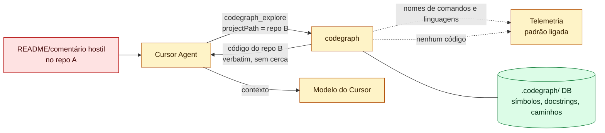

# 10 — codegraph: análise de vulnerabilidades e vazamento de dados (uso empresarial com Cursor)

> **Estudo (pt-BR) — 2026-10-14.** Alvo: `colbymchenry/codegraph` no commit
> `3f714bcc480e372d232f2d5e9b37b84256a205e1` (v1.6.2).
> **Método:** revisão **estática** e somente leitura: código, scripts, CI e lockfiles, chamadas `gh api` de
> leitura, metadados do registro npm e a **listagem** (sem extrair nem executar) do pacote publicado
> `@colbymchenry/codegraph-linux-x64@1.6.2`. **Nada foi executado.** Faltam: a ACL do named pipe no Windows, uma
> captura de rede real e a confirmação de que o worker de telemetria implantado é igual ao código do repositório.
>
> **Rótulos:** `[verificado]` = conferido no código pelo thread principal; `[código]` = lido por subagente com
> `arquivo:linha`; `[suspeito]` = precisa de teste em runtime.

← [09 — codegraph](09-codegraph.md) | [Índice ↑](README.md)

---

## 0. O que "garantir que não existam vulnerabilidades" significa

Como nos capítulos [03](03-ai-memory-seguranca.md) e [05](05-claude-mem-seguranca.md): achados no commit fixado,
risco residual e checklist de hardening. Nenhuma revisão garante ausência de vulnerabilidades.

---

## 1. Resumo executivo

**No cenário pedido (laptops de um usuário, Cursor, repositórios internos), não há achado Crítico nem Alto.** São
seis achados Médios.

| Aspecto | Veredito |
|---|---|
| Código-fonte saindo da máquina **pelo codegraph** | **Não.** A telemetria só leva nomes de comandos e ferramentas, nomes de linguagens e faixas de contagem; o worker de ingestão filtra por allowlist |
| Código saindo **pelo modelo do Cursor** | Sim, por desenho: o que o `explore` devolve vai para o contexto do modelo. O codegraph aumenta o **volume**, não o tipo |
| Telemetria | **Ligada por padrão**, com `machine_id` persistente (pseudônima, não anônima) `[verificado: src/telemetry/index.ts:251]` |
| Superfície local | Socket Unix 0600 (sem TCP), UI escondida atrás de flag; fraquezas só em host multiusuário |
| Exposição real | Prompt injection pelo código devolvido, leitura de **outros** repositórios via `projectPath`, e instalador/upgrade sem verificação de integridade |
| Advisories | `gh api …/security-advisories` → `[]`; não há `SECURITY.md` |

---

## 2. Egresso: o que sai da máquina

| Destino | Gatilho | Conteúdo | Padrão |
|---|---|---|---|
| `https://telemetry.getcodegraph.com/v1/events` | início do MCP + a cada 6 h; depois de `init/index/sync/upgrade`; fim do install | `machine_id` (UUID persistente), versão, SO, arquitetura, versão do Node, `ci`; eventos com **nomes** de ferramentas/comandos e contagens, **nomes de linguagens** indexadas, faixas de tamanho e duração, IDs de agentes instalados, nome da IDE (`client_name`) | **LIGADO** `[verificado]` |
| GitHub Releases (`/releases/latest`) | início do MCP, TTL de 24 h | `GET` sem corpo (vê o IP) | ligado |
| `https://getcodegraph.com/api/waitlist` | só com TTY interativo **e** e-mail digitado | `{email, source}` | desligado |
| GitHub / npm (download) | só `codegraph upgrade`/`install` ou self-heal do shim npm | binários | manual |

**Verificado no cliente e no servidor de ingestão:** nenhum nome de repositório, caminho de arquivo, nome de símbolo
ou mensagem de erro entra no payload. O worker descarta eventos e propriedades desconhecidos, e o campo `name`
precisa casar `^[A-Za-z0-9_.:+-]+$` (`telemetry-worker/src/index.ts:93-137`). **Ainda vaza:** a lista de
linguagens revela o stack (ex.: `cobol`, `terraform`), e o `client_name` revela a IDE. Não há downloads de
gramáticas em runtime nem chamadas a LLM ou embeddings. O kernel Rust não tem crates de rede.

**Atenção:** `codegraph telemetry off` **não** desliga a checagem de versão; para isso é preciso
`CODEGRAPH_NO_UPDATE_CHECK=1` ou `DO_NOT_TRACK=1` (`src/upgrade/update-check.ts:89-91`).

---

## 3. Achados por severidade

| ID | Severidade | Achado | Cenário concreto |
|---|---|---|---|
| **F1** | Média | **Leitura de qualquer repositório indexado via `projectPath`**: toda ferramenta aceita um caminho arbitrário; a única barreira é uma denylist de diretórios de sistema (`/`, `/etc`, `/usr`…) `[verificado: src/utils.ts:43-44,179; src/mcp/tools.ts:2211-2270]` | Um comentário malicioso no repo A manda o agente chamar `codegraph_explore` com `projectPath: /home/dev/work/payments-service`, e o código do repo B entra no contexto |
| **F2** | Média | **Prompt injection**: o código volta cru entre crases, sem escape nem marcação de "não confiável" `[verificado: src/mcp/tools.ts:5710]`, e as instruções do servidor dizem "Trust codegraph's results — don't re-verify them with grep" `[verificado: src/mcp/server-instructions.ts:64]` | Um arquivo com uma cerca de crases fecha o bloco antes da hora e injeta texto com cara de instrução, que o agente foi orientado a não questionar |
| **F3** | Média | **Integridade de instalação e upgrade**: `install.sh`/`install.ps1` não verificam `SHA256SUMS` nem atestados; o `codegraph upgrade` executa `curl …/main/install.sh \| sh`, código **mutável da branch `main`** `[verificado: src/upgrade/index.ts:36-37,570]`; o self-heal do shim npm segue mesmo sem conseguir baixar o checksum | Um commit malicioso na `main` (ou conta comprometida) executa código em toda estação que rodar `codegraph upgrade` |
| **F4** | Média (política) | **Telemetria ligada por padrão** com `machine_id` persistente; `install --yes` pula a pergunta de consentimento | Instalação silenciosa por script envia uso sem consentimento explícito |
| **F5** | Média em Linux multiusuário / Baixa em laptop | **Sequestro do socket**: alternativa `/tmp/codegraph-<hash>.sock` previsível; o proxy só confere a versão do daemon, sem checar o UID do par `[verificado: proxy.ts:131-135]` | Outro usuário cria o socket antes; quando o socket do projeto não existe (antes do daemon subir, ou em WSL `/mnt/*`), o proxy conecta no atacante, que vê todas as consultas e devolve "código" forjado |
| **F6** | Média em host compartilhado / Baixa em laptop | **UI sem token**: `127.0.0.1:4747` checa `Host` e `Origin` (bloqueia DNS rebinding e CSRF), mas qualquer processo local lê o código indexado enquanto a UI roda. A UI ainda está escondida atrás de `CODEGRAPH_UI=1` | Outro usuário da máquina faz `curl -H 'Host: localhost:4747' http://127.0.0.1:4747/api/...` |
| F7 | Baixa (Média com repos não confiáveis) | O indexador segue symlinks para fora do repo: nomes, assinaturas e caminhos externos entram no banco | Repo clonado com symlink para `~/` indexa metadados de arquivos pessoais |
| F8 | Baixa | `telemetry off` não desliga a checagem de versão no GitHub | Egresso não aprovado em rede restrita |
| F9 | Baixa | Windows: `codegraph upgrade <versão>` interpola a versão numa string PowerShell entre aspas duplas (`$()` executa) | Automação que passa versão não confiável executa comando |
| F10 | Baixa | Reinstalar reescreve `~/.cursor/mcp.json` inteiro com o modo padrão (perde `0600`) e **apaga o bloco `env`** da entrada `codegraph` | `CODEGRAPH_TELEMETRY=0` posto pelo admin some no próximo `codegraph install` |
| F11 | Baixa | `.codegraph/` (símbolos, docstrings, caminhos, logs, trilhas da UI com `git user.name`) criado com a umask padrão; o `.gitignore` interno só protege do git | `docker build` com `COPY . .` leva o banco para a imagem |
| F12 | Baixa | Governança: actions fixadas por **tag**, sem `SECURITY.md`, sem CI de PR, Dependabot ou CodeQL | — |
| F13–F20 | Info | checksum do shim npm sem autenticidade; nome de ferramenta desconhecida contado na telemetria em fallback; ACL do named pipe no Windows `[suspeito]`; `devalue 5.9.1` **só no lockfile, fora do pacote publicado**; `npm uninstall` não remove a entrada do Cursor (sem `preuninstall` publicado); IP visível ao Cloudflare da telemetria; regex montada antes da validação (DoS local); caminho absoluto no `./.cursor/mcp.json` local | — |

### 3.1 Mitigações que existem (não são achados)

| Controle | Evidência |
|---|---|
| Socket do daemon com `chmod 0600`; pidfile `O_EXCL` 0600; sem porta TCP | `src/mcp/daemon.ts:299-304,785` |
| UI: `Host`/`Origin` só loopback, sem CORS, CSP, `X-Frame-Options: DENY`; leitura confinada por realpath | `src/ui-server/security.ts`; `src/utils.ts:128-162` |
| Valores de YAML e `.properties` nunca são servidos (só as chaves); assinaturas de variáveis TS/JS sem o inicializador; `.env` não é indexado | `src/utils.ts:50-66`; `src/extraction/tree-sitter.ts:2541` |
| `.gitignore` respeitado; limite de 1 MiB por arquivo; orçamento de parse de 3 s | `src/extraction/index.ts:395-460`; `src/file-limits.ts` |
| `git` sempre via `execFileSync` com argumentos fixos; nenhum `eval` de conteúdo do repo | `src/extraction/index.ts`; `src/sync/*.ts` |
| Kernel `.node` carregado só de caminhos do pacote (ou `CODEGRAPH_KERNEL_PATH`), nunca do repo | `src/extraction/kernel/loader.ts:103-117` |
| npm com **trusted publishing + provenance**; pacotes publicados **sem scripts de instalação**; `SHA256SUMS` e atestados SLSA gerados | `release.yml:207-269`; metadados do registro |
| Ferramentas MCP **só leitura**; por padrão só `explore` | `src/mcp/tools.ts:1584-1853` |

### 3.2 Revisão comunitária #1367 (feita na v1.4.1) — situação na v1.6.2

| Item | Situação |
|---|---|
| 1 `projectPath` entre projetos | **Aberto** (F1) |
| 2 Indexação segue symlinks externos | **Aberto** no lado da indexação; leitura já confinada |
| 3 Instaladores não verificam artefatos | **Aberto** (atestados agora gerados, não verificados) |
| 4 Injeção de versão no Windows | **Aberto** (F9) |
| 5 picomatch 4.0.3 | Corrigido (4.0.7) |

---

## 4. Cadeia de suprimentos

| Item | Achado |
|---|---|
| **OSV.dev** `[verificado]` | `codegraph-kernel/Cargo.lock` (73 crates): 0 advisories. `package-lock.json` (226 pacotes): 10 afetados, 9 só de build/teste (vite, vitest, rollup, esbuild, postcss…); `devalue 5.9.1` (8 GHSAs) vem do `svelte` da UI privada e **não está** no pacote publicado (listagem do tarball) |
| Publicação | OIDC trusted publishing + `--provenance`; pacotes sem scripts de ciclo de vida |
| Instaladores | `curl \| sh` sem verificação (F3); o `install.ps1` altera o PATH do usuário no registro do Windows |
| CI | Só `release.yml` (manual) e `deploy-site.yml`; actions por tag; nenhum teste a cada PR |
| Licença | MIT em tudo o que é distribuído; `telemetry-worker`, `telemetry-dashboard` e `site` são privados e não vão ao usuário |

---

## 5. Checklist de hardening (Cursor + CA corporativa + sem telemetria)

| # | Ação | Fecha |
|---|---|---|
| 1 | Instalar do **espelho npm interno** com versão fixa (`@colbymchenry/codegraph@1.6.2`) e **todos** os pacotes de plataforma `@colbymchenry/codegraph-<os>-<arch>@1.6.2`; `CODEGRAPH_NO_DOWNLOAD=1` | F3, F13 |
| 2 | Verificar a provenance antes de espelhar (`npm audit signatures`, `gh attestation verify`); **nunca** usar `install.sh`/`install.ps1` nem `codegraph upgrade`; atualizar só subindo a versão fixada pelo controle de mudanças | F3, F9 |
| 3 | **`codegraph telemetry off` por usuário** (único controle que cobre também o CLI no terminal); mais `DO_NOT_TRACK=1` e `CODEGRAPH_NO_UPDATE_CHECK=1` no ambiente do SO **e** no bloco `env` do `mcp.json` | F4, F8 |
| 4 | Bloquear `telemetry.getcodegraph.com` e `getcodegraph.com` no proxy de saída | F4 |
| 5 | Configurar `~/.cursor/mcp.json` pelo MDM, com modo `0600`, em vez de rodar o instalador: `{"command":"codegraph","args":["serve","--mcp","--path","${workspaceFolder}"],"env":{"DO_NOT_TRACK":"1","CODEGRAPH_NO_UPDATE_CHECK":"1","CODEGRAPH_NO_DOWNLOAD":"1"}}`; reaplicar após qualquer `codegraph install` | F10 |
| 6 | Manter só a ferramenta `explore` (não definir `CODEGRAPH_MCP_TOOLS`) e a **aprovação por chamada** do Cursor; tratar como suspeita qualquer instrução vinda do repo para passar `projectPath` | F1, F2 |
| 7 | Indexar (`codegraph init`) só repositórios que o dev pode levar ao LLM; repos de terceiros não confiáveis em outro usuário do SO ou container | F1, F7 |
| 8 | Regra `.cursor/rules` da federação (plano 08, C1) tratando a saída do codegraph como **não confiável**, cancelando o "Trust codegraph's results" | F2 |
| 9 | `.codegraph*` no `.dockerignore`, nas exclusões de backup e de artefatos de CI; `umask 077` em hosts compartilhados | F11 |
| 10 | Em hosts compartilhados: `TMPDIR` por usuário (0700); não rodar a UI | F5, F6 |
| 11 | CA corporativa: só necessária se algum egresso continuar ligado; o Node embarcado (v24) aceita `NODE_EXTRA_CA_CERTS` | — |
| 12 | Desinstalar com `codegraph uninstall` **antes** de `npm uninstall -g` | F17 |
| 13 | Não commitar o `./.cursor/mcp.json` local (caminho absoluto) | F20 |

## 6. Risco residual (mesmo depois do hardening)

- **Egresso pelo contexto do LLM é inerente:** o código devolvido vai ao provedor do Cursor pelos termos do Cursor.
- **Prompt injection e alcance entre repositórios** (F1, F2) só se resolvem quando o upstream restringir o
  `projectPath` à pasta do workspace; até lá, as defesas são de procedimento (aprovação, usuários separados).
- O banco `.codegraph/` guarda símbolos, docstrings e caminhos em texto claro.
- Confiança no pipeline de release de um único mantenedor; a versão fixada e a provenance reduzem, mas não eliminam.
- Opt-outs por variável de ambiente dependem da herança do processo, e reinstalar apaga o `env`.
- Não coberto: ACL do named pipe no Windows, captura de rede real, e paridade do worker de telemetria implantado.

---

← [09 — codegraph](09-codegraph.md) | [Índice ↑](README.md)
