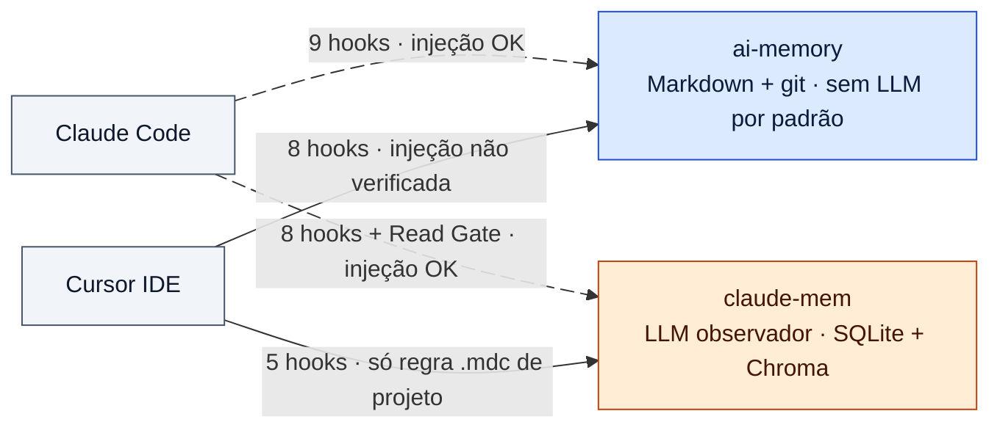

# Memória de longo prazo para agentes de código: ai-memory × claude-mem

> **Estudo (pt-BR) — 2026-10-14.** Pesquisa sobre os conceitos de memória para agentes, análise de arquitetura e de
> vulnerabilidades de [`akitaonrails/ai-memory`](https://github.com/akitaonrails/ai-memory) (commit `705aba7`, v3.0.0)
> e [`thedotmack/claude-mem`](https://github.com/thedotmack/claude-mem) (commit `fef3402`, v13.39.0), integração com
> **Claude Code** e **Cursor IDE**, e um comparativo para adoção, inclusive em contexto empresarial.
>
> **Método:** os dois repositórios foram clonados e lidos **estaticamente** (nada foi instalado nem executado). As
> fontes da literatura foram baixadas e cada citação foi conferida contra o texto da fonte. As vulnerabilidades
> conhecidas de dependências foram consultadas na OSV.dev. O veredito passou por uma revisão adversarial.

## Ordem de leitura

| # | Capítulo | Para quem |
|---|---|---|
| 01 | [Conceitos e estado da arte](01-conceitos-memoria-agentes.md) | Quem quer entender memória de agentes do zero |
| 02 | [ai-memory: conceitos, arquitetura e vantagens](02-ai-memory.md) | Avaliação técnica |
| 03 | [ai-memory: vulnerabilidades e vazamento](03-ai-memory-seguranca.md) | Segurança / compliance |
| 04 | [claude-mem: conceitos, arquitetura e vantagens](04-claude-mem.md) | Avaliação técnica |
| 05 | [claude-mem: vulnerabilidades e vazamento](05-claude-mem-seguranca.md) | Segurança / compliance |
| 06 | [Comparativo e recomendação](06-comparativo.md) | Decisão |
| 07 | [Integração com Cursor IDE e Claude Code](07-integracao-cursor-claude-code.md) | Quem vai instalar |
| 08 | [Plano: fork empresarial do ai-memory + codegraph + AWS Neptune](08-plano-fork-empresarial.md) | Quem vai implementar |
| 09 | [codegraph: conceitos e arquitetura](09-codegraph.md) | Avaliação técnica |
| 10 | [codegraph: vulnerabilidades e vazamento](10-codegraph-seguranca.md) | Segurança / compliance |

## Visão geral

## Quando usar cada um

| Situação | Escolha | Detalhe |
|---|---|---|
| Empresa que não pode vazar informação interna | **ai-memory**, endurecido | [03 §9](03-ai-memory-seguranca.md#9-checklist-de-hardening-para-ambiente-empresarial) |
| Time que alterna Claude Code e Cursor | **ai-memory** | [07](07-integracao-cursor-claude-code.md) |
| Dev solo, só Claude Code, código não sensível | **claude-mem** | [06 §3](06-comparativo.md#3-recomendação-por-cenário) |
| Host multiusuário | **ai-memory** com token em arquivo; **nunca** claude-mem | [05 §3](05-claude-mem-seguranca.md#3-exposição-do-worker-f2-f6) |

Placar ponderado (juízo sobre evidência de código, não benchmark): **ai-memory 3,20 × claude-mem 2,80**.

## Diagramas interativos (archify)

Os arquivos são HTML autônomos, com tema claro/escuro, zoom, busca e exportação. A interface fixa do visualizador está
em inglês; o conteúdo, em português.

| Diagrama | ai-memory | claude-mem |
|---|---|---|
| Arquitetura (Claude Code e Cursor como nós separados) | [ai-memory-arquitetura.html](html/ai-memory-arquitetura.html) | [claude-mem-arquitetura.html](html/claude-mem-arquitetura.html) |
| Sessão no Claude Code | [ai-memory-sessao.html](html/ai-memory-sessao.html) | [claude-mem-sessao.html](html/claude-mem-sessao.html) |
| Fluxo no Cursor IDE | [ai-memory-cursor.html](html/ai-memory-cursor.html) | [claude-mem-cursor.html](html/claude-mem-cursor.html) |

Do codegraph (capítulo 09): [codegraph-arquitetura.html](html/codegraph-arquitetura.html).

Do plano (capítulo 08): [arquitetura alvo](html/plano-arquitetura-alvo.html) · [ciclo de vida da âncora](html/plano-ancora.html) ·
[handoff em duas fases no Cursor](html/plano-cursor-handoff.html).

As especificações-fonte (`diagrams/*.json`) declaram `arquivo:linha` de cada componente. O archify confere essas
referências contra o checkout do commit fixado antes de renderizar.

## Apresentação

O [canvas de apresentação](https://claude.ai/artifact/Vdqp6H2VDwUDJJtPRtLzEp) (claude.ai Design, privado até ser compartilhado) tem 11 pranchas: capa e veredito, conceitos, as duas arquiteturas,
segurança, integração Cursor/Claude Code, comparativo, três pranchas do plano (arquitetura alvo, fork endurecido,
Âncora e roadmap) e a auditoria do codegraph.

**Cópia versionada no repositório:** [apresentacao/index.html](apresentacao/index.html) — todas as pranchas como HTML autônomo
(sem depender do claude.ai). Os fontes `.dc.html` ficam em [apresentacao/source/](apresentacao/source/), e
[`export_canvas.py`](apresentacao/export_canvas.py) regenera o HTML depois de qualquer alteração no canvas.
