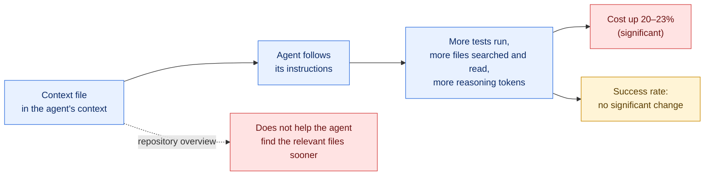

# Analysis: Evaluating AGENTS.md — Are Repository-Level Context Files Helpful for Coding Agents?

> **Status**: Current — rewritten 2026-10-11 against version 3 of the paper. It replaces an analysis of v1 (2026-02-01).
> **Source document**: [Gloaguen et al. (ETH Zurich / LogicStar.ai) — arXiv:2602.11988v3](https://arxiv.org/abs/2602.11988v3), posted 2026-09-29. Full text in this library: [`general-llm/Evaluating-AGENTS-paper.md`](../general-llm/Evaluating-AGENTS-paper.md).
> **Scope**: What the paper measured about context files (`AGENTS.md`, `CLAUDE.md`), what follows from it, and what does not.
>
> **Labels.** `[§n]` cites a section, table or appendix of the paper. `[inference]` marks a conclusion of this analysis that the paper does not state. Nothing here was re-measured.

---

## 1. Executive summary

A **context file** is a file such as `AGENTS.md` or `CLAUDE.md` that a coding agent loads into its context at the start of every task in a repository. Agent vendors recommend them and ship an `/init` command that writes one automatically. This paper is the first controlled test of whether they help an agent resolve real tasks.

The answer, in the authors' words: "context files don't improve coding agent performance, and should only contain specific additional instructions beyond what is already available in the codebase" `[§6]`.

Three things to hold on to:

1. **Success does not move.** Neither LLM-generated nor developer-written files change the success rate by a statistically significant amount `[§4.2, Table 3]`.
2. **Cost always rises.** Every kind of context file adds steps and cost, significantly `[§4.2, Table 6]`.
3. **The reason is obedience, not neglect.** Agents do what the file says. That extra work is what costs more `[§4.3]`.

## 2. What was tested

| | |
|---|---|
| **Agents and models** | Claude Code with Sonnet-4.5; Codex with GPT-5.2; Codex with GPT-5.1 mini; Qwen Code with Qwen3-30b-coder `[§4.1]` |
| **Benchmarks** | SWE-bench Lite: 300 tasks from 11 popular Python repositories, none with a developer context file. **CTXbench** (new): 138 tasks from 12 less-known Python repositories that all have one `[§4.1]` |
| **Settings** | **None** (no context file; developer files removed), **LLM** (generated with each agent's own recommended init command), **Dev** (the developer's committed file; CTXbench only) `[§4.1]` |
| **Metrics** | Success rate (the patch makes all tests pass), number of steps, inference cost `[§4.1]` |
| **Runs** | One sample per agent per task; temperature 0 except Qwen `[§4.1]` |

How CTXbench was built `[§3.2]`: repositories with a root context file, Python as the main language, a test suite and at least 400 pull requests; then per pull request an LLM agent set up the environment, rewrote the task description into a standard six-section form, and generated the unit tests. The authors reviewed every instance and hand-edited the tests of 25 of the 138 to remove over-specification `[Appendix C]`.

The benchmark was called AGENTbench in v1. One table in v3 labels it "Plan-Bench" `[Table 5]`, which reads as a leftover name.

## 3. Findings

### 3.1. Success rate: no significant effect

Success rates in percent, from `[Table 5]`:

| Benchmark | Setting | Sonnet-4.5 | GPT-5.2 | GPT-5.1 mini | Qwen3-30B |
|---|---|---|---|---|---|
| SWE-bench Lite | None | **59.9** | **56.6** | **47.7** | 31.1 |
| | LLM | 58.7 | 54.4 | 47.6 | **32.4** |
| CTXbench | None | **73.2** | 65.2 | 54.3 | 45.7 |
| | LLM | 65.2 | **68.1** | 50.7 | 47.1 |
| | Dev | 70.3 | **68.1** | **55.8** | **53.6** |

Significance of the differences (two-sided Cochran-Mantel-Haenszel test) `[Table 3]`:

| Comparison | Average change | p-value | Significant? |
|---|---|---|---|
| SWE-bench: None vs LLM | −0.5% | 0.87 | No |
| CTXbench: None vs LLM | −2% | 0.37 | No |
| CTXbench: None vs Dev | +2.4% | 0.21 | No |
| CTXbench: LLM vs Dev | Dev better | **0.038** | Yes |

Read plainly:

- **LLM-generated files** lowered success in 5 of the 8 model-and-benchmark settings, but the average drop is within noise `[§4.2]`.
- **Developer-written files** raised it slightly, also within noise. They helped every agent **except Claude Code** `[§4.2]`.
- **The one significant result on success** is that developer-written files beat LLM-generated ones. The introduction quantifies that gap as "7% on average" `[§1]`.

For Claude Code specifically, both kinds of file scored below no file at all on CTXbench: 73.2 with none, 70.3 with the developer's, 65.2 with the generated one `[Table 5]`. That is one model, one sample per task, and standard errors near 4 points, so it is a pattern to note, not a proven effect `[inference]`.

### 3.2. Cost and steps: a significant increase, every time

| File type | Extra steps (average) | Cost | Source |
|---|---|---|---|
| LLM-generated | +2.45 (SWE-bench), +3.92 (CTXbench) | **+20%** and **+23%** | `[§4.2]` |
| Developer-written | +3.34 | up to +19% | `[§4.2]` |

All six comparisons of steps and cost are statistically significant under stratified permutation tests `[Table 6]`. The paper's summary: "all context files consistently increase the cost and number of steps required to complete tasks" `[§6]`.

### 3.3. Why: agents follow the file

The paper analysed the agents' traces `[§4.3, Appendix A.2]`:

- **Named tools get used.** `uv` was called 1.6 times per task when the context file mentioned it and fewer than 0.01 times when it did not. Repository-specific tools: 2.5 times against fewer than 0.05.
- **More of everything.** With a context file present, agents ran more tests, searched and read more files, wrote more files, and ran more code-quality checks.
- **More thinking.** Reasoning tokens rose by 22% (GPT-5.2) and 10% (GPT-5.1 mini) on SWE-bench with LLM-generated files, and by 14% and 10% on CTXbench. Developer files: +20% and +2%.

The authors' conclusion from this: "the absence of improvements when using context files is not due to a lack of instruction-following capabilities" `[§4.3]`. Their hypothesis is that the extra instructions "make the task harder".

### 3.4. Overviews do not help the agent navigate

A codebase overview is the most commonly recommended section. 8 of the 12 developer files had one, and between 95% and 100% of the files generated by Sonnet-4.5, GPT-5.2 and Qwen3 had one (GPT-5.1 mini: 36%) `[§4.3]`.

The test: how many steps pass before the agent first touches a file that the real fix modified? With a context file, that number did not meaningfully fall for any agent on either benchmark. For GPT-5.1 mini it rose significantly, because the model kept issuing commands to find and re-read context files that were already in its context `[§4.3]`.

"We conclude that context files are not effective at providing a repository overview" `[§4.3]`.

### 3.5. Generated files are redundant with the documentation

This is the paper's explanation for the developer-versus-generated gap, and its most useful experiment `[Appendix B]`.

The authors deleted all documentation from the repositories (Markdown files, example code, `docs/`) and re-ran the test without Claude Code. With the context file as the only documentation left:

- LLM-generated files **improved** success by 2.7% on average, and
- they **outperformed** developer-written files.

So a generated file mostly restates what the repository's documentation already says. It helps when that documentation is missing and adds only cost when it exists. The authors suggest this explains the anecdotes of agents doing better after a context file is added: "many less popular repositories contain little to no documentation" `[Appendix B]`.

### 3.6. What does not rescue generated files

| Idea | Result | Source |
|---|---|---|
| Use a stronger model to write the file | +2% on SWE-bench, −3% on CTXbench. "Stronger models do not necessarily generate superior context files." | `[§4.4]` |
| Use a different vendor's generation prompt | No prompt was consistently best. | `[§4.4]` |
| Make the file shorter or longer | "No clear dependency" between length and success or cost. | `[Appendix B]` |
| Remove one category (overview, tooling, or testing) | No category had a significant effect on accuracy. Removing the **testing** section cut cost significantly on both benchmarks; removing **tooling** cut it on SWE-bench. | `[Appendix B, Table 7]` |

The last row matters for cost: the instructions that make agents run tests are the ones that cost most, and removing them did not reduce accuracy in this benchmark.

### 3.7. Robustness checks

- **Contamination.** Splitting CTXbench by whether each task predates the model's knowledge cutoff showed "no significant or consistent difference" `[Appendix B]`.
- **Per repository.** No single repository showed a significant effect of context files `[Appendix A.3]`.
- **Developer files are really human.** They are shorter than generated ones and score as far less likely to be AI-written on a detection model `[Appendix C]`.
- **Rewritten task descriptions.** Applying the CTXbench description pipeline to SWE-bench raised accuracy by about 15% while preserving model rankings, which the authors read as "slightly easier but fairer" `[Appendix C, Table 8]`.

## 4. What the paper does not show

Easy to over-read. Each point is a limit of the evidence.

1. **It does not say context files are useless.** The abstract keeps a role for them: "useful for specifying non-standard coding practices". The trace analysis shows instructions are followed, so a file is an effective way to make an agent use a specific tool or convention.
2. **"No significant effect" is not "proven zero effect".** One sample per task and 138 tasks leave wide error bars (about ±4 points per cell on CTXbench). A real effect of a few points in either direction would not be detected `[inference]`.
3. **It measures task resolution only.** Not code quality, security, maintainability or adherence to conventions, which are the things a context file is usually written for. The authors name efficiency and security as future work `[§5]`.
4. **It is Python only.** The authors note that Python tooling may already be in the models' parametric knowledge, "nullifying the effect of context files", and that niche languages may differ `[§5]`.
5. **The models are a generation old.** Sonnet-4.5, GPT-5.2, GPT-5.1 mini, Qwen3. Nothing here was measured on current models.
6. **The Claude Code setup has changed.** In the paper, Claude Code's `Task` tool let Sonnet-4.5 call Haiku-4.5 subagents `[Appendix A.1]`. Today the tool is called `Agent` and built-in subagents use the main conversation's model ([sub-agents docs](https://code.claude.com/docs/en/sub-agents)).
7. **Tests and task descriptions were LLM-generated**, then reviewed by the authors, with average test coverage of 75% of the modified code `[Table 1]`.
8. **Only a single always-loaded file was tested.** Path-scoped rules, skills loaded on demand and hooks were not. Conclusions about those are inference.
9. **More testing is counted as cost, not as value.** The benchmark rewards a passing patch. It cannot credit an agent for running extra tests that would catch a regression elsewhere `[inference]`.

## 5. When a context file earns its cost

Drawn from the findings above. The first column is evidence; the framing as guidance is `[inference]`.

| Situation | What the paper shows | Guidance |
|---|---|---|
| The repository has little or no documentation | Generated files improved success by 2.7% when documentation was removed `[Appendix B]` | A context file helps. Better still, write the documentation. |
| There is a non-standard tool or command | Named tools are used almost only when the file mentions them `[§4.3]` | Name it. This is the clearest use. |
| There is a convention or constraint not visible in the code | Instructions are followed `[§4.3]`; the abstract endorses this use | State it, briefly. |
| The repository is well documented | Generated files restate the documentation `[Appendix B]` | Do not add a generated file. |
| You want the agent to find its way around | Overviews did not reduce steps to the relevant files `[§4.3]` | Leave the overview out. |
| You want "always run the full test suite" | Testing instructions significantly raised cost with no accuracy gain here `[Table 7]` | Keep it only if you value the extra checking for reasons this benchmark does not measure. |

## 6. Applicability to agent infrastructure

Everything in this section is `[inference]`: the paper tested one always-loaded file, not these mechanisms.

- **`CLAUDE.md` / `AGENTS.md`.** The paper's direct subject. Its conclusion maps onto the current vendor guidance to keep the file short and put the rest in path-scoped rules and skills ([memory docs](https://code.claude.com/docs/en/memory)).
- **Skills and path-scoped rules.** The cost in the paper comes from instructions that are always loaded and always followed. A mechanism that loads an instruction only when it is relevant avoids paying that cost on unrelated tasks. This is a plausible reading, not a result: the paper measured no on-demand mechanism.
- **Hooks.** If an instruction exists to guarantee an action (format, lint, run a check), a hook performs it deterministically without spending the model's reasoning on deciding to. The paper's finding that instruction-following consumes reasoning tokens `[§4.3]` is consistent with moving such instructions out of prose.
- **Subagents.** The paper says nothing about them beyond noting Claude Code could delegate to Haiku-4.5 `[Appendix A.1]`. No conclusion about subagent prompts follows from it.
- **Memory.** Auto-written memory is a generated context file by another name. The redundancy finding `[Appendix B]` suggests the same test: record what cannot be found in the repository, not a summary of it.
- **Evaluation.** The authors' own recommendation generalises best: "any attempts to improve performance should be rigorously evaluated before deployment" (abstract). A change to a context file is a change to the agent's behaviour and cost on every task.

## 7. Correlations with other documents in this library

| Document | Relation |
|---|---|
| [`analysis/state-of-practice-2026-10.md`](state-of-practice-2026-10.md) §5 | Summarises this paper's v3 findings alongside the other October 2026 evidence. |
| [`claude-code/memory/how-claude-remembers-a-project.md`](../claude-code/memory/how-claude-remembers-a-project.md) | Vendor guidance on file size and scoping; consistent with "only what the codebase does not already say". |
| [`general-llm/a-guide-to-agents.md`](../general-llm/a-guide-to-agents.md) | Recommends minimal files and warns against auto-generation. The paper supports "minimal" directly. On auto-generation it shows no benefit and added cost, and that developer files beat generated ones. |
| [`software-factory/03-matt-pocock-skills-v1-3.md`](../software-factory/03-matt-pocock-skills-v1-3.md) | The `retro` skill and `writing-for-agents` reach the same rule from practice: keep always-loaded files to pointers, hunt no-ops, and move mechanical rules into deterministic checks. |
| [`context-engineering/agents-md-is-a-liability-paddo.md`](../context-engineering/agents-md-is-a-liability-paddo.md) | An opinion piece arguing the same direction; this paper is the evidence, with the caveats in section 4. |

On 2026-10-11 the other analyses in this folder that cite the study were updated to these v3 figures. Third-party articles elsewhere in the library that quote an earlier version keep their original text and carry a currency note with the v3 figures.

## 8. Strengths and limitations of the paper

**Strengths**

1. **A controlled comparison.** Same tasks, same agents, three settings, with developer files removed for the baseline.
2. **A benchmark built for the question.** SWE-bench repositories have no developer context files; CTXbench repositories all do.
3. **Significance tests**, added since v1, which turn "tends to reduce" into "no significant effect" and make the cost finding firm.
4. **A mechanism, not only an outcome.** Trace analysis shows *why* cost rises, and the documentation-removal experiment shows *why* generated files underperform.
5. **Ablations that close the obvious escapes**: stronger generator, different prompt, length, categories, contamination.
6. **Prompts published** in the appendix.

**Limitations**

1. Python only; one sample per task; 138 tasks in the new benchmark.
2. Task resolution is the only outcome measured.
3. Tests and task descriptions are LLM-generated (reviewed, 25 hand-corrected).
4. Models and one agent's configuration are no longer current.
5. One monolithic file per repository; no on-demand or path-scoped context.
6. The CTXbench repositories adopted context files recently (the format was formalised in August 2025), so the developer files may not reflect mature practice `[§3.2]`.

## 9. Practical recommendations

Ordered by how directly the paper supports them.

**Supported by the paper**

1. **Do not add a generated context file to a documented repository.** It restates the documentation, changes success by nothing measurable and adds about 20% to cost `[§4.2, Appendix B]`. The authors: "we therefore suggest omitting LLM-generated context files for the time being" `[§1]`.
2. **Write only what the repository does not already say.** Human-written files "should only include instructions required for coding agents that are not already present in the README (e.g., specific conventions or non-functional requirements)" `[§1]`.
3. **Leave out the codebase overview.** It did not help agents find the relevant files `[§4.3]`.
4. **Name non-standard tools explicitly.** This is where the file demonstrably changes behaviour `[§4.3]`.
5. **Measure before and after.** Treat every instruction as a cost on every task, and check that it buys something `[abstract]`.

**Reasonable inferences**

6. **If a repository has no documentation, fix that first.** A context file helps in that case, but so would a README that humans can also read.
7. **Move instructions that must always happen into hooks or CI**, and instructions that apply to part of the codebase into path-scoped rules or skills.
8. **Re-test when the model changes.** The result is tied to four model-and-agent pairs from late 2025; a newer model may follow, ignore or need these files differently.

**Not supported, despite being widely repeated**

- A specific word or line limit. The paper found no relation between length and outcome `[Appendix B]`.
- "Context files hurt performance." The measured drop for generated files is not significant, and developer files trend slightly positive.
