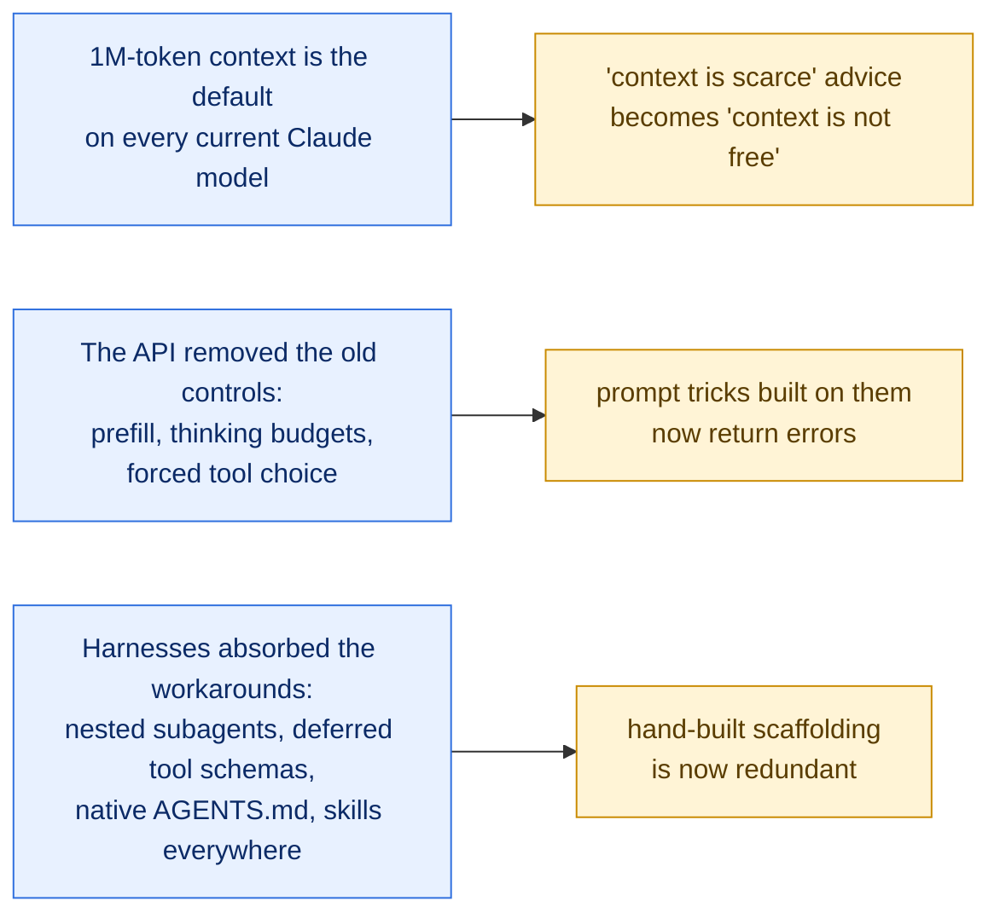

# State of practice, October 2026 — what in this library still holds

> **Written 2026-10-11**, as the summary of a currency audit of every document under `ai/docs/`. Most of the library was captured between March and May 2026, one to two model generations ago.
>
> **How to read it.** Each claim carries the source that supports it. The audit was done by parallel research agents working from primary sources (vendor docs fetched as raw markdown, papers, the original posts); their per-file findings are in the `Currency check` or `Revision` block at the top of each audited file. Items no agent could confirm are listed under [Not verified](#6-not-verified), not folded into the conclusions.
>
> **Where the detail lives.** Models: [models/claude-5-5-model-selection.md](../models/claude-5-5-model-selection.md). Factory design: [software-factory/05-unified-factory-study.md](../software-factory/05-unified-factory-study.md).

## 1. The short version

Three things changed underneath the library, and most of what went stale follows from them.

What did **not** change is the principle under all of it: put the smallest set of high-signal tokens in front of the model, separate the worker from the judge, and prefer a deterministic check to a model's opinion.

## 2. Still makes sense

| # | Practice | Why it still holds | Source |
|---|---|---|---|
| 1 | **Curate context instead of filling it.** | Context rot is documented by the vendor even with 1M windows. More context is not automatically better. | [Context windows](https://platform.claude.com/docs/en/build-with-claude/context-windows), [Effective context engineering](https://www.anthropic.com/engineering/effective-context-engineering-for-ai-agents) |
| 2 | **Progressive disclosure.** | It became the default packaging: a skill's description is always loaded, its body only on use. Keep `SKILL.md` under 500 lines. | [Skills](https://code.claude.com/docs/en/skills) |
| 3 | **Short instruction files.** | `CLAUDE.md` under 200 lines, the rest in path-scoped rules and skills. Context files raise inference cost by over 20% on average without generally improving task success. | [Memory](https://code.claude.com/docs/en/memory), [Gloaguen et al., v3](https://arxiv.org/abs/2602.11988v3) |
| 4 | **Use context files for non-standard practices, not repository overviews.** | Agents follow the instructions in them; overviews "are not helpful". This holds for LLM-generated and developer-committed files alike. | [Gloaguen et al., v3](https://arxiv.org/abs/2602.11988v3) |
| 5 | **Long documents first, the question last.** | Still Anthropic's guidance ("up to 30 percent" better). | [Prompting best practices](https://platform.claude.com/docs/en/build-with-claude/prompt-engineering/claude-prompting-best-practices) |
| 6 | **XML tags to separate instructions, context, examples and inputs.** | Unchanged guidance. | same |
| 7 | **3–5 examples in `<example>` tags.** | "Multishot examples work with thinking." | same |
| 8 | **Plain language over "CRITICAL: You MUST".** | Current models over-react to emphasis. | same |
| 9 | **Say what to do, broadly ("think thoroughly"), not a step list.** | Explicit chain-of-thought scaffolding is redundant with adaptive thinking. | same |
| 10 | **Start a fresh context with state on disk, in preference to compacting.** | Still recommended; an append-only log outside the window is the source of truth. | same, [Managed agents](https://www.anthropic.com/engineering/managed-agents) |
| 11 | **Subagents for context isolation**, not for role-play. | Their value is a clean window and a narrow brief. | [Subagents](https://code.claude.com/docs/en/sub-agents) |
| 12 | **Separate the evaluator from the generator; keep a planner.** | Self-evaluating agents praise mediocre work. | [Harness design for long-running apps](https://www.anthropic.com/engineering/harness-design-long-running-apps) |
| 13 | **Deterministic sensors (tests, types, linters) before model judges.** | Böckeler's computational-vs-inferential split. | [Harness engineering](https://martinfowler.com/articles/harness-engineering.html) |
| 14 | **A human reviews before code is written, and reads the code in small slices.** | HumanLayer's revised position keeps both. | [wsff.md](https://github.com/humanlayer/advanced-context-engineering-for-coding-agents/blob/main/wsff.md) |
| 15 | **The critique of spec-driven tooling**: review fatigue, one heavy workflow for every size of change. | Unchanged, and echoed by Matt Pocock's "they take away your control". | [Böckeler on SDD tools](https://martinfowler.com/articles/exploring-gen-ai/sdd-3-tools.html) |

## 3. No longer makes sense

### Rejected by the API

These used to be techniques. On current models they return HTTP 400.

| Old advice | Now | Source |
|---|---|---|
| Prefill the assistant turn to force a format | Rejected on Claude 4.6 and later. Use structured outputs or a system-prompt instruction. | [Prompting best practices](https://platform.claude.com/docs/en/build-with-claude/prompt-engineering/claude-prompting-best-practices) |
| Set a thinking budget (`budget_tokens`), or disable thinking | Rejected on Claude 4.7 and later; thinking cannot be disabled on Opus 5.5. Use adaptive thinking and `effort`. | [What's new in Opus 5.5](https://platform.claude.com/docs/en/models/opus-5-5/whats-new-opus-5-5) |
| Force a tool with `tool_choice: any` / `tool` | Rejected on Opus 5.5 and Sonnet 5.5. Use `auto` with strict tools, or structured outputs. | same |
| "Structured outputs are beta" | Generally available through `output_config.format`. | [Structured outputs](https://platform.claude.com/docs/en/build-with-claude/structured-outputs) |
| Ask for reasoning inside `<thinking>` tags | May be declined on Fable 5.1, Opus 5.5, Sonnet 5.5. | Prompting best practices |
| "think hard" / "think harder" keywords | Only `ultrathink` is recognized. | [Model config](https://code.claude.com/docs/en/model-config) |

### Overtaken by the 1M default

| Old advice | Now | Source |
|---|---|---|
| Budget for a 200K window; 1M is an opt-in variant | 1M is the default on every current model. | [Models overview](https://platform.claude.com/docs/en/about-claude/models/overview) |
| "The dumb zone starts at 40% of the window" | HumanLayer now warns at a **fixed ~100K tokens**, not a percentage. | [Long context isn't the answer](https://www.hlyr.dev/blog/long-context-isnt-the-answer) |
| Claude Code compacts at 83.5% | Native-1M models compact at about 967K. | [Model config](https://code.claude.com/docs/en/model-config) |
| Flat per-token pricing at any length | Haiku 5.5 reprices the whole request at 5× above 100K prompt tokens. | [Pricing](https://platform.claude.com/docs/en/about-claude/pricing) |
| Mandatory context resets between phases | Dropped once the model stopped showing "context anxiety" (Opus 4.5). | [Harness design](https://www.anthropic.com/engineering/harness-design-long-running-apps) |
| The model knows how much context it has left | No budget tags on Opus 4.7 and later, Sonnet 5.5, Haiku 5.5, Fable. | [Context windows](https://platform.claude.com/docs/en/build-with-claude/context-windows) |
| Lost-in-the-middle as a fixed U-shaped curve | Depends on how full the window is; the original studies used 8K–16K models. | [arXiv 2508.07479](https://arxiv.org/abs/2508.07479) |
| "Put reference data in the middle" | Was never Anthropic's advice; corrected in two of our own syntheses. | Prompting best practices |

Note the direction of the second row: the advice did not go away, it got **stricter in absolute terms**. A 40% rule on a 1M window would allow 400K tokens; the revised warning is at 100K.

### Absorbed by the harness

| Old advice | Now | Source |
|---|---|---|
| Subagents cannot spawn subagents | Three layers by default (`CLAUDE_CODE_MAX_SUBAGENT_SPAWN_DEPTH`), background by default, up to 20 concurrent. | [Subagents](https://code.claude.com/docs/en/sub-agents) |
| MCP tool schemas are dead weight at startup | Deferred by default. | [Context window](https://code.claude.com/docs/en/context-window) |
| Claude Code needs a `CLAUDE.md` symlink to read `AGENTS.md` | Read natively since v2.1.277 when no `CLAUDE.md` exists. | [Memory](https://code.claude.com/docs/en/memory) |
| "Explore runs on Haiku"; aliases map to 4.5/4.6 | Explore uses the main model; aliases resolve to 5.5 on the Anthropic API (and to older models on other providers). | [Subagents](https://code.claude.com/docs/en/sub-agents), [Model config](https://code.claude.com/docs/en/model-config) |
| "`max` effort is Opus 4.6 only" | `xhigh` and `max` are broadly available; defaults differ per model. | Model config |
| Skill descriptions cost 2% of the window | The listing budget is 1%, 1,536 characters per entry. | [Skills](https://code.claude.com/docs/en/skills) |
| 22 hook events, four handler types | 33 events, five handler types (`mcp_tool` added). A timed-out `PreToolUse` hook no longer blocks unless `onFailure: "block"`. | [Hooks](https://code.claude.com/docs/en/hooks) |

### Superseded by their own authors

| What | Now | Source |
|---|---|---|
| Research-Plan-Implement (RPI) as originally published, including "review the plan, not the code" | HumanLayer published "Everything We Got Wrong About RPI" and moved toward a longer sequence and reading the code. | [HumanLayer resources](https://www.humanlayer.com/blog/humanlayer-resources) |
| The HumanLayer / CodeLayer repository architecture | Its README calls the code "pretty much all deprecated". | [humanlayer/humanlayer](https://github.com/humanlayer/humanlayer) |
| Sprint decomposition and per-sprint evaluation in Anthropic's long-running harness | Dropped with Opus 4.6; the planner and one end-of-run evaluator pass remain. | [Harness design](https://www.anthropic.com/engineering/harness-design-long-running-apps) |
| `anthropic-cookbook` | Renamed `claude-cookbooks`, with new agent-SDK, managed-agents and skills directories. | [anthropics/claude-cookbooks](https://github.com/anthropics/claude-cookbooks) |
| Tessl as a spec-as-source tool; GSD's original repo | Tessl repositioned as an "agent enablement platform"; the GSD repo was archived 2026-06-26. | [tessl.io](https://www.tessl.io/), [gsd-build/get-shit-done](https://github.com/gsd-build/get-shit-done) |
| Matt Pocock's `CONTEXT.md`, `to-prd`, `to-issues`, `resolving-merge-conflicts` | `GLOSSARY.md`, `to-spec`, `to-tickets`; the merge-conflict skill was removed. | [03 — Matt Pocock skills](../software-factory/03-matt-pocock-skills-v1-3.md) |

### Protocols and API surfaces that moved

| Old claim in the library | Now | Source |
|---|---|---|
| The latest MCP spec is 2025-11-25 | Revision **2026-07-28**. The protocol is now stateless: the `initialize` handshake, protocol sessions, `Mcp-Session-Id` and SSE resumability are removed; `server/discover` is added. | [MCP changelog](https://modelcontextprotocol.io/specification/2026-07-28/changelog) |
| Servers send sampling, elicitation and roots requests to the client | Replaced by Multi Round-Trip Requests. Roots, Sampling and Logging are deprecated; HTTP+SSE is formally deprecated. | same |
| MCP auth uses Dynamic Client Registration | Deprecated in favour of Client ID Metadata Documents. An Enterprise-Managed Authorization extension is stable. | same, [MCP blog](https://blog.modelcontextprotocol.io/posts/enterprise-managed-auth/) |
| "Skills versus MCP" as competing options | Skills over MCP is an **official extension** (SEP-2640, final 2026-09-13), built on Resources with `skills/list` and `skills/get`. Client support is still partial. | [SEP-2640](https://modelcontextprotocol.io/seps/2640-skills-extension) |
| A2A is at v0.3; Agent Cards live at `agent.json` | A2A is v1.0.x (since 2026-03-12), with renamed operations and three bindings; cards live at `/.well-known/agent-card.json`. ACP was archived and folded into A2A. | [A2A v1](https://github.com/a2aproject/A2A/blob/main/docs/whats-new-v1.md), [ACP](https://github.com/i-am-bee/acp) |
| Programmatic tool calling is beta and saves 80%+ of tokens | Generally available; Anthropic's own measurement is 20–40%. | [Programmatic tool calling](https://platform.claude.com/docs/en/agents-and-tools/tool-use/programmatic-tool-calling) |
| Tool search is `"type": "tool_search"` | The types are `tool_search_tool_regex_20251119` and `tool_search_tool_bm25_20251119`, used with `defer_loading`. | [Tool search](https://platform.claude.com/docs/en/agents-and-tools/tool-use/tool-search-tool) |
| Tool names are limited to 64 characters; `output_format` sets structured output | The limit is 128; `output_format` now returns 400 without the old beta header. | [Define tools](https://platform.claude.com/docs/en/agents-and-tools/tool-use/define-tools), [Structured outputs](https://platform.claude.com/docs/en/build-with-claude/structured-outputs) |

Unchanged: the agentskills.io standard is essentially the same as in May, and the MCP Registry is still in preview.

### Captures removed for not matching their sources

Four files in `mcp/` were deleted on 2026-10-11 because their content could not be traced to the source they named. They remain in git history only.

| Removed file | Why | What to read instead |
|---|---|---|
| `skills-over-mcp-meeting-notes-2248.md`, `skills-over-mcp-office-hours-2460.md` | The attendees, action-item owners and several decisions in the files do not appear in the GitHub discussions they cite. | [SEP-2640](https://modelcontextprotocol.io/seps/2640-skills-extension) and the [Skills extension overview](https://modelcontextprotocol.io/extensions/skills/overview) |
| `skills-vs-mcp-speakeasy.md` | A reconstruction: of 25 sentences sampled, 1 appears on the live article. | The article itself: <https://www.speakeasy.com/blog/skills-vs-mcp> |
| `long-live-mcp-aws.md` | No source article; its own header said the content was "compiled from web search". | The [MCP 2026-07-28 changelog](https://modelcontextprotocol.io/specification/2026-07-28/changelog) |

## 4. The pattern behind the list

The most useful single idea from the audit is Anthropic's own, from the long-running-harness post: **every component of a harness encodes an assumption about what the model cannot do alone, and those assumptions go stale.** Context resets, sprint decomposition, percentage-based context zones, anti-nesting rules and hand-rolled tool loading were each correct when written and are each now overhead.

Two cautions keep that from becoming "delete everything":

- **It is not monotonic simplification.** The same post says the space of useful harness designs *moves* as models improve; it does not simply shrink. Its first harness cost over 20× a single agent, and the evaluator earned its cost only on tasks beyond what the model did reliably alone.
- **The evidence is thin and a generation old.** The ETH study (v3) tested Sonnet-4.5 and GPT-5.2-era agents on 438 tasks. The harness post is one team's report on one harness, built on Opus 4.5 and 4.6. Neither has been rerun on the 5.5 family.

So the working rule for anything built on this library: **make each piece of scaffolding a switch you can turn off, and re-test it when the model changes.**

## 5. The ETH Zurich AGENTS.md study

The study this library cites most on context files is Gloaguen et al., *Evaluating AGENTS.md*. Only its current version is used here: **v3, posted 2026-09-29** ([arXiv 2602.11988v3](https://arxiv.org/abs/2602.11988v3)). The full text is in [`general-llm/Evaluating-AGENTS-paper.md`](../general-llm/Evaluating-AGENTS-paper.md); section numbers below refer to it.

**What was tested** (§4.1): four agent and model pairs (Claude Code with Sonnet-4.5, Codex with GPT-5.2 and with GPT-5.1 mini, Qwen Code with Qwen3-30b-coder), on SWE-bench Lite (300 tasks, no developer context files) and the paper's own CTXbench (138 tasks from 12 repositories that do have them). Three settings: no context file, an LLM-generated one, a developer-provided one.

| Finding | Evidence in the paper |
|---|---|
| **LLM-generated files do not change success.** | Success fell in 5 of 8 settings, by 0.5% on SWE-bench and 2% on CTXbench on average; neither is significant (p = 87% and 37%). §4.2 |
| **Developer-provided files do not change it significantly either.** | +2.4% on average (p = 21%). They do significantly outperform LLM-generated ones (p = 3.8%), and help every agent except Claude Code. §4.2 |
| **Every context file costs more.** | LLM-generated: more steps in every setting and a significant cost increase of 20% and 23%. Developer-provided: 3.34 more steps on average, cost up by at most 19%. §4.2 |
| **Agents follow them.** | Instructions "are generally followed and lead to more testing and broader exploration". §6 |
| **They do not work as overviews.** | Context files "do not function as effective repository overviews"; they do not meaningfully reduce the steps an agent needs to reach the relevant files. §4.3, §6 |
| **A stronger model does not write a better file.** | Files generated by stronger models helped on SWE-bench (2%) and hurt on CTXbench (3%). §4.4 |
| **The generation prompt, the file's length and its instruction categories do not matter much.** | §4.4 and Appendix B |

The paper's conclusion (§6): context files "should only contain specific additional instructions beyond what is already available in the codebase."

What this means for an instruction file: keep it to what an agent cannot infer from the repository (non-standard commands, conventions, constraints), leave out descriptions of the codebase, and measure before assuming a longer file helps.

One limit to keep in view: the models are a generation old. The paper has not been rerun on the 5.5 family.

## 6. Not verified

No agent could confirm these, and they should not be repeated as fact:

- Any replication of lost-in-the-middle, or any long-context retrieval score, on 5.5-generation models.
- Whether native-1M models still show the instruction-following drop HumanLayer reported.
- A rerun of the ETH context-file study on 2026 models.
- The "150–200 instructions" budget attributed to HumanLayer, and the "15–20% boost from XML tags".
- OpenAI's harness-engineering post (returned HTTP 403), and the expansion of HumanLayer's newer acronym.
- Star counts and "top marketplace" tables in the Claude Code skills-format research file.

## 7. What was done to the library

| Area | Files | Treatment |
|---|---|---|
| `claude-code/`, `claude/` | 12 | 8 re-mirrored verbatim from `code.claude.com` / `platform.claude.com`; 1 repaired (truncated tail restored); 3 marked with currency blocks (two are superseded duplicates of the prompting page). |
| `cursor/` | 13 | 11 re-mirrored verbatim (`cursor.com/docs/<page>.md` now serves raw markdown); 1 currency block; index rewritten. |
| `general-llm/` and 5 analyses | 15 | Our own syntheses: corrected inline as `~~old~~ → new [source]`, with a `Revision` block. |
| `context-engineering/`, `harness-engineering/`, `agentic-engineering/`, `spec-driven-development/`, `long-context-research/`, `human-layer-project/` | 27 | Third-party snapshots: body untouched, `Currency check` verdict added. 4 Current, 20 Partially outdated, 2 Superseded, 1 Obsolete. |
| `shared/`, `structured-outputs/`, `tool-calling/`, `mcp/`, `agent-protocols/` | 38 audited, 34 kept | 14 re-mirrored verbatim (agentskills.io pages, skill authoring guide, structured-output and tool-use pages, MCP spec revision 2026-07-28 index and changelog, two MCP READMEs); third-party pieces given a `Currency check`; 4 captures that did not match their sources deleted (see section 3); indexes rewritten. Four sources could not be opened (DZone, optinampout, Reddit, PMC). |
| `analysis/` (Claude Code-related) | 10 | `Currency check` block listing the findings each analysis got wrong against today's docs. |
| `software-factory/`, `models/` | new | Written in this pass. |

Limits of the audit, stated by the agents that ran it: the synthesis revision extracted claims by search and targeted reads, not line by line; academic benchmark numbers inside our syntheses were not re-checked; old `docs.anthropic.com` links were not all re-tested.

Two sibling copies of this library were **not** updated and now differ from `ai/docs/`: the untracked `docs/` tree at the repository root, and the frozen copy the `harness-kb` package ships (`tools/harness-kb/src/harness_kb/data/ai_docs`), which needs a graph refresh and a `harness-kb build` to catch up.
