# 01 — A palestra: "All Code Is Slop (Except Mine)"

> **Fonte primária.** Lauren Tan (`poteto`), Principal Engineer na SpaceXSI, time do Grok Bot. AI Engineer Code Summit, publicado no canal AI Engineer em 2026-11-14, 17min31s. <https://youtu.be/O_zcc6Xl12g>.
>
> **Como foi capturada.** A transcrição veio do `youtube_transcript_api` (legenda automática). O vídeo veio do `yt-dlp` em 720p. Os frames foram extraídos com `ffmpeg`, um a cada 10 s para mapear os slides e depois um por slide escolhido. Não foram prints de navegador. A legenda automática troca nomes: "Potato", "Graph Bot", "Gulp bot", "Grabot", "Growth Bot", "SpaceX SI", "P stack", "lean". Por isso nomes e números vêm sempre do slide. Os números são os que ela apresentou. Não houve verificação independente deles.

Os capítulos abaixo seguem a descrição do vídeo. As citações estão em inglês, verbatim da fala, só com os nomes próprios corrigidos.

---

## 0:00 — Transformar slop em ouro

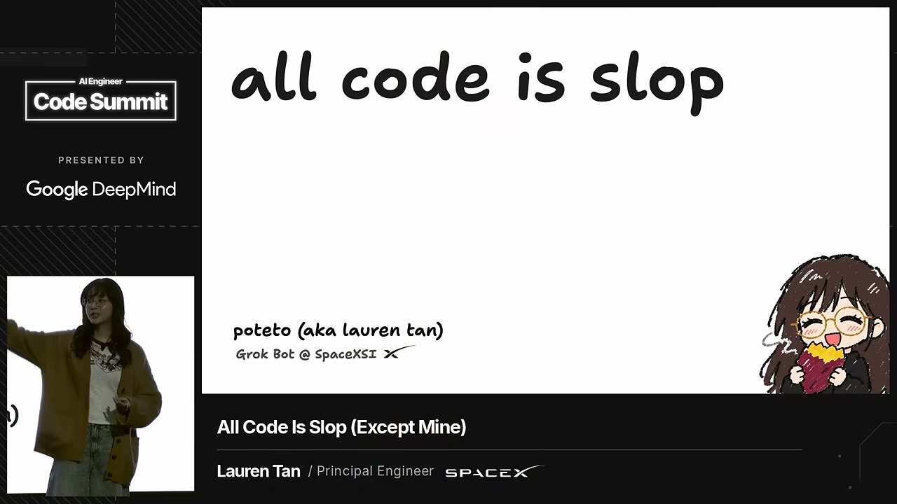

Ela abre provocando: todo código que outra pessoa escreveu parece slop. A tese vem logo depois.

> "the job of the software engineer, the meta of being a software engineer is figuring out how to maintain or even improve the quality of your code while massively increasing your productivity."

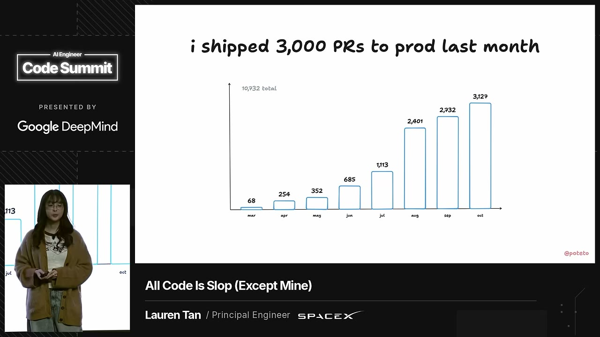

- **3.000 PRs para produção em um mês**, só dela. O gráfico vai de 68 em março a 3.127 em outubro, 10.732 no total.
- Antes dos agentes, volume importava só nos outliers, as "coding machines". O exemplo dela é Bret Taylor reescrevendo o Google Maps em um fim de semana. "with agents anyone can now be a coding machine". O slide resume: "quality & quantity — everyone can be a coding machine".
- Ela evita o nome "software factory": "I like to keep it simple and I think of it as all about **trust**. Not blind trust but investing in your agents environment so you can trust that your agents are going to do the right thing."
- Levou **seis meses** para chegar aí. Ela diz que você levará menos.

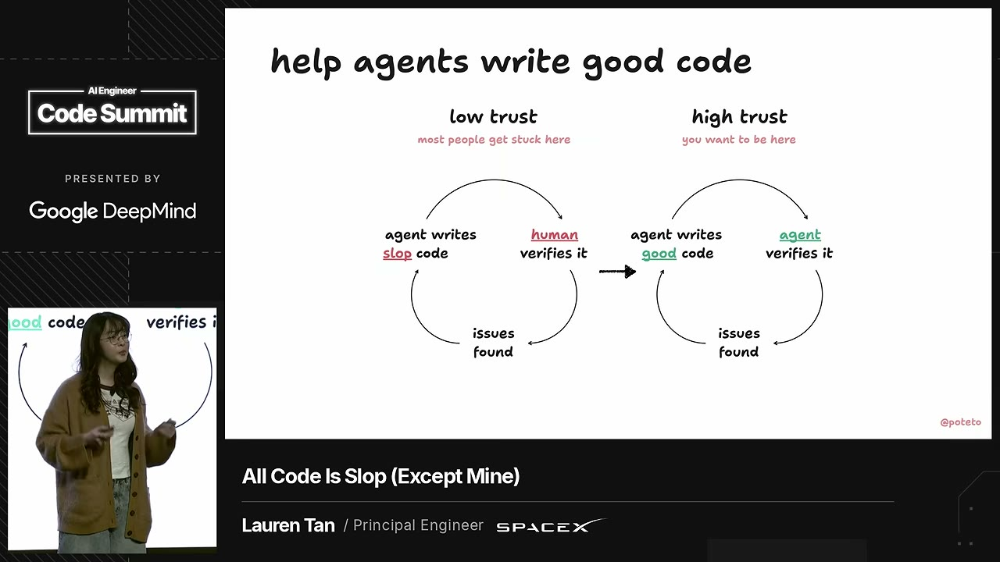

O slide "help agents write good code" mostra dois loops:

- **Low trust**: "agent writes **slop** code → **human** verifies it → issues found". O slide nota: "most people get stuck here".
- **High trust**: "agent writes **good** code → **agent** verifies it → issues found".

## 2:03 — A pirâmide de confiança ("the poteto pyramid")

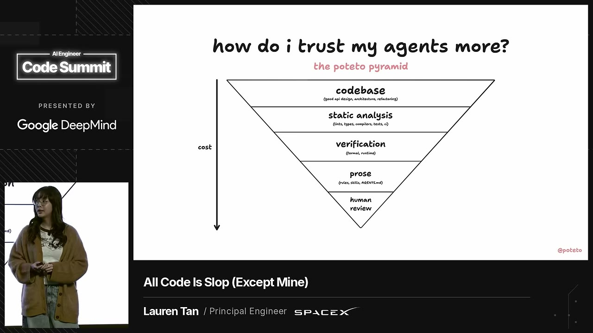

O slide se chama "how do i trust my agents more?". É uma pirâmide invertida com uma seta de **custo** que cresce para baixo. São **cinco camadas**. A fala cita quatro, mas o slide tem cinco:

| Camada | O que entra | Natureza |
|---|---|---|
| **codebase** | good api design, architecture, refactoring | determinística |
| **static analysis** | lints, types, compilers, tests, ci | determinística |
| **verification** | formal, runtime | determinística ou checável |
| **prose** | rules, skills, AGENTS.md | julgamento |
| **human review** | — | a mais cara |

> "The first two layers are deterministic [...] you can use both of these layers together to constrain what agents can do and force them to do the right thing by default."

> "whenever you're correcting your agent, think about how you can make that a deterministic check instead of adding another line to your rules or your agents.md because it's far more reproducible when it's in code and it lets you trust it more."

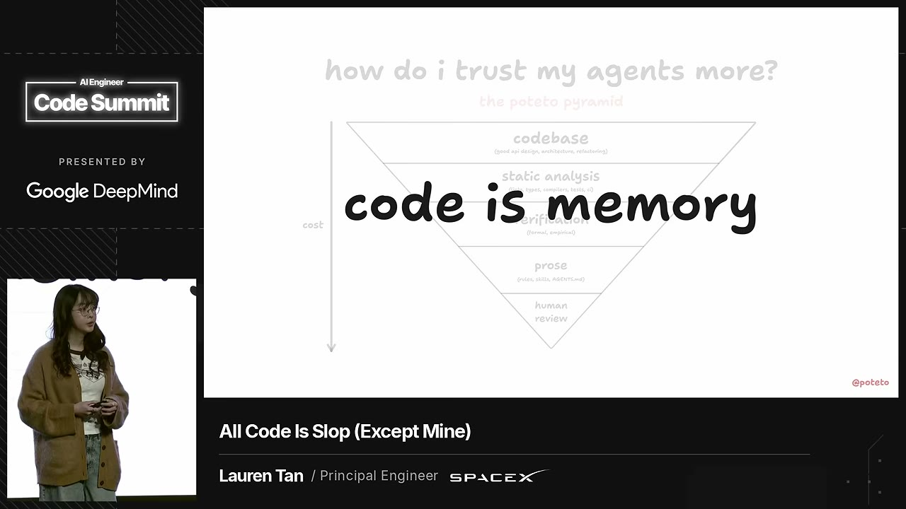

**"code is memory"**: o codebase é o maior input do agente. O agente gera a saída a partir da entrada.

### Arquitetura orgânica (o jardim)

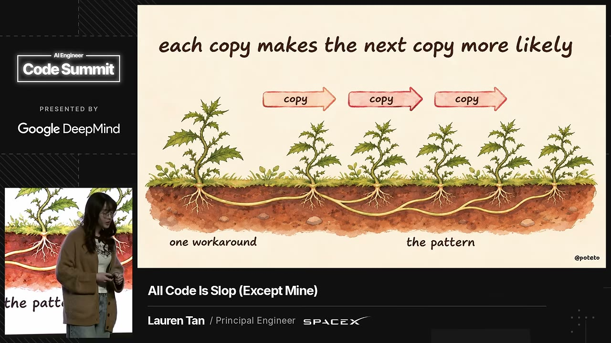

- Ela usa a analogia do jardim. Antes chegavam ~3 PRs de colegas para revisar por dia; hoje são ~300. "every engineer is now a team of hundreds or even thousands of agents".
- O código chega como um fluxo contínuo, quase orgânico. As restrições e guardrails são a fundação de concreto em volta da qual o código novo cresce. O slide "Organic Architecture" mostra um prédio coberto de vegetação.
- **"each copy makes the next copy more likely"**: um workaround vira "the pattern". Gambiarra, anti-pattern, código deprecated e débito técnico são copiados pelo próximo agente, porque parecem o padrão estabelecido. É a erva daninha que se espalha. Por isso: "make your codebase as pristine as possible so that agents are always copying the good stuff."
- O slide seguinte diz "yes, you should read the code sometimes".

## 5:00 — Dune e arquitetura que se impõe

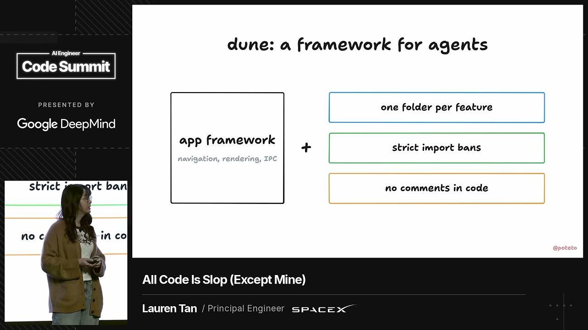

**Dune** é o framework de cliente que o time criou para o Grok Bot. Ela compara com "kind of like Next.js for Electron apps". Tecnicamente não é interessante. O que importa são as restrições e lint rules que codificam lições aprendidas. O slide: "app framework (navigation, rendering, IPC) + one folder per feature + strict import bans + no comments in code".

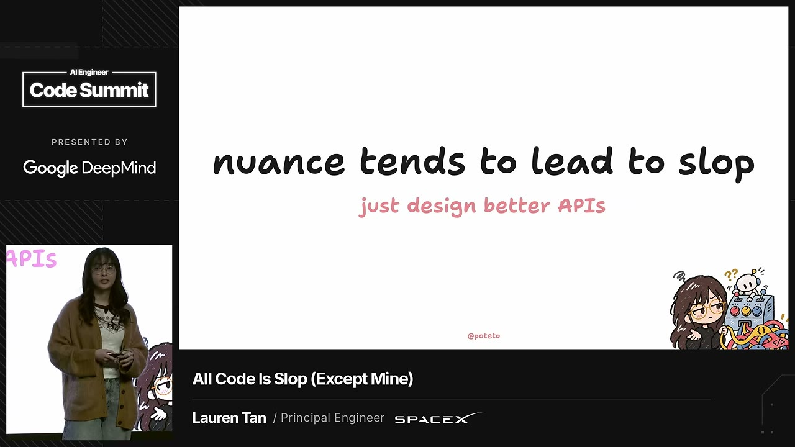

**"nuance tends to lead to slop — just design better APIs"**. O exemplo é `useEffect` no React: "some people joke that you need a PhD to use use effect". Agentes usam mal. A solução foi **banir em código de produto**. Ele só é permitido dentro de APIs do Dune. "this problem has now been categorically eliminated, and we never need to catch that during code review again."

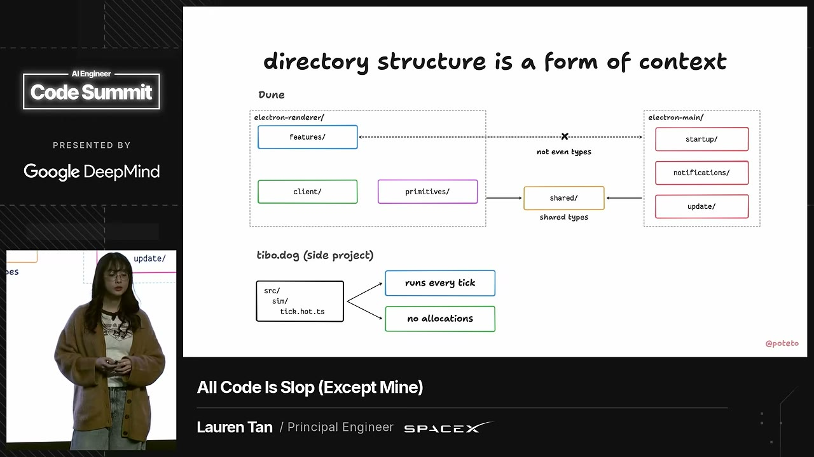

**"directory structure is a form of context"**:

- No Cursor, que também é Electron, agentes importavam código do main thread no renderer, o que gerava long tasks e jank.
- No Dune, os diretórios de topo se chamam literalmente `electron-renderer/` (`features/`, `client/`, `primitives/`) e `electron-main/` (`startup/`, `notifications/`, `update/`). Importar entre eles é proibido, "not even types". Só `shared/` cruza a fronteira, com tipos compartilhados.
- Quem impõe isso é um analisador de grafo de dependências mais lint rules.
- No projeto pessoal `tibo.dog`, o nome `src/sim/tick.hot.ts` carrega duas restrições: "runs every tick" e "no allocations".

## 6:56 — Trocar comentários por lint rules

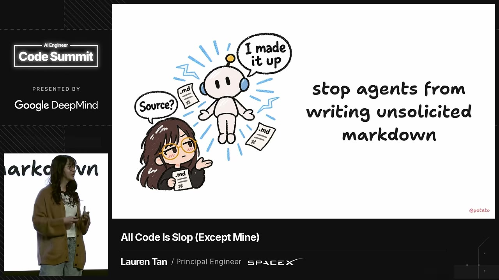

**"stop agents from writing unsolicited markdown"**. Agentes usam Markdown (docs, comentários, rules, skills) "as a place to write down their justifications for not doing the right thing". Também "over rotate on some small correction that you made, and they treat it like a hard rule that can never be broken ever again."

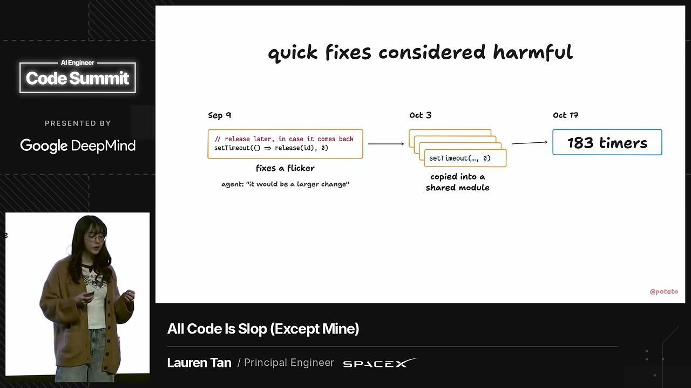

**"quick fixes considered harmful"** é um caso real do Cursor:

- **9 set:** o agente escreve `// release later, in case it comes back` / `setTimeout(() => release(id), 0)`. Isso "fixes a flicker". A justificativa do agente: "it would be a larger change".
- **3 out:** o padrão foi "copied into a shared module".
- **17 out:** **183 timers**.

A causa raiz era um choque de arquitetura entre o estilo imperativo do VS Code e o declarativo do React. Muitos timers criados e destruídos geram GC pesado, lag e jank. E o pior: "agents wrote a lot of code comments [...] explaining why this quick fix was justified."

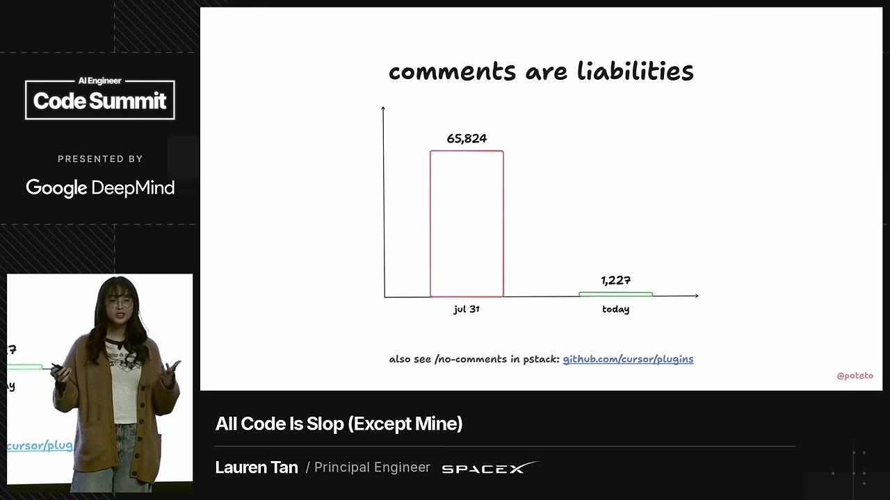

**"comments are liabilities"**:

- O gráfico vai de **65.824** comentários (31 jul) para **1.229** (hoje). O slide remete a `/no-comments` no pstack.
- No Grok Bot "we decided to just ban 99% of comments". Os motivos: ficam velhos, humanos não leem, dão ao agente uma rota de fuga, e "the worst part about comments though is that they're not enforceable."
- No lugar entram lint rules com mensagens de erro úteis, que mandam o agente corrigir a causa raiz.

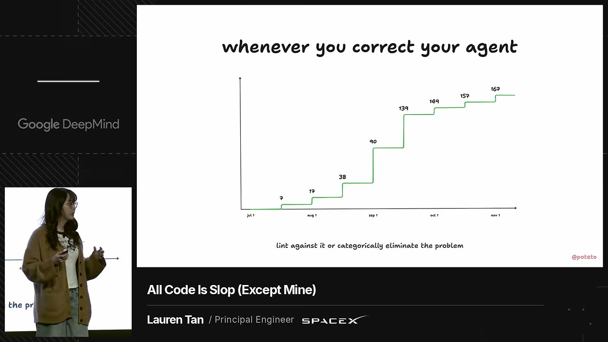

**"whenever you correct your agent — lint against it or categorically eliminate the problem"**. A escada de regras do slide vai de 7 (jul) para 167 (nov).

> "every time we correct our agents, it turns into one of these deterministic checks or we think about how to categorically eliminate that problem in the code through better API design, through better architecture. And if you do this enough times, you'll find that you have just less things to look out for in code review. And at some point you'll realize there's nothing left to review. And you can just let agents merge most of their own pull requests."

## 9:40 — Verificação em runtime e feature maps

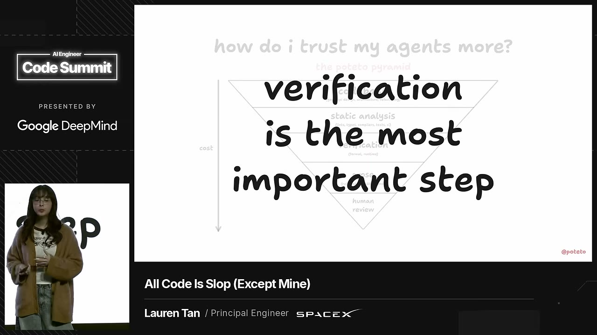

**"verification is the most important step"**. "our code review process has now really shrunk into looking at verification artifacts instead. So things like videos, screenshots, diagrams, formal verification."

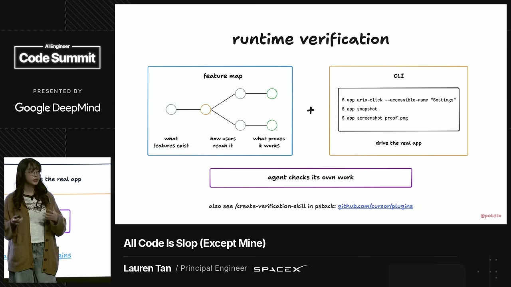

**Runtime verification** é "giving your agent a way to run the code for itself and use debugging tools that [...] human developers use as well, like the Chrome DevTools protocol". O slide tem três partes:

- **feature map**: "what features exist → how users reach it → what proves it works". É um "site map" das features do ponto de vista do usuário, que serve de vocabulário comum. O agente não precisa adivinhar o que é "the thingy in the left sidebar".
- **CLI**: `$ app aria-click --accessible-name "Settings"`, `$ app snapshot`, `$ app screenshot proof.png`, resumido como "drive the real app". É uma CLI própria, reutilizada a cada run: gasta menos tokens e é testável.
- O resultado é **"agent checks its own work"**. O slide remete a `/create-verification-skill` no pstack.

## 10:50 — Verificação formal e testes de UI

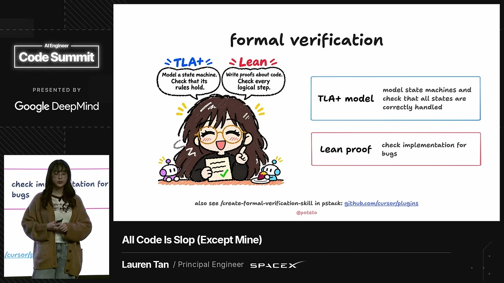

- **TLA+**: "Model a state machine. Check that its rules hold". Ela usa model checking em fluxos grandes do usuário, por exemplo notificações entre vários devices e plataformas.
- **Lean**: "Write proofs about code. Check every logical step". Prova algoritmos, por exemplo a biblioteca de virtualização própria, para garantir que não há flickering ou jittering.
- "we've already found quite a few bugs with formal verification. But it's certainly not a silver bullet and we're treating it as another tool, another layer". O slide remete a `/create-formal-verification-skill`.

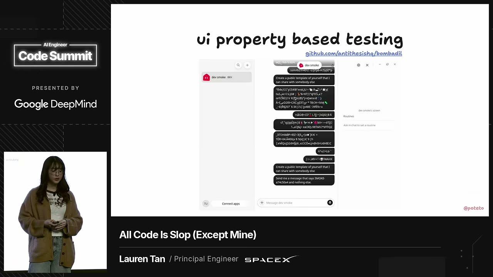

**UI property-based testing** com **Bombadil** (`github.com/antithesishq/bombadil`). O slide mostra o app recebendo entradas aleatórias, inclusive texto lixo. "this has also caught a few UI bugs for us already."

## 11:51 — Gastar tokens em verificação

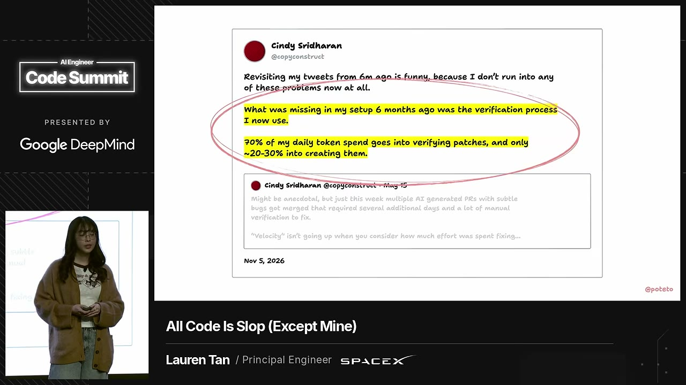

Ela cita um tweet de **Cindy Sridharan** (`@copyconstruct`), de 5 nov 2026. Seis meses antes, em 15 de maio, Cindy reclamava de "multiple AI generated PRs with subtle bugs [that] got merged". Agora: "What was missing in my setup 6 months ago was the verification process I now use. 70% of my daily token spend goes into verifying patches, and only ~20-30% into creating them." Lauren: "most of my token usage goes to verification" também.

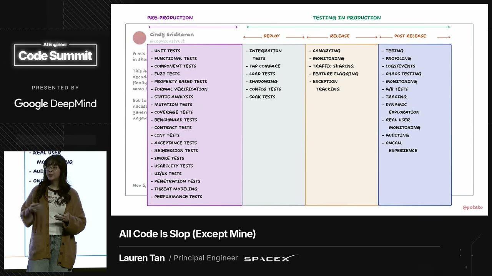

O slide mostra a taxonomia de testes de Cindy em quatro grupos:

- **PRE-PRODUCTION**: unit, functional, component, fuzz, property based, formal verification, static analysis, mutation, coverage, benchmark, contract, lint, acceptance, regression, smoke, usability, UI/UX, penetration, threat modeling, performance.
- **DEPLOY**: integration, tap compare, load, shadowing, config, soak.
- **RELEASE**: canarying, monitoring, traffic shaping, feature flagging, exception tracking.
- **POST RELEASE**: teeing, profiling, logs/events, chaos testing, monitoring, A/B, tracing, dynamic exploration, real user monitoring, auditing, oncall experience.

> "none of these things here are new or novel techniques [...] but ones that might have been prohibitively expensive to use before [...] agents drastically cut this cost down. And really, we are entering a golden age of software testing and verification."

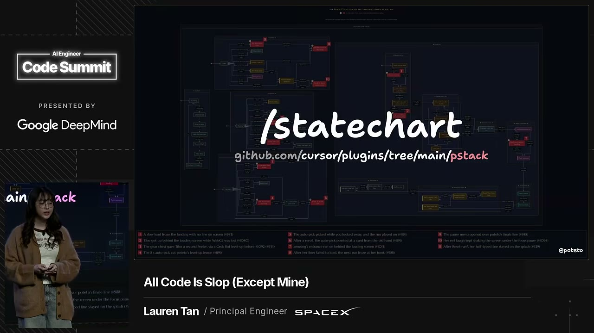

**`/statechart`** é uma skill nova do pstack. Ela visualiza máquinas de estado do ponto de vista do usuário, geradas de um modelo TLA+. "I find this much easier to review alongside the videos and screenshots that we provide."

## 13:32 — 11.000 PRs e taxa de revert de 0,5%

| Slide | Dado |
|---|---|
| 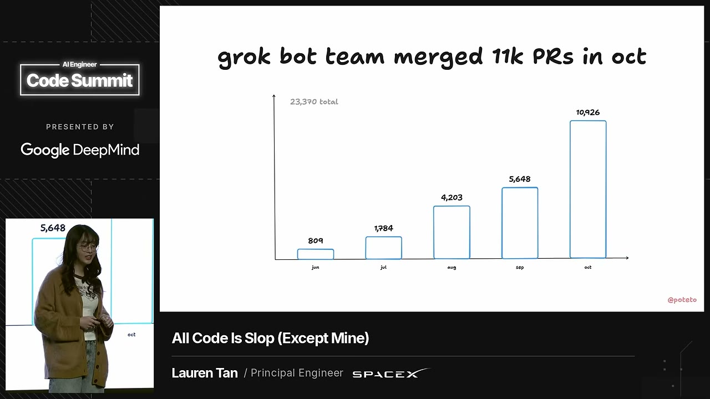 | "grok bot team merged 11k PRs in oct": 809 (jun), 1.784 (jul), 4.203 (ago), 5.648 (set), **10.926** (out). Total no slide: 23.370. |
| 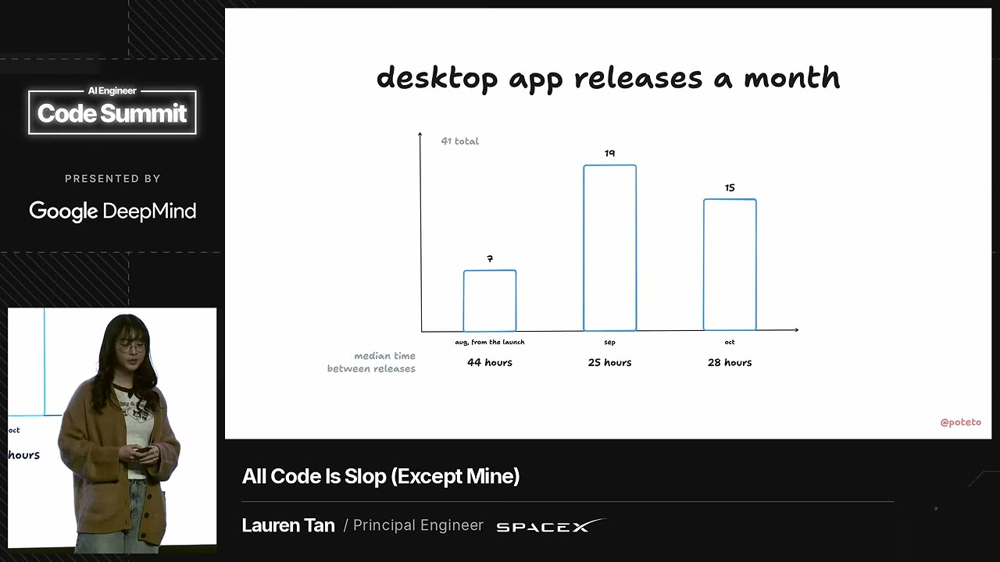 | "desktop app releases a month": 7 releases em ago (a partir do launch), 19 em set, 15 em out, 41 no total. Mediana entre releases de 44 h, 25 h e 28 h. Na fala, "about once a day". |
| 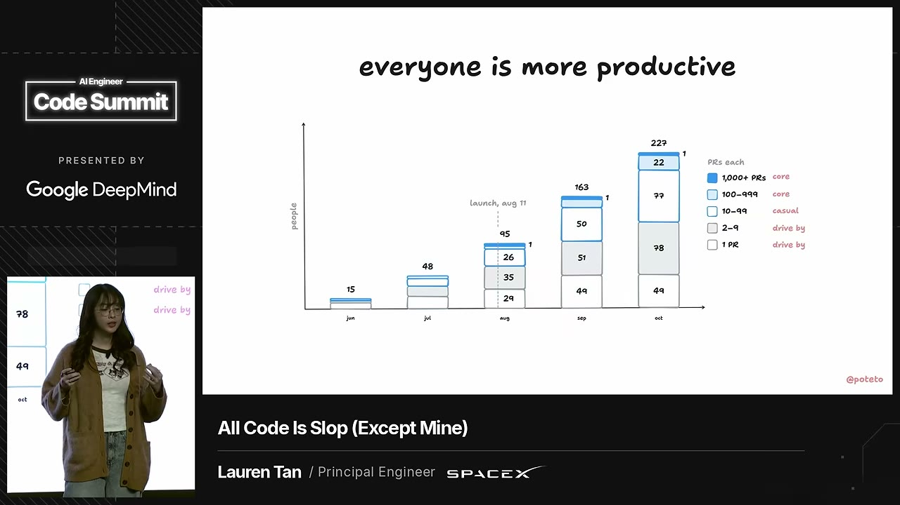 | "everyone is more productive": contribuidores por mês, 15 → 48 → 95 → 163 → **227** (out). Buckets: 1.000+ PRs e 100–999 (core), 10–99 (casual), 2–9 e 1 PR (drive-by). Launch em 11 ago. |
| 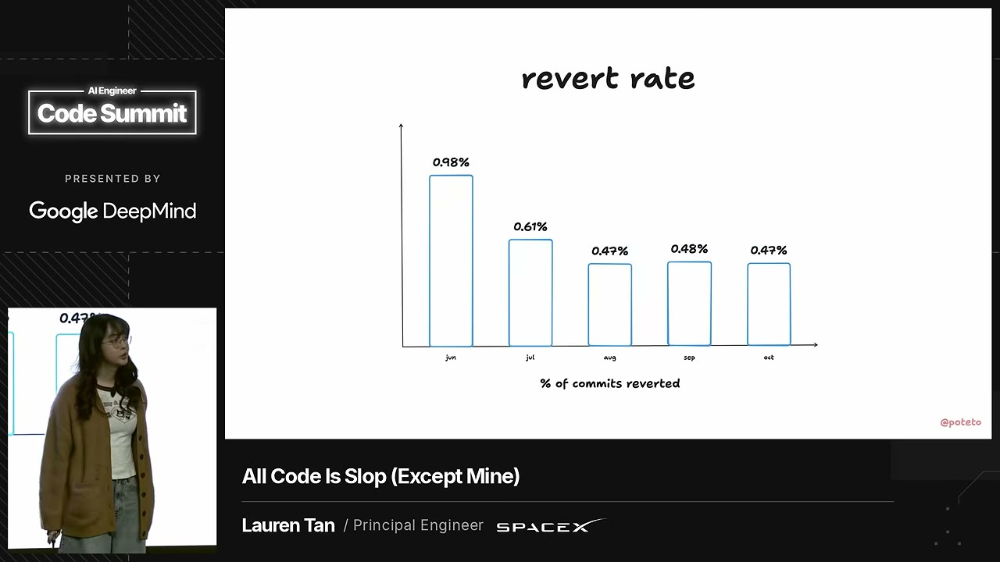 | "revert rate" (% de commits revertidos): 0,98% (jun), 0,61% (jul), 0,47% (ago), 0,48% (set), **0,47%** (out). |
| 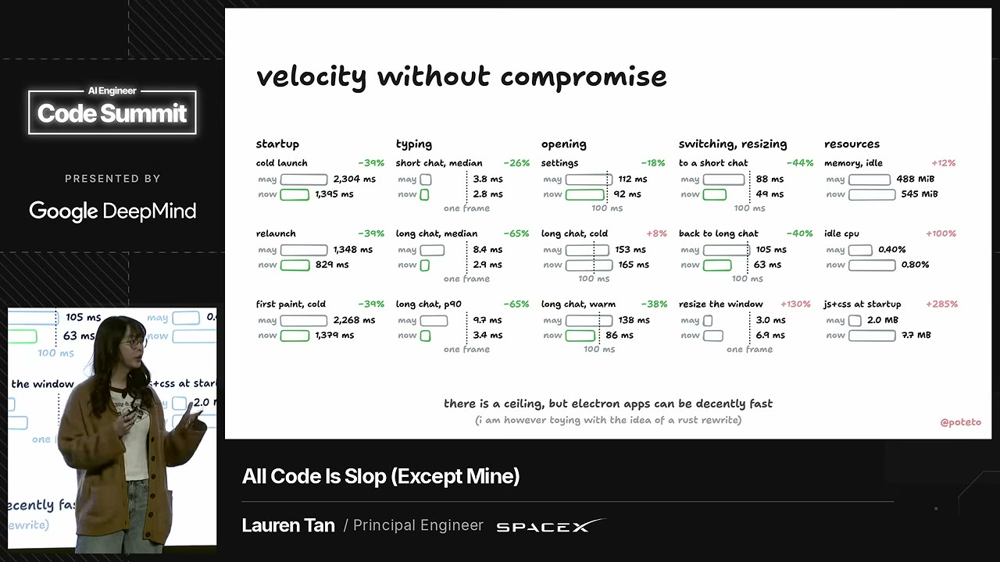 | "velocity without compromise": comparação mai → agora. |

O slide de performance mostra ganhos **e** regressões. A fala só fala em "has improved on multiple dimensions":

- **Ganhos**:
  - cold launch −39% (2.304 → 1.395 ms);
  - typing em chat longo −65%;
  - trocar para chat curto −44%;
  - relaunch −39%.
- **Regressões**:
  - memória idle +12% (488 → 545 MiB);
  - idle CPU +100% (0,40% → 0,80%);
  - resize da janela +130% (3,0 → 6,9 ms);
  - js+css no startup +285% (2,0 → 7,7 MB);
  - chat longo frio +8%.

O rodapé diz "there is a ceiling, but electron apps can be decently fast (i am however toying with the idea of a rust rewrite)".

## 15:11 — Fundação antes da fábrica

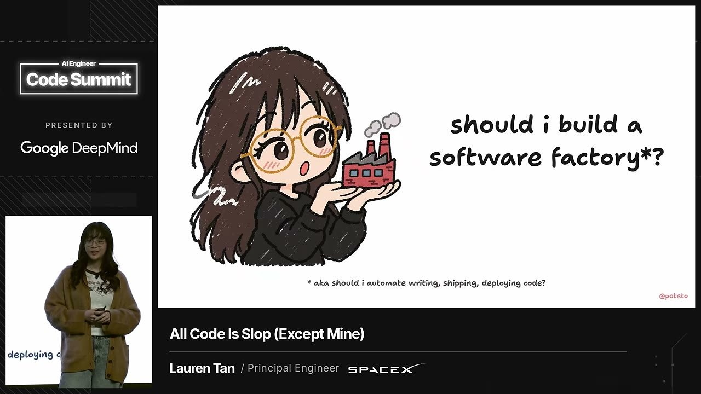

**"should i build a software factory*?"**, com a nota "\* aka should i automate writing, shipping, deploying code?"

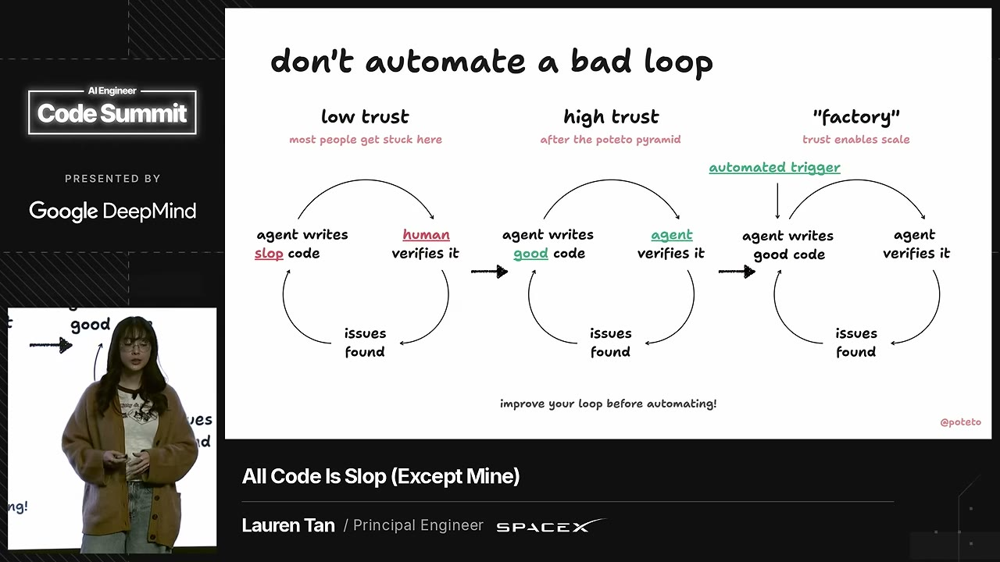

**"don't automate a bad loop"** mostra três estágios:

1. **low trust**: "most people get stuck here". O agente escreve slop e um humano verifica.
2. **high trust**: "after the poteto pyramid". O agente escreve código bom e outro agente verifica.
3. **"factory"**: "trust enables scale". Um **automated trigger** inicia o loop high-trust.

O rodapé: "improve your loop before automating!"

> "If your inner coding loop produces slop, then automating that loop just produces more slop and you need to throw more and more and more tokens at the problem."

> "whenever you correct your agent, try and do it by improving your codebase first. You know, start with a lint rule to prevent new occurrences of anti-patterns and then clean up those old patterns as well. And then make sure that your verification story is really strong. A lot of this work is a prerequisite to automation anyway."

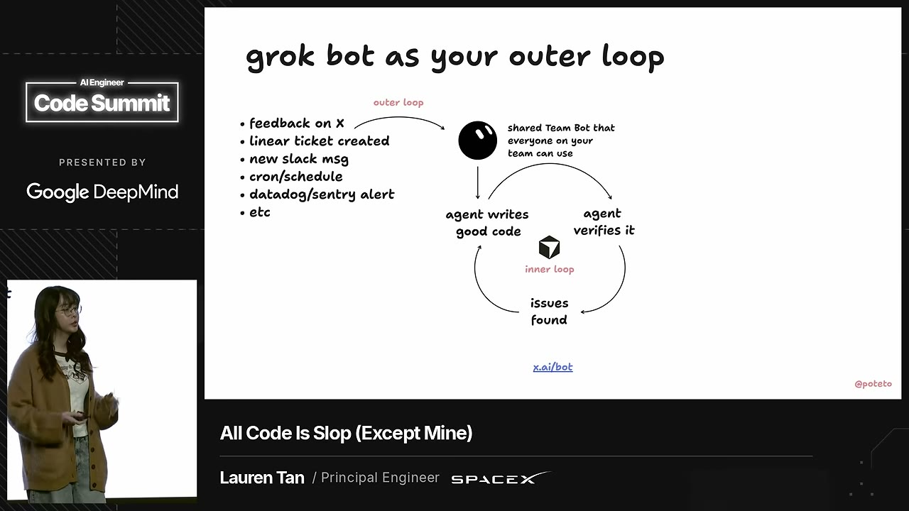

**"grok bot as your outer loop"**:

- Os triggers são feedback no X, ticket novo no Linear, mensagem no Slack, cron/schedule, alerta do Datadog/Sentry e outros.
- Eles disparam um "shared Team Bot that everyone on your team can use". O bot roda o inner loop: agente escreve código bom, agente verifica, issues found.
- Por baixo há "connectors, routines that can kick off Cursor cloud agents, and projects which let you orchestrate hundreds or even thousands of agents".

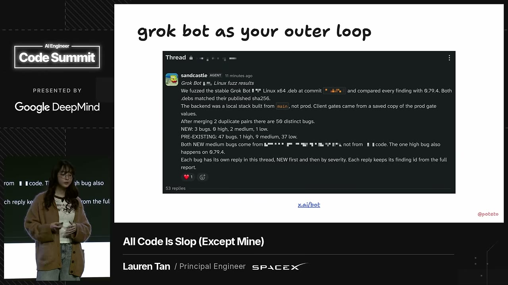

Exemplo real: a cada release, o Grok Bot abre um projeto do Cursor que **faz fuzz no build inteiro**, usando o app "like a real user". A thread do agente `sandcastle` mostra:

- "We fuzzed the stable Grok Bot [...] Linux x64 .deb" e "compared every finding with 0.79.4". Os dois `.deb` batiam com o sha256 publicado.
- O backend era local, buildado de `main`, e os gates vinham de "a saved copy of the prod gate values".
- "50 distinct bugs" após dedupe. NEW: 3 (0 high, 2 medium, 1 low). PRE-EXISTING: 47.
- "Each bug has its own reply in this thread, NEW first and then by severity."

Depois disso, o bot abre PRs de correção e **faz auto-merge**: "because our codebase is good enough that pull requests tend to just be good by default and most product code that we land no longer really requires deep human review."

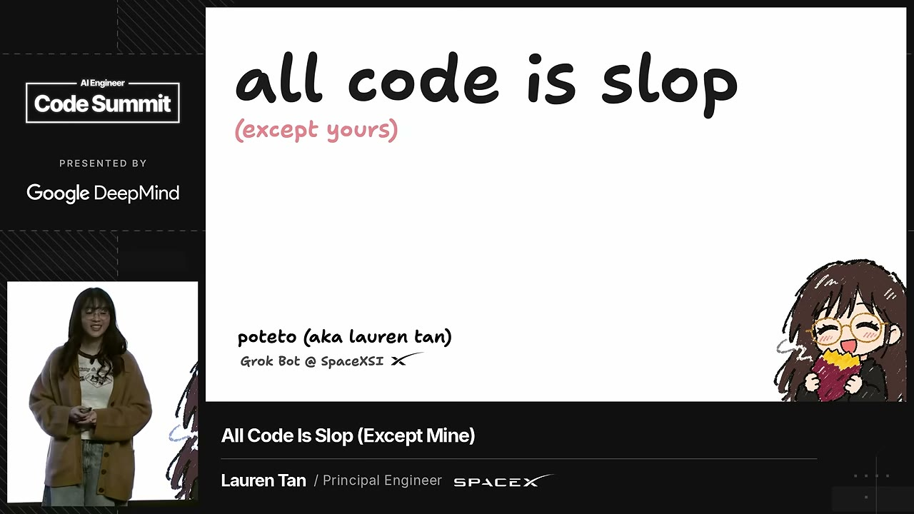

O fechamento é "all code is slop (except yours)".

---

## Resumo dos termos da palestra

| Termo | Significado na fala |
|---|---|
| **slop** | código de baixa qualidade, geralmente gerado por IA sem restrições |
| **coding machine** | engenheiro com volume outlier; com agentes, qualquer um vira um |
| **trust / low trust / high trust** | quanto você pode deixar o agente verificar o próprio trabalho; o objetivo, em vez de "factory" |
| **poteto pyramid** | ordem de investimento: codebase → static analysis → verification → prose → human review, do mais barato e reprodutível ao mais caro |
| **code is memory** | o codebase é o maior input do agente; o que está nele é copiado |
| **organic architecture** | restrições do codebase como fundação em volta da qual o código dos agentes cresce |
| **categorically eliminate** | remover a classe inteira de erro por API ou arquitetura, não pegá-la em review |
| **directory structure is context** | o nome e o lugar do arquivo carregam regras (`electron-main/`, `*.hot.ts`) |
| **unsolicited markdown** | docs, comentários e rules que o agente escreve para justificar atalhos |
| **comments are liabilities** | comentário envelhece, não é imposto e abre rota de fuga; vira lint |
| **verification artifacts** | vídeos, screenshots, diagramas e provas formais que substituem a leitura do diff |
| **runtime verification** | o agente roda o app de verdade e usa ferramentas de debug (CDP) |
| **feature map** | mapa do app do ponto de vista do usuário: feature → como chegar → o que prova que funciona |
| **formal verification** | TLA+ para máquinas de estado e Lean para provas sobre algoritmos |
| **UI property-based testing** | gerar entradas aleatórias contra a UI (Bombadil) e checar propriedades |
| **outer loop / inner loop** | inner: escrever e verificar; outer: o trigger automático que inicia o inner (Grok Bot) |
| **don't automate a bad loop** | automatizar um loop que produz slop só produz mais slop e mais tokens |

---

## Palestra complementar: sessão de ~55 min sobre confiança, verificação e pstack

> **Fonte.** "SpaceX AI engineer, Lauren Tan", canal **Ai insider** (re-upload não oficial, título caça-clique), publicado em 2026-09-26, 55min30s: <https://www.youtube.com/watch?v=I_oMJk6barY>. A origem da gravação não é identificada. Pelo conteúdo, ela foi feita por volta de 12 ago 2026: Lauren diz "this month we're only on the 12th" e que o Grok Bot lançou "yesterday", e o slide de novembro marca "launch, aug 11". Na época ela se apresenta como engenheira do Cursor havia cinco meses, trabalhando no agents window ("glass") e no Grok Bot. A transcrição é a legenda automática, lida na íntegra. Só entram aqui trechos conferidos nela.

Pontos que a palestra de novembro não traz, ou traz só de passagem:

1. **Trust curve.** É o gráfico dela, "not a very scientific chart". Sem confiança no agente, o modo de operar é o de um gerente que não confia no time: **micromanagement**. Você assiste a cada saída e não consegue paralelizar. "you can't go to a 100 agents [...] when you don't even trust the output of one agent". Em cinco meses ela subiu a curva até agentes que fazem **auto-merge**: "I woke up today and there were like 20 PRs landed and I just reviewed them on main". Ela avisa que não há atalho: "there's really no shortcut for going from here to there because this is really about your personal level of trust in agents".
2. **Verificação como a habilidade mais importante.** "the ability for an agent to actually run the code or take CPU traces or heap snapshots or open an iOS simulator [...] that's the thing that really closes the loop. It doesn't guarantee your agent writes good code but it allows them to at least write correct code". Sem verify skill, "you are the verifier [...] you're the bottleneck".
3. **Origem do feature map.** A primeira skill dela no Cursor foi `control glass`: Glass é o codinome interno do agents window, e a skill faz o agente dirigir o app via CDP. O agente conseguia rodar o app, "but it had no idea what the agents window was". Diante de "the left sidebar is laggy", ele ficava "flailing around". O feature map lista, do ponto de vista do usuário, as sub-features, como chegar a cada uma, os atalhos de teclado e "the DOM elements [...] the attributes that you use for selecting things through the CDP". Com ele, até um report de Slack que é só um screenshot com "???" vira algo navegável.
4. **Origem do pstack.** O nome é uma brincadeira com o **gstack** de Garry Tan, CEO da Y Combinator: "we share the last name, we have no relations". "I honestly actually never set out to build pstack. It just started with a bunch of skills". Cada falha observada virou uma skill: "stop hallucinating, actually go and search up, look up the code, use a lot of sub agents [...] stop guessing". O gatilho da skill `how` foi notar que o agente afirmava a causa sem ter lido o código afetado, o que ela viu nas tool calls.
5. **Skill como onboarding.** Ela compara o agente a um engenheiro recém-contratado, bom de código e "no business context whatsoever". A skill é o onboarding. Também usa a analogia do **head chef**: você monta a cozinha e distribui as estações, não cozinha tudo.
6. **Evals como unit tests de skills.** "it's like a unit test for an agent". A cada mudança de skill ela roda o `eval` playbook. O coordenador escreve uma rubrica e spawna subagentes em diretórios "cleverly named to not let the sub agent know that it's being evaluated because agents can actually tell and when they do they change their behavior". Ela roda em vários modelos, e um juiz de outro modelo confere o viés do primeiro. Dá para fazer **hill climb**: "use /loop in Cursor and you can say okay keep looping on this eval until everything is 10 out of 10". Foi assim que ela fez a própria verify skill e sua CLI.
7. **Manter skills exige gosto e observação.** Ela descreve o papel como "backseat driver". É preciso abrir as tool calls, ler o código e os thinking blocks, ver onde o agente falha e então escrever a skill.
8. **Comece local, depois vá para a nuvem.** "the best place to start is local because you can observe". Depois vêm os cloud agents e automations. Exemplo: o **Benny** pega cada bug report, sobe o Cursor numa máquina na nuvem, usa as mesmas control skills para reproduzir e responde, por exemplo, que o bug reproduz mas "it's already fixed on main". O aviso: "I would definitely encourage you not to try to jump [...] to I'm going to spawn hundreds or thousands of cloud agents right now because you're just going to waste a lot of tokens".
9. **Greenfield com vibe coding é o maior risco.** A infraestrutura de big tech é desenhada para "the least capable engineer on your team": frameworks, convenções, guardrails e credenciais restritas. Um codebase assim já serve bem aos agentes. Um protótipo feito só com vibe coding "you essentially have no guardrails whatsoever" e entra em espiral. O refactor do Grok Bot para o Dune levou "over 600 PRs". Hoje: "I really don't look at the code anymore".
10. **"the shortest path is the best path".** É um princípio do Dune: o agente sempre pega o atalho, então o framework torna o atalho o caminho certo. Uma feature mora num diretório só. Os "nouns" do framework (feature, entry point, transcript card) têm um jeito convencional de serem criados.
11. **Camadas hard vs soft.** O codebase e a análise estática "actually make CI red". Rules, skills e Bugbot "are more soft [...] Your agents can still forget". Ela usa as duas: "I like to layer them, but I don't like to rely on them as the only source of enforcement because it's very very soft". Isso inclui a escolha de stack: o compilador estrito do Rust dá confiança de que "if the code compiles it probably works". E o ponto central: "Every time [a human enforces an invariant in code review] you should consider that as a code smell [...] how do I turn this into a lint rule, how do I turn this into a CI failure? Or how do I even categorically eliminate this problem entirely?"
12. **Comentários.** "99% of the time agents just write code comments that kind of describe some historical thing that is actually totally irrelevant", por exemplo "Lauren said you should never do this". Ela explica: "I didn't say that as like a durable, global rule".
13. **Tamanho de PR.** Não há teto, mas ela pede PRs atômicos. "the git history is a very rich source of context", e um PR pequeno facilita achar e reverter o bug.
14. **ROI.** O custo de tokens fica concentrado no início, no refactor e nas checagens. Em troca, ela aplica sozinha um nível de restrição que antes exigiria anos, e PMs, designers e GTM passam a contribuir com segurança. Ela admite o viés: "I work at an AI lab where we have unlimited tokens".

---

## Live com Matt Pocock: "Poteto (creator of pstack) on shipping 1,000's of PR's a month at SpaceX"

> **Fonte.** Canal **Matt Pocock**, live de 2026-10-03, 65min36s: <https://www.youtube.com/live/MN9dGgmLyso>. Transcrição automática em [`sources/talk-MN9dGgmLyso-transcript.txt`](sources/talk-MN9dGgmLyso-transcript.txt), lida na íntegra. Matt conduz a conversa como um Q&A de um talk anterior dela, em que ela diz ter shippado 2.500 PRs em um mês. Ela se apresenta como vinda do Cursor, "which is now SpaceX AI". Esta conversa importa em particular porque o `/run-spec` e o `software-factory` usam as skills do Matt (`grilling`, `to-spec`, `to-tickets`, `wayfinder`).

1. **Origem do pstack.** Depois de sair do time de React da Meta, ela tirou um mês de folga. Em fevereiro de 2026 começou um projeto paralelo de orquestração e percebeu que gastava horas "micromanaging one agent". Esse projeto é o **`poteto/noodle`** ("Orchestrate agents using skills", em Go): skills e um diretório `brain/`, com 16 princípios em `brain/principles/`. O grupo de verificação dele tinha só `prove-it-works` e `fix-root-causes`; o pstack hoje tem 24 princípios e 5 de verificação. "how do I extract my own ability [...] and give it to the agent". Ela entrou no Cursor em março. Em abril, trabalhando na performance do agents window, era "the meat proxy between my agent and Chrome DevTools". A primeira skill que escreveu lá foi a de verificação.
2. **"how do I make the easy thing the right thing?"** "even the frontier ones tend to take shortcuts", então as skills dela servem para que o atalho seja o caminho certo.
3. **Domain expertise vale mais, não menos.** "the bottleneck is no longer the agent, it becomes your ability to express your intent and your goals in a clear way". Os dois falam de palavras que "comprimem intenção": Matt cita TDD e grilling; ela, "tautological tests".
4. **Michelin kitchen, não software factory.** "factory" não evoca "quality or craft". O home cook faz tudo sozinho, e pôr a família na cozinha gera caos. O chef é "almost like the tech lead for the kitchen": organiza ingredientes, preparo e estações. "how you set up your kitchen, your skills, your environment, your codebase [...] are ultimately the new ingredients". Escalar é abrir uma **rede de restaurantes**: "I've spent the time building one kitchen and one restaurant. And now I'm in a position where I don't actually have to be there anymore".
5. **Verificação é o que faz um loop ser loop.** "the most important part of a loop that allows it to be a loop is the verification part". Ela fala em dar ao agente "hands and eyes". Com verificação vem o **hill climbing**: uma rubrica ou nota e um agente que melhora iterando, e ela cita o autoresearch de Karpathy. "every app that Cursor has or SpaceXAI has has a verification skill that is automaintained [...] it's become critical infrastructure for our team".
6. **Determinismo vs julgamento.** A CLI dentro da verify skill existe porque, sem ela, "the agent [...] would basically rebuild the world each time and then every agent did it differently". A regra geral: "extract out the deterministic parts and turn that into code and just leave only the parts that actually require judgment to the agent". Migrações seguem o mesmo raciocínio: codemods e transformações de AST, não o agente reescrevendo à mão.
7. **O novo trabalho é o ambiente.** "the new job of the engineer is really to spend time on the environment". Quem não investe fica preso no micromanagement, como um cozinheiro com faca cega e prazo apertado. Ela liga isso ao **type narrowing** do TypeScript: restrições estreitam o espaço até "there's really only one way to do something". As primeiras versões do Grok Bot eram "eight god files [...] at least 10,000 lines long". Daí veio o diretório por feature, com um registro que descobre as features.
8. **Outer loop × inner loop.**
   - **Inner loop**: os agentes trabalhando em direção a "a snapshot of my intent". O snapshot envelhece quando chega informação nova.
   - **Outer loop**: o Grok Bot, com connectors e routines para Slack, X, Linear e email, puxa esse contexto e manda mensagem para **Cursor Projects**.
   - Um Project é um "coordinator agent in the cloud [...] It doesn't do the work itself. It delegates", o "chief of staff". Ela tem "more than 10 chiefs of staff", um por área: performance do app, bugs de usuários, um rewrite nativo de brinquedo.
   - A pergunta constante: "where am I the bottleneck in this process? Why do my agents need me [...] to answer this question?" O princípio é o "context not control" da Netflix.
9. **Agrupar antes de despachar.** Com 30 reports de performance de uma vez, um agente por report "lost that sort of thread between them" e duplica trabalho. O coordenador agrupa os relacionados e acha a causa comum, que pode estar "up here".
10. **Buffer antes de corrigir.** Uma routine procura padrões banidos (os foot-guns do React) e só os **acrescenta a um documento**, sem corrigir. A cada poucos dias ela lê o documento e vê que "these are all the same thing". "sometimes having a buffer forces you to think about the big picture."
11. **Review por amostragem.** "you cannot be tasting every single dish [...] it becomes more about sampling". Um erro isolado não pede nada; o mesmo atalho repetido por vários agentes é sinal para mudar o ambiente: skills, constraints, lints e tipos. "The idea of sampling instead of blocking", nas palavras do Matt.
12. **"Dark factory" com luz acesa.** O "full autopilot" do pstack (playbook `autopilot-full`) "will spawn a bunch of verifier agents for every pull request and it will fuzz". Os verificadores rodam o app como usuário e corrigem até o PR poder entrar. Ela avisa que "it is quite token intensive. You can tune this [...] instead of like 10 verifier agents you might do like one". De manhã ela revisa o **histórico de commits**: "if I see problems, I go and course correct [...] revert or modify, add new lint rules". Sobre o primeiro dia: "it took a lot of bravery".
13. **One-way doors.** Matt pergunta sobre PRs que não dá para desfazer (perda de dados, domínios regulados). Ela responde que "it all comes back [...] to the quality of the verification". Em domínios verificáveis "the one-way doors become two-way doors in a sense". Fora deles, "it's very hard to get to that point". E admite: "a great question that I don't really have the answer to". Ela aposta em linguagens orientadas a agentes que unem programa e prova, citando **Bend**, além de Lean e TLA+.
14. **pstack + skills do Matt.** Ela vê os dois conjuntos como complementares: "combining your grill me with docs, or wayfinder skill with some of the execution skills in pstack", ou "Combine Wayfinder with poteto-mode and make your own custom mode". Mas "everyone should have their own set of knives": cada chef leva suas facas. O caminho é minerar os próprios transcripts atrás das intervenções repetidas, "suggest turning them into lint rules or new skills". "past chats [...] a treasure trove of context [...] it's the process materialized". Daí vieram `/recall` (bugs de virtualização) e `/automate-me`.
15. **Skills vão encolher.** As skills do ano passado eram "implementation details like here are the exact script commands"; com os modelos atuais, "you can just delete those parts and just really focus on the workflow". O que é determinístico vai para script; o resto é processo em palavras.
