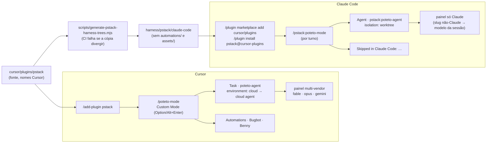

# 02 — pstack: visão geral, arquitetura e paridade Cursor × Claude Code

> **Fonte.** Mirror verbatim de `cursor/plugins` no commit `bf0c7cd8` (2026-11-14), em [`mirror/pstack/`](mirror/pstack/). Versão `0.15.42` ([`plugin.json`](mirror/pstack/plugin.json)). Licença MIT ([`LICENSE`](mirror/pstack/LICENSE)). O repositório `github.com/poteto/pstack` não existe. A casa canônica é `github.com/cursor/plugins/tree/main/pstack`. Os 30+ repos chamados `*pstack*` no GitHub são ports de terceiros.

## 1. O que é

Lauren se apresenta no [`README.md`](mirror/pstack/README.md) como alguém que trabalhou com "millions of lines of code at Meta, Netflix, and Cursor", e diz estar no time core do React Compiler. O pstack é a resposta dela ao slop:

> "i don't want to ship like a team of twenty slop artists. throughput without quality is not a goal i aspire to. if you want to go fast, go deep first."

> "**pstack gives you fearless parallelism.** when you can go deep on one agent and trust it to write good, verifiable code, you can truly parallelize with confidence."

> "the goal is not to maximize loc, in fact it's the opposite. pstack helps you write less, but higher quality code."

Pela palestra complementar ([01](01-a-palestra.md#palestra-complementar-sessão-de-55-min-sobre-confiança-verificação-e-pstack)), o pstack cresceu uma skill por vez, cada uma nascida de uma falha observada em agentes. O nome brinca com o `gstack` de Garry Tan.

## 2. Anatomia

| Peça | Quantidade | Papel | Catálogo |
|---|---|---|---|
| `poteto-mode` (router) | 1 skill + 23 playbooks + scripts | lê o pedido, escolhe um playbook, copia os passos para uma todo list e chama as outras skills quando um passo pede | [05](05-catalogo-poteto-mode-playbooks.md) |
| Princípios (`principle-*`) | 24 | uma regra cada; `poteto-mode` os indexa inline e lê o índice no início da tarefa | [03](03-catalogo-principios.md) |
| Skills situacionais | 33 | `how`, `why`, `architect`, `arena`, `swarm`, `interrogate`, `tdd`, verificação, `statechart`, `correct`, `reflect`… | [04](04-catalogo-skills-agentes-automacoes.md) |
| Agentes | 2 | `poteto-agent`, wrapper dos delegados que lê `poteto-mode` inteiro, e `comment-sicko`, revisor de comentários só-leitura | [04](04-catalogo-skills-agentes-automacoes.md) |
| Automação Benny | 1 pack dormente | triagem de reports no Slack, reprodução e correção com evidência de UI. Só Cursor | [04](04-catalogo-skills-agentes-automacoes.md) |
| Guia | 10 capítulos | setup → poteto-mode → entender → desenhar → construir/limpar → verificar/enviar → overnight → princípios → personalizar → receitas | [`docs/guide/`](mirror/pstack/docs/guide/README.md) |

O README pede para chamar `/poteto-mode` sempre que a tarefa exigir rigor. As outras skills disparam sozinhas quando os passos pedem.

```text
/poteto-mode this pr has a subtle bug where the scroll drifts every 750ms even when idle. repro first, then fix and verify.
/poteto-mode i'm going to bed. land the stack even if ci flakes. i want everything merged by morning.
```

O guia resume tudo em uma regra: "Give the agent a goal and a way to check it, in your own words" ([`docs/guide/README.md`](mirror/pstack/docs/guide/README.md)).

### Modelos por papel

`/setup-pstack` grava um rule com o modelo de cada papel. O default no README:

- delegados de código (feature, refactoring, bug fix, perf, hillclimb), prosa e julgamento vão para **opus 5.5**;
- as mudanças mais difíceis vão para **fable 5.2**;
- o painel default é **fable 5.2 / opus 5.5 / gemini 4 carbon**.

Várias skills usam painéis multi-modelo de propósito: `interrogate`, `arena` e o juiz do `eval`.

### "Por que não há skills de planejamento?"

O README responde, e isso conflita com o fluxo spec-first do usuário (ver [07](07-aplicacao-software-factory-e-run-spec.md)):

> "cursor already has a great plan mode which works great with pstack. but personally, i don't believe in planning. the best spec is code. if you do want to make a plan, `/poteto-mode` covers it, but it's not a default."

Quando há plano, o playbook `multi-phase-plan` o torna checável por máquina com `scripts/check-plan.mjs` (ver [05](05-catalogo-poteto-mode-playbooks.md)).

## 3. Cursor × Claude Code

O pstack é escrito para o Cursor, com nomes de ferramentas do Cursor. O próprio repositório gera e mantém um port para o Claude Code.

| Aspecto | Cursor | Claude Code | Fonte |
|---|---|---|---|
| **Instalação** | `/add-plugin pstack` (Cursor Marketplace) | `/plugin marketplace add cursor/plugins` + `/plugin install pstack@cursor-plugins` | [`README.md`](mirror/pstack/README.md). Os docs locais confirmam o marketplace do Claude Code (`ai/docs/claude-code/skills/research-claude-code-skills-format.md:34`) e o Cursor Marketplace (`ai/docs/cursor/plugin/plugins.md:45-49`). O comando `/add-plugin` não está nos docs espelhados do Cursor. |
| **Árvore instalada** | `pstack/` direto | `harness/pstack/claude-code/`, uma cópia gerada por `scripts/generate-pstack-harness-trees.mjs`; a CI falha se ela estiver desatualizada | `.claude-plugin/marketplace.json` de `cursor/plugins@bf0c7cd` aponta `"source": "./harness/pstack/claude-code"` |
| **O que fica de fora no Claude Code** | — | `automations/` (Benny) e `assets/`; links para eles apontam para o GitHub | `harness/pstack/README.md` |
| **Auto-update** | gerenciado pelo Cursor | desligado para marketplaces de terceiros; liga em `/plugin` → marketplaces → `cursor-plugins` → enable auto-update | [`README.md`](mirror/pstack/README.md) |
| **Nome dos comandos** | `/poteto-mode` | `/pstack:poteto-mode` (prefixo do plugin) | idem |
| **Manter a skill ligada entre turnos** | **Custom Mode**: escolher no `/` e apertar Option/Alt+Enter | não há equivalente; invoca por turno | `ai/docs/cursor/skills/agent-skills-guide.md:31,220` |
| **Rodar outra skill do pstack** | `/name` | `Read <pstack>/skills/<name>/SKILL.md` e seguir, porque "The `Skill` tool refuses most pstack skills" | [`docs/harness/claude-code.md`](mirror/pstack/docs/harness/claude-code.md) |
| **Subagentes** | `Task`, `subagent_type`, `readonly`, `environment: "cloud"` | `Agent`; `readonly: true` → `Explore` mais "do not edit files" e checagem de `git status`; `environment: "cloud"` → `isolation: "worktree"` | idem, tabela "Subagent fields" |
| **Modelos** | slugs como `claude-opus-5-5-xhigh`, `gemini-*` | `model: "opus"` + `effort: "xhigh"`; slug não-Claude → omite `model` e roda no modelo da sessão. **Painéis multi-modelo viram mono-vendor.** | idem, tabela "Models" |
| **Config de modelos** | `~/.cursor/rules/pstack-models.mdc` | `~/.claude/rules/pstack-models.md`, carregado em toda sessão | idem |
| **Rules sempre aplicadas** | `.cursor/rules/*.mdc` | `CLAUDE.md`/`AGENTS.md`; "Claude Code never reads `.mdc` files" | idem, tabela "Paths" |
| **Skill de verificação nativa do harness** | nenhuma embutida; os docs sugerem criar um subagente `verifier` em `.cursor/agents/verifier.md` (`ai/docs/cursor/subagents/subagents-guide.md:303-329`), sem receita de launch nem feature map; o pstack fornece `/create-verification-skill` | `/run-skill-generator` (`.claude/skills/run-<name>/`) e `/verify` (grava `.claude/skills/verify/SKILL.md`), sem feature map | `ai/docs/claude-code/skills/extend-claude-with-skills.md:62-64` |
| **Transcripts** (para `/recall`, `/automate-me`, `/correct`) | `~/.cursor/projects/<slug>/agent-transcripts/` | `~/.claude/projects/<slug>/<session>.jsonl` | idem |
| **Recursos só do Cursor** | Automations (routines, webhooks), Bugbot, cloud agents, PR tool nativo | o passo é pulado com uma linha `Skipped in Claude Code: <step>. <reason>.`; Bugbot vira thread comum de review; PR via `gh pr create` | idem, "Cursor-only features" |

### Diagrama: a mesma skill nos dois harnesses



### Lacunas de paridade que importam para validação

1. **Diversidade de modelo.** `interrogate`, `arena`, o juiz do `eval` e os painéis do `autopilot-full` assumem famílias diferentes. No Claude Code, um slug `gemini-*` cai para o modelo da sessão. O valor adversarial de "outro modelo tenta quebrar" vira "outro contexto, mesmo modelo".
2. **Verificador em máquina própria.** `shipping` e `autopilot-full` usam um cloud agent por PR, com o app rodando "the way a user would". No Claude Code isso vira worktree local, e o app sobe na mesma máquina. Isso afeta portas, recursos e paralelismo.
3. **Outer loop.** Automations, Benny e routines, que são o "factory" do slide final, não existem no Claude Code. O equivalente teria de vir de fora: `/loop` e `/schedule` no Claude Code, ou um script como o do `software-factory`.
4. **Mode persistente.** No Cursor o rigor fica ligado na sessão inteira. No Claude Code é preciso reinvocar a cada turno, ou usar um `CLAUDE.md` do projeto.

## 4. O fio condutor

O pstack é a forma operacional da pirâmide da palestra:

- **Codebase e static analysis**: `/correct`, `/no-comments`, `/unslop`, os princípios `encode-lessons-in-structure`, `type-system-discipline` e `boundary-discipline`, e `/architect`.
- **Verification**: `/create-verification-skill` com feature map, `/maintain-verification-skill`, `/create-formal-verification-skill`, `/maintain-formal-verification-skill`, `/statechart`, `/blast-radius`, `/interrogate`, `/benchmark-checklist`, e os princípios `prove-it-works`, `sequence-verifiable-units` e `test-behavior-not-implementation`.
- **Prose**: o próprio `poteto-mode` e as skills. Ela as trata como soft, por isso as liga a scripts como `check-plan.mjs` e `watch-pr`.
- **Human review**: o que sobra, cada vez menor. O alvo é revisar artefatos de verificação, não diffs.

O doc [06](06-validacao-de-fluxo-agentico.md) detalha como isso vira um método de validação de fluxo agêntico.
