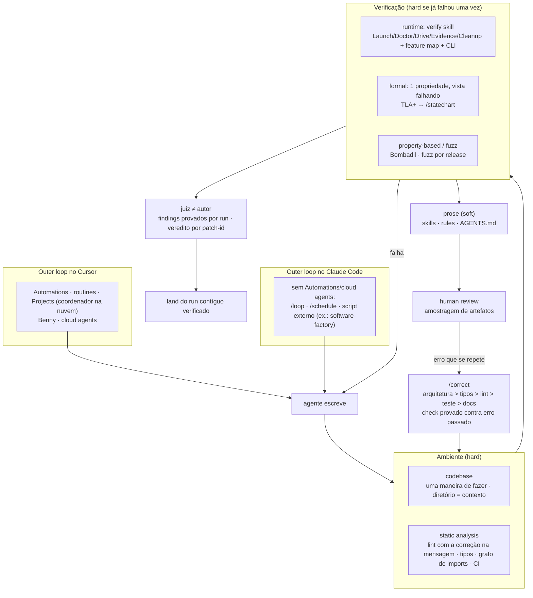

# 06 — A abordagem de Lauren Tan como método de validação de fluxo agêntico

> **Base.** As três falas de [01](01-a-palestra.md), o pstack espelhado em [`mirror/pstack/`](mirror/pstack/) (catálogos [03](03-catalogo-principios.md), [04](04-catalogo-skills-agentes-automacoes.md) e [05](05-catalogo-poteto-mode-playbooks.md)) e as claims confirmadas da deep research (ver [08](08-referencias.md)). Este documento organiza o que ela faz como um método. A organização em oito pilares é leitura deste estudo; ela não usa esses nomes. Toda regra citada tem fonte primária.

## 1. A tese em uma frase

Validar um fluxo agêntico não é revisar a saída do agente. É **construir um ambiente em que a saída errada não compila, não passa no lint ou falha numa verificação que o próprio agente executa**, e deixar a revisão humana só para o que sobra. Ela chama o objetivo de *trust*: "Not blind trust but investing in your agents environment so you can trust that your agents are going to do the right thing" ([01, 0:00](01-a-palestra.md#000--transformar-slop-em-ouro)).

A pirâmide ([slide 2:05](assets/talk/000205-potato-pyramid.jpg)) funciona ao mesmo tempo como ordem de investimento e como ordem de gates. A camada de cima é a mais barata e mais reprodutível; a de baixo é a mais cara.

| Camada | Gate que ela produz | É hard ou soft? |
|---|---|---|
| codebase | o jeito errado não existe (API, arquitetura, diretórios) | hard: não há o que errar |
| static analysis | CI vermelho (lint com a correção na mensagem, tipos, compilador, testes, grafo de imports) | hard: "these two actually make CI red" |
| verification | o agente roda o app ou o modelo e vê falhar | hard, se o check já foi visto falhando |
| prose | rules, skills, AGENTS.md, Bugbot | soft: "Your agents can still forget" |
| human review | amostragem de artefatos, não leitura de diff | caro; o objetivo é encolher |

## 2. Os oito pilares

### Pilar 1 — Toda correção vira estrutura

- **Regra.** "whenever you're correcting your agent, think about how you can make that a deterministic check instead of adding another line to your rules". Cada vez que um humano impõe uma invariante em code review, "you should consider that as a code smell".
- **Ordem de preferência.** É a do `/correct` ([`skills/correct/SKILL.md`](mirror/pstack/skills/correct/SKILL.md)):
  1. "Eliminate it with architecture".
  2. "Enforce it with types".
  3. Um lint ou CI "whose error names the file, type, or function to use instead". Quando o padrão já é comum, falha só quando a mudança acrescenta mais ocorrências.
  4. "Test the behavior".
  5. "Write docs or agent rules last, only for judgment calls. Nothing fails when an agent skips them."
- **Prova.** "Prove each new check fails on a real past mistake. Run the same command locally and in CI." Uma classe de erro só conta depois de ocorrer duas vezes.
- **Registro.** Uma tabela no arquivo de instruções liga cada regra ao que a impõe. Uma regra sem enforcer que volta a ser violada é tratada como repetição e sobe de nível. Uma regra cai quando o erro deixa de ser possível.
- **Na prática do Grok Bot.**
  - `useEffect` banido em código de produto.
  - Imports entre `electron-main/` e `electron-renderer/` banidos, "not even types".
  - 99% dos comentários banidos: 65.824 → 1.229.
  - A escada de regras foi de 7 para 167 em quatro meses.
  - "the shortest path is the best path": o atalho que o agente vai tomar é desenhado para ser o caminho certo.

### Pilar 2 — "Pronto" é o artefato real, com a condição escrita antes

- **Princípio.** `principle-prove-it-works` ([03](03-catalogo-principios.md)): verificar "against the real artifact (run the feature, read the actual value, inspect the diff), not a proxy, self-report, or 'it compiles'".
- **Condição de término no primeiro prompt.** O guia pede para escrevê-la logo no início ([`docs/guide/06-verify-and-ship.md`](mirror/pstack/docs/guide/06-verify-and-ship.md)): "Now the agent has three checks it can run, not a mood to satisfy." A resposta traz comandos e saídas. "inconclusive" é um resultado válido. "A confident reply without evidence is a warning sign."
- **O check acompanha a mudança.**

  | Mudança | Check |
  |---|---|
  | CLI | roda o comando real |
  | UI | percorre o fluxo no app rodando, ou faz diff de pixels contra um baseline congelado (`visual-parity`) |
  | parser ou migration | replay de um input salvo |
  | perf | perfis antes e depois |
  | storage | lê o valor de volta |

- **Bug fix.** Verifica-se "on the same surface" da reprodução original (`bug-fix.md`). Um green build não é sucesso, e o guia lista isso como pitfall.
- **Planos multi-fase.** O `check-plan.mjs` exige em cada PR os blocos `Verify, unit.`, `Verify, live.` (10 lanes, cada uma com screenshot e "Pass when") e `Verify, perf.` (Metric, Probe, Baseline, Rule). Exige também a frase "Tests alone are not sufficient verification. A PR is verified only when its unit, live, and perf boxes are all checked." O checker valida a forma, não a execução ([05 §1.7](05-catalogo-poteto-mode-playbooks.md)).

### Pilar 3 — Um oráculo de runtime reutilizável: verify skill + feature map + CLI

- **Por quê.** "you are the verifier [...] you're the bottleneck". Verificação "is the thing that really closes the loop" e é o que faz um loop ser loop ([01, live §5](01-a-palestra.md#live-com-matt-pocock-poteto-creator-of-pstack-on-shipping-1000s-of-prs-a-month-at-spacex)).
- **O que o `/create-verification-skill` gera.** Ele "interviews the repository, not you" e escreve `.cursor/skills/verify-<app>/`, ou `.claude/skills/` no Claude Code ([02 §3](02-pstack-visao-geral.md)). A skill gerada tem:
  - seções **Launch, Doctor, Drive, Evidence, Cleanup**, mais Helpers;
  - um **feature map** com um README de índice e um arquivo por feature, cada um com quatro H2: *Sub-features*, *How to get to it (user POV)*, *Driving it with \<harness\>*, *Gotchas*.

  Exemplo: [`references/feature-map-example/search.md`](mirror/pstack/skills/create-verification-skill/references/feature-map-example/search.md). Cada passo nomeia o comando do driver e o resultado observável, com seletores por papel ARIA. O exemplo completo de um app grande é [`mirror/verification-skill-example/`](mirror/verification-skill-example/), com 34 features; a comparação está em [04](04-catalogo-skills-agentes-automacoes.md).
- **Provado antes de entregar.** O gerador roda launch, doctor, drive de uma feature, captura de evidência e cleanup, e confirma que a evidência sobreviveu ao cleanup. "If that proof fails, don't use the output."
- **Mantido.** `/maintain-verification-skill` roda "at least once a day", de preferência por automação. Ele termina em `clean`, `changed` (um PR de correções restrito ao diretório da skill) ou `blocked`. Nunca edita código de produto. Se acha uma regressão, reporta em vez de escondê-la com uma edição de doc.
- **Construir a alavanca.** Uma CLI de controle no lugar de scripts descartáveis. Sem ela, os agentes "would basically rebuild the world each time and then every agent did it differently". O guia lista as traits de uma boa CLI:
  - poucos comandos componíveis;
  - `--dry-run` no que é destrutivo;
  - subcomandos progressivos;
  - erros que dizem o que fazer;
  - `--help` rico;
  - saída JSON.

  O princípio por trás: "extract out the deterministic parts and turn that into code and just leave only the parts that actually require judgment to the agent".
- **Escala.** Com a skill pronta, um `/swarm` divide uma passada completa por entrada do feature map.

### Pilar 4 — Verificar o que nenhum caminho dirigido alcança

- **Formal.** `/create-formal-verification-skill` escolhe "the strongest target, not the easiest to verify": uma promessa do código cuja quebra fere usuários e que os testes raramente alcançam (retries sobrepostos, lease que expira no meio da escrita, eventos fora de ordem). A pergunta escolhe a ferramenta: TLA+ para ordem de eventos, um verificador no código para "every input", prova para "every size". As regras:
  - **Able to fail.** "A check that you have never seen fail proves nothing". A propriedade tem de falhar numa variante quebrada do código.
  - **Findings stay findings.** Não se enfraquece a propriedade até ela passar.
  - **Escopo declarado.** "A pass covers the model or the bound, not the whole system."
  - **Sincronia.** Registra a cobertura e o commit em que o check bateu com o código. `/maintain-formal-verification-skill` diz se cada falha é "drift in the verification or a bug in the code".
- **Statechart para quem decide.** `/statechart` gera um Mermaid do que o usuário vê a partir do modelo TLA+ checado, "so the picture and the checked model can't drift apart". As regras do dono viram invariantes, e o relatório dá o caminho mais curto até cada estado quebrado nas palavras dele. Antes de entregar, cada caminho de bug é reproduzido no código real. Precisa de TLC e Java via `mise` na primeira execução.
- **Property-based e fuzz.** Bombadil gera entradas aleatórias contra a UI. A cada release, um fuzz do build inteiro "like a real user", que compara com a versão anterior e separa NEW de PRE-EXISTING ([slide 16:35](assets/talk/001635-fuzz-thread.jpg)).
- **Ressalva dela.** "certainly not a silver bullet": formal e Bombadil ainda são experimentos.

### Pilar 5 — Independência e findings que um run prova

- **Quem julga não escreveu.** "Only a verdict from an agent that did not write the code counts, because an author checks what it meant to build" (`shipping.md`). "Green CI alone never authorizes a merge" (`autopilot-full.md`).
- **O veredito pertence ao patch.** "A verdict covers one patch and green CI covers one head". Uma comparação por `git patch-id` decide se um veredito sobrevive a um rebase.
- **Land do run contíguo verificado.** Sobe-se a partir da base e para no primeiro PR sem `PASS`. Um PR verificado acima de um não verificado espera ([05, shipping](05-catalogo-poteto-mode-playbooks.md)).
- **Findings precisam de um run.** No `/interrogate`, adversários de famílias de modelo diferentes tentam quebrar a mudança: "Prove each finding with a run against the real code [...] Leave out anything you did not run. That covers style, naming, structure". O orquestrador re-roda cada comando e mantém o finding "when the output shows the failure and the failure breaks the intent".
- **Regra de bloqueio.** No `autopilot-full`, só bloqueia "a bug a user would hit, a failed gate, or a wrong shipped doc". O que a base já tinha vira follow-up.
- **Re-verificação proporcional.**
  - Swarm completo no head code-ready, e de novo só para comportamento novo ou diff grande.
  - Um verificador para rebase ou correção pequena.
  - Só CI para mudança de texto.
- **Afrouxar um gate exige countersign** de quem não quer o verde: "because the owner is the one who wants green".

### Pilar 6 — Números e evals com o mesmo rigor

- **`/benchmark-checklist`** faz sete perguntas, cada uma com evidência de run:
  1. O que limita o número?
  2. Os dois lados rodaram tunados como em produção?
  3. O número quebra um limite físico?
  4. Houve erro?
  5. Reproduz em runs alternados (mediana e range)?
  6. Importa ponta a ponta?
  7. O trabalho aconteceu na região medida?

  O veredito é faster, slower, sem diferença mensurável ou inconclusive.
- **Evals de skill** ([05, eval](05-catalogo-poteto-mode-playbooks.md)), "like a unit test for an agent":
  - a rubrica é vista só pelo juiz;
  - os candidatos rodam em diretórios com nomes neutros, porque "agents can actually tell and when they do they change their behavior";
  - os candidatos usam modelos diferentes;
  - o juiz é de outra família;
  - hill climb com `/loop` "until everything is 10 out of 10".

  Ela fez isso com a própria verify skill. Mudou a skill, roda o eval.

### Pilar 7 — Escalar só depois que o loop interno é confiável

- **Sequência.** A trust curve/ladder vai do micromanagement ao auto-merge. "there's really no shortcut". "don't automate a bad loop [...] improve your loop before automating!" Se o inner loop produz slop, automatizar "just produces more slop and you need to throw more and more and more tokens at the problem".
- **Começar local.** "the best place to start is local because you can observe". Depois cloud agents e automations. Pular para milhares de agentes "you're just going to waste a lot of tokens".
- **Inner × outer loop.** O inner loop trabalha sobre um snapshot da intenção. O outer loop (Grok Bot, connectors, routines) puxa contexto novo e o entrega a coordenadores, os "chief of staff". Coordenadores **agrupam** reports relacionados em vez de abrir um agente por report.
- **Buffer.** Uma routine que encontra padrões banidos só anota. A pessoa lê o acumulado e acha o padrão maior.
- **Review por amostragem.** "sampling instead of blocking". Revisar o histórico de commits de manhã, reverter, e acrescentar uma lint rule quando o problema se repete entre agentes.
- **Medir a confiança.** A taxa de revert ficou em ~0,5% com 11k PRs/mês, junto com métricas de performance antes e depois. O slide mostra também as regressões ([01, 13:32](01-a-palestra.md#1332--11000-prs-e-taxa-de-revert-de-05)).
- **Custo.** 70% dos tokens vão para verificação, segundo Cindy Sridharan, e ela confirma o mesmo padrão: "most of my token usage goes to verification".

### Pilar 8 — O processo aprende com a própria história

- **`/reflect`.** Depois de uma tarefa longa, reviewers paralelos (julgamento, tooling, divergente) e um sintetizador propõem edições de skill para aprovação humana ([04](04-catalogo-skills-agentes-automacoes.md)).
- **`/correct`.** Minera commits, reverts, comentários de review e workarounds atrás de classes de erro (pilar 1).
- **`/recall` e `/automate-me`.** Transcripts passados são "the process materialized"; as intervenções repetidas viram lint rules ou skills ([01, live §14](01-a-palestra.md#live-com-matt-pocock-poteto-creator-of-pstack-on-shipping-1000s-of-prs-a-month-at-spacex)).
- **`/show-me-your-work`.** Uma trilha de decisões em TSV append-only, versionável, auditada contra o transcript.
- **Skills encolhem.** O que é determinístico vai para script; a skill fica só com o workflow.

## 3. Diagrama do método

Cursor e Claude Code aparecem em nós separados onde o mecanismo difere (regra do `CLAUDE.md` do projeto).

## 4. Checklist para validar um fluxo agêntico

Cada pergunta vem de um pilar. Um "não" é uma lacuna a fechar antes de automatizar mais.

1. Cada correção humana recorrente virou arquitetura, tipo, lint, CI ou teste? Existe uma tabela regra → enforcer? (P1)
2. Cada check novo foi visto falhando num erro passado real? (P1, P4)
3. A condição de "pronto" de cada unidade está escrita antes do trabalho e é checável por comando? (P2)
4. A evidência é o artefato real, e não "tests pass" ou "build green"? Inconclusivo é aceito como resposta? (P2)
5. Existe um jeito scriptado, versionado e mantido de subir e dirigir o app, com um mapa de features do ponto de vista do usuário? (P3)
6. O oráculo é auditado contra o app real com frequência e reporta regressões em vez de escondê-las? (P3)
7. As partes com concorrência, retries ou máquinas de estado têm uma propriedade checada além dos testes de exemplo? (P4)
8. Quem dá o veredito não escreveu o código? O veredito está atrelado ao patch ou head exato? (P5)
9. Um finding bloqueante precisa de um run que o prove? A regra de bloqueio separa o que o patch introduziu do que a base já tinha? (P5)
10. Afrouxar um gate exige alguém que não quer o verde? (P5)
11. Os números (perf, eval) passam por um checklist de limitador, repetição e relevância? (P6)
12. O loop interno é confiável em execução local observada antes de virar automação? (P7)
13. Há uma métrica de confiança ao longo do tempo (taxa de revert, regressões escapadas)? (P7)
14. O review humano é por amostragem de artefatos, e cada padrão repetido volta para o ambiente? (P7, P1)
15. Mudanças nas skills e prompts do próprio fluxo passam por um eval cego antes de entrar? (P6, P8)

## 5. Limites e críticas

- **Os números são autodeclarados.** 3.000 PRs dela, 11k do time e 0,5% de revert vêm de uma pessoa e de um time, sem auditoria externa. O mesmo slide de performance mostra regressões que a fala omite: memória idle +12%, idle CPU +100%, js+css no startup +285%.
- **Viés de recursos.** "I work at an AI lab where we have unlimited tokens." A verificação come 70% dos tokens. Ela própria diz que o ROI depende de cada um fazer a conta.
- **Ela controla o codebase.** O Dune, o ban de comentários e o grafo de imports são decisões do dono do repositório. Num repositório de terceiros, a camada codebase não é de quem roda o fluxo.
- **Verificabilidade do domínio.** Para one-way doors em domínios difíceis de verificar, ela diz que não tem resposta.
- **Formal e PBT ainda são experimento**, nas palavras dela.
- **Paridade de harness.** No Claude Code, os painéis multi-modelo caem para um único fornecedor, e os cloud agents viram worktrees locais ([02 §3](02-pstack-visao-geral.md#3-cursor--claude-code)). A independência passa a vir do contexto, não do modelo.
- **"Não acredito em planejamento."** O método dela assume que o código é a spec. Fluxos spec-first precisam traduzir a ideia: o critério de aceite executável é que faz o papel do "código como spec". Ver [07](07-aplicacao-software-factory-e-run-spec.md).
