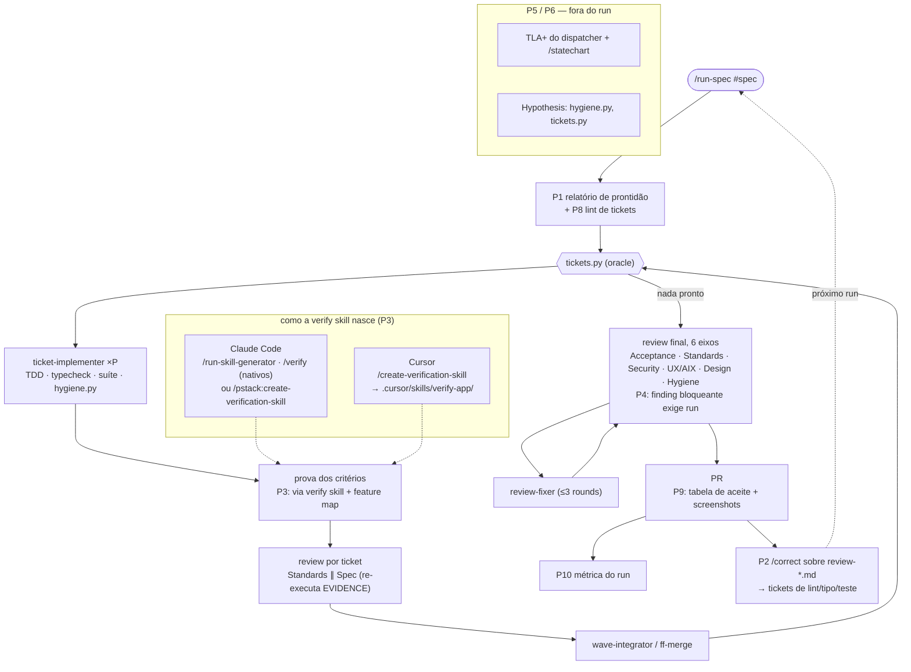

# 07 — Aplicação ao `/run-spec` e ao `software-factory`

> **Versões analisadas.**
> - **`/run-spec`**: branch `feat/run-spec-aaa` em `8f79b33` (2026-11-15), em `ai/skills/run-spec/`. É a versão instalada em `~/.claude/skills/run-spec`. Não é a versão de 5 eixos que está em `main` (`e948668`). Tem 6 eixos no review final (Acceptance, Standards, Security, UX/AIX, Design, Hygiene) e é um kit autocontido, sem depender da skill `code-review` pinada. Os caminhos abaixo são relativos a `ai/skills/run-spec/` nesse commit.
> - **`software-factory`**: `~/Workspace/software-factory` em `1dffd43`, plugin 0.1.8, spec #38. O mapa completo, com evidência `file:line` e ADR, está em [`sources/software-factory-validation-map.md`](sources/software-factory-validation-map.md), escrito por um agente de pesquisa só-leitura.
>
> **Caveat central do software-factory.** Todo teste stuba o Claude. Os textos dos agentes só serão julgados nas acceptance runs (#79, aberta). "Construído" aqui significa que o esqueleto determinístico tem testes, e não que o loop esteja provado.
>
> As propostas são inferência deste estudo. Lauren não fala desses dois sistemas.

## 1. Resumo

1. **Os dois sistemas já aplicam boa parte do método.**
   - O `hygiene.py` do `/run-spec` é o "ban de comentários + nada de Markdown não solicitado" dela, transformado em gate determinístico.
   - O `acceptance-verifier` é o `prove-it-works`: executa cada critério pelo entry point público, com comandos re-executáveis e tiers A/B/S.
   - O `software-factory` faz do script o verificador de registro. Lê o profile do commit base para o agente não afrouxar o próprio check. E condiciona o auto-merge a dados do ledger: é a trust curve dela escrita como regra.
2. **As maiores lacunas estão nas camadas que ela mais valoriza.**
   - (a) Não há um oráculo de runtime reutilizável (verify skill + feature map + CLI); cada round redescobre como subir o app.
   - (b) Correções recorrentes não viram checks no repositório-alvo. Os padrões do alvo são impostos só por prosa de reviewer.
   - (c) Os eixos de julgamento são LLM lendo diff. Em runs anteriores do `/run-spec`, quando o review final tinha só os 2 eixos Standards e Spec, o fixer dispensou cerca de metade de 228 findings (ADR 0016 do software-factory). A versão de 6 eixos ainda não tem esse número.
   - (d) As máquinas de estado dos próprios orquestradores (recovery, rounds, ledger) só têm testes de exemplo.
3. **No software-factory, o conselho dela que mais importa é o mais simples.** "the best place to start is local because you can observe". O loop ainda não rodou ponta a ponta com agentes reais (#79). Antes de acrescentar máquina, é preciso rodar e observar.

## 2. Onde a abordagem dela não transfere

| Ponto dela | Choque | O que fazer |
|---|---|---|
| "i don't believe in planning. the best spec is code" (README do pstack) | Os dois sistemas são spec-first: `to-spec` e `to-tickets` do Matt Pocock, ADRs, grilling | Manter spec-first. A spec é o contrato com o dono num fluxo AFK. Traduzir a ideia dela para "**cada critério de aceite é executável**", o que o `acceptance-verifier` já faz. Na live com Matt, ela mesma sugere "combine Wayfinder with poteto-mode" ([01](01-a-palestra.md#live-com-matt-pocock-poteto-creator-of-pstack-on-shipping-1000s-of-prs-a-month-at-spacex)) |
| Auto-merge noturno, com review do histórico de manhã | Software-factory v1 fica no estágio C: todo job termina em PR que o dono mergeia (ADR 0002, ADR 0007). `/run-spec` só mergeia com `--merge` | Não mudar. O critério de entrada no estágio D (≥30 aprovações pareadas, nenhuma regressão nas últimas 30, janela de 14 dias) é exatamente "subir a curva com dados" |
| Ela é dona do codebase: Dune, ban de `useEffect`, grafo de imports | O software-factory roda em repositórios de terceiros. A camada codebase pertence ao dono do alvo | Os checks novos no alvo entram como propostas que o dono aceita (retro → follow-up job, ADR 0034), nunca impostos pela fábrica |
| Outer loop no Cursor: Automations, Projects, cloud agents, Benny | Os dois sistemas rodam no Claude Code, que não tem nada disso ([02 §3](02-pstack-visao-geral.md#3-cursor--claude-code)) | O outer loop do software-factory é o script no host (ADR 0009). No `/run-spec`, é o dono chamando. Não importar o modelo dela de coordenadores na nuvem |
| Painéis multi-fornecedor (`interrogate`, `arena`, juiz do `eval`) | Tudo é Claude. Os agent files pinam Opus/Sonnet | A independência vem de contexto, ferramentas e prompt. Diversidade real exigiria um caminho Cursor SDK (P7) |
| "unlimited tokens" | Orçamento real | O padrão dela é um swarm completo só no head code-ready e um verificador para mudanças pequenas. Isso é o que deixa a verificação barata o bastante |

## 3. Pirâmide × `/run-spec` × `software-factory`

| Camada | `/run-spec@8f79b33` | `software-factory@1dffd43` | Lacuna real |
|---|---|---|---|
| **codebase** | Não toca a arquitetura do alvo. `axes/design.md` revisa módulos, mas em prosa | Idem. Profile, protected list e escalações protegem o processo, não o design do alvo | Nenhum mecanismo leva um erro recorrente para a arquitetura do alvo |
| **static analysis** | O implementer roda typecheck e a suíte completa. **`hygiene.py`** bloqueia comentário e Markdown adicionados, com teste (`test_hygiene.py`) | O script roda os comandos `verify` do profile depois do implementer, do integrator e de cada fixer (`verification.py`, ADR 0027). Protected list, secret scan (gitleaks), teste apagado escala (ADR 0010). O `CODING_STANDARDS.md` da própria fábrica tem "Enforced by tooling" e `[check candidate]` | No alvo, os padrões são impostos só pelo reviewer de Standards lendo prosa. Não há ponte de "finding recorrente → lint" |
| **verification (runtime)** | `acceptance-verifier`: cada user story e critério pelo entry point público, tiers A/B/S, probes reaproveitados via `PREVIOUS`, scope creep. Também o implementer prova cada critério antes do review | Lentes de browser UI e UX via Chrome DevTools MCP, com screenshots e Lighthouse. **BUILT-blocked**: imagem sem Chrome (#102), app sem screens não dispara lente (#103). **Nenhum componente executa os critérios de aceite** | Não há oráculo reutilizável: o verifier "Read the repo's agent docs and README for how to build and run it" a cada round. Não há feature map. No software-factory, falta a execução dos critérios |
| **verification (formal / PBT)** | Nenhuma. Testes por exemplo (`test_hygiene.py` 232 linhas, `test_tickets.py` 112) | Nenhuma | As máquinas de estado do dispatcher, do ledger e dos owner acts nunca foram checadas além de exemplos |
| **prose** | Briefs de 6 eixos, `guides/tdd.md`, agent files com HARD_RULES | Agent files, `merge-policy.md`, prompts | Ok. É a camada soft, e ela recomenda não depender só dela |
| **independência** | Reviewers são agentes separados do implementer; o Spec reviewer re-executa os `EVIDENCE:` do implementer. O review por ticket é spawnado pelo próprio implementer | O script roda o review por ticket ("a leaf agent cannot spawn one"). O approver não roda nada e trata relatórios de agentes como alegações | O fixer, que é agente, julga os findings e pode dispensar Standards/Spec sem escalar. Tudo um fornecedor só |
| **human review** | Dono lê o PR com o relatório da última rodada | Dono mergeia. Audit compara PR com ledger. Retro proposta pelo agente e aceita pelo dono | O PR não carrega artefatos visuais. No software-factory, screenshots ficam locais (ADR 0023) |
| **métrica de confiança** | Nenhuma entre runs | Ledger: vereditos × atos do dono, `sf regression`, scan de reverts, critério do estágio D | `/run-spec` não mede nada ao longo do tempo |

## 4. Propostas

Cada proposta traz o problema com evidência, o que muda concretamente, o custo, o argumento contrário e o alvo. A ordem é a recomendada.

### P1 — Gate de prontidão antes de automatizar ("don't automate a bad loop")

- **Problema.** O `/run-spec` checa só `docs/agents/issue-tracker.md` e `max-parallel` (passo 1) antes de despachar N implementers. O software-factory faz o *profile check*: roda cada comando antes da aprovação (ADR 0026). Mas a spike S9 mostrou que "verify verde" nos pilotos não sobe Postgres, e 15 de 96 arquivos de teste do `med-trilha` não rodam nem na fábrica nem no CI.
- **O que muda.** Um relatório de prontidão do alvo antes do primeiro wave/job, com quatro linhas:
  1. Existe typecheck e lint no comando de verify?
  2. A suíte cobre os testes de integração ou os pula?
  3. Existe um jeito scriptado de subir o app (verify skill ou `[app]` do profile)?
  4. Os critérios dos tickets têm superfície observável (P8)?

  No `/run-spec`, o relatório vai para o report do passo 7. No software-factory, entra no profile check e na aprovação do dono.
- **Custo.** Baixo. São leituras e um comando.
- **Contra.** Pode virar burocracia que ninguém lê. Por isso o relatório informa e não bloqueia. Bloquear é decisão do dono.
- **Software-factory, antes de tudo.** Rodar as acceptance runs de #79 local e observadas, lendo transcripts e tool calls, como ela descreve. Isso vale mais que qualquer proposta abaixo.

### P2 — Fechar o loop "correção recorrente → check" (`/correct` sobre o histórico de review)

- **Problema.**
  - O `/run-spec` grava findings em `$STATE/review-<N>.md` e dispensas em `review-<N>-fix.md`. Os learnings vão só para o relatório e para `learnings.md`. Ninguém agrega isso entre runs.
  - No software-factory, a retro (ADR 0034) já transforma propostas `checks`/`standards` em follow-up jobs aceitos pelo dono. Mas não pede a hierarquia do `/correct` nem a prova de que o check falha.
  - O fixer dispensou cerca de metade de 228 findings nas runs antigas de 2 eixos (ADR 0016). O ADR avisa que isso mede quantas vezes o fixer discordou do reviewer, não quantas vezes o reviewer errou. É uma disputa recorrente que um check ou uma regra escrita resolveria.
- **O que muda.**
  - **`/run-spec`**: um passo opcional pós-relatório, ou uma skill irmã, que lê os `review-*.md` e `*-fix.md` de todos os slugs em `.git/run-spec/`. Agrupa findings e dispensas por classe; uma classe conta a partir de duas ocorrências. Para cada classe, propõe um ticket de follow-up no nível mais alto do `/correct`: arquitetura > tipos > lint com a correção na mensagem > teste > doc. O critério de aceite do ticket é "o check novo falha no commit X do run Y, onde o erro ocorreu".
  - **software-factory**: o formato do relatório da retro ganha os campos `level` e `fails_on` (o ponteiro `ledger:` ou `input:` do caso que o check teria pego). O alvo mantém uma tabela regra → enforcer, como no `CODING_STANDARDS.md` da própria fábrica.
- **Custo.** Médio.
- **Contra.** Num repositório de terceiros, lint novo é invasivo. Isso é resolvido pelo gate de aceitação do dono, que já existe.

### P3 — Oráculo de runtime reutilizável: verify skill + feature map consumidos pelo verificador

- **Problema.**
  - O `acceptance-verifier` (fase 1) lê README e docs para descobrir como buildar e rodar, a cada round. Só os probes passam de um round para o outro (`PREVIOUS`).
  - O implementer escreve probes em `<scratchpad>/t<id>/`, que se perdem.
  - É o "rebuild the world each time and then every agent did it differently" que ela descreve.
  - No software-factory, o mais próximo é o `[app]` do profile mais os globs de `[lenses] screens`. As lentes não têm um mapa do que dirigir.
- **O que muda.**
  - **`/run-spec`**: se o alvo tem `.claude/skills/verify-<app>/`, o verifier e o implementer usam Launch/Doctor/Drive/Evidence/Cleanup dela e a entrada do feature map que o ticket toca. Os probes que se repetem em vários runs viram comandos da CLI dessa skill, por um ticket de follow-up.
  - **software-factory**: o feature map vira um artefato aprovado junto com o profile, pelo hash, como o profile. As lentes de browser dirigem as entradas que o diff toca, e não globs. Um `maintain` periódico relata `clean`, `changed` ou `blocked`.
  - **Como gerar**:
    - **Claude Code, nativo**: o próprio Claude Code tem `/run-skill-generator`, que grava a receita de subir o app em `.claude/skills/run-<name>/`. Tem também `/verify`, que grava o que funcionou em `.claude/skills/verify/SKILL.md`, ou no diretório do pacote num monorepo (`ai/docs/claude-code/skills/extend-claude-with-skills.md:62-64`). Isso cobre o "rebuild the world each time" sem plugin, mas não traz o feature map nem a manutenção diária.
    - **Claude Code, com pstack**: `/pstack:create-verification-skill` traz feature map, prova ponta a ponta e `maintain`. Grava em `.claude/skills/verify-<app>/`, pela tabela de paths do adaptador. Skill de projeto em `.claude/skills/<nome>/SKILL.md` é o local documentado (`extend-claude-with-skills.md:161`).
    - **Cursor**: `/create-verification-skill` grava em `.cursor/skills/verify-<app>/`, o diretório de skills de projeto documentado (`ai/docs/cursor/skills/agent-skills-guide.md:67-68`). Um `.cursor/skills/` aninhado vale só para arquivos sob aquele diretório (`:129-141`).
    - **Ponto de partida barato:** o `acceptance-verifier` e o implementer podem ler `.claude/skills/run-*/` e `.claude/skills/verify/` quando existirem, antes de qualquer mudança maior.
- **Custo.** Médio a alto, uma vez por alvo, mais manutenção diária.
- **Contra.** Alvo sem UI (CLI, lib) ganha pouco com feature map. Ali o oráculo é a CLI pública, e o tier A atual já serve. Comece pelos alvos com app.

### P4 — Findings que bloqueiam precisam de um run (regra do `/interrogate`)

- **Problema.**
  - Standards, Design e parte do Spec são julgamento lendo diff.
  - O review-fixer decide e pode dispensar.
  - No software-factory, dispensar Standards ou Spec não força escalação (`review.py:243-248`).
  - O eixo Security já exige exploit path, mas não um run.
- **O que muda.**
  - Um finding de **correção de comportamento** (Spec, Design ou Standards) só bloqueia com um comando reproduzível: teste que falha, probe ou saída. O review-fixer re-executa o comando antes de decidir.
  - Sem o run, o finding vira advisory.
  - Findings de **conformidade a regra escrita** (Standards) bloqueiam citando a linha da regra. Isso desloca a pressão para P2: regra escrita boa vira check.
  - Security mantém o balde `needs-human` para crypto e config, onde o run é difícil e a perda é alta (estudo [`run-spec-review-axes`](../run-spec-review-axes/README.md)).
- **Custo.** Baixo nos briefs. Médio em tokens nos reviewers.
- **Contra.** Perde-se o finding real mas difícil de reproduzir. Por isso ele cai para advisory, e não some.

### P5 — Modelar e checar as máquinas de estado dos orquestradores (TLA+ + `/statechart`)

- **Problema.**
  - O dispatcher do `/run-spec` é uma máquina de estado com muitas regras:
    - órfãos merged, finished e unfinished;
    - `attempt` ≤ 2 e `resume` ≤ 2;
    - rounds ≤ 3, com round 3 só de verificação;
    - triage com teto 4;
    - `main-owner` com stash do trabalho abandonado;
    - markers `running/` lidos pelo watchdog.
  - Dos 9 commits de `feat/run-spec-aaa` sobre `main`, 6 são de correção (rounds 1–5 e smoke-run), e os 5 de rounds mexem nessa lógica ("resume, watchdog", "queue merging state", "queue holds on halt", "watchdog orphan cap, lost-agent markers", "per-invocation watchdog, name ownership").
  - No software-factory, o ledger (#82: a cauda pode ser reescrita sem detecção), os owner acts e os estágios A–E são máquinas do mesmo tipo.
  - Testes por exemplo não alcançam a ordem ruim de eventos. Esse é o caso de uso que ela dá para TLA+.
- **O que muda.** Um modelo TLA+ pequeno do dispatcher, com invariantes tiradas do próprio `SKILL.md`:
  - "um ticket nunca é integrado duas vezes";
  - "todo ticket do último ORACLE termina done, skipped ou stuck";
  - "o review termina";
  - "só os fixes do round 3 e de um round advisory-only entram sem review".

  O `/statechart` desenha o que o dono vê, por exemplo "run interrompido → retomado", e marca os estados que quebram regra. A skill gerada guarda o commit de sincronia; `/maintain-formal-verification-skill` diz se uma falha é drift ou bug.
- **Custo.** Médio a alto. TLC e Java via `mise`, e alguém que leia o modelo.
- **Contra.** O dispatcher é prosa interpretada por um LLM, não código, e o modelo checa o desenho, não a obediência do agente. Ainda assim, um desenho com estado inalcançável ou deadlock é bug antes de qualquer agente rodar.

### P6 — Property-based tests para `hygiene.py` e `tickets.py`

- **Problema.** Os dois são parsers: `hygiene.py` tokeniza comentários de dezenas de linguagens com regex, e `tickets.py` lê o formato dos tickets. Os dois só têm testes por exemplo, e os rounds 3–5 corrigiram justamente "pragma and notice rules", "hygiene literal guards" e "anchored ticket lines".
- **O que muda.** Testes com Hypothesis com propriedades como:
  - um arquivo gerado sem token de comentário não produz saída;
  - um literal de string contendo `//`, `#` ou `<!--` nunca é reportado;
  - uma licença conhecida em qualquer largura de quebra é aceita;
  - `tickets.py`: um ticket bem formado sobrevive a reordenação de linhas e a negrito opcional.

  Ela cita property-based testing e "golden age of software testing".
- **Custo.** Baixo.
- **Contra.** Hypothesis é dependência nova num kit que hoje usa só a stdlib. Pode rodar via `uvx` só no teste.

### P7 — Diversidade de modelo (opcional)

- **Problema.** Independência só por contexto. O mesmo modelo tende a errar do mesmo jeito.
- **O que muda.** Um adversário de outra família, no estilo do `/interrogate`, no review final, via Cursor SDK workflows (o repo `cursor-workflows-starter` do usuário já tem o caminho). Ele só reporta findings provados por run (P4).
- **Custo.** Alto: autenticação, outro runtime, tokens.
- **Contra.** O ganho não está medido. Fazer só depois de P2–P4, e medir com o eval cego dela.

### P8 — Lint de tickets antes do run (estilo `check-plan.mjs`)

- **Problema.** O `acceptance-verifier` marca UNVERIFIED o que não tem superfície. Isso aparece no fim do run, quando já é caro.
- **O que muda.** Antes do primeiro wave, o `tickets.py` (que já parseia o formato) ou um checker irmão exige que cada critério de aceite nomeie uma superfície observável: comando, endpoint, tela ou arquivo de saída. Critério sem superfície vai para o relatório de prontidão (P1) como "não verificável". O checker valida a forma, não a execução, como ela faz com `check-plan.mjs`.
- **Custo.** Baixo.
- **Contra.** Critérios de julgamento ("a mensagem é clara") são legítimos. São listados, não bloqueados.

### P9 — Artefatos de verificação no PR

- **Problema.** Ela revisa artefatos, não diffs. O PR do `/run-spec` traz resumo e findings restantes. O do software-factory nomeia screenshots sem anexá-los (ADR 0023).
- **O que muda.** O corpo do PR ganha a tabela PASS/FAIL/UNVERIFIED do Acceptance final com os comandos, e os screenshots tier S do verifier quando houver.
- **Custo.** Baixo no `/run-spec`.
- **Decisão do dono no software-factory.** Subir imagens para o GitHub publica conteúdo do alvo.

### P10 — Métrica de confiança no `/run-spec`

- **Problema.** O software-factory tem ledger, `sf regression` e scan de reverts. O `/run-spec` não mede nada entre runs.
- **O que muda.** Uma linha por run num arquivo dentro de `.git/run-spec/`, com:
  - findings por eixo e taxa de dispensa;
  - rounds usados;
  - critérios UNVERIFIED;
  - revert do PR nos 14 dias seguintes, a partir do `This reverts commit` no default branch.

  É o 0,5% de revert dela aplicado ao seu fluxo.
- **Custo.** Baixo.
- **Contra.** Com poucos runs o número não diz nada. Mesmo assim vale começar a coletar.

## 5. Onde cada peça do pstack encaixa

| Peça do pstack | `/run-spec` | `software-factory` |
|---|---|---|
| `create-` / `maintain-verification-skill` | P3: consumida pelo verifier e pelo implementer | P3: artefato aprovado com o profile; dirige as lentes |
| `correct` | P2: pós-run sobre `review-*.md` | P2: formato da retro |
| `interrogate` | P4: regra de finding provado; P7: adversário | P4 |
| `create-formal-verification-skill`, `statechart` | P5: dispatcher | P5: ledger, owner acts, estágios |
| `shipping` (juiz ≠ autor, patch-id, run contíguo) | Já coberto pelo Acceptance independente. Patch-id serviria se o `--merge` de fila crescer | O approver e o verify do script já fazem a parte "CI verde ≠ veredito" |
| `autopilot-full` (re-verificação proporcional) | Rounds 2 e 3 já são de verificação só dos commits novos, que é o mesmo princípio | Idem nos rounds de review |
| `benchmark-checklist`, `explain-the-number` | Para qualquer ticket de performance | Para a métrica do estágio D |
| `eval` (cego, juiz de outra família) | Para mudar briefs de eixo ou agent files com evidência | Para mudar prompts (seam 3), complementando #79 |
| `no-comments`, `unslop` | Já coberto pelo `hygiene.py` (e mais forte: é gate) | Não há equivalente no alvo. Portar o `hygiene.py` como check opcional do profile é decisão do dono do alvo |
| `reflect`, `recall`, `automate-me` | Minerar os transcripts das sessões de `/run-spec` | Retro já usa ledger e Learnings; não guarda transcripts (decisão consciente) |

## 6. Diagrama: o `/run-spec` com as propostas

## 7. Sequência recomendada

1. **Software-factory: #79 primeiro.** Rodar local e observar, seguindo o "start local" dela. Sem isso, as demais propostas otimizam um loop que ninguém viu rodar.
2. **`/run-spec`: P6, P8 e P10.** São baratas, determinísticas e não mudam o contrato do dispatcher.
3. **P2 nos dois sistemas.** É o pilar que mais diferencia o método dela, e aproveita dados que já existem.
4. **P3 nos alvos que têm app.** P4 junto, porque um oráculo reutilizável torna barato exigir run em finding.
5. **P5** quando o dispatcher parar de mudar toda semana. Hoje ele está em revisão ativa (round 5), e um modelo agora envelheceria rápido.
6. **P7 e P9** quando houver dados de P10 mostrando onde o review erra.
