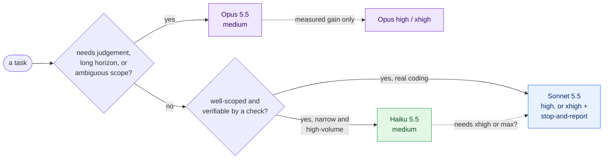

# Claude 5.5 family — benchmarks and which model fits which job

> **Compiled 2026-10-11.** Covers Claude Opus 5.5, Sonnet 5.5 and Haiku 5.5, with Fable 5.1 for reference.
>
> **Where the numbers come from.** Nothing here was measured by us.
> - `[card]` — Anthropic system cards: Opus 5.5 (2026-09-22), Sonnet 5.5 (2026-09-28), Haiku 5.5 (2026-10-07). Text extracted from the PDFs; page numbers given.
> - `[doc]` — official docs at `platform.claude.com/docs` and `code.claude.com/docs`, and the launch pages on `anthropic.com`.
> - `[3p]` — third parties (Cursor's CursorBench, Artificial Analysis). Cross-checks only; the Haiku rows from these two were read through a summarising fetch, not raw page text.
> - `[analysis]` — my inference from the above.
>
> Opus and Sonnet figures were collected on 2026-09-29 for the `studio` project (`~/Workspace/studio/raw/research/modelos-opus-sonnet-5-5/notes.md`) and re-checked on 2026-10-11; corrections found on re-check are in [section 7](#7-corrections-since-2026-09-29).

## 1. The one thing to understand first: effort

Every 5.5 model takes an **effort** setting: `low`, `medium`, `high`, `xhigh`, `max`. It controls how much the model thinks and how many tokens it spends. It moves quality and cost more than most people expect, and it makes the headline benchmark tables misleading:

- **Every headline number is measured at `max`**, a setting almost nobody runs. Opus card Table 8.1.A (p.174): "adaptive thinking at max effort". Same wording in the Sonnet (p.109) and Haiku (p.111) cards `[card]`.
- **The defaults are much lower.** On the API: Opus 5.5 `medium`, Sonnet 5.5 `high`, Haiku 5.5 `medium`. In Claude Code all three default to `medium` `[doc]`.

So the useful question is never "which model is best?" but "**which model at which effort**, for this job, at what cost per finished task?"

## 2. Price and limits

`[doc]` pricing page and models overview, first-party API rates per million tokens.

| | Input | Output | Cache read | Context / max output | Default effort (API) |
|---|---|---|---|---|---|
| **Fable 5.1** | $10.00 | $50.00 | $0.25 | 1M / 128K | high |
| **Opus 5.5** | $4.00 | $20.00 | $0.20 | 1M / 128K | **medium** |
| **Sonnet 5.5** | $2.00 | $10.00 | $0.10 | 1M / 128K | high |
| **Haiku 5.5** (prompt ≤100K) | $0.10 | $0.50 | $0.01 | 1M / 128K | **medium** |
| **Haiku 5.5** (prompt >100K) | $0.50 | $2.50 | $0.05 | — | — |

Things the table hides:

- **Haiku has a price cliff.** Above 100K prompt tokens the *whole request* is repriced at 5× `[doc]`. A Haiku subagent fed a large context is not a $0.10 model.
- **Haiku 5.5's tokenizer produces about 30% more tokens** than Haiku 4.5's for the same text `[doc]`.
- **Opus 5.5 is cheaper than Opus 5** ($5 / $25) but defaults one effort level lower, so cost per task does not follow the per-token cut directly.
- **Per-token price is not cost per task.** A cheaper request that needs more turns or a retry is not cheaper. See section 4.

## 3. Headline benchmarks (all at `max` unless stated)

`[card]` Sonnet card p.109, Opus card p.174–178, Haiku card p.111–131.

| Benchmark | What it measures | Opus 5.5 | Sonnet 5.5 | Haiku 5.5 |
|---|---|---|---|---|
| SWE-bench Pro | Real-repo, multi-file coding | **89.9** | 81.3 | 64.8 |
| SWE-bench Multilingual | Coding in 9 languages | **93.9** | 90.3 | 83.7 |
| SWE-bench Multimodal | Coding from screenshots and mockups | **61.4** | 54.3 | 30.7 |
| FrontierCode v1.1 Main | Mergeable diffs; scope creep penalized | **54.4** (54.6 at `medium`) | 46.2 (52.1 at `xhigh`) | 46.4 |
| DeepSWE v1.1 | Long-horizon engineering | **74.2** | 71.0 | not published |
| FrontierSWE v2 | ~20-hour tasks | **62.3** | 61.9 | 43.8 |
| Terminal-Bench 4.0 | Terminal and CLI work | 66.4 (`xhigh`) | **70.6** | 39.2 |
| Terminal-Bench-Science 0.1 | Scientific CLI workflows | 58.7 | **59.9** | 20.6 |
| Toolathlon-Verified | Multi-step use of 600+ tools | 77.8 | 77.8 | not published |
| HLE, no tools / with tools | Hard reasoning and knowledge | **64.4 / 67.7** | 56.9 / 64.5 | 45.9 / 57.4 |
| GDPval-AA v2.1 (Elo) | Professional deliverables | **1846** | 1844 | 1620 |
| AA-Briefcase v1.1 (Elo) | Long-horizon knowledge work | **1822** | 1811 | 1578 |
| Chartography, no tools / with tools | Reading charts | 64.4 / 89.0 | 61.6 / **90.2** | 46.4 / 86.2 |
| OSWorld 2.1 (original run) partial / strict | Computer use | **81.8 / 48.7** | 80.1 / 43.5 | — |
| OSWorld 2.1 (offline subset, 82 tasks) | Same, re-based in the Haiku card | **87.2 / 53.2** | 83.9 / 48.8 | 72.4 / 37.1 |

The two OSWorld rows are different task sets and must not be compared with each other.

**Reading it** `[analysis]`:

- **Opus leads almost everywhere**, most on real-repo coding (+8.6 over Sonnet on SWE-bench Pro) and on coding from images (+7.1).
- **Sonnet leads only on terminal work.**
- **Haiku is a tier down, not a slightly smaller Sonnet.** It trails Sonnet by 16 points on SWE-bench Pro and by 31 on Terminal-Bench. On multi-language coding (83.7) and tool-assisted chart reading (86.2) it is close. Anthropic says the same: "Sonnet 5.5 and Opus 5.5 remain better choices for complex agentic coding tasks like those measured by Terminal-Bench 4.0" `[doc]`.
- **Tools beat tier for vision.** Given a crop-and-measure tool, all three models read charts at 86–90; without one they range from 46 to 64.

**Fable 5.1, for reference.** On the same table Opus 5.5 leads Fable 5.1 on every row checked (for example SWE-bench Pro 89.9 vs 81.2, Terminal-Bench 66.4 vs 55.8) at well under half the price `[card, Opus p.174; the column mapping was reconstructed from extracted text]`. Anthropic's guidance still reserves Fable 5.1 "for demanding reasoning and long-horizon agentic work" `[doc]`; these benchmarks do not show where that advantage lies.

## 4. The numbers that matter: per effort, with cost

Only two sources publish a sweep across effort levels for all three models.

### CursorBench 4.0 — agentic coding, score and cost per task

`[3p]` Cursor; scores for Opus and Sonnet also appear in the system cards `[card]`.

| Effort | Opus 5.5 | | Sonnet 5.5 | | Haiku 5.5 | |
|---|---|---|---|---|---|---|
| | score | $/task | score | $/task | score | $/task |
| low | 43.7 | — | 35.8 | — | 30.9 | $0.08 |
| medium | **52.5** | **$2.91** | 39.2 | $0.52 | 36.9 | $0.17 |
| high | 56.0 | $3.97 | 47.8 | $1.20 | 42.3 | $0.32 |
| xhigh | 56.0 | $6.98 | **53.1** | **$2.81** | 44.3 | $0.56 |
| max | 57.8 | $13.43 | 55.5 | $7.05 | 48.4 | $1.12 |

### Artificial Analysis Intelligence Index

`[3p]`

| Effort | Opus 5.5 | Sonnet 5.5 | Haiku 5.5 |
|---|---|---|---|
| low | 42 | not published | 29 |
| medium | 51 | 41 | 34 |
| high | 54 | 47 | 38 |
| xhigh | 56 | 52 | 41 |
| max | 58 | 56 | 43 |

Output speed `[3p]`: Opus 73–92 tokens/s, Sonnet 84–138, Haiku 169–234.

### What the sweeps show

`[analysis]`

1. **Opus `medium` ≈ Sonnet `xhigh`, on quality and on cost.** CursorBench: 52.5 at $2.91 against 53.1 at $2.81. AA index: 51 against 52. They are the same point, reached two ways. The choice between them is about behaviour (section 5), not price.
2. **Sonnet below `xhigh` is clearly weaker than Opus `medium`**: 5 to 13 points on both measures, at a fifth to two-fifths of the cost.
3. **Haiku at `max` (48.4, $1.12) matches Sonnet at `high` (47.8, $1.20).** Haiku does not undercut Sonnet at equal quality on hard coding. Its advantage is at the bottom: `low` and `medium` cost $0.08–$0.17 a task.
4. **The top of each range is expensive for little.** Opus `xhigh` → `max` buys 1.8 points for nearly double the cost.
5. **More effort is not always better.** On FrontierCode, which penalizes out-of-scope changes, Opus peaks at `medium` and Sonnet scores 46.2 at `max` against 52.1 at `xhigh` `[card]`. At high effort the models start their own review rounds and "make related fixes" `[doc]`. That is scope creep, and it is the exact risk for an agent with a narrow ticket.

## 5. How each model behaves, and fails

From the three prompting guides `[doc]`.

| | Strongest at | Known failure modes |
|---|---|---|
| **Opus 5.5** | "Complex work requiring careful judgment"; the hardest long-horizon work; reading visuals without tools | Some progress updates "end the turn with text rather than a tool call": treat a text-only return from an Opus subagent as possibly unfinished. Thinking cannot be disabled; forced tool choice is rejected. |
| **Sonnet 5.5** | "Well-scoped everyday tasks, fixing bugs, and creating polished documents"; terminal work; fast iteration | At `low`: "can skip verifying a change". At `low`/`medium`: "more likely to stop and check in" on long tasks. At `xhigh`/`max`: starts its own review and hardening rounds, may spawn reviewer subagents. |
| **Haiku 5.5** | "High-volume, cost-sensitive tasks ... summaries, compactions, database queries, and classification"; "pairs well with Opus 5.5 and Sonnet 5.5 as a subagent" | At `low`: "more likely to skip a search, stop early, or skip a check". At `low`/`medium`: "sometimes reports a code change as done without running a check". At `xhigh` over many turns: can end a turn with no visible text. Refuses more than the others ("over-refused more than any other model we tested", card p.3) and has no server-side refusal fallback; 1.8% of its Terminal-Bench trials died on a refusal. |

Three prompt fixes the guides give, worth carrying into any agent definition:

- **For Sonnet at `xhigh`:** "When the work the user asked for is done and its checks pass, stop and report. Don't start extra rounds of review or hardening on your own..." It "cut session cost by about a third, with no change in quality" at `max` `[doc]`.
- **For Sonnet at `low`/`medium` on long tasks:** "Keep working until everything the user asked for is done, and only stop to ask when you can't go on without the user or before a risky step."
- **For any model at lower effort that must verify:** say explicitly to run a real check that exercises the change before reporting it done.

And one rule for Haiku `[doc]`: if a route needs `xhigh` or `max`, "also run your evals on Claude Sonnet 5.5 and compare".

## 6. Which model for which job

### Anthropic's own guidance on architectures

`[doc]` "Optimizing for cost and intelligence":

- **Default:** "For most agent workloads, start with Claude Opus 5.5 at its default effort (`medium`)."
- **Before building a multi-model system, lower the effort first.** "On work a single model could handle alone, the same model at lower effort was cheaper every time", and "lowering effort beat an architecture change". An orchestrator with cheaper workers pays off only when the work fans out beyond one context.
- **Orchestrator pattern:** "the frontier model holds the loop ... dispatches subtasks to lower-cost worker models".
- **Advisor pattern:** "the most cost-effective configuration is a frontier advisor over a mid-tier executor". But executors do not consult unprompted: Haiku 5.5 and Sonnet 5.5 called an Opus advisor on 0 of 198 questions without a prompt telling them when to.

Limits of that guidance: every orchestrator measurement used the previous-generation Sonnet as the worker, and there is **no official guidance on which model should review**.

### Recommendations by role

`[analysis]`, for a coding pipeline such as the one in [the software-factory study](../software-factory/05-unified-factory-study.md).

| Role | Recommendation | Why |
|---|---|---|
| **Deciding what runs next** | A script. Failing that, Opus `medium` | Orchestration errors are the most expensive kind, and the cheapest reliable orchestrator is not a model. |
| **Alignment, spec writing, task breakdown** | Opus `medium`, `high` for hard designs | Judgement-heavy and low-volume; every later stage inherits its mistakes. |
| **Implementing a well-specified ticket** | Sonnet `xhigh` + the stop-and-report line, **or** Opus `medium` | Same quality and cost band (section 4). Prefer Opus where scope discipline matters most; prefer Sonnet for terminal-heavy work and for speed. |
| **Implementing something ambiguous or long-horizon** | Opus `medium`–`high` | "For the hardest long-horizon work, an Opus model is the better choice" `[doc]`. |
| **Code review, fixing review findings** | Opus `medium` | A reviewer reads a diff, so cost is low and judgement is the whole job. No official guidance exists; this is inference. |
| **Security review, merge approval** | Opus `medium`–`high` | The costliest mistakes. |
| **UI and UX review of a running app** | Sonnet `high` with browser and image tools | With tools the vision gap closes; without them use Opus. |
| **Mechanical, checkable steps** (render, measure, validate, run a script and report) | Sonnet `high` | Never `low`: verification gets skipped. |
| **High-volume narrow work** (classify an issue, summarize a log, compact a transcript, extract fields) | Haiku `medium` | Its stated purpose. Keep the prompt under 100K tokens, make the output checkable, and handle the `refusal` stop reason. |
| **Search and exploration subagents** | Haiku `medium`, or Sonnet `medium` if it must judge relevance | Fast (169–234 tokens/s) and cheap; the caller verifies what comes back. |
| **Anything Haiku needs `xhigh` for** | Sonnet instead | Haiku `max` only reaches Sonnet `high`. |

### Where each model should *not* be used

- **Haiku** for real agentic coding, terminal-heavy work, computer use, or unsupervised verification.
- **Sonnet at `low`/`medium`** for unattended long tasks: it stops to ask, and a subagent that asks just returns early.
- **Opus at `xhigh`/`max`** by default: "Reserve `xhigh` and `max` for work where you've measured a quality gain" `[doc]`.
- **A multi-model cascade** before trying one model at lower effort.

### Claude Code mechanics that change the answer

`[doc]` `code.claude.com/docs/en/model-config` and `sub-agents`.

- **Set `effort` in every subagent definition.** Omitted, it inherits the session's, which may be `max`.
- **Pin full IDs** (`claude-opus-5-5`, `claude-sonnet-5-5`, `claude-haiku-5-5`). The aliases resolve per provider: on Bedrock and Google Cloud `sonnet` is Sonnet 4.5 and `haiku` is Haiku 4.5; on Foundry `opus` is Opus 4.6.
- **Frontmatter is not the last word.** A per-invocation `model` or `effort` overrides it; `CLAUDE_CODE_EFFORT_LEVEL` overrides a subagent's `effort`; `CLAUDE_CODE_SUBAGENT_MODEL_FORCE=1` (v2.1.257+) ignores a subagent's `model`.
- **Haiku 5.5 needs Claude Code v2.1.293 or later.**
- **Check what actually ran** with `/tasks`, which shows model and effort per subagent.

## 7. Corrections since 2026-09-29

Found when re-checking the earlier notes:

1. **Sonnet 5.5 cache reads cost $0.10**, not $0.20 (price change effective 2026-10-07).
2. **Cost per task for Sonnet is now published** by Cursor. The earlier notes listed "is Sonnet `xhigh` cheaper than Opus `medium`?" as unverified; the answer is that they cost the same.
3. **OSWorld was re-based** onto an 82-task offline subset in the Haiku card; both sets of numbers are kept above.
4. **Two Sonnet Elo scores differ between cards**: GDPval-AA 1844 (Sonnet card) vs 1840 (Haiku card); AA-Briefcase 1811 vs 1824. Cause not stated.

## 8. Gaps

- **No Haiku 5.5 result** for Toolathlon, DeepSWE or AutomationBench.
- **Per-effort numbers for SWE-bench, Terminal-Bench, OSWorld and HLE exist only as plotted figures**, not text.
- **No measurement uses a 5.5 model as the worker** under an orchestrator, and none covers the reviewer role.
- **Third-party figures disagree with Anthropic's in places** (Artificial Analysis reports Terminal-Bench 4.0 as Sonnet 64, Opus 60, against 70.6 and 66.4), probably a harness difference.
- **AutomationBench's Opus value differs between two system cards** (42.5 and 40.0).
- **Benchmarks are proxies.** None measures your repository. The recommendations in section 6 are a starting configuration to check against your own runs, not a result.
