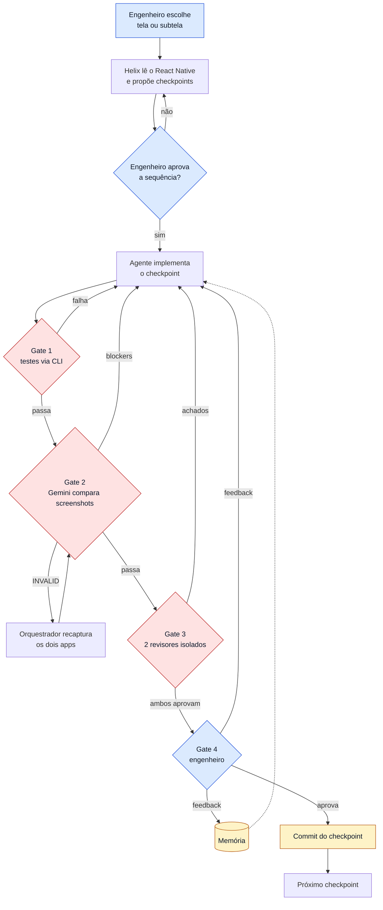

# 02 · Helix segundo a Shopify (fonte primária)

> **Fonte principal:** Talha Naqvi, [*"Helix: The internal tool powering our Shopify app's native migration"*](https://shopify.engineering/helix),
> Shopify Engineering, publicado em **2026-09-21**. Página baixada com `curl` e convertida com MarkItDown em
> 2026-10-14. Todas as citações deste capítulo foram conferidas no texto bruto `[verificado]`, salvo indicação. O
> artigo completo **não** foi copiado para o repositório: ficam só citações curtas e paráfrases.

## Contexto: por que a Shopify precisou disso

Em setembro de 2026, a Shopify anunciou que estava **deixando o React Native e voltando ao nativo** (Swift no iOS,
Kotlin no Android). O argumento, no post [*back-to-native*](https://shopify.engineering/back-to-native) de Mustafa Ali
(2026-09-10), é que os agentes de código reduziram o custo de manter duas bases nativas, e com isso a principal
vantagem do React Native (escrever uma vez só) perdeu peso `[verificado]`.

O primeiro app migrado foi o *Shop*, reconstruído e publicado nas lojas em **12 semanas** (número da própria Shopify)
`[verificado]`. O segundo é o app *Shopify*, que a empresa descreve como seu maior app, com mais de 300 telas
`[verificado]`. É para esse que o Helix foi construído.

## O problema que o Helix resolve

A seção "Preventing slop" do post *back-to-native* descreve a abordagem que **não** funcionou, e o post do Helix repete
o diagnóstico `[verificado]`:

1. Apontar o LLM para o código React Native e pedir a mesma feature em nativo de uma vez só (*one-shot*).
2. Uma variante "mais cuidadosa": mandar o agente coletar o máximo de informação primeiro, congelar tudo em specs e
   arquivos de tarefa, e depois implementar.

O resultado, nas palavras do post, é *"a huge amount of unmaintainable code that can't be shipped"* (uma montanha de
código impossível de manter e de lançar).

> **Para iniciantes:** a variante 2 é, em essência, o *spec-driven development* de ferramentas como GitHub spec-kit e
> Kiro (especificar → planejar → quebrar em tarefas → implementar). A Shopify não cita essas ferramentas, mas descreve
> e rejeita exatamente esse fluxo para o seu caso. O [capítulo 03](03-linhagem-das-fontes.md#spec-driven-development-o-contraste)
> compara os dois.

A resposta da Shopify é um sistema que *"doesn't expect the first output to be correct"* (não espera que o primeiro
resultado esteja certo) e monta um loop em que uma tentativa imperfeita não avança até virar um bom resultado.

## Vocabulário

| Termo | O que significa no Helix |
|---|---|
| **Referência** | O app React Native existente, tanto o código quanto o app rodando |
| **Checkpoint** | Uma fatia pequena e ordenada do trabalho, por exemplo "esqueleto da tela" ou "barra de navegação + título" |
| **Gate** | Uma verificação obrigatória. Se o checkpoint não passa, ele volta para correção e não avança |
| **Orquestrador** | O agente que conduz o processo, um modelo **GPT** segundo o post |
| **Revisor adversarial** | Um agente cuja função é achar problemas, não aprovar |
| **Contexto isolado** | O revisor não vê a conversa do implementador, só o código e as regras. Assim não "herda" as justificativas de quem escreveu |
| **Memória** | O registro do feedback humano, usado para melhorar os checkpoints seguintes |

## O fluxo completo

### Passo 1: planejar checkpoints que se revisam de relance

O engenheiro aponta o Helix para uma tela inteira ou uma subtela. O Helix lê o código React Native e propõe checkpoints
de **complexidade crescente**, e o primeiro costuma ser o esqueleto da tela. Cada checkpoint é descrito **em poucas
palavras**, de propósito: nesta fase o engenheiro só precisa julgar se a *sequência* faz sentido, e o post resume o
motivo assim: *"Nobody can effectively review a wall of generated text."*

Checkpoints pequenos também cabem numa janela de contexto pequena. Isso permite ao agente ler direto o trecho
relevante da referência, em vez de depender de uma spec enorme que tenta representar o código. Daí a frase-chave do
método: *"The reference **is** the spec."* (a referência *é* a spec).

Por trás disso, um **subagent** lê o código de referência e **gera os casos de teste** de cada checkpoint. Esses testes
funcionam como testes de integração, do ponto de vista do usuário, e incluem casos de borda além do caminho feliz.

### Passo 2: os quatro gates, em ordem

| Gate | O que verifica | Como | Detalhe que importa |
|---|---|---|---|
| **1 · Comportamento** | A tela faz o que a referência faz | A CLI do app *Shopify* expõe o mesmo estado e as mesmas ações da tela, e o agente valida com testes pela CLI | Sem simulador, o loop é rápido: o agente pode iterar o comportamento dezenas de vezes antes de tirar um único screenshot |
| **2 · UI** | A tela é visualmente igual à referência | O orquestrador captura screenshots da implementação e da referência **no mesmo estado** e pede ao **Gemini** que atue como *"perfectionist design reviewer"* | Diferenças corrigíveis em código são **blockers** por padrão |
| **3 · Revisão adversarial** | O código é bom, não só "parece certo" | **Dois** revisores independentes e de contexto isolado comparam o código com a arquitetura documentada | Todo achado precisa ser corrigido. Os testes afetados rodam de novo, e o gate 2 também se algo visível mudou |
| **4 · Engenheiro** | O resultado bate com a expectativa humana | O engenheiro olha o código e o app rodando | O feedback vai ao agente, que corrige e roda os gates de novo, e também para a **memória** |

#### Gate 2 em detalhe, o mais importante segundo a Shopify

O post explica por que a equivalência visual é difícil de pedir num prompt: uma pessoa nota na hora um título pequeno
demais ou um divisor escuro demais, mas esses detalhes quase nunca entram na instrução. Também explica por que
comparar pixels não serve: dois frameworks de UI não produzem saída idêntica byte a byte.

Durante o trabalho de ensinar agentes a operar simuladores, a equipe descobriu que os modelos Gemini atuais têm boa
**noção espacial** para esse problema: pegam diferenças de margem e padding e estimam o tamanho da diferença. Então
montaram o gate em torno disso:

- O Gemini lista **toda** diferença encontrada, cada uma com **severidade** e **posição na tela**.
- Ele julga tamanhos **proporcionalmente** às dimensões de cada screenshot, o que permite detectar texto pequeno ou
  grande demais mesmo com resoluções diferentes.
- Se o orquestrador mandar screenshots de estados diferentes (por exemplo, um pedido "não enviado" contra um
  "enviado"), o Gemini marca a comparação como ***INVALID*** e o orquestrador recaptura os dois apps.
- O escopo cresce junto com o checkpoint: num checkpoint de esqueleto, o orquestrador pede para checar só a barra de
  navegação e o título, porque a referência já tem a tela completa.

O post resume a ideia assim: o primeiro render não precisa ser perfeito, porque o sistema consegue *ver* o que está
errado, descrever, localizar e exigir outra tentativa. Isso é mais confiável do que especificar todos os detalhes
visuais antes.

#### Gate 3: por que a arquitetura documentada é pré-requisito

Mesmo com comportamento e visual certos, o código por baixo pode ser ruim, e o gate 3 existe para isso. A Shopify
investiu numa arquitetura "fácil para agentes implementarem" e a documentou em detalhe. Segundo o post, é essa
documentação que torna a revisão adversarial **aplicável**: sem regras escritas, o revisor não tem contra o que cobrar.

### Passo 3: commit, memória e autonomia crescente

Cada checkpoint termina num **commit**. A maioria dos engenheiros abre branches e PRs a partir daí.

A memória do feedback faz a autonomia crescer ao longo da migração. Os primeiros checkpoints recebem mais atenção,
porque a incerteza é alta e há pouco trabalho aprovado de onde aprender. Conforme se acumulam código aprovado e
feedback, os checkpoints seguintes rodam com menos intervenção.

## Modo autônomo

A aprovação do engenheiro é obrigatória **por padrão**, mas pode ser desligada. O Helix pode completar vários
checkpoints de uma vez ou pular aprovações por completo, trabalhando por horas ou durante a noite `[verificado]`. Os
gates **continuam os mesmos**. Várias telas podem migrar em paralelo, cada uma passando pelos próprios gates. No fim
de uma rodada autônoma, o engenheiro recebe uma série de checkpoints commitados, cada um com evidência (revisões de UI
arquivadas, testes passando e veredictos dos revisores), em vez de um diff gigante.

## Além da migração

Nada no loop é exclusivo de migração, segundo o post. Numa feature nova, o Helix usa designs e docs de produto como
referência. Em refactors e migrações de arquitetura, mudanças só de lógica pulam o gate de UI `[verificado]`.

## O precursor interno: o workflow do Shop app

O post [*"Migrating Shop app from React Native to native"*](https://shopify.engineering/shop-app-migration) (Max Da
Silva, Jason Kim e Quique Fagoaga, 2026-09-10) mostra o que veio antes `[verificado]`:

- Uma **prova de conceito** de uma semana: um engenheiro com agentes de código migrou o máximo possível do app para
  SwiftUI, usando o app React Native como referência. Os agentes foram especialmente eficazes quando tinham uma
  implementação existente para seguir.
- Um **workflow de migração reutilizável, construído como extensão do Pi coding agent**. Nele, subagents
  especializados inspecionavam o código React Native, documentavam o comportamento, preparavam planos por plataforma,
  implementavam e revisavam a paridade.
- **Aprovação de plano presa a um hash do conteúdo:** alterar o plano invalidava a aprovação anterior. Assim a
  aprovação ficava ligada ao plano que tinha sido revisado de fato.
- **Tardis**, uma ferramenta de depuração que dava aos agentes acesso estruturado a eventos, logs e estado do app
  rodando. Uma funcionalidade dela capturava screenshots e janelas de eventos dos dois apps em *"named checkpoints"*,
  para revisão de paridade.

O post do Helix apresenta o Shop como a origem do aprendizado aplicado agora `[verificado]`, mas **nenhum dos dois
posts diz que o Helix descende da extensão do Pi ou da Tardis**. A afirmação "a Tardis é precursora da comparação de UI
do Helix" foi **refutada** na verificação adversarial (1 voto a favor, 2 contra) por ser interpretação, não fato
declarado. O que se pode afirmar é a semelhança: screenshots dos dois apps em checkpoints nomeados aparecem nos dois
sistemas.

| | Workflow do Shop (extensão do Pi) | Helix |
|---|---|---|
| Referência | App React Native | App React Native |
| Subagents especializados | Sim (inspeção, documentação, planos, implementação, paridade) | Sim (testes, revisores) |
| Aprovação humana do plano | Sim, presa ao hash do plano | Sim, aprova a sequência de checkpoints |
| Comparação visual | Screenshots em checkpoints nomeados (Tardis) | Gemini como revisor, com severidade e posição |
| Revisão de código | Revisão humana, lint, testes e análise estática | Dois revisores adversariais isolados + engenheiro |
| Memória que aumenta a autonomia | Não mencionada | Sim |

## O que o post não diz

- **Nenhuma métrica** de qualidade, custo, tempo por checkpoint ou taxa de reprovação nos gates. A única medida citada
  é qualitativa: o resultado chega "nearly 1:1" com a referência.
- **Nenhuma fonte externa**. O corpo do post só linka *back-to-native*, *shop-app-migration* e páginas de carreira da
  Shopify `[verificado]`. Ralph loop, papers e ferramentas de terceiros não aparecem.
- **Nenhum código**. O Helix é interno e não foi publicado.
- **Como a memória é guardada** (formato, escopo, poda) e quais critérios liberam pular a aprovação humana.
- **Como as imagens chegam ao Gemini** (num único prompt ou não) e se ele usa bounding boxes para a "posição na tela".
- Não foram achadas palestras ou threads de Talha Naqvi sobre o Helix, nem relação declarada com outras ferramentas de
  IA da Shopify, como o Roast `[não verificado]`.

---

[← 01 · O vídeo do AI LABS](01-o-video-ailabs.md) · [↑ README](README.md) · [Próximo → 03 · Linhagem](03-linhagem-das-fontes.md)
