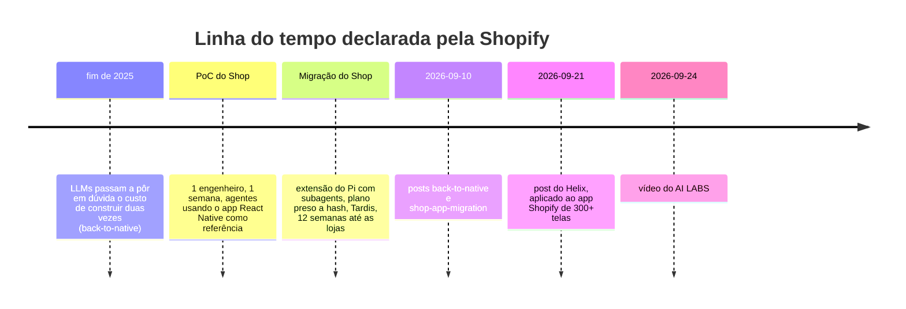

# 03 · Linhagem: de onde vêm as ideias

> **A regra deste capítulo.** A Shopify **não cita nenhuma fonte externa** no post do Helix `[verificado]`. Então
> nada do que está aqui é "o Helix foi baseado em X" no sentido de atribuição declarada. Este capítulo separa três
> coisas:
>
> - **Tier A**: o que a Shopify diz, inclusive sobre os próprios precursores.
> - **Tier B**: o que o AI LABS acrescentou.
> - **Tier C**: ideias mais antigas que o método reaproveita (*prior art*) ou com as quais converge. A ligação é de
>   **mecanismo**, identificada por este estudo, e não uma influência declarada por alguém.

## Mapa das fontes

| Fonte | Data | Tier | O que contribui | Validação |
|---|---|---|---|---|
| [Shopify · back-to-native](https://shopify.engineering/back-to-native), Mustafa Ali | 2026-09-10 | A | Motivo da migração; rejeição do one-shot e do "congelar specs, depois implementar"; primeiro resumo do Helix | `[verificado]` |
| [Shopify · shop-app-migration](https://shopify.engineering/shop-app-migration), Max Da Silva, Jason Kim e Quique Fagoaga | 2026-09-10 | A | Precursor interno: extensão do Pi com subagents, aprovação de plano presa a hash, Tardis | `[verificado]` |
| [Shopify · Helix](https://shopify.engineering/helix), Talha Naqvi | 2026-09-21 | A | O método completo | `[verificado]` |
| [AI LABS · vídeo bBMp5tLxShQ](https://youtu.be/bBMp5tLxShQ) | 2026-09-24 | B | Recriação em Claude Code: Stop hook, subagents Claude, protótipo HTML + `design.md`, learnings | `[verificado]` (descrição e capítulos) |
| [Geoffrey Huntley · "Ralph Wiggum as a 'software engineer'"](https://ghuntley.com/ralph/) | 2025-07-14 | C | Origem do Ralph loop, a inspiração que o vídeo declara para o Stop hook | `[conferido]` |
| [Anthropic · plugin `ralph-wiggum`](https://github.com/anthropics/claude-code/tree/main/plugins/ralph-wiggum) | lido em 2026-10-14 (branch `main`) | C | Ralph loop *dentro* do Claude Code via Stop hook | `[verificado]` (README e `stop-hook.sh`) |
| [Claude Code · Hooks reference](https://code.claude.com/docs/en/hooks) | espelho de 2026-10-11 | C | `Stop` + `decision: "block"`, teto de 8 continuações | `[verificado]` (espelho local) |
| [Cursor · Hooks](https://cursor.com/docs/hooks) | espelho de 2026-10-11 | C | `stop` + `followup_message`, `loop_limit` | `[verificado]` (espelho local) |
| [Anthropic · "Building effective agents"](https://www.anthropic.com/engineering/building-effective-agents), Erik Schluntz e Barry Zhang | 2024-12-19 | C | Padrão *evaluator-optimizer* (gerador + avaliador em loop) | `[conferido]` |
| [Self-Refine](https://arxiv.org/abs/2303.17651), Madaan et al. | 2023-03-30 | C | O mesmo modelo gera, critica e refina | `[conferido]` |
| [Reflexion](https://arxiv.org/abs/2303.11366), Shinn et al. | 2023-03-20 | C | Reflexão verbal guardada em memória episódica para as próximas tentativas | `[conferido]` |
| [Judging LLM-as-a-Judge](https://arxiv.org/abs/2306.05685), Zheng et al., NeurIPS 2023 | 2023-06-09 | C | LLM como juiz: mais de 80% de concordância com humanos, e vieses conhecidos | `[conferido]` |
| [UICrit](https://arxiv.org/abs/2407.08850), Duan et al., UIST 2024 | 2024-07-11 | C | Críticos de UI baseados em LLM ainda ficam abaixo de humanos | `[fonte]` |
| [Beyond Pixel Diffs](https://arxiv.org/abs/2607.01728), Zhang et al. (preprint) | 2026-07-02 | C | Diff de pixels é "semanticamente cego" | `[fonte]` |
| [Gemini API · image understanding](https://ai.google.dev/gemini-api/docs/image-understanding) | atualizada em 2026-09-23 | C | Várias imagens por prompt; bounding boxes normalizadas em 0–1000 | `[fonte]` |
| [GitHub · spec-kit](https://github.blog/ai-and-ml/generative-ai/spec-driven-development-with-ai-get-started-with-a-new-open-source-toolkit/), Den Delimarsky | 2025-09-02 | C (contraste) | Specify → Plan → Tasks → Implement | `[conferido]` |
| [Kiro · "From chat to specs"](https://kiro.dev/blog/from-chat-to-specs-deep-dive/), Ryan Yanchuleff | 2025-07-15 | C (contraste) | `requirements.md` → `design.md` → `tasks.md` | `[conferido]` |
| [Martin Fowler · Strangler Fig Application](https://www.martinfowler.com/bliki/StranglerFigApplication.html) | página datada de 2024-08-22 | C (contraste) | Substituição gradual de sistema legado | `[conferido]` |
| [Airbnb · migração de testes com LLM](https://medium.com/airbnb-engineering/accelerating-large-scale-test-migration-with-llms-9565c208023b), via [InfoQ](https://www.infoq.com/news/2025/03/airbnb-llm-test-migration/) | InfoQ: 2025-03-28 | C | Migração em lote com etapas validadas e retry por arquivo | `[conferido]` (InfoQ, fonte secundária) |
| [Google · "How is Google using AI for internal code migrations?"](https://arxiv.org/abs/2501.06972), Nikolov et al. | 2025-01-12 | C | Migrações internas com LLM em larga escala | `[conferido]` |

## Tier A: o que a Shopify diz sobre a própria origem

A linha do tempo que a Shopify publicou:

O post *back-to-native* diz que a Shopify usa LLMs para construir software desde 2021 e que, no fim de 2025, os modelos
já faziam a equipe questionar se construir duas vezes ainda custava o dobro `[verificado]`. A extensão do Pi aparece
como o workflow anterior e o Helix como o atual. A ligação direta entre os dois é inferida pela ordem de publicação e
pelo enquadramento do post do Helix, não por uma frase explícita.

## Tier B: o que o AI LABS acrescentou

Detalhado no [capítulo 01](01-o-video-ailabs.md#o-que-é-da-shopify-e-o-que-é-do-ai-labs). O acréscimo com fonte
rastreável é um só: o **Stop hook inspirado no Ralph loop**, que a descrição do vídeo apresenta como emprestado *"from
the Ralph loop idea"* `[verificado]`. As outras adições (subagents Claude, protótipo HTML, `design.md`, arquivo de
learnings) são escolhas de implementação sem fonte externa citada.

A verificação adversarial do workflow **não confirmou nenhuma afirmação Tier B de forma independente**, porque o
transcript não estava disponível. Este estudo só sustenta o que está na descrição e nos capítulos do vídeo.

## Tier C: as ideias anteriores, gate por gate

### O loop que não deixa parar → Ralph loop

| | Ralph original (Huntley) | Plugin `ralph-wiggum` (Anthropic) | Helix (Shopify) |
|---|---|---|---|
| Onde roda o loop | Fora do agente: `while :; do cat PROMPT.md \| claude-code ; done` | Dentro da sessão: um Stop hook intercepta a saída | Dentro do orquestrador |
| O que é reenviado | O mesmo prompt | O **mesmo** prompt (`# Not complete - continue loop with SAME PROMPT`) | O feedback específico do gate que reprovou |
| Quando para | Quando alguém interrompe | Quando a última mensagem traz `<promise>…</promise>` igual à string configurada, ou quando `max_iterations` é atingido | Quando os 4 gates aprovam |
| Quem decide que acabou | Ninguém | **O próprio modelo**, pela promessa (*"do not lie to exit!"*) | **Verificadores externos**: testes, Gemini, revisores e engenheiro |

Huntley define a técnica com a frase *"In its purest form, Ralph is a Bash loop."* `[conferido]`. O README do plugin cita
a mesma ideia e credita o autor `[verificado]`. O `stop-hook.sh` (177 linhas) guarda o estado em
`.claude/ralph-loop.local.md` e, enquanto o loop não termina, devolve `decision: "block"` com o **prompt original** como
`reason` `[verificado]`.

> **A diferença que importa.** O Ralph resolve *"o agente para cedo demais"* com insistência: o mesmo prompt de novo,
> até o modelo se declarar pronto. O Helix resolve com **gates externos**: o agente não decide sozinho que terminou.
> Uma recriação fiel do Helix usa o mecanismo do Ralph (o Stop hook) com o critério de saída do Helix (evidência
> externa). O [capítulo 04](04-claude-code-e-cursor.md) mostra como fazer isso.

### Gerador + crítico em loop → evaluator-optimizer, Self-Refine, Reflexion

| Ideia | Fonte | Equivalente no Helix |
|---|---|---|
| Uma chamada de LLM gera a resposta, outra avalia e dá feedback, em loop | Anthropic, *evaluator-optimizer* (2024-12-19) `[conferido]` | Todo o laço implementador ↔ gates. A Anthropic diz que o padrão funciona melhor com **critérios claros de avaliação**, e no Helix os critérios são testes, a referência visual e a arquitetura documentada |
| O mesmo modelo gera, critica a própria saída e refina | Self-Refine (2023) `[conferido]` | **Contraste**: o Helix evita a autocrítica e usa revisores **separados e de contexto isolado** |
| O agente guarda reflexões sobre o feedback numa memória episódica e melhora nas tentativas seguintes | Reflexion (2023) `[conferido]` | A memória do Helix, só que alimentada pelo feedback **humano** do gate 4, e não por autorreflexão |

### LLM como juiz → gates 2 e 3

O paper de Zheng et al. (NeurIPS 2023) mostrou que juízes fortes como o GPT-4 chegam a *"over 80% agreement"* com
humanos, o mesmo nível de concordância entre humanos, e catalogou vieses de **posição**, **verbosidade** e
**autopromoção** `[conferido]`. O viés de autopromoção, em que o modelo favorece respostas parecidas com as próprias, é
uma justificativa conceitual para revisores **de contexto isolado**. Isso é leitura deste estudo, não argumento da
Shopify.

Para UI, especificamente:

- **Diff de pixels falha.** Um preprint de 2026 chama a comparação pixel a pixel de *"semantically blind"*: ela trata
  ruído de renderização e defeitos reais da mesma forma `[fonte]`. O paper estuda UI web num mesmo renderizador. O
  Helix compara **frameworks diferentes**, onde o problema é ainda maior, então a ligação é por analogia.
- **O Gemini tem o substrato técnico.** A API aceita várias imagens num prompt (com o exemplo oficial *"What is
  different between these two images?"*) e detecta objetos com bounding boxes normalizadas em 0–1000 `[fonte]`. A
  Shopify **não** diz que usa nenhum dos dois recursos.
- **Juízes de UI ainda erram.** O UICrit (UIST 2024) concluiu que técnicas baseadas em LLM ainda não alcançam
  avaliadores humanos em crítica de UI: qualidade média 0,48 contra 0,75 dos humanos, e os participantes preferiram as
  críticas humanas em 81% dos casos `[fonte]`. A tarefa é diferente (crítica aberta, não comparação com referência),
  mas o resultado sustenta manter o **engenheiro no gate 4**.

### Spec-driven development: o contraste

| | spec-kit (GitHub) | Kiro (AWS) | Helix |
|---|---|---|---|
| Fonte da verdade | A intenção, escrita como spec: *"intent is the source of truth"* `[conferido]` | `requirements.md` → `design.md` → `tasks.md` `[conferido]` | **O app de referência rodando**: *"the reference is the spec"* |
| Granularidade da revisão humana | Spec, plano e tarefas, revisados por fase | Os três arquivos | A sequência de checkpoints, em poucas palavras, e depois cada checkpoint pronto |
| Quando vale | Feature nova, sem referência executável | Idem | Porte de algo que já existe (e, por extensão, feature nova com design como referência) |

> A comparação completa, com exemplos lado a lado e a correção de premissa sobre o `/speckit.converge`, está no
> [capítulo 05](05-helix-vs-spec-kit.md).

A Shopify rejeita explicitamente, **para o seu caso**, o fluxo "coletar tudo, congelar em specs e tarefas, implementar"
`[verificado]`. Isso não refuta o spec-driven development em geral. Mostra que, quando já existe uma implementação
funcionando, ela é uma spec melhor do que qualquer documento derivado dela.

### Migração incremental: Strangler Fig, Airbnb e Google

- **Strangler Fig** (Fowler): o termo hoje descreve *"a gradual approach to legacy modernization"* `[conferido]`. O
  Helix é gradual na **construção** (checkpoint por checkpoint), mas a Shopify escolheu **greenfield** (reconstruir do
  zero) e não brownfield (trocar pedaços dentro do app vivo) `[verificado]`. É incremental no processo, não na
  implantação.
- **Airbnb** migrou cerca de 3,5 mil arquivos de teste de Enzyme para React Testing Library. A estimativa original era
  de 1,5 ano, e a migração levou cerca de 6 semanas, num pipeline de etapas validadas (refatorar → corrigir Jest →
  lint → `tsc`), cada uma com retry quando a validação falhava `[conferido]` (InfoQ, fonte secundária). É o mesmo
  princípio de "não avança até passar na validação", aplicado em lote e sem revisão visual.
- **Google** publicou em 2025 como usa LLMs em migrações internas de código e relata redução significativa do tempo
  `[conferido]`. O resumo não traz números.

## O que foi refutado

| Afirmação | Voto | Por quê |
|---|---|---|
| A Tardis é **precursora** da comparação de UI por checkpoint do Helix | 1–2 | Os dois fatos estão nos posts, mas a relação de origem é interpretação |
| Métodos de *image difference captioning* têm dificuldade em UI web, logo há um limite para revisores multimodais | 0–3 | Extrapolação além do que o abstract diz |
| MLLMs como juízes ficam próximos do humano em comparação pareada | 0–3 | Não sustentado pela fonte (arXiv 2402.04788) |
| Os vieses do GPT-4V tornam um revisor VLM não confiável por si só | 1–2 | Conclusão mais forte do que a fonte permite |

## Perguntas abertas

1. Há linhagem **declarada** entre o Helix e evaluator-optimizer, Self-Refine, Reflexion ou LLM-as-a-judge? Nada
   encontrado. Hoje é só convergência.
2. Talha Naqvi ou outros engenheiros da Shopify falaram do Helix em palestras ou threads? Nada encontrado.
3. Existe relação entre o Helix e outras ferramentas de IA da Shopify (por exemplo, o Roast)? Nada encontrado.

---

[← 02 · Helix segundo a Shopify](02-helix-fonte-primaria.md) · [↑ README](README.md) · [Próximo → 04 · Claude Code e Cursor](04-claude-code-e-cursor.md)
