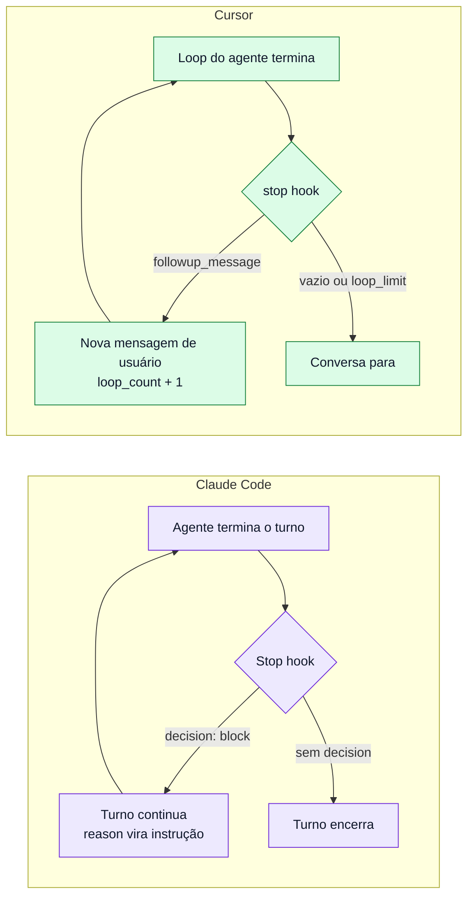

# 04 · Recriar o loop do Helix no Claude Code e no Cursor

> **Fontes dos mecanismos:** espelhos locais da documentação oficial, capturados em 2026-10-11.
> [Claude Code hooks reference](../claude-code/hooks/claude-hook-reference-doc.md),
> [Claude Code hooks guide](../claude-code/hooks/automate-workflow-with-hooks.md),
> [Claude Code subagents](../claude-code/subagents/creating-custom-subagents.md),
> [Cursor hooks](../cursor/hooks/hooks-guide.md),
> [Cursor subagents](../cursor/subagents/subagents-guide.md) e
> [Cursor browser](../cursor/tools/browser/browser-guide.md). Também foram baixadas em 2026-10-14 as páginas
> [Claude Code · Chrome](https://code.claude.com/docs/en/chrome) e
> [Cursor · Models & pricing](https://cursor.com/docs/models-and-pricing). Cada campo citado foi conferido nesses
> arquivos `[verificado]`. Os scripts deste capítulo são exemplos originais deste estudo. Foram testados **isolados**, com stdin e
> `gates.json` de exemplo, e **não** dentro do Claude Code ou do Cursor (ver [Teste isolado](#teste-isolado-dos-scripts)).

## A ideia em uma tabela

O Helix precisa de quatro capacidades. Cada harness oferece um mecanismo diferente para cada uma:

| Capacidade do Helix | Claude Code | Cursor | Paridade |
|---|---|---|---|
| **Não deixar parar antes dos gates** | Hook `Stop` devolve `decision: "block"` + `reason`. O turno **continua** | Hook `stop` devolve `followup_message`. O loop **termina** e o Cursor envia uma **nova mensagem de usuário** | Mecanismos diferentes, mesmo efeito |
| Teto contra loop infinito | 8 continuações seguidas, zerado a cada chamada de ferramenta; ajustável com `CLAUDE_CODE_STOP_HOOK_BLOCK_CAP` | `loop_limit` por script, padrão **5** (`null` remove o teto); o hook recebe `loop_count` | Tetos e contagens diferentes |
| **Revisores de contexto isolado** | Subagents, cada um com o próprio contexto | Subagents com `readonly: true` (sem edição nem shell que mude estado) e `is_background` | Cursor tem modo somente leitura nativo |
| **Modelo do revisor** | `model`: `sonnet`, `opus`, `haiku`, `fable` ou um ID `claude-*`, ou seja, **só Claude** | `model`: `inherit` ou **um ID de modelo específico**; a lista de modelos do Cursor inclui GPT e Gemini (por exemplo, Gemini 3.1 Pro) | **Só o Cursor reproduz nativamente o par GPT + Gemini da Shopify** |
| **Revisão visual** | Integração com **Chrome** pela extensão *Claude in Chrome* (exige `/login`): automação de browser e screenshots salvos em disco | Ferramenta **Browser** nativa: screenshots entram como imagem no contexto do agente | Os dois cobrem **web**. App nativo (o caso da Shopify) exige MCP de simulador nos dois |
| **Memória / learnings** | `CLAUDE.md` + skills carregados em toda sessão | Rules (`.cursor/rules`) + skills | Equivalentes |
| **Verificação por LLM dentro do hook** | Hooks `type: "prompt"` e `type: "agent"`. O `agent` sobe um subagent que usa Read, Grep e Glob e devolve `{ "ok": true/false }` (experimental) | Hook `type: "prompt"`: um modelo rápido avalia uma condição e devolve `{ ok, reason }`, com `model` opcional. Não há tipo `agent` | Hook que **investiga o código** com ferramentas: só Claude Code |



> **Para iniciantes:** um **hook** é um script que o harness executa num momento fixo do ciclo do agente. O momento
> que interessa aqui é "o agente acha que terminou". No Claude Code, o hook pode **vetar** o fim. No Cursor, o fim
> acontece, mas o hook pode **puxar uma nova rodada** escrevendo a próxima mensagem.

## O erro a evitar: confiar na promessa do modelo

O plugin oficial `ralph-wiggum`, a implementação mais conhecida de "Stop hook que não deixa parar", libera a saída
quando a última mensagem do modelo contém `<promise>TEXTO</promise>` igual à string configurada `[verificado]`. Nenhum
teste ou revisor é consultado: a saída depende de o modelo não mentir, e o próprio plugin avisa no prompt *"do not lie
to exit!"*.

Isso é o **contrário** do Helix, onde quem decide que o checkpoint está pronto são verificadores externos. Uma
recriação fiel precisa de:

1. **Evidência escrita por quem verifica, não por quem implementa.** O runner de testes grava o resultado do gate 1, e
   cada revisor grava o próprio veredicto.
2. **Um Stop hook que lê essa evidência**, e não a última mensagem do agente.
3. **Gates que rodam de novo quando algo muda.** Na Shopify, um achado do gate 3 que mexe em UI faz o gate 2 rodar de
   novo.

Uma limitação continua: se o agente implementador puder escrever o arquivo de status, ele pode "aprovar a si mesmo".
Para fechar essa porta, o hook pode **rodar ele mesmo** a verificação barata (os testes) em vez de só ler o arquivo, e
um hook `PreToolUse` pode negar escrita do agente principal em `.helix/`.

## Exemplo: o mesmo gate nos dois harnesses

O exemplo usa um arquivo de status por checkpoint, `.helix/gates.json`, escrito pelos gates:

```json
{ "behavior": "pass", "ui": "fail", "review": "pending" }
```

### Claude Code

`.claude/settings.json`:

```json
{
  "hooks": {
    "Stop": [
      { "hooks": [ { "type": "command", "command": "\"$CLAUDE_PROJECT_DIR\"/.claude/hooks/helix-gates.sh" } ] }
    ]
  }
}
```

`.claude/hooks/helix-gates.sh`:

```bash
#!/usr/bin/env bash
# Block the end of the turn while any Helix gate lacks a "pass" verdict.
set -euo pipefail
status=".helix/gates.json"
[ -f "$status" ] || exit 0   # no checkpoint in progress: allow stop

pending=$(jq -r '[to_entries[] | select(.value != "pass") | .key] | join(", ")' "$status")
[ -z "$pending" ] && exit 0  # every gate passed: allow stop

jq -n --arg gates "$pending" '{
  decision: "block",
  reason: ("Gates not passed: " + $gates + ". Run them, fix every finding, then stop.")
}'
```

O `reason` diz **quais gates faltam**, em vez de repetir o prompt original como o Ralph faz. Se o loop realmente avança,
o agente chama ferramentas entre um bloqueio e outro, e o teto de 8 continuações seguidas raramente é atingido.

### Cursor

`.cursor/hooks.json`:

```json
{
  "version": 1,
  "hooks": {
    "stop": [ { "command": ".cursor/hooks/helix-gates.sh", "loop_limit": 10 } ]
  }
}
```

`.cursor/hooks/helix-gates.sh`:

```bash
#!/usr/bin/env bash
# Queue a follow-up message while any Helix gate lacks a "pass" verdict.
set -euo pipefail
input=$(cat)
[ "$(jq -r '.status' <<<"$input")" = "completed" ] || { echo '{}'; exit 0; }

status=".helix/gates.json"
[ -f "$status" ] || { echo '{}'; exit 0; }

pending=$(jq -r '[to_entries[] | select(.value != "pass") | .key] | join(", ")' "$status")
[ -z "$pending" ] && { echo '{}'; exit 0; }

jq -n --arg gates "$pending" '{
  followup_message: ("Gates not passed: " + $gates + ". Run them, fix every finding, then finish.")
}'
```

Diferenças práticas:

- No Cursor, o hook só deve agir quando `status` é `completed`. Se o usuário abortou, reenviar mensagem seria
  desrespeitar o abort.
- O `loop_limit` padrão de 5 é **baixo** para quatro gates com retrabalho. O exemplo sobe para 10, e `null` remove o
  limite (com o risco de um loop sem fim).
- O Cursor também carrega hooks no formato do Claude Code. Nesse caso, um `Stop` com `decision: "block"` vira
  follow-up automático, e o `loop_limit` padrão desses hooks é `null`, ou seja, **sem limite** `[verificado]` (linha
  `loop_limit` da tabela de opções). Quem reaproveita o hook do Claude Code no Cursor perde o teto sem perceber.

### Teste isolado dos scripts

Rodados em 2026-10-14, fora do harness, alimentando o stdin à mão `[verificado]`:

| Caso | Claude Code (`helix-gates.sh`) | Cursor (`helix-gates.sh`) |
|---|---|---|
| Sem `.helix/gates.json` | Sem saída, exit 0 (libera a parada) | `{}`, exit 0 |
| `ui: fail`, `review: pending` | `{"decision": "block", "reason": "Gates not passed: ui, review. ..."}` | `{"followup_message": "Gates not passed: ui, review. ..."}` |
| `status: aborted` | n/a | `{}` (respeita o abort) |
| Todos `pass` | Sem saída, exit 0 | `{}`, exit 0 |

O teste prova a lógica dos scripts, não o comportamento dos harnesses. Que o Claude Code continue o turno e que o
Cursor envie o follow-up é o que a documentação afirma, e não foi exercitado aqui.

## Os revisores: subagents

| | Claude Code | Cursor |
|---|---|---|
| Onde se define | `.claude/agents/<nome>.md` com frontmatter | `.cursor/agents/<nome>.md` com frontmatter (campos `name`, `description`, `model`, `readonly`, `is_background`) |
| Revisor que não pode editar | Restringir `tools` no frontmatter (sem Edit/Write) | `readonly: true` |
| Revisor Gemini, como na Shopify | Não nativo: um MCP ou a CLI de outro fornecedor via Bash | `model:` com o ID de um modelo Gemini da lista do Cursor (modelos de terceiros são cobrados à parte, a preço de API) |
| Dois revisores independentes | Dois subagents, sem compartilhar o contexto do implementador | Idem |

> **Por que o modelo do revisor importa.** A Shopify escolheu o Gemini para o gate 2 pela noção espacial do modelo. O
> AI LABS usou subagents Claude porque, no Claude Code, só há modelos Claude. Se a revisão visual é o gate mais
> importante (é o que a Shopify diz), a escolha do modelo deixa de ser um detalhe. No Claude Code, quem quiser o
> desenho original precisa trazer o Gemini por fora.

## O gate visual: a lacuna comum

Nenhum dos dois harnesses tem um "gate de UI" pronto. O que existe:

- **Cursor:** a ferramenta Browser tira screenshots que o agente vê como imagem, e a doc cita testes de regressão
  visual `[verificado]`. Isso cobre **web**. Para apps nativos (o caso da Shopify), é preciso um MCP de simulador.
- **Claude Code:** a integração com Chrome (extensão *Claude in Chrome*) automatiza o browser e salva screenshots em
  disco `[verificado]`. Também cobre **web**. Para app nativo, de novo, é preciso um MCP de simulador.

Nos dois casos, o "revisor perfeccionista" é um **prompt escrito por você**, com as regras que a Shopify descreve:
listar toda diferença com severidade e posição, julgar tamanhos de forma proporcional, marcar INVALID quando os estados
não batem e limitar o escopo ao que o checkpoint construiu.

## Lacunas de paridade

| Lacuna | Afeta |
|---|---|
| Claude Code não troca de fornecedor de modelo nos subagents | Reproduzir GPT + Gemini |
| Cursor encerra o loop e manda nova mensagem, então cada iteração aparece como mensagem de usuário no histórico | Leitura do transcript, contagem de turnos |
| Hooks no formato do Claude Code rodando no Cursor ficam sem teto por padrão | Risco de loop infinito |
| Hook `type: "agent"` (subagent com ferramentas dentro do hook) só existe no Claude Code, e é experimental. O Cursor tem só `type: "prompt"`, que avalia sem investigar o código | Gate 3 implementado como hook |
| Browser do Cursor e Chrome do Claude Code são web. App nativo exige MCP de simulador nos dois | Gate 2 em mobile |

---

[← 03 · Linhagem](03-linhagem-das-fontes.md) · [↑ README](README.md) · [Próximo → 05 · Helix × spec-kit](05-helix-vs-spec-kit.md)
