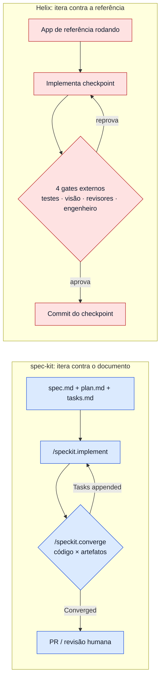
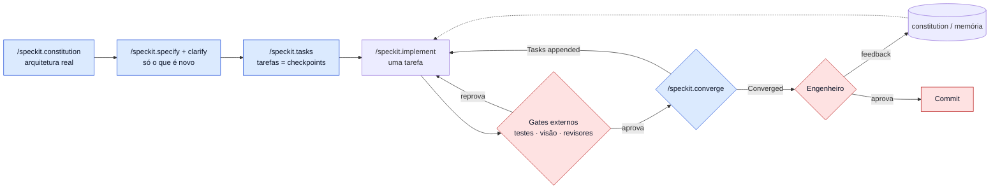

# 05 · Helix × spec-kit: a mesma pergunta, duas respostas

> **Fontes:**
> - Shopify: [Helix](https://shopify.engineering/helix) e [back-to-native](https://shopify.engineering/back-to-native) `[verificado]`.
> - GitHub spec-kit, release **v1.2.0** (2026-10-13), commit `3238fa9` da branch `main`, lido em 2026-10-14 `[verificado]`:
>   [README](https://github.com/github/spec-kit/blob/main/README.md),
>   [spec-driven.md](https://github.com/github/spec-kit/blob/main/spec-driven.md) (a metodologia),
>   [Agentic SDD reference](https://github.com/github/spec-kit/blob/main/docs/reference/agentic-sdd.md) (os comandos) e
>   [Adopting Spec Kit in an Existing Project](https://github.com/github/spec-kit/blob/main/docs/guides/existing-projects.md).
>
> **Os exemplos são ilustrativos.** Foram escritos por este estudo para mostrar a mecânica e não vêm de nenhuma das
> fontes. A tela, os checkpoints, os achados e os textos de comando são inventados.
>
> Para a crítica geral ao spec-driven development (custo de revisão, *spec rot*, falsa confiança), veja
> [spec-driven-development/README.md](../spec-driven-development/README.md) e
> [a análise de Martin Fowler](../spec-driven-development/spec-driven-development-variant.md).

## A pergunta que os dois respondem

O problema é o mesmo: **um LLM deixado solto improvisa**. Ele preenche lacunas com suposições, entrega uma montanha de
código de uma vez, e o humano só descobre os erros no fim.

Os dois põem estrutura em volta do agente, mas discordam sobre **onde mora a verdade** e sobre **quem decide que o
trabalho terminou**:

| | spec-kit | Helix |
|---|---|---|
| **Onde mora a verdade** | Num **documento escrito**: o `spec.md`, derivado da intenção do time | Numa **referência executável**: o app que já existe, rodando |
| **Frase-síntese da própria fonte** | *"code serves specifications"* (o código serve à especificação) | *"The reference **is** the spec."* (a referência *é* a spec) |
| **Quem decide que terminou** | O agente, comparando o código com os artefatos (`/speckit.converge`), e depois o humano no PR | Juízes **externos** ao implementador: testes, um modelo de visão, dois revisores isolados e o engenheiro |
| **Pergunta-guia** | "O código faz o que o documento diz?" | "O código faz e **parece** o que a referência faz?" |

> **Para iniciantes:** *spec* (especificação) é um documento que descreve o que o software deve fazer. No spec-kit, ela
> é escrita antes do código e guia o agente. No Helix, a "spec" é o próprio app antigo: em vez de descrever a tela
> em palavras, o agente olha para a tela que já existe.

## Um erro comum: "o spec-kit é one-shot"

É tentador ler a crítica da Shopify ao fluxo "coletar tudo, congelar em specs e tarefas, implementar" `[verificado]`
como uma crítica direta ao spec-kit. **Na versão atual, essa leitura está errada em três pontos**, e esses pontos
estão na documentação do próprio spec-kit `[verificado]`:

1. **O spec-kit tem um loop de convergência.** O fluxo documentado é *"specify → plan → tasks → implement →
   converge"*. O `/speckit.converge` compara o código com spec, plano e tarefas e **anexa** o que falta ao `tasks.md`.
   O ciclo implement → converge se repete até o resultado ser **Converged**.
2. **A implementação pode ser feita em etapas.** A referência recomenda, para features grandes, rodar
   `/speckit.implement` por fases ("só Setup e Foundational", depois "só a user story do Kanban") e validar cada etapa
   antes da próxima, para não sobrecarregar o contexto do agente.
3. **Em projeto existente, o spec-kit desaconselha especificar o sistema todo de trás para frente.** O guia de
   projetos existentes diz para não fazer de "documentar o sistema existente inteiro" a primeira feature, e afirma que
   *"The codebase remains implementation context"*: o `spec.md` descreve a mudança pretendida, não cada comportamento
   que já existe.

Então a diferença real **não** é "iterativo × one-shot". É **contra o que** cada um itera:



## Mapa conceito a conceito

| Conceito | spec-kit v1.2.0 | Helix | Quem faz melhor, e quando |
|---|---|---|---|
| **Regras do projeto** | `constitution.md`: princípios que valem para todo plano, criados com `/speckit.constitution` | Arquitetura "highly opinionated" documentada, usada pelo gate 3 | Equivalentes. Os dois dizem que a revisão só cobra o que está escrito |
| **Unidade de trabalho** | Feature, dividida em fases: Setup → Foundational → uma fase por *user story* → Polish | **Checkpoint**: fatia pequena de complexidade crescente, descrita em poucas palavras | Helix para porte (fatias menores e revisáveis de relance); spec-kit para feature nova com várias histórias |
| **O que o humano revisa antes do código** | `spec.md`, `plan.md`, `tasks.md`, checklists | Só a **sequência** de checkpoints | spec-kit dá mais controle, mas custa mais leitura. Helix lembra que ninguém revisa bem "a wall of generated text" |
| **Ambiguidade** | `/speckit.clarify` faz até 5 perguntas e grava as respostas na spec | Resolvida olhando a referência. Quando não dá, o engenheiro responde no gate 4 | spec-kit quando não há referência; Helix quando há |
| **Testes** | *Test-first*: os templates mandam criar contratos e testes (contrato → integração → e2e → unidade) antes do código | Um subagent gera testes de integração **a partir do código de referência** | Equivalentes em intenção; a fonte dos testes muda |
| **Gates** | Sobre os **artefatos**: "Phase -1" do plano (Simplicity Gate, Anti-Abstraction Gate), `/speckit.checklist` ("unit tests for your requirements") e `/speckit.analyze` (consistência, somente leitura) | Sobre o **código e o app rodando**: testes, visão, revisão adversarial, engenheiro | São complementares: o spec-kit filtra o plano, o Helix filtra o resultado |
| **Verificação visual** | Não há | Gate 2 com Gemini como revisor de design | Só Helix |
| **Quem verifica o código** | O agente, com `/speckit.converge` (um comando, não um revisor isolado) | Dois revisores **de contexto isolado**, mais o engenheiro | Helix, quando o risco de autoaprovação importa |
| **Laço de correção** | Converge anexa tarefas, e o agente roda implement de novo | Gate reprovado devolve o checkpoint ao implementador com o achado | Mesma ideia; o critério de saída difere |
| **Memória entre ciclos** | Specs persistentes, em três modelos (registro histórico imutável, `spec.md` como contrato vivo, ou reconciliação a partir do código) | Memória do feedback humano, que deixa os checkpoints seguintes mais autônomos | spec-kit guarda **o quê**; Helix guarda **o gosto do revisor** |
| **Granularidade do commit** | Não fixada; o fluxo termina em PR | Um commit por checkpoint, com evidência arquivada | Helix |
| **Distribuição** | Open source (MIT), instalado com `specify init --integration <key>`. No **Claude Code**, chave `claude`, com as skills em `.claude/skills`. No **Cursor**, chave `cursor-agent`, com as skills em `.cursor/skills` | Interno, sem código publicado | Só o spec-kit pode ser instalado hoje |

## Exemplo 1: migrar uma tela existente (o caso do Helix)

**Cenário ilustrativo:** portar a tela "Detalhes do pedido" de React Native para SwiftUI. A tela mostra o cabeçalho
do pedido, a lista de itens, o resumo de valores e um botão "Marcar como enviado" que só aparece em pedidos não
enviados.

### Com o Helix

**1. Plano de checkpoints**, que o engenheiro aprova em um minuto:

```text
1. Esqueleto: barra de navegação + título
2. Cabeçalho do pedido (número, data, status)
3. Lista de itens (imagem, nome, quantidade, preço)
4. Resumo de valores (subtotal, frete, total)
5. Botão "Marcar como enviado" + estado enviado/não enviado
```

**2. Checkpoint 3 passando pelos gates:**

| Gate | O que acontece (ilustrativo) |
|---|---|
| 1 · Comportamento | O subagent leu o componente React Native e gerou testes como "pedido com 0 itens mostra estado vazio" e "item com quantidade 3 mostra '×3'". Pela CLI, o agente iterou até todos passarem |
| 2 · UI | O revisor visual recebe as duas telas no **mesmo** estado (pedido com 3 itens) e devolve: `ALTA: preço do item 2 quebra em duas linhas (canto direito, ~70% da altura)`; `MÉDIA: espaçamento entre itens ~30% maior que na referência`. Como os dois achados são corrigíveis em código, são **blockers** e o checkpoint volta |
| 2 · UI, nova rodada | O orquestrador manda por engano um pedido *enviado* contra um *não enviado*. O revisor responde `INVALID` e o orquestrador recaptura |
| 3 · Adversarial | Revisor A: "a célula da lista acessa a rede direto; a arquitetura documentada exige passar pelo repositório". Revisor B aprova. Um achado basta para reprovar, então o agente corrige, e os testes e a UI rodam de novo |
| 4 · Engenheiro | "A imagem do item deveria ter cantos arredondados como no resto do app." O agente corrige, e a observação vai para a **memória**, de modo que no checkpoint 5 os cantos já saem arredondados |

**3. Resultado:** 5 commits, cada um com testes passando, revisões de UI arquivadas e veredictos dos revisores.

### Com o spec-kit na mesma tarefa

```text
/speckit.constitution Seguir a arquitetura nativa documentada em docs/architecture.md.
  Toda tela passa por um repositório; nenhuma view acessa a rede. Testes de UI obrigatórios.
/speckit.specify Portar a tela "Detalhes do pedido" de React Native para SwiftUI,
  preservando comportamento e aparência da versão atual.
/speckit.clarify
/speckit.plan SwiftUI + o padrão de repositório existente; reutilizar os componentes de lista.
/speckit.tasks
/speckit.implement
/speckit.converge
```

O que o `spec.md` precisaria conter para o converge detectar os mesmos problemas:

- Cada estado da tela (vazio, 1 item, muitos itens, enviado, não enviado).
- A regra de quebra de linha do preço, o espaçamento entre itens e o raio dos cantos da imagem.
- Todo o resto que um humano "vê" mas ninguém escreve.

É aqui que a abordagem falha **para este caso**. A Shopify chama a equivalência visual de *"almost impossible to
specify"* `[verificado]`: esses detalhes quase nunca entram num prompt. E o `/speckit.converge` compara o código com
os **artefatos**, não com o app React Native rodando. Se o `spec.md` não fala do espaçamento, o converge pode
responder **Converged** com a tela visualmente errada. O problema não é o spec-kit ser malfeito: o documento é uma
cópia com perda de algo que já existe e pode ser consultado direto.

## Exemplo 2: feature nova (o caso do spec-kit)

**Cenário**, adaptado do próprio guia de projetos existentes do spec-kit: exportar CSV na página de pedidos, mantendo
filtros e permissões, sem mudar a resposta da API JSON.

### Com o spec-kit

```text
/speckit.specify Adicionar exportação CSV à página de pedidos. Preservar filtros e autorização atuais.
  Exportar só as linhas visíveis para o usuário logado. Não alterar a resposta da API JSON.
/speckit.clarify   -> "O CSV respeita a paginação ou exporta todas as páginas filtradas?"
/speckit.plan      -> reaproveita o endpoint de listagem e o serviço de autorização existentes
/speckit.tasks     -> Setup / Foundational / US1 exportar / US2 permissões / Polish
/speckit.analyze   -> "a tarefa T07 não cobre o requisito de autorização da US2"
/speckit.implement -> /speckit.converge -> Converged
```

Aqui o spec-kit está em casa: **não há referência** para olhar, e a intenção precisa ser escrita de qualquer jeito. O
`/speckit.clarify` força as decisões que nenhum app antigo responderia, como a dúvida sobre a paginação.

### Com o Helix

A Shopify diz que, numa feature nova, o Helix usa **designs e docs de produto** como referência `[verificado]`. Na
prática, alguém precisa produzir essa referência antes: um mock da tela e um documento de produto. O loop de
checkpoints e gates continua igual, mas o gate 2 passa a comparar a implementação com um **mock estático**, que não
tem estados nem comportamento. Foi exatamente o que o AI LABS fez com o protótipo HTML e o `design.md`
([capítulo 01](01-o-video-ailabs.md#por-que-a-troca-de-referência-importa)).

**Conclusão do exemplo:** sem referência executável, as duas abordagens precisam de um documento escrito, e o spec-kit
é a ferramenta mais completa para produzi-lo.

## Exemplo 3: combinar os dois

Esta combinação é **proposta deste estudo**, não algo que a Shopify ou o GitHub descrevam. Ela usa cada ferramenta onde
a outra é fraca.

| Etapa | De onde vem | O que fazer |
|---|---|---|
| Regras do projeto | spec-kit | `/speckit.constitution` com a arquitetura real; é o que o gate 3 do Helix precisa para cobrar |
| O quê e o porquê | spec-kit | `/speckit.specify` + `/speckit.clarify`, só para o que **não** existe como referência |
| Fatiamento | Helix | Pedir ao `/speckit.tasks` tarefas pequenas, ordenadas por complexidade e descritas em poucas palavras, ou seja, checkpoints |
| Implementação | Ambos | `/speckit.implement` uma tarefa por vez |
| Critério de saída | Helix | Em vez de confiar só no `/speckit.converge`, exigir os gates externos: testes, revisor visual e revisores isolados, com o Stop hook do [capítulo 04](04-claude-code-e-cursor.md#exemplo-o-mesmo-gate-nos-dois-harnesses) lendo o resultado |
| Fechamento | Ambos | `/speckit.converge` para pegar requisitos esquecidos; engenheiro aprova; um commit por checkpoint |



Um ponto em que o spec-kit já se aproxima do Helix: o `/speckit.implement` lê o estado dos checklists e **pergunta
antes de seguir** quando há item desmarcado, e a referência proíbe o agente de marcar checklists por conta própria
(*"must not silently self-approve"*) `[verificado]`. É a mesma preocupação do Helix com autoaprovação, aplicada aos
requisitos em vez do código.

## Quando usar qual

| Situação | Recomendado | Por quê |
|---|---|---|
| Portar algo que existe e roda (outra plataforma, framework ou linguagem) | **Helix** | A referência é mais completa que qualquer spec derivada dela |
| Feature nova sem design pronto | **spec-kit** | Alguém precisa escrever a intenção; o `clarify` força as decisões |
| Feature nova **com** design e protótipo | **Combinação** | spec-kit para regras de negócio, gates do Helix para a fidelidade visual |
| Refactor que não muda comportamento | **Helix sem gate 2** | O código antigo é a referência de comportamento; os testes provam a equivalência |
| Correção de bug | Nenhum dos dois por inteiro | O spec-kit tem um fluxo próprio (`/speckit-bug-assess → fix → test`); o Helix não trata bugs |
| Time sem arquitetura documentada | Comece pela `constitution` | Sem regras escritas, nem o gate 3 do Helix nem o `analyze` do spec-kit têm o que cobrar |

## Resumo em quatro frases

1. Os dois combatem o mesmo inimigo, o LLM que improvisa e entrega tudo de uma vez.
2. O spec-kit escreve a verdade num documento e itera até o código concordar com ele. O Helix aponta para a verdade
   que já existe e itera até juízes externos não acharem diferença.
3. A crítica da Shopify atinge "especificar de trás para frente um sistema que já existe", e o próprio spec-kit
   desaconselha isso no guia de projetos existentes.
4. Para portar, a referência ganha. Para criar, a spec ganha. Para criar com design, vale combinar.

---

[← 04 · Claude Code e Cursor](04-claude-code-e-cursor.md) · [↑ README](README.md)
