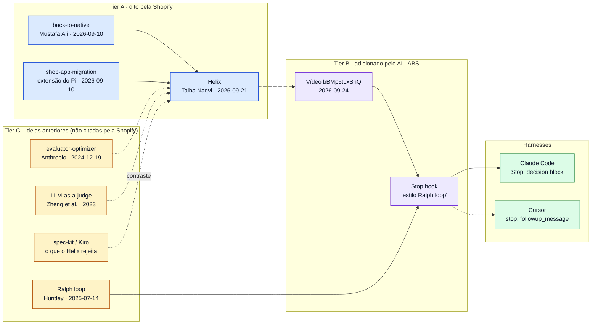

# Helix da Shopify: o método, as fontes originais e a recriação em Claude Code e Cursor

> **Estudo (pt-BR), 2026-10-14.** Ponto de partida: o vídeo do AI LABS
> [*"Shopify Just Released The Greatest AI Coding Workflow Ever"*](https://youtu.be/bBMp5tLxShQ) (2026-09-24, 14min51s).
> O estudo pergunta de onde vem a técnica: o que a Shopify publicou de fato, o que o vídeo acrescentou e quais ideias
> mais antigas o método reaproveita, mesmo que a Shopify não as cite.
>
> **Método:** as três fontes primárias da Shopify foram baixadas e cada citação foi conferida no texto bruto. Um
> workflow `deep-research` abriu 5 eixos de busca, leu 24 fontes, extraiu 119 afirmações e submeteu 25 delas a
> verificação adversarial com 3 votos (21 confirmadas, 4 refutadas). As fontes de linhagem que saíram vazias da
> verificação foram conferidas uma a uma pelo thread principal. Os mecanismos do Claude Code e do Cursor foram
> conferidos nos espelhos locais (`ai/docs/claude-code/`, `ai/docs/cursor/`), não na descrição de terceiros.

## O que é, em uma frase

O **Helix** é a ferramenta interna da Shopify que reconstrói, tela por tela, o app *Shopify* (mais de 300 telas) de
React Native para Swift e Kotlin. Ela não confia no primeiro resultado do LLM: divide o trabalho em **checkpoints**
pequenos e só deixa cada um avançar depois de passar por **quatro gates** em ordem (testes, revisão visual, revisão
adversarial e aprovação do engenheiro).

## Ordem de leitura

| # | Capítulo | Para quem |
|---|---|---|
| 01 | [O vídeo do AI LABS: o que ele mostra e o que acrescenta](01-o-video-ailabs.md) | Quem viu o vídeo e quer separar o que é da Shopify |
| 02 | [Helix segundo a Shopify (fonte primária)](02-helix-fonte-primaria.md) | Quem quer o método original, gate por gate |
| 03 | [Linhagem: de onde vêm as ideias](03-linhagem-das-fontes.md) | Quem quer as fontes originais e a validação de cada uma |
| 04 | [Recriar no Claude Code e no Cursor](04-claude-code-e-cursor.md) | Quem vai montar o loop no próprio harness |
| 05 | [Helix × spec-kit, com exemplos](05-helix-vs-spec-kit.md) | Quem já usa spec-driven development e quer saber quando trocar ou combinar |

## Visão geral

Setas cheias indicam ligação declarada por uma das partes. As tracejadas indicam semelhança de mecanismo, que este
estudo identificou e **nenhuma das partes afirmou**.

## Quando usar o padrão Helix

| Situação | O padrão Helix serve? | Por quê |
|---|---|---|
| Portar algo que já existe e roda (outra plataforma, outro framework) | **Sim, é o caso de origem** | A referência funcionando é a spec, e cada checkpoint pode ser comparado com ela |
| Feature nova com design e docs de produto | Sim, segundo a Shopify | O design passa a ser a referência, e o resto do loop não muda |
| Refactor ou migração de arquitetura | Sim, sem o gate de UI | Mudança só de lógica pula a revisão visual |
| Tarefa pequena e única | Não | O custo de planejar checkpoints e rodar 4 gates supera o ganho |
| Projeto sem arquitetura documentada | Só parcialmente | O gate 3 (revisão adversarial) depende de regras escritas para cobrar |

## Diagramas (archify)

| Diagrama | Fonte JSON | HTML |
|---|---|---|
| Helix como a Shopify descreve | [diagrams/helix-shopify.workflow.json](diagrams/helix-shopify.workflow.json) | [html/helix-shopify.html](html/helix-shopify.html) |
| Recriação do AI LABS no Claude Code | [diagrams/ailabs-claude-code.workflow.json](diagrams/ailabs-claude-code.workflow.json) | [html/ailabs-claude-code.html](html/ailabs-claude-code.html) |
| Mesmos gates no Claude Code e no Cursor | [diagrams/gates-claude-code-vs-cursor.architecture.json](diagrams/gates-claude-code-vs-cursor.architecture.json) | [html/gates-claude-code-vs-cursor.html](html/gates-claude-code-vs-cursor.html) |
| Linhagem das fontes | [diagrams/linhagem.architecture.json](diagrams/linhagem.architecture.json) | [html/linhagem.html](html/linhagem.html) |
| Helix × spec-kit: contra o que cada um itera | [diagrams/helix-vs-spec-kit.architecture.json](diagrams/helix-vs-spec-kit.architecture.json) | [html/helix-vs-spec-kit.html](html/helix-vs-spec-kit.html) |

Os HTML abrem direto no navegador, sem servidor. A interface fixa do viewer (botões e menus) fica em inglês, porque o
archify só traduz essa parte para `en` e `zh-CN`. O conteúdo dos diagramas está em português.

## Como ler os rótulos de evidência

| Rótulo | Significado |
|---|---|
| `[verificado]` | Conferido pelo thread principal no texto bruto (página baixada com `curl`, código-fonte ou espelho local) nesta sessão |
| `[conferido]` | Conferido pelo thread principal via WebFetch, que entrega um resumo do modelo com citações curtas |
| `[fonte]` | Confirmado só pela verificação adversarial do workflow (3 votos), sem nova checagem pelo thread principal |
| `[não verificado]` | Não foi possível confirmar |

Os níveis de atribuição (**Tier A**, **B** e **C**) são outra dimensão e respondem *quem disse*. Os rótulos acima
respondem *como foi checado*.

## Limitação conhecida

O **transcript do vídeo não pôde ser baixado**. O YouTube devolveu HTTP 429 e "Sign in to confirm you're not a bot" para
este IP em todos os caminhos: `youtube-transcript-api`, quatro clients do `yt-dlp`, impersonação de navegador e um
site externo de transcrição. Por isso, tudo o que o estudo atribui ao vídeo se apoia na **descrição e nos capítulos
oficiais** do vídeo (obtidos via `yt-dlp --write-info-json`). Os detalhes de implementação mostrados só na tela, como o
código do hook ou o texto das skills, ficam como pergunta aberta no [capítulo 01](01-o-video-ailabs.md#perguntas-abertas).
