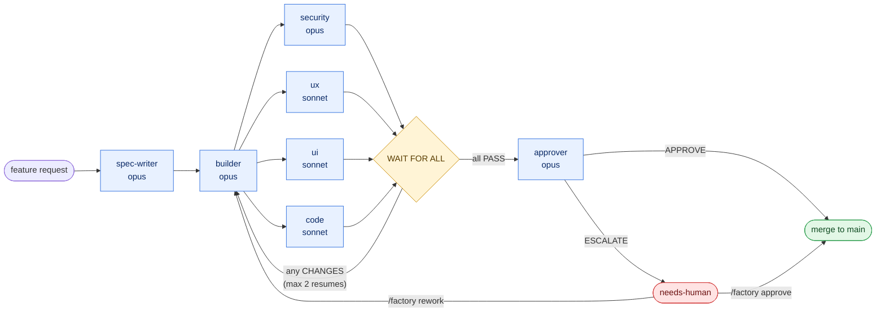

# ZazenCodes — "Build Your Own AI Software Factory with Claude Code"

> **Sources (captured 2026-10-11)**
> - Video: <https://www.youtube.com/watch?v=ctoaIC4LHmI> (published 2026-10-07, 28 min). Transcript: [transcripts/zazencodes-ai-software-factory-claude-code.md](transcripts/zazencodes-ai-software-factory-claude-code.md). Cited below as `[video mm:ss]`.
> - Repo: <https://github.com/zazencodes/zazencodes-season-3/tree/main/src/software-factory-claude-code> at commit `555467c`. Cited below as `[repo <path>]`.
>
> **Labels.** `[repo]` and `[video]` mark what the source literally says. `[analysis]` marks my reading of it. Nothing here was executed: the factory was read, not run.

## What it is, in one paragraph

A **software factory** is a pipeline you feed a feature request into and get a merged change out of, with agents doing the work between the deterministic steps. Zazen's version is deliberately tiny: **one skill** (`/factory`), **seven subagents**, and **plain files** as the only state. You type `/factory <feature>`; agents write a spec, build it on its own branch, review it from four angles in parallel, and an approver agent either merges it to `main` or hands it to you `[repo README.md]`.



## The literature the video draws on

The video spends about ninety seconds on history `[video 02:10–03:15]`. The claims, as stated:

| Era | Claim in the video | Note |
|---|---|---|
| 1968 | "Software factories were first described by Bob Bemer at GE": a computer-controlled programming environment with standardized tools plus historical data for management and measurement | Matches the usual attribution to R. W. Bemer's 1968 paper. Not re-verified here. |
| 1970s–80s | "A lot of stuff going on in Japan" | The Japanese software factories (Hitachi, Toshiba, NEC, Fujitsu) are the standard reference; the video names no source. |
| 2000s | "Reusable patterns, models and frameworks" | This is the Microsoft-era "Software Factories" / product-line idea. |
| 2010s–20s | CI/CD, GitHub Actions | |
| now | "Agentic factories" | |

The one sentence worth keeping verbatim `[video 03:00]`:

> "What's new is the automation of relatively unstructured cognitive work between the deterministic stages, including of course writing the entire code itself."

`[analysis]` That sentence is the definition to build on. A CI pipeline already automated the *deterministic* stages (build, test, deploy). An agentic factory fills the gaps between them, which used to need a person: turning a request into a spec, a spec into code, a diff into a verdict. The pipeline shape is old; what moved is who occupies the non-deterministic boxes.

Two of Bemer's original ingredients are easy to miss and Zazen brings both back at the end `[video 24:50–25:40]`: **standardized tools** and **historical information for management and measurement**. His "future work" list is exactly that second ingredient: application metrics (Sentry), infrastructure metrics (CPU, memory), and a factory that "can still be in the loop even after it's published", rolling back a feature that breaks production.

## How it works

### The design rules

The whole design fits in five rules `[repo BUILD_PROMPT.md, "Rules"]`:

1. **Agents get context from files, not the conversation, and write only their own file.**
2. **Every verdict is the first line of a file.** Reviews start with `VERDICT: PASS` or `VERDICT: CHANGES`; `build.md` starts with `STATUS: READY` or `STATUS: BLOCKED`; `decision.md` starts with `APPROVE` or `ESCALATE`.
3. **The builder works and commits on its own branch** and tests against the spec's acceptance criteria.
4. **WAIT FOR ALL.** A review round is done only when every reviewer's file exists. The builder is never resumed mid-round.
5. **The same builder is resumed** (by name, with `SendMessage`) for each new round, so it keeps the context of what it built.

`[analysis]` Rules 1 and 2 are the load-bearing ones. Because each agent's only output is one file with a fixed first line, the orchestrator never has to *interpret* anything: it reads one line and branches. That is what makes a prompt-driven orchestrator reliable enough to work.

### Roles

| Agent | Model | Reads | Writes | Tools |
|---|---|---|---|---|
| `spec-writer` | opus | `AGENTS.md`, the code | `spec.md` | read-only + Write |
| `builder` | opus | `spec.md`, reviews, rework notes | commits + `build.md` | + Edit |
| `reviewer-security` | opus | spec, build, diff | `round-N/review-security.md` | read-only + Write |
| `reviewer-ux` | sonnet | same + running app | `round-N/review-ux.md` | read-only + Write |
| `reviewer-ui` | sonnet | same + running app | `round-N/review-ui.md` | read-only + Write |
| `reviewer-code` | sonnet | same, runs tests/lint | `round-N/review-code.md` | read-only + Write |
| `approver` | opus | everything in the job folder + diff | `decision.md` | read-only + Write |

Source: `[repo .claude/agents/*.md]`. The orchestrator is whichever Claude Code session ran `/factory`; it "never writes code, specs, reviews or decisions" and is "the only writer of the job's `job.json`" `[repo .claude/skills/factory/SKILL.md]`.

### State on disk

```
factory/
  backlog.md                      queue for /factory next
  dashboard.html                  one self-contained page, polls every 2 s
  jobs/<NNN-slug>/
    job.json                      stage, round, per-reviewer verdicts
    spec.md  build.md  decision.md
    rework-<k>.md                 human feedback, verbatim
    round-<N>/review-{security,ux,ui,code}.md
../<repo>-factory/<job-id>/       the job's git worktree, branch factory/<job-id>
```

`factory/jobs/` is gitignored: job folders are runtime state `[repo README.md step 3]`.

### The approver's escalation policy

The approver approves only when every acceptance criterion has convincing evidence (it must spot-check at least one itself), all four final reviews pass, and the branch merges cleanly. It **must escalate** when the change `[repo .claude/agents/approver.md]`:

- touches money, access or identity (payments, auth, permissions, storage rules);
- changes deploy, CI or hosting config, or the build scripts it runs;
- migrates a schema, sends email, writes production data, or adds a dependency;
- rests on a spec *Assumption* that is really a product or business decision.

`[analysis]` This list is the factory's most reusable artifact. It turns "is this safe to auto-merge?" from a vibe into a checklist, and it is the same question Matt Pocock's `pr` skill asks under "Merge Danger" (one-way vs two-way door, blast radius). See [03-matt-pocock-skills-v1-3.md](03-matt-pocock-skills-v1-3.md).

### Concurrency details worth stealing

- **One worktree per job**, outside the main checkout. Agents never touch the user's checkout; only the merge does.
- **Atomic claims without a lock service.** A job number is claimed with `mkdir` (no `-p`), which fails if another session took it. A backlog line is claimed with one exact-string `Edit`, which fails if the line changed.
- **Ports derived from the job number** (`5100 + 10n` for the builder, `+1` for UX, `+2` for UI) so parallel jobs never share a dev server or a browser session.
- **Never push.** The merge is local.

## What the demo showed

- **It ran three features in parallel** in three sessions, one with a Sonnet orchestrator on low effort `[video 17:37–19:17]`. Zazen's intuition: the orchestrator is not the bottleneck (the subagents are), but he still wants "a really smart model to be the orchestrator" and cheaper models for some subagents.
- **The approver over-escalates.** "I think all of these things Claude is going to figure out some reason to get me to look at them" `[video 21:30]`. Of the two example jobs in the repo, one was escalated for a one-line edit to a prerender script `[repo factory/jobs/001-blog-reading-time/decision.md]`.
- **A real bug appeared.** An approved job did not merge because `factory/backlog.md` was dirty in the main checkout, which `/factory next` always causes `[video 22:04]`. The fix now in the repo exempts that file from the clean-tree check `[repo SKILL.md, "Merge"]`.
- **Cost is the open question.** "It's going to cost more money. There's no way around it" `[video 26:32]`.
- **Build your own.** "You're not relying on some dude's factory skill that is all hyped ... this is your own very simple skill" `[video 19:50]`.

## Assessment

`[analysis]` throughout.

**Strong:**

- **Legibility.** A reader understands the whole system in minutes. Every decision is in one skill file.
- **File-mediated context.** No agent depends on conversation history, so any step can be re-run or inspected.
- **Four independent review lenses in parallel.** Each reviewer has a fresh context and a narrow brief.
- **An explicit auto-merge gate** with a written escalation policy, plus `approve` / `rework` commands for the human.
- **Observability.** The dashboard is one static HTML file over the same files the agents write.
- **A build prompt, not just a product.** `BUILD_PROMPT.md` regenerates the factory in any repo.

**Weak or missing:**

| Gap | Why it matters |
|---|---|
| No alignment step | `spec-writer` turns one sentence into a spec alone. Ambiguity becomes an "Assumptions" list that only the approver looks at, after the code is written. |
| No decomposition | One job is one builder context. A feature too big for one context has nowhere to go. |
| No TDD | The builder "tests against the acceptance criteria" after building. Nothing forces a failing test first. |
| The orchestrator is the loop | State transitions are prose followed by a model. There is no script that says which step is next, so a confused orchestrator can skip one. |
| Local auto-merge to `main`, no PR | No CI run, no remote review surface, no evidence trail outside gitignored files. |
| No learning loop | Nothing reads past jobs to improve the agents, the checklists or the repo. |
| Every reviewer re-runs validation | Four agents start dev servers and run the suite for one diff. |
| Review rounds are all-or-nothing | One `CHANGES` re-runs all four reviewers next round. |

The gaps are not criticism of the video: it set out to be "a very simple factory". They are the list of what the other three sources supply. See [05-unified-factory-study.md](05-unified-factory-study.md).

---

[↑ Software factory index](README.md) | Next → [02 — Austin Marchese, harness engineering](02-austin-marchese-harness-engineering.md)
