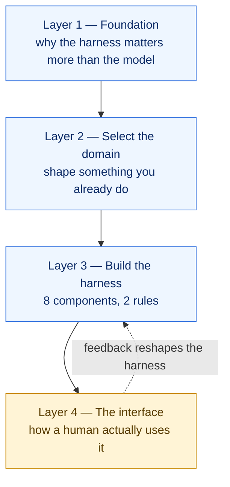
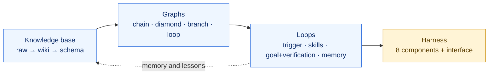

# Austin Marchese — "Stop Prompting Claude. Start Harness Engineering."

> **Source (captured 2026-10-11)**
> - Video: <https://www.youtube.com/watch?v=bIYWxYm5cOY> (published 2026-10-09, 16 min). Transcript: [transcripts/austin-marchese-harness-engineering.md](transcripts/austin-marchese-harness-engineering.md). Cited below as `[video mm:ss]`.
> - Three companion videos named in its description, transcribed the same way: see [The rest of the series](#the-rest-of-the-series).
> - No repository accompanies the videos. The prompts are shown on screen only (not in the captions or the description), and the `build-partner` plugin is a commercial product behind a sign-up at `buildpartner.ai`; neither was retrieved.
>
> **Labels.** `[video]` marks what the speaker says. `[analysis]` marks my reading. `[unverified]` marks a claim in the video that I could not trace to a primary source; treat those as the speaker's framing, not as fact.

## What it is, in one paragraph

A talk for a general (not only developer) audience arguing that results come less from the model and more from the **harness**: "whatever wraps around the model and the input you provide it to improve the actual output you get" `[video 01:40]`. It gives a mental model in four layers, a checklist of eight harness components, and one worked example (a knowledge-base assistant with a local web page). It is the least technical of the four sources and the only one that treats the **human interface** and the **feedback mechanism** as first-class parts of a harness.

## The equation

```
most people:   output = (model + prompt) × base harness
the leaders:   output = (model + prompt) × (base harness + domain harness)
```

`[video 01:06–02:46]`. The **base harness** is the product you chose (Claude Code). The **domain harness** is what you build on top of it, and it is "the one thing you actually own".

`[analysis]` The formula is a slogan, not a model: nothing is measured. Its useful content is the split. You do not rebuild Claude Code; you add the layer that encodes your own workflow. A software factory is exactly a domain harness whose domain is "shipping changes to this repository".

## The four layers



### Layer 2: makers, takers, shapers

`[video 03:18–04:23]`, attributed in the video to a McKinsey report:

| Role | What they do | The video's verdict |
|---|---|---|
| **Maker** | Builds the model (OpenAI, Anthropic, Google) | "That isn't you." |
| **Taker** | Uses AI the way the vendor shipped it | Fast and cheap, but no different from anyone else. |
| **Shaper** | Builds their own layer on someone else's model | "This is essentially the process of harness engineering." |

The practical advice: shape **what you already do and are expert in**, because shaping needs the domain knowledge to be precise. And you can out-build a large vendor on your own workflow because "you get to design for one user" `[video 04:23]`.

### Layer 3: the eight components and two rules

**Rule 1: don't reinvent.** Extend what the base harness already does. **Rule 2: keep it simple.** "The simplest solution that actually solves the problem is better than any complex solution" `[video 07:09–08:48]`.

| # | Component | The video's definition `[video 07:41–08:15]` | Claude Code artifact |
|---|---|---|---|
| 1 | **Rules** | Direct instructions for how the AI should behave | `CLAUDE.md` / `AGENTS.md`, `.claude/rules/` |
| 2 | **Skills** | Reusable capabilities you build once and call when needed | `.claude/skills/*/SKILL.md` |
| 3 | **MCP servers** | The wiring to other tools; external connections | `.mcp.json` |
| 4 | **Context** | The knowledge specific to you ("a knowledge graph helps a lot here") | docs, glossary, ADRs, indexes |
| 5 | **Hooks** | Scripts that run on events (block a command, run a test after an edit) | `settings.json` hooks |
| 6 | **Subagents** | How you delegate and partition work | `.claude/agents/*.md` |
| 7 | **Interface** | How you interact with the whole thing: chat, documents, or a local dashboard | a served HTML page, a CLI, a plugin |
| 8 | **Feedback mechanism** | What lets you shape the harness over time | (no native artifact; you build it) |

The "Claude Code artifact" column is `[analysis]`: the video names the components but not the files.

### Layer 4: the interface

The video calls this "the most important of the four layers" and the one "most people completely neglect" `[video 12:36]`: two harnesses with the same capabilities differ in usefulness by how a person drives them. Three reasons given for a **local web page** as the interface `[video 13:09–14:14]`:

1. **It runs on your subscription.** A local app can use the Claude plan you already pay for instead of API credits.
2. **It iterates fast.** His internal tool has a pencil icon: hover an element, type the change, and the harness edits itself.
3. **It has a path to a team.** A page is easier to hand to colleagues than a terminal workflow.

### The worked example

An internal knowledge harness that answers only from documents you provide `[video 09:21–11:30]`:

- **Rule:** only pull context from this project.
- **Skills:** `kb-answer` (answers from local context only) and `kb-sync` (pulls context in from external sources).
- **MCP:** Google Drive, Notion, or wherever the knowledge lives.
- **Interface:** a one-page site with a Send button (runs `kb-answer`) and a Sync button (runs `kb-sync`).
- **Feedback:** a control on each answer to say whether it was good, and to ingest the missing context when it was not.

## The rest of the series

The link the video was shared with points at a playlist that YouTube now reports as nonexistent. The video's own description names three earlier videos as companions; all three were transcribed and are summarised here because the harness video assumes them.

| Video | Date | Transcript | Cited as |
|---|---|---|---|
| "How to 10x Your Claude Code Projects (Karpathy's Method)" | 2026-04-24 | [transcript](transcripts/austin-marchese-karpathy-method.md) | `[kb mm:ss]` |
| "Stop Prompting Claude. Start Loop Engineering." | 2026-06-19 | [transcript](transcripts/austin-marchese-loop-engineering.md) | `[loop mm:ss]` |
| "Stanford's Graph Method Explained" | 2026-08-20 | [transcript](transcripts/austin-marchese-stanford-graph-method.md) | `[graph mm:ss]` |

Read in order they form one argument: build a **knowledge base** (the harness's context), wire steps into **graphs**, close the graphs that need checking into **loops**, and wrap the whole thing in a **harness** with an interface.



### Loop engineering

A **loop** is "a prompt that runs over and over again until a specific task or goal is complete" `[loop 00:31]`. The video opens with a quote it attributes to Claude Code's creator: "I don't prompt Claude anymore ... My job is to write loops" `[loop 01:03]` `[unverified]`.

**When a task deserves a loop: the four-condition test** `[loop 01:03–02:08]`:

1. Does the task repeat?
2. Is there a clear definition of done?
3. Can you afford to be wasteful? (Loops spend tokens.)
4. Does the loop have every tool it needs to do the work *and* check it?

**The four building blocks** `[loop 02:08–08:41]`:

| Block | What it is | Notes |
|---|---|---|
| **Trigger** | What starts it | `/loop` (local, interval), `/schedule` (cloud, cron), or his preference: one **loop orchestration skill** that holds the goal, the steps and the verification. |
| **Execution skills** | Single specialised jobs the orchestrator calls | "You don't build a loop without battle-tested skills behind it." He calls this **skill-driven loop development**. |
| **Goal + verification** | What "done" means, and the rule that confirms it | "You can't have a goal unless you're able to verify the goal was complete." |
| **Output + memory** | What it produces, and what it records | "Every loop starts from scratch unless you record what happened." A markdown file of lessons and run history is enough. |

Three ideas here carry straight into a software factory:

- **Bridging the abstract to the verifiable.** A fuzzy goal ("is this code good?") becomes checkable by routing it through a review skill whose output is `approved` / `not approved` or a score `[loop 05:57–07:03]`. This is exactly Zazen's first-line `VERDICT:` and `/run-spec`'s status blocks.
- **A different judge.** "If you can have different AI analyze the output, you'll be able to get a less biased opinion": a subagent, or another vendor's model `[loop 07:35]`.
- **Loop training mode.** The first few runs of a new loop pause at every step for approval, then the pauses are switched off `[loop 10:19]`. And for goals that are hard to quantify, break the loop into smaller goals with **human checkpoints at the decisions that would ruin everything downstream** `[loop 10:51–11:25]`.

### Graph engineering

A **graph** is the shape of a workflow: its steps and which ones wait on which. "Just creating graphs isn't engineering graphs. The process of tweaking, designing, and optimizing is" `[graph 01:05]`. The video credits a course by Andrew Ng `[unverified]`.

**The wait test** `[graph 01:40–02:44]`: at every step ask, "does this actually need the result of the one before it?" If not, the two can run at once.

| Shape | What it does | Failure mode `[graph 09:53–11:32]` | How to avoid it |
|---|---|---|---|
| **Chain** | One step after another | Slow and brittle: one failure stops everything | Start every workflow as a chain (easiest to test), then reshape. |
| **Diamond** | Fan out to parallel agents, then join | A *false sense of independence* (two agents do the same work, or miss shared context) and **silent failures** (one branch fails and the join carries on) | Run the wait test; fan out only where an error is cheap. |
| **Branch** | Route to one of several paths by context ("skill routing") | Over-engineering: one skill that tries to do everything | No more than about five branches per skill. |
| **Loop** | Do, evaluate, feed back, repeat until it passes | Infinite loops: a client's loop "spent thousands of dollars on tokens" overnight | A maximum number of iterations, always. |

"Loop engineering is a subcategory within the graph engineering topic" `[graph 07:11]`.

### Knowledge bases, auto-research, context engineering

Presented as three strategies from Andrej Karpathy `[kb 00:00]`; the attributions were not checked against his posts.

- **LLM knowledge base.** "The LLM is rediscovering knowledge from scratch on every question. There's no accumulation." The fix is three folders `[kb 01:05–01:37]`: **raw** (sources; read-only, the source of truth), **wiki** (summaries and cross-references the model writes and maintains), and a **schema** (the instruction file saying how the wiki is structured and what to do with a new source). Why it survives where human wikis die: "the maintenance burden grows faster than the value. LLMs don't get bored" `[kb 02:09]`.
- **Auto-research.** A loop of propose → test → evaluate → keep or discard → repeat, pointed at something with a number attached `[kb 02:41–03:13]`. Marchese's honest caveat: it works when "there's a clear number"; most work has none `[kb 03:48]`. His substitute for unmeasurable work is to use **the back-and-forth of a session as the signal**: a skill reads the conversation in which he corrected the model and updates the knowledge base, and a session-start **hook** reminds him to run it `[kb 04:54–05:59]`.
- **Context engineering.** "Filling the context window with just the right information for the next step." Two practices: a short `CLAUDE.md` ("keep it under 50 lines") and scoping what the model sees, with skills that load the right reference only when the topic calls for it `[kb 07:05–08:41]`.

## Claims to treat with care

| Claim in the video | Status |
|---|---|
| "Meta released Muse", "SpaceX released Grokbot", described as harnesses `[video 00:33]` | `[unverified]`. Product names come from auto-captions and were not checked. |
| A Pieter Levels quote that a Y Combinator batch "literally only has harness startups and hardware startups" `[video 00:33]` | `[unverified]`. |
| The "Karpathy curve": a future where "the model is the least interesting part of the stack" and the real work is "data curation, task decomposition, and organizational adaptation" `[video 14:47–15:52]` | `[unverified]` as a named concept attributed to Andrej Karpathy. The idea itself is a reasonable summary of the harness-engineering position. |
| Makers / takers / shapers from "a McKinsey report" | Consistent with McKinsey's published generative-AI archetypes; the specific report was not opened. |
| Claude product features in the sponsored segment `[video 05:00–06:40]` | Sponsored content; not evaluated. |

## Assessment

`[analysis]` throughout.

**What it adds that the other three sources do not:**

- **A component checklist.** Eight boxes to tick is a fast audit of any harness. Zazen's factory fills rules (via `AGENTS.md`), skills, subagents and interface; it has no hooks, no MCP, and no feedback mechanism. Matt Pocock's skills fill rules, skills, subagents and feedback (`retro`); they have no interface.
- **Interface as a design object.** The others treat the UI as a nice-to-have (Zazen) or ignore it (Pocock, `run-spec`).
- **Feedback as a required part**, not an afterthought. A harness with no way to tell it "that was wrong" does not improve.
- **Design for one user.** A justification for building a personal factory instead of adopting a framework, which is also Zazen's closing argument and Pocock's stated reason for small composable skills.

**What it lacks:**

- **Engineering depth.** No verification, no testing, no review, no failure handling. The example harness is a retrieval assistant, not a system that changes code.
- **Evidence.** Every quantitative-sounding statement ("10 times faster", "90 to 95%") is rhetorical.
- **Deterministic control.** Hooks get one sentence. In a code factory, hooks and scripts are where reliability comes from; the talk does not go there.

**What the companion videos add:**

- **A go/no-go test for automation** (the four conditions) and **a shape vocabulary** (chain, diamond, branch, loop) with a named failure mode for each. The factory in [05](05-unified-factory-study.md) is a chain at the front, a diamond in the middle, a branch at the review lenses and a loop around review and fix.
- **Operational guards the engineering sources leave implicit:** a hard iteration cap on every loop, a supervised "training mode" before a loop runs unattended, and human checkpoints placed at the decisions that would ruin everything after them.
- **Memory as a required output of every run**, which is the gap in `/run-spec` (handoff "Learnings" that nothing reads).

**Where it lands in the unified design:** it is the **frame** (domain harness on a base harness), the **audit list** (eight components), the **shape vocabulary**, and the argument for an **interface plus feedback loop**. It contributes no pipeline stage. See [05-unified-factory-study.md](05-unified-factory-study.md).

---

← [01 — ZazenCodes, software factory](01-zazencodes-software-factory.md) | [↑ index](README.md) | Next → [03 — Matt Pocock, skills v1.3](03-matt-pocock-skills-v1-3.md)
