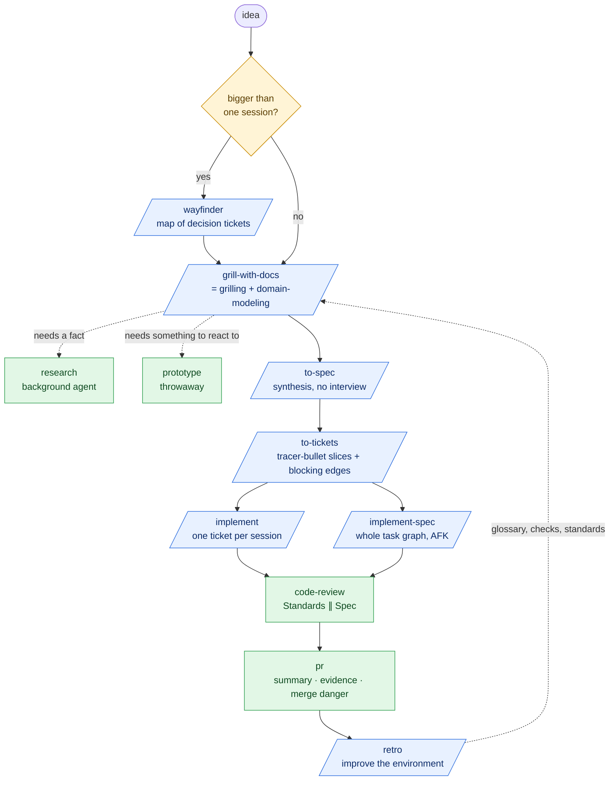

# Matt Pocock — Skills v1.3 and the spec → tickets → implement flow

> **Sources (captured 2026-10-11)**
> - Video: <https://www.youtube.com/watch?v=BsJGo1wFTvQ> "New Skills! v1.3 brings /pr, /implement-spec, and /retro" (published 2026-10-05, 15 min). Transcript: [transcripts/matt-pocock-skills-v1-3.md](transcripts/matt-pocock-skills-v1-3.md). Cited as `[video mm:ss]`.
> - Repo: <https://github.com/mattpocock/skills> at commit `49dd158` (2026-10-09), package version **1.3.1**. Cited as `[repo <path>]`.
>
> **Labels.** `[repo]` and `[video]` mark what the source says. `[analysis]` marks my reading. The skills were read, not run, for this document.
>
> **Local state.** This machine has plugin version **1.2.3** installed (`~/.claude/plugins/installed_plugins.json`, installed 2026-08-14). Everything marked *new in 1.3* below is not yet available locally. The consequences for `/run-spec` are in [04-run-spec-flow.md](04-run-spec-flow.md).

## The idea, in one paragraph

A set of small, composable agent skills that encode ordinary software-engineering discipline, written to counter four failure modes of coding agents `[repo README.md]`. They are explicitly **not** a process framework: "Approaches like GSD, BMAD, and Spec-Kit try to help by owning the process. But while doing so, they take away your control and make bugs in the process hard to resolve." The skills are meant to be read in full, forked and edited.

| Failure mode | Root cause named in the README | The fix | Book it cites |
|---|---|---|---|
| The agent didn't do what I want | Misalignment: "no-one knows exactly what they want" | A **grilling** session before any work | *The Pragmatic Programmer* |
| The agent is way too verbose | No shared language | A **glossary** (ubiquitous language) plus ADRs | *Domain-Driven Design* (Evans) |
| The code doesn't work | No feedback loops | Types, browser access, tests; **red-green** TDD | *The Pragmatic Programmer* |
| We built a ball of mud | Agents accelerate entropy | Care about design: **deep modules** | *Extreme Programming Explained* (Beck), *A Philosophy of Software Design* (Ousterhout) |

## The main flow

Blue boxes are **user-invoked** skills (you type them). Green boxes are **model-invoked** skills (the agent reaches for them). That split is a design rule, explained under [Writing for agents](#writing-for-agents-the-theory-behind-the-skills).

## Concept by concept

### Alignment: `grilling`, `grill-with-docs`, `grill-me`

The interview is modelled as a **design tree**: every decision branches into the decisions that hang off it. The agent works it in **rounds**. Each round asks the whole **frontier**: every question whose prerequisites are already settled. Each question carries a recommended answer, worded so that "yes" accepts it `[repo skills/productivity/grilling/SKILL.md]`.

Two rules make it work:

- **Facts are the agent's job, decisions are the user's.** A question the agent could answer by looking is dispatched to a subagent, not asked.
- **Done means the frontier is empty**: every branch visited, "nothing left silently assumed". The agent does not act until the user confirms shared understanding.

`grill-with-docs` is one line: call `grilling` and `domain-modeling` together.

### Shared language: `domain-modeling`, `GLOSSARY.md`, ADRs

While grilling, the agent challenges terms against the glossary, proposes precise names for fuzzy ones, stress-tests with invented edge cases, checks the code agrees, and **writes the term down the moment it is resolved** `[repo skills/engineering/domain-modeling/SKILL.md]`.

- **Renamed in 1.3.0:** `CONTEXT.md` → `GLOSSARY.md` (and `CONTEXT-MAP.md` → `GLOSSARY-MAP.md`). Reason given: `CONTEXT.md` "felt way too vague. It didn't trigger the agent to pull it in at the right moment", and the file had shrunk to "literally just a glossary" `[video 08:19–09:27]`. Existing repos must `git mv` the file `[repo CHANGELOG.md 1.3.0]`.
- **The glossary holds no implementation detail.** "It is a glossary and nothing else."
- **ADRs are offered sparingly**, only when a decision is hard to reverse, surprising without context, *and* the result of a real trade-off. All three, or no ADR.

Payoff claimed in the README: "There's a problem when a lesson inside a section of a course is made 'real'" becomes "There's a problem with the materialization cascade". Shorter prompts, consistent names in code, fewer thinking tokens.

### Huge work: `wayfinder`

For work "more than one agent session can hold". It produces a **map** (one issue labelled `wayfinder:map`) whose child issues are **decision tickets**: questions, not build slices `[repo skills/engineering/wayfinder/SKILL.md]`.

- **Destination first.** Naming where the map leads fixes its scope.
- **Fog of war.** The map is deliberately incomplete. What can be stated precisely becomes a ticket; what cannot stays in a "Not yet specified" section and graduates as earlier answers land.
- **Four ticket types:** research (AFK), prototype (HITL), grilling (HITL), task (either).
- **One ticket per session** (research excepted), each "sized to one 100K token agent session".
- **Plan, don't do.** The urge to start building is "the signal you've reached the edge of the map".

### Spec: `to-spec`

Synthesis only, no interview: it writes down what the grilling already settled `[repo skills/engineering/to-spec/SKILL.md]`. Template: Problem Statement, Solution, a long numbered list of User Stories, Implementation Decisions, **Testing Decisions**, Out of Scope, Further Notes.

Two rules stand out:

- **Seams before spec.** The agent sketches the **seams** the feature will be tested at, preferring existing seams and the highest one possible ("the ideal number is one"), and checks them with the user *before* writing.
- **No file paths or code snippets.** "They may end up being outdated very quickly." Exception: a snippet from a prototype that encodes a decision better than prose (a state machine, a schema).

### Decomposition: `to-tickets`

Tickets are **tracer bullets**: each a narrow but complete path through every layer (schema, API, UI, tests), demoable on its own, and "sized to fit in a single fresh context window" `[repo skills/engineering/to-tickets/SKILL.md]`. Each declares its **blocking edges**. Together they form a **task graph**, not a list, so there is always a **frontier** of tickets ready to start.

- **Prefactor first.** "Make the change easy, then make the easy change."
- **Wide refactors are the exception.** A rename that breaks thousands of call sites cannot be a vertical slice. Sequence it as **expand → migrate in batches → contract**.
- **The user approves the breakdown** before anything is published.

### Building: `implement`, `implement-spec`, `tdd`

The video frames three ways to run tickets `[video 01:06–03:19]`:

| Loop | Who babysits | Verdict in the video |
|---|---|---|
| **Manual** | You: implement, clear context, repeat | "Not really workable." |
| **Deterministic** | A script reads each ticket and runs the agent on it | "How I recommend that most people do this": reliable, cheap, "runs the same way every time". But complex to set up; "out of range for beginners". |
| **Agentic** (`implement-spec`, new in 1.3) | An orchestrator agent | "Worse than doing a deterministic loop", but a good way into AFK work when "you don't have your software factory dialed in". |

`implement-spec` in nine steps `[repo skills/engineering/implement-spec/SKILL.md]`: read spec and tickets; optionally send an **exploration subagent** that saves notes outside the repo; create an **integration branch**; run **implementer subagents**, each in its own worktree, each building with `tdd` and merging the integration tip before reporting; a **merger subagent** lands each finished ticket; refill from the new frontier; `code-review` the whole branch and fix in one subagent; mark the PR ready; clean up worktrees.

It became possible, the video says, because "sub agents can themselves spawn sub agents" now `[video 02:44]`. Communication between agents is by **context pointers** (to the spec, tickets, notes, commits), never by restating content.

`tdd` is short and strict `[repo skills/engineering/tdd/SKILL.md]`:

- **Test only at pre-agreed seams**, through public interfaces.
- **Red before green**, one vertical slice per cycle.
- **Three named anti-patterns:** implementation-coupled, tautological (the assertion recomputes the answer the way the code does), and horizontal slicing (all tests first).
- **Refactoring is not part of the loop.** It belongs to review.

### Review: `code-review`

Two axes, run as parallel subagents so neither pollutes the other, reported side by side and **never merged or re-ranked** `[repo skills/engineering/code-review/SKILL.md]`:

- **Standards:** does the diff follow the repo's documented standards? Plus a fixed baseline of twelve Fowler code smells that applies even when the repo documents nothing. Repo standards override the baseline; anything tooling already enforces is skipped.
- **Spec:** what the spec asked for that is missing or partial, what the diff does that was not asked for, and what looks implemented but wrong.

Why two: code can follow every standard and implement the wrong thing, or the reverse. One merged list lets one axis mask the other.

### Shipping: `pr` (new in 1.3)

A template for the PR body, adapted from Dex Horthy's `show-me` skill `[repo skills/engineering/pr/SKILL.md]`. Its goal: "make human review as easy as possible", because "PRs are still the main bottleneck for work getting to main" `[video 05:33]`.

| Section | Content |
|---|---|
| **Summary** | The smallest *visual* that makes the change clear: pseudocode, a call tree, a file tree, Mermaid, or a diff-sketch. |
| **Evidence** | Before and after. Screenshots are "S-tier", execution output "A-tier". |
| **Merge Danger** | **Door:** one-way or two-way (can it be walked back?). **Blast radius:** what it could affect. |

On evidence `[video 06:07]`: asking for it "often means it runs an extra test or it takes an extra screenshot ... without asking for hard evidence it's very easy for agents to say yeah that probably works because I've read the code".

### Learning: `retro` (new in 1.3)

Reads a real session (the current one, or logs on the machine) and proposes changes to the agent's **environment**, not the code, most severe first `[repo skills/engineering/retro/SKILL.md]`. Seven categories:

1. **Navigation** — did the agent struggle to find things? Add a pointer.
2. **Automated checks** — could a linter, type or test have caught the mistake? A repo with no guardrail at all is itself a finding.
3. **Coding standards** — a *mechanical* violation gets a deterministic check; `CODING_STANDARDS.md` is reserved for judgement calls.
4. **Global AGENTS.md** — move steering out of always-loaded files.
5. **Tool economy** — expensive or token-wasteful tool calls.
6. **No-ops** — instructions that change nothing.
7. **Information access** — logs, read-only service access the agent lacked.

Two points from the video matter for factory design:

- **Agents hide friction.** "My agents are bumping into all kinds of problems that went undetected. But due to persistence, the features still got built" `[video 10:34]`.
- **Do not automate it.** "Automating this means the agent will get itself into a loop where it continually finds false positives" and drifts the repo `[video 12:46]`. Retro is human-in-the-loop, run on a sample of sessions.

Its reference section states a division of labour: the **implementation agent has the most context pressure**, so the **review agent enforces coding standards**. `CODING_STANDARDS.md` is read during review, not implementation, and `CLAUDE.md`/`AGENTS.md` hold little more than navigation pointers.

### The supporting cast

| Skill | One line |
|---|---|
| `triage` | Issues (and optionally external PRs) move through a state machine: `needs-triage`, `needs-info`, `ready-for-agent`, `ready-for-human`, `wontfix`. It verifies the claim before grilling, writes an agent brief, and keeps rejected ideas in `.out-of-scope/`. |
| `diagnosing-bugs` | "Build a feedback loop" is the skill: one command, red on this bug, deterministic, fast. Then minimise, write 3–5 falsifiable hypotheses, instrument one variable at a time, fix with a regression test. |
| `codebase-design` | The vocabulary: module, interface, depth, seam, adapter, leverage, locality. "One adapter means a hypothetical seam. Two adapters means a real one." |
| `improve-codebase-architecture` | Surveys recent hot spots for shallow modules and renders candidates as an HTML report, then grills the one you pick. |
| `research` | A background agent reads primary sources and writes one cited Markdown file. |
| `prototype` | Throwaway code that answers one question: a single HTML file for logic, or switchable UI variants. |
| `handoff` | Compacts the conversation for a fresh agent, by reference, to the OS temp directory. |
| `setup-matt-pocock-skills` | Once per repo: issue tracker, triage labels, domain-doc layout, written to `docs/agents/*.md`. |
| `ask-matt` | A router: which skill fits this situation. |

### What the reference files add

Several skills keep their detail in sibling files, loaded only when needed. The concepts that live there:

**Tests and mocks** `[repo skills/engineering/tdd/tests.md, mocking.md]`

- A good test is **integration-style**: public interface only, describes *what* not *how*, survives a refactor, one logical assertion. Verify through the interface (`createUser` then `getUser`), never by querying the database behind it.
- **Mock only at system boundaries**: external APIs, time and randomness, sometimes the database or file system. Never your own modules.
- **Prefer SDK-style interfaces to a generic fetcher** (`getUser(id)`, `createOrder(data)` rather than one `fetch(endpoint, options)`), so each mock returns one shape with no conditional logic.

**Deepening a module safely** `[repo skills/engineering/codebase-design/DEEPENING.md]`

How a deepened module is tested depends on what it depends on:

| Dependency category | Example | How to test across the seam |
|---|---|---|
| In-process | Pure computation, in-memory state | Merge and test directly. No adapter. |
| Local-substitutable | Postgres with PGLite, an in-memory filesystem | Run the stand-in in the suite. The seam stays internal. |
| Remote but owned | Your own services over a network | A **port** at the seam; an HTTP adapter in production, an in-memory adapter in tests. |
| True external | Stripe, Twilio | Inject the dependency as a port; tests supply a mock adapter. |

And the testing rule **replace, don't layer**: once tests exist at the deepened module's interface, the old unit tests on the shallow modules are waste, and are deleted.

**Design it twice** `[repo .../DESIGN-IT-TWICE.md]`, after Ousterhout: "your first idea is unlikely to be the best". Spawn three or more subagents in parallel, each told to produce a *radically different* interface under a different constraint (minimise the interface; maximise flexibility; optimise for the most common caller; ports and adapters). Compare them on depth, locality and seam placement, then give an opinionated recommendation, possibly a hybrid.

**Agent briefs** `[repo skills/engineering/triage/AGENT-BRIEF.md]`: the comment that turns an issue into work for an unattended agent. "The original body and discussion are context: the agent brief is the contract." Four principles:

- **Durability over precision.** The issue may wait weeks. Name interfaces, types and behavioural contracts; never file paths or line numbers.
- **Behavioural, not procedural.** What the system should do, not how to change it.
- **Complete acceptance criteria**, each independently verifiable.
- **Explicit scope boundaries**, to stop gold-plating.

**The out-of-scope knowledge base** `[repo .../OUT-OF-SCOPE.md]`: one file per rejected *concept* (not per issue) in `.out-of-scope/`, holding the reason and the list of prior requests. Triage reads it first and matches by concept ("night theme" matches `dark-mode.md`). Only rejected enhancements go there; something closed because it already exists does not, or it "would poison the dedup checks with false rejections".

**ADR and glossary formats** `[repo skills/engineering/domain-modeling/*.md]`: an ADR "can be a single paragraph"; the value is recording *that* a decision was made and *why*. A glossary entry is one or two sentences saying what the term *is*, with an `_Avoid_` list of rejected synonyms, and only for terms specific to the project.

**Context hygiene and phase boundaries** `[repo skills/engineering/ask-matt/SKILL.md]`:

- Keep grilling, spec and tickets in **one unbroken context window**, so each builds on the same thinking. Each `implement` then starts fresh from its ticket.
- The limit is the **smart zone**: "the window (~150k tokens on state-of-the-art models) within which the model still reasons sharply".
- At a boundary between phases there are five moves, to consider in this order: **continue**, **clear**, **handoff** (only for a new harness, a new directory, a colleague, or a mid-phase fork), **subagent**, and **compact** as the default at the bottom of the tree.
- **Don't triage tickets `to-tickets` produced**: they are agent-ready by construction. Triage is for work you did not create.
- A **wayfinder** map hands off at `to-spec`, which "collapses the map's linked decisions into a buildable plan". Going straight to `implement` throws that detail away.

## Writing for agents: the theory behind the skills

`writing-for-agents` is the reference the others are written against `[repo skills/productivity/writing-for-agents/SKILL.md]`. Its vocabulary is the most transferable thing in the repo:

| Term | Meaning |
|---|---|
| **Context pointer** | A reference held in context that names out-of-context material *and* the condition for reaching it. A skill description is one. The pointer's wording, not its target, decides whether the agent gets there. |
| **Context load** vs **cognitive load** | Always-loaded text costs the agent's window every turn. Text with no pointer costs the human, who must remember it exists. Every document spends one or the other. |
| **Information hierarchy** | In-file step → in-file reference → disclosed reference. **Progressive disclosure** moves material down the ladder; it protects legibility first and saves tokens second. |
| **Completion criterion** | Every step ends on a checkable condition. A vague one invites **premature completion**. A demanding one ("every modified model accounted for") drives **legwork**. |
| **Leading word** | A compact concept from pretraining (*tracer bullet*, *fog of war*, *tight*, *red*) repeated as a token to anchor behaviour cheaply. |
| **Negation** | Steering by prohibition makes the banned behaviour more available. State the target behaviour. |
| **No-op** | An instruction the model already follows by default. Delete the whole sentence. |
| **Sediment** | Stale layers that accumulate because adding feels safe and removing feels risky. |

And the invocation rule `[repo .../SKILL-MECHANICS.md]`: a **model-invoked** skill keeps a description and pays permanent context load for discoverability; a **user-invoked** skill (`disable-model-invocation: true`) costs no context but the human must remember it. A user-invoked skill may call model-invoked ones, never another user-invoked one.

## What changed in 1.3.x

From `[repo CHANGELOG.md]`:

| Change | Detail |
|---|---|
| **Added** | `implement-spec`, `pr`, `retro` graduated into the Engineering bucket and ship in the plugin. |
| **Removed** | `resolving-merge-conflicts`: "the agent works through an in-progress merge or rebase conflict without a dedicated skill". |
| **Renamed** | `CONTEXT.md` / `CONTEXT-MAP.md` → `GLOSSARY.md` / `GLOSSARY-MAP.md`, in eleven skills. |
| **Invocation wording** | Cross-skill calls now say `Call the Skill tool with "x"`, because naming a skill in prose "does not reliably cause it to load". |
| **Invariant fixed** | Skills no longer try to call user-invoked skills; they tell the human to run them. |
| **Ticket heading** | Local ticket files now start `# <NN>: <title>` (was `# <NN> — <title>`), a side effect of removing every em-dash from the repo. |
| **Declared out of scope** | Guards against subagent recursion: "The harness should be responsible for stopping infinite subagent loops, not skills" `[repo .out-of-scope/subagent-recursion.md]`. |

## Assessment

`[analysis]` throughout.

**Strong:**

- **The front half.** Grilling, a glossary, seams agreed before the spec, and tracer-bullet tickets with blocking edges are the most developed alignment-and-decomposition practice of the four sources. Nothing in Zazen's factory or Marchese's talk comes close.
- **A named vocabulary** that is reused across skills (frontier, seam, tracer bullet, context pointer). The skills practise what `writing-for-agents` preaches.
- **Two-axis review** with a stated reason for keeping the axes apart.
- **A learning loop** (`retro`) with an explicit rule about which findings become deterministic checks.
- **Honesty about its own ceiling.** The author says the agentic loop is worse than a deterministic one.

**Weak or missing, for a factory:**

- **No deterministic orchestrator.** `implement-spec` is nine prose steps; the frontier is computed by the model each time.
- **No failure policy.** Nothing says what happens when a ticket fails twice, a merge cannot be resolved, or the suite stays red.
- **No auto-merge gate.** `pr` computes merge danger for a human reader; nothing acts on it.
- **No observability.** No dashboard, no per-run state files, no status protocol.
- **No specialised review lenses** (security, UX, UI). Standards and Spec only.
- **No model routing.** The skills are deliberately model-agnostic.
- **HITL by design at the front.** Grilling, seam confirmation and ticket approval all wait for a person. That is correct, and it means the factory's intake cannot be fully AFK.

See [05-unified-factory-study.md](05-unified-factory-study.md) for how these combine with the other three.

---

← [02 — Austin Marchese, harness engineering](02-austin-marchese-harness-engineering.md) | [↑ index](README.md) | Next → [04 — The `/run-spec` flow](04-run-spec-flow.md)
