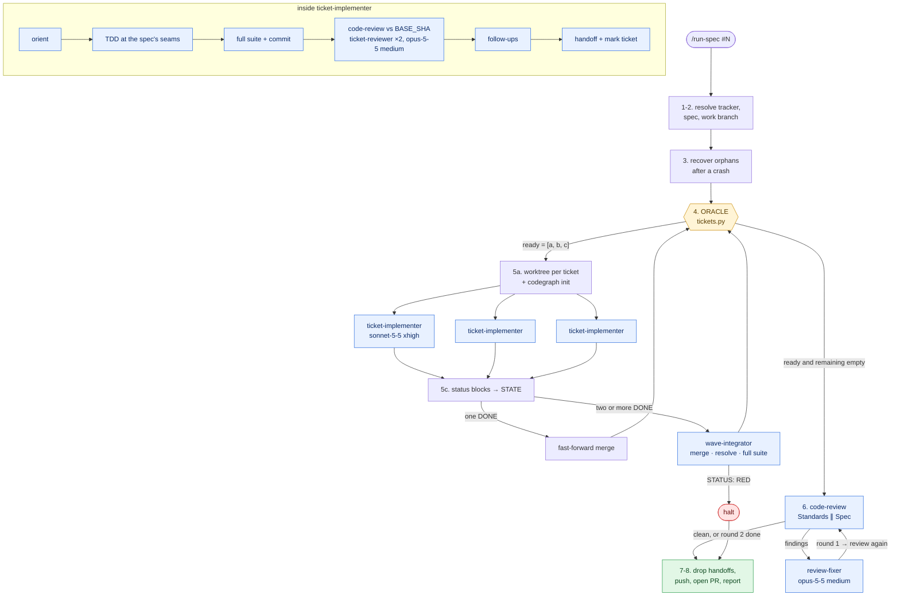

# The `/run-spec` flow — AFK execution of a spec's tickets

> **Sources (read 2026-10-11, on this machine)**
> - `~/.claude/skills/run-spec/SKILL.md` and `tickets.py`
> - `~/.claude/agents/ticket-implementer.md`, `ticket-reviewer.md`, `wave-integrator.md`, `review-fixer.md`
> - Upstream dependency: the `mattpocock-skills` plugin, installed at version **1.2.3**; compared against upstream **1.3.1** (commit `49dd158`).
>
> **Labels.** `[file]` marks what a file literally says. `[verified]` marks something I checked by running a command in this session. `[analysis]` marks my reading. The flow itself was not executed for this document.

## What it is, in one paragraph

`/run-spec` takes a spec that was produced by `/to-spec` and split by `/to-tickets`, and implements all of its tickets with nobody watching. It is the same job as Matt Pocock's `implement-spec` (see [03](03-matt-pocock-skills-v1-3.md)), built before that skill graduated, with one structural difference: **a script, not the model, decides what runs next**. In Pocock's own terms it sits between the "agentic loop" and the "deterministic loop".

## The parts

### The dispatcher (the skill)

The main session is a **dispatcher**: "passive: it routes work and never does it" `[file SKILL.md]`. Its whole toolbox is: run the oracle, run the listed git/gh commands, read and write its own state files, spawn three agent types, and run `code-review` once at the end.

The **dispatcher contract** is what keeps it passive:

| Rule | Text |
|---|---|
| Work goes to a subagent | Reading or editing source, running tests, committing code: all subagent work. |
| Evidence is the status block | "A subagent's `TESTS:` line or `STATUS:` line is the verification. Never re-run the suite to double-check it." |
| Scope is the oracle's ticket set | Only ids in `ready`, in order, once per attempt. |
| Chat is a status line | One line per event. No analysis, prediction or questions. |
| AFK | Never ask during the run. Every stop ends in the final report. |

The contract also states that it **overrides conflicting global instructions** (verify-before-done, advisor passes, codegraph indexing, decision-framing, memory consolidation).

### The oracle (`tickets.py`)

A 149-line script that reads only ticket *metadata* and prints one JSON object `[file tickets.py]`: for each ticket its `id`, `blockers`, `done`, `attempts`, `skipped`, `ready`; plus `ready` (ids runnable now, in order) and `remaining`.

How it decides, without a model:

- **Done** = the work branch's history carries a `Ticket: <id>` commit trailer or a `chore(handoff): <id>` commit, or the issue is closed.
- **Attempts** = the number of `<id>-attempt*.md` failure files. Two attempts → **skipped**, and everything blocked by a skipped ticket is skipped too.
- **Ready** = not done, not skipped, and every blocker done. An unknown blocker never counts as done.
- **In scope** = closed, or labelled `ready-for-agent`. Other tickets (`needs-info`, `ready-for-human`, follow-ups) never run but still block.

`[analysis]` This is the piece neither Zazen's factory nor `implement-spec` has. Because "done" is derived from git history and failure files, the run is **resumable after a crash** with no memory of its own, and the model cannot dispatch a ticket early.

### State

`STATE` = `<git-common-dir>/run-spec/<slug>/`: worktrees under `wt/`, `status-<id>.md`, `<id>-attempt<k>.md`, `wave-NN.md`, `review-N.md`, `pr-body.md`. Keeping it inside `.git` means it never shows in the tree, `git status`, or test discovery `[file SKILL.md]`.

### The agents

| Agent | Model / effort | Job | Returns |
|---|---|---|---|
| `ticket-implementer` | `claude-sonnet-5-5` / `xhigh` | One ticket, end to end, in its worktree: TDD → suite → commit → two-axis review → fixes → follow-ups → handoff | A six-line status block |
| `ticket-reviewer` | `claude-opus-5-5` / `medium`, read-only | One review axis (Standards or Spec) for the implementer | Findings with `file:line` |
| `wave-integrator` | inherits | Merge a wave's branches in order, resolve conflicts using both handoffs, run the full suite, delete worktrees and branches | `GREEN` / `RED` block |
| `review-fixer` | `claude-opus-5-5` / `medium` | Fix final-review findings, one commit each; every finding ends as `fixed`, `dismissed` or `follow-up` | Per-finding block |

Design choices worth noting `[file agents/*.md]`:

- **Every question a skill would ask a human is pre-answered by an input.** `tdd`'s "confirm seams" is answered by the spec's Testing Decisions; `code-review`'s "fixed point" is `BASE_SHA`.
- **Commit before review.** The review diffs `BASE_SHA...HEAD`, so uncommitted work would be invisible.
- **An 80% confidence rule** for fixing a review finding versus dismissing it with a reason.
- **Absorb by default.** A problem the ticket can close is fixed and listed as `absorbed:`; an issue is filed only when it is provably out of scope, and never as a ticket of the same spec (the run would pick it up).
- **A failure path.** A ticket that cannot be finished writes a failure handoff *outside* the worktree, with "what the next attempt should try". The retry reads it.
- **Self-validation.** Each agent ends with a checklist it must verify with fresh command output before returning.

### Limits that are built in

| Limit | Value | Reason given |
|---|---|---|
| Wave size | 3 tickets | "Every ticket runs a full test suite on this one machine." |
| Attempts per ticket | 2 | Then skipped, with its dependents. |
| Final review rounds | 2 | Then remaining findings go in the report. |
| Merging the PR | never | The human merges. |

## Drift against upstream 1.3.1

`[verified]` on 2026-10-11 by reading both versions. These break or degrade `/run-spec` the moment the plugin updates from 1.2.3:

| # | What changed upstream | Where `/run-spec` depends on the old behaviour | Effect |
|---|---|---|---|
| 1 | `resolving-merge-conflicts` was **removed** in 1.3.0 | `wave-integrator.md` preloads `mattpocock-skills:resolving-merge-conflicts` and tells the agent to follow it | The preload names a skill that no longer exists. Conflict resolution loses its guidance. |
| 2 | `CONTEXT.md` was **renamed** to `GLOSSARY.md` | `ticket-implementer.md` phase 1 reads `CONTEXT.md` | The implementer skips the glossary in any repo that followed the rename. |
| 3 | Local ticket heading is now `# <NN>: <title>` (was `# <NN> — <title>`) | `tickets.py` strips the prefix with `^#\s*\d+\s*[—-]\s*` | The title keeps its `# 01: ` prefix. Blockers written as *numbers* still resolve; blockers written as *titles* stop matching. Checked: the regex returns `'# 01: Add login'` for the new form and `'Add login'` for the old. |
| 4 | `implement-spec` now exists upstream | `/run-spec` duplicates its purpose | Not a break. A decision: keep the oracle-driven version, or adopt upstream and lose determinism. |
| 5 | `pr` and `retro` now exist upstream | `/run-spec` writes its own PR body and has no retrospective step | Not a break. Two capabilities available to adopt. |

## Assessment

`[analysis]` throughout.

**Strong:**

- **Deterministic frontier.** The model routes; the script decides.
- **Crash recovery and bounded retries**, with failure handoffs that inform the next attempt.
- **A status-block protocol** between every agent and the dispatcher, which keeps the dispatcher's context small.
- **Review at two scales:** per ticket (against `BASE_SHA`) and per spec (against the merge-base), with a bounded fix loop.
- **Model routing by role:** a cheaper model at high effort builds; a stronger model at medium effort reviews and fixes.
- **Evidence discipline:** trailers on every commit, fresh command output behind every "done".

**Weak or missing:**

| Gap | Who has the answer |
|---|---|
| No front half: it needs a finished spec and tickets | Pocock (grilling, to-spec, to-tickets) |
| No approval gate or escalation policy; every run ends in a PR for a human | Zazen (approver), Pocock (merge danger) |
| The PR body lists tickets and summaries but no visual summary, no before/after evidence, no door or blast radius | Pocock (`pr`) |
| No learning loop: handoffs carry "Learnings" but nothing consumes them | Pocock (`retro`) |
| No observability: state lives in `.git`, visible only as chat status lines | Zazen (dashboard), Marchese (interface) |
| No backlog or intake | Zazen (`backlog.md`, `/factory next`), Pocock (`triage`) |
| Only two review lenses | Zazen (security, UX, UI) |
| Waves, not a continuous frontier: a slow ticket holds back the next wave | Pocock (`implement-spec` refills as each ticket lands) |
| Lives in `~/.claude`, not in a plugin; depends on a specific plugin version and on overriding the user's global instructions | A packaged, versioned plugin |
| The dispatcher is still a model following prose for steps 5–8 | A fully scripted loop (Pocock's "deterministic loop") |

The last row is the natural end state: the oracle already answers "what next?", so a script could run the whole loop and call `claude -p` per ticket. See [05-unified-factory-study.md](05-unified-factory-study.md).

---

← [03 — Matt Pocock, skills v1.3](03-matt-pocock-skills-v1-3.md) | [↑ index](README.md) | Next → [05 — Unified factory study](05-unified-factory-study.md)
