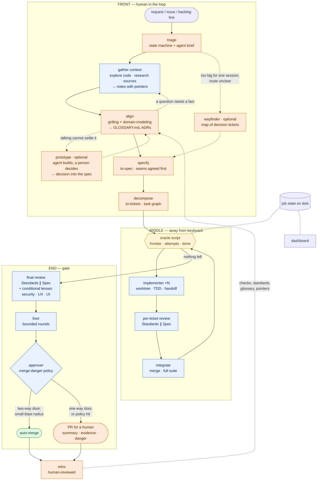

# Unified software-factory harness — a study

> **Status: study, not a plan.** This document compares four sources, derives design principles, and sketches one way to combine them. It ends in **open questions**. No implementation plan exists yet, and none should be written before those questions are answered.
>
> **Inputs.** [01 ZazenCodes](01-zazencodes-software-factory.md) · [02 Austin Marchese](02-austin-marchese-harness-engineering.md) · [03 Matt Pocock](03-matt-pocock-skills-v1-3.md) · [04 `/run-spec`](04-run-spec-flow.md) · [06 Prototyping evidence](06-prototyping-evidence.md) · [07 Wayfinder assessment](07-wayfinder-assessment.md) · [08 Guardrails](08-guardrails.md) · [Claude 5.5 model selection](../models/claude-5-5-model-selection.md) · [State of practice, October 2026](../analysis/state-of-practice-2026-10.md).
>
> **Labels.** `[01]`–`[04]` point at the source analysis that supports a statement. `[lit]` marks outside literature, cited inline. `[proposal]` marks my design suggestion: an inference from the sources, not something any of them states or that was tested.

## 1. The question

Can one project provide every agentic artifact (skills, subagents, hooks, scripts, state files, an interface) needed to install a **software factory** in a repository, taking the strongest part of each of the four flows?

Short answer: yes, and the four fit together unusually well, because **each is strong exactly where the others are empty**.

## 2. What each source is best at

A software change moves through twelve stages. Rated per source: ● strong, ◐ partial, ○ absent.

| Stage | What happens | Zazen `[01]` | Marchese `[02]` | Pocock `[03]` | `/run-spec` `[04]` |
|---|---|:-:|:-:|:-:|:-:|
| 1. Intake | Requests arrive and are queued | ◐ `backlog.md` | ○ | ● `triage` | ○ |
| 2. Gather context | Facts about the code and the outside world are collected before anything is decided | ◐ `spec-writer` reads first | ◐ knowledge base | ◐ `research`, exploration subagent, fact-finding inside grilling | ◐ per-ticket orient + code index |
| 3. Align | Human and agent agree what to build | ○ | ○ | ● grilling, glossary, ADRs | ○ |
| 4. Specify | The agreement becomes a spec | ◐ solo `spec-writer` | ○ | ● `to-spec`, seams first | ○ |
| 5. Decompose | The spec becomes a task graph | ○ | ○ | ● tracer-bullet tickets | ○ (consumes it) |
| 6. Orchestrate | Something decides what runs next | ◐ prose loop | ○ | ◐ prose loop | ● script oracle |
| 7. Build | Code is written and tested | ◐ no TDD | ○ | ● `tdd` at seams | ● TDD + handoffs |
| 8. Integrate | Parallel work is merged | ◐ one job, one branch | ○ | ◐ merger subagent | ● integrator + full suite |
| 9. Review | An independent judge checks it | ● four lenses | ○ | ● two axes + smells | ● two axes, two scales |
| 10. Gate | Merge automatically, or ask a human | ● approver + policy | ○ | ◐ merge danger (advisory) | ○ always a PR |
| 11. Observe | A human can see what is happening | ● dashboard | ● interface as a layer | ○ | ○ |
| 12. Learn | The harness improves from its runs | ○ | ◐ feedback as a component | ● `retro` | ◐ learnings, unused |

Read by column:

- **Pocock owns the front** (1, 3–5) and the learning loop (12).
- **`/run-spec` owns the middle** (6–8): the only deterministic orchestration.
- **Zazen owns the end** (10–11): the auto-merge gate and the dashboard.
- **Marchese owns no stage.** He supplies the frame: a factory is a *domain harness*, audited against eight components, and its interface and feedback loop are design objects. His companion videos add a shape vocabulary (chain, diamond, branch, loop) and a test for what deserves a loop at all.
- **Nobody owns stage 2.** All four gather context, none treats it as a stage with its own output. Section 5a covers what that costs and what the rest of this library says about it.

## 3. The literature behind the practices

| Practice | Origin | Enters through |
|---|---|---|
| Standardized tools + historical data for measurement | Bemer, 1968 software factory | Zazen `[01]`; mostly still unbuilt |
| Automating the cognitive work between deterministic stages | Zazen's definition of the agentic factory | `[01]` |
| Ubiquitous language | Evans, *Domain-Driven Design* | `GLOSSARY.md` `[03]` |
| Tracer bullets; "no-one knows exactly what they want" | Hunt & Thomas, *The Pragmatic Programmer* | grilling, `to-tickets` `[03]` |
| Red-green; "invest in the design every day" | Beck, *Extreme Programming Explained* | `tdd` `[03]` |
| Deep modules | Ousterhout, *A Philosophy of Software Design* | `codebase-design` `[03]` |
| Seams | Feathers, *Working Effectively with Legacy Code* | `to-spec`, `tdd` `[03]` |
| Code smells | Fowler, *Refactoring* ch. 3 | `code-review` baseline `[03]` |
| One-way and two-way doors | Bezos's shareholder-letter framing | `pr` merge danger `[03]` |
| Makers, takers, shapers | McKinsey gen-AI archetypes | `[02]` |
| **Guides and sensors; computational vs inferential controls** | Böckeler, *Harness engineering* (martinfowler.com, 2026-04-02) `[lit]` | not in the four sources; adopted below |
| **Planner / generator / evaluator; "every component encodes an assumption about what the model can't do"** | Anthropic, *Harness design for long-running apps* (2026-03-24) `[lit]` | not in the four sources; adopted below |
| **Minimal context files, kept for non-standard practices** | Gloaguen et al., *Evaluating AGENTS.md*, v3 (ETH Zurich, arXiv 2602.11988v3) `[lit]` | consistent with `retro` and `writing-for-agents` `[03]` |
| **Research as its own phase: a fresh context, subagents for the noisy reading, a compressed written result, a human checkpoint** | HumanLayer, *Research-Plan-Implement* ([agentic-engineering/](../agentic-engineering/research-plan-implement-rpi.md)); the workflow was later revised by its authors, the research step was kept `[lit]` | only partly in the four sources; adopted in section 5a |
| **A prototype as a risk-resolution technique chosen for a named uncertainty; several variants in parallel** | Boehm 1988; Hunt & Thomas; Houde & Hill 1997; Dow et al. 2010 `[lit]`, detailed in [06](06-prototyping-evidence.md) | Pocock's `prototype` skill `[03]`; adopted below as an optional step |
| **Guardrails as layered controls enforced outside the model; least agency; approval tiered by reversibility; the Rule of Two for untrusted input** | OpenAI, Google and OWASP guidance (2025); Willison; Meta; with the evidence in [08](08-guardrails.md) `[lit]` | present in all four sources, mostly as prompt text; made explicit in section 5c |
| **Autonomy ladder; the "dark factory"** | Shapiro's levels 0–5; StrongDM's factory `[lit]` | used below to stage the rollout |

The three `[lit]` rows in bold supply vocabulary the four sources use without naming. Böckeler's two-by-two is the most useful:

| | **Guide** (feedforward: steer before acting) | **Sensor** (feedback: observe after acting) |
|---|---|---|
| **Computational** (deterministic, cheap) | the oracle's ticket order, worktree setup, hooks that block a command | tests, types, linters, CI, commit-trailer checks |
| **Inferential** (a model; slower, costlier, noisier) | the spec, the glossary, coding standards, skill text | review subagents, the approver, `retro` |

## 4. Design principles

Each principle is derived from the sources; the derivation is the `[proposal]`.

1. **A deterministic skeleton with inferential muscles.** A script decides *what runs next*; models do the work inside each step. Pocock ranks the deterministic loop above the agentic one `[03]`; `/run-spec`'s oracle is the working example `[04]`; Zazen's and `implement-spec`'s prose loops are the thing to replace.
2. **Files are the interface between agents.** One agent, one output file, a fixed first line (`VERDICT: PASS`, `STATUS: DONE`, `APPROVE`). The orchestrator reads a line and branches `[01]` `[04]`.
3. **The worker never judges its own work.** Reviewers get a fresh context and a diff `[01]` `[03]` `[04]`. Anthropic's harness post gives the reason: self-evaluating agents praise mediocre work `[lit]`.
4. **Human in the loop at the front and at one-way doors; nobody in the loop in the middle.** Alignment needs a person `[03]`. Building does not `[04]`. Merging needs a person only when the change is hard to undo `[01]` `[03]`.
5. **Computational sensors before inferential ones.** Anything a linter, type checker or test can catch must not cost a review agent's attention `[03 retro]` `[lit Böckeler]`.
6. **Almost nothing always-loaded.** `CLAUDE.md`/`AGENTS.md` hold navigation pointers; standards are read at review time; skills are disclosed by pointer `[03]`. The ETH result (context files raise inference cost by over 20% with no clear gain in task success) points the same way `[lit]`.
7. **Every component is removable.** Each stage encodes an assumption about what the model cannot do alone, and those assumptions expire with each model generation `[lit Anthropic]`. A lens, a round limit or a decomposition step should be a switch, not a load-bearing wall.
8. **Evidence, not claims.** Before/after output in the PR `[03]`, fresh command output behind every "done" `[04]`, acceptance criteria with recorded evidence `[01]`.
9. **The learning loop stays human-reviewed.** Automated self-improvement drifts on false positives `[03]`.
10. **Small enough to read.** A factory you cannot read end to end is one you cannot fix `[01]` `[02]` `[03]`.
11. **Every loop has a cap, and every new loop starts supervised.** A maximum number of iterations is not optional; the first runs of a new stage pause for approval before it is trusted unattended `[02]`. Zazen's `MAX_RESUMES` and `/run-spec`'s two attempts and two review rounds are the same rule `[01]` `[04]`.
12. **Parallelise only what is truly independent.** Fan-out fails silently and duplicates work when branches secretly depend on each other `[02]`. Blocking edges between tickets are how independence is declared rather than assumed `[03]`.
13. **Gather facts before asking for decisions, and write them down once.** Reading the codebase is noisy work that belongs in a subagent's context; what comes back is a short note with pointers, which every later stage reads instead of re-exploring `[03]` `[lit RPI]`. Gathering is per task: a static overview of the repository does not help an agent find the relevant files sooner `[lit ETH v3]`.
14. **A rule the factory depends on is enforced by something the agent cannot edit.** An instruction in a prompt is guidance; it explains the rule so the agent rarely meets the guard. Permission rules, the sandbox, hooks, the oracle and CI are what make it true `[lit]`, [08](08-guardrails.md). All four sources state their hard rules mostly in prose `[01]` `[03]` `[04]`.

## 5. A combined pipeline

`[proposal]`

What each part takes from where:

| Part | Taken from | Change made in the combination |
|---|---|---|
| Triage, grilling, glossary, spec, tickets | Pocock `[03]` | Used as published. |
| Optional prototype | Pocock's `prototype` `[03]`, with the literature in [06](06-prototyping-evidence.md) | Invoked only for a named question that talking cannot settle. The agent builds; a person decides; the decision enters the spec and the code stays on a throwaway branch, enforced by a merge check. |
| Optional wayfinder on-ramp | Pocock's `wayfinder` `[03]`, assessed in [07](07-wayfinder-assessment.md) | For work too big for one session with an unclear route. Same front half, spread over sessions; its documented failures are closed by harness guards. |
| Context gathering | Pocock's `research` and exploration subagent `[03]`, `/run-spec`'s orient step and code index `[04]`, Marchese's knowledge base `[02]`, RPI's research phase `[lit]` | Made an explicit stage with a written output. See section 5a. |
| Oracle and status-block protocol | `/run-spec` `[04]` | The oracle grows to drive the whole run, not only the frontier. |
| Implementer with TDD, handoffs, failure path | `/run-spec` `[04]` | Unchanged in shape. |
| Continuous frontier instead of fixed waves | Pocock `implement-spec` `[03]` | Refill as each ticket lands, under a concurrency cap. |
| Conditional review lenses | Zazen `[01]` | Security, UX and UI run **only when the diff touches their area**. Zazen runs all four on every job. |
| Approver and escalation policy | Zazen `[01]` + Pocock merge danger `[03]` | One policy file; the approver's verdict is `door` + `blast radius` + `APPROVE`/`ESCALATE`. |
| PR body with evidence | Pocock `pr` `[03]` | Replaces `/run-spec`'s list-of-tickets body. |
| Job folder and dashboard | Zazen `[01]` | The dashboard reads the same files the oracle reads. |
| Interface and feedback as components | Marchese `[02]` | The dashboard gets `approve` / `rework` controls and a "this was wrong" note that feeds `retro`. |
| Retro | Pocock `[03]` | Fed by handoff "Learnings" and failure files, which `/run-spec` already writes and nobody reads. |

## 5a. Context gathering: the stage none of the four names

**What it is.** Before anyone decides what to build, something has to find out what is already there: which modules the change touches, how they work today, what the existing tests and conventions are, and what outside facts (an API's behaviour, a library's limits) the design depends on. That is **context gathering**. It produces facts, not decisions.

**How each source handles it today:**

| Source | Where gathering happens | What is missing |
|---|---|---|
| Zazen `[01]` | Inside `spec-writer` ("Read first": `AGENTS.md`, linked docs, the code the feature touches) and again inside the builder and each of four reviewers. | No shared output. Six agents explore the same code separately. |
| Pocock `[03]` | Spread over four places: `grilling` ("finding facts is your job": a subagent is dispatched for anything that can be looked up); `research` (a background agent writes one cited file from primary sources); `to-spec` and `to-tickets` ("explore the repo if you haven't already"); `implement-spec` step 2 (an optional **exploration subagent** that saves notes outside the repo "accessible by all future subagents"). | It is the most complete, but optional at every point and never a named stage. |
| `/run-spec` `[04]` | Per ticket: the implementer's "orient" phase reads the ticket, spec, handoffs and agent docs, and each worktree gets a code index (`codegraph init`). Handoffs carry "Notes for dependent tickets". | Nothing is gathered once for the whole spec. Each implementer starts from the ticket and rediscovers the code. |
| Marchese `[02]` | A standing **knowledge base** (raw sources → model-maintained wiki → schema), built once and reused. | It is about domain knowledge, not about the code a specific change touches. |

**What the rest of this library says.**

- **Research is a phase with its own output.** In HumanLayer's Research-Plan-Implement, research starts "with a fresh context window containing only the problem definition", uses subagents for the noisy operations (searching, reading), and ends in a compressed research document, followed by a human checkpoint. The authors later revised the workflow, but the audit of that document found these two parts still hold: "human checkpoints after research and after planning, and sub-agents for research" ([research-plan-implement-rpi.md](../agentic-engineering/research-plan-implement-rpi.md), currency note).
- **Just-in-time beats pre-loaded.** Anthropic's guidance is to keep lightweight pointers and load detail when needed ([state of practice](../analysis/state-of-practice-2026-10.md), section 2).
- **A static overview is not a substitute.** In the ETH study (v3), repository overviews in context files did not reduce the number of steps agents needed to reach the relevant files ([analysis](../analysis/analysis-evaluating-agents-paper.md), section 3.4). Context has to be gathered for the task at hand.
- **Subagents exist for exactly this.** Their value is "a clean window and a narrow brief" (state of practice, section 2): the exploration's noise stays out of the context that will make decisions.

**How it would enter the pipeline** `[proposal]`. Gathering is not one moment; it recurs at three scales, and each should write something the next stage reads:

| Scale | When | Who | Output | Read by |
|---|---|---|---|---|
| **Per request** | After triage, before and during alignment | Exploration and research subagents, dispatched by the aligning session | A short discovery note: the modules involved, how they work today, existing seams and tests, open factual questions answered, each claim with a pointer (path, symbol, URL) | The grilling session, then `to-spec` |
| **Per spec** | After decomposition, before the build loop starts | One exploration subagent | Notes per area of the codebase the tickets touch, stored outside the working tree | Every implementer and reviewer |
| **Per ticket** | At the start of each implementer | The implementer itself, with a code index | Nothing new: it reads the notes above plus its blockers' handoffs, and explores only the gap | — |

Two rules keep this from becoming overhead:

- **Notes hold pointers, not copies.** A note that restates the code goes stale and repeats the redundancy the ETH study measured. It says where to look and what was learned that the code does not show.
- **Facts and decisions stay apart.** The gathering stage answers "what is true". It hands questions of "what should we do" to alignment, where a person answers them `[03]`.

The dashed arrow in the diagram above is the loop Pocock's grilling already describes: a question that needs a fact goes back to gathering, and the rest of the frontier carries on meanwhile.

## 5b. Two optional paths: a prototype step and the wayfinder on-ramp

Neither applies to most jobs. Both are documented separately; this is the summary.

**Prototype (optional step inside alignment).** A prototype answers one question that conversation cannot: how something should look, or how it should behave. The literature supports it as a technique chosen for a named uncertainty, not as a fixed stage, and gives experimental support for building several different variants at once. No study measures it with coding agents. The factory's rules: gated by the criteria in [06](06-prototyping-evidence.md) section 6; the agent builds unattended; a person makes the choice; the decision goes into the spec and the code stays out of the main line, enforced by the harness.

**Wayfinder (optional on-ramp before the spec).** For work that does not fit one session and whose route is unclear. It is the same front half (gather context, align, prototype) broken into typed decision tickets on a shared map, resolved one per session. Its author documents seven failure modes; the two worst come from rules that live in a prompt the constrained agent can rewrite. The factory's contribution is to enforce those rules from outside the model. See [07](07-wayfinder-assessment.md).

**The idea both share, and the factory should apply everywhere:** every unit of work is typed as *needs a person* or *agent alone*. That one classification decides what may run unattended, in planning and in building alike.

## 5c. Guardrails: the layer under every stage

Guardrails are not a stage. They apply to all of them. The full study is [08](08-guardrails.md); this is what it changes here.

**What the literature says.** Layer the controls; put the enforcing layer outside the model; treat model-based checks (classifiers, reviewer agents) as one layer and never as the boundary; ask a person only where it matters, because approval requested for everything stops being read. The measured evidence is thin, and where it exists it mostly shows guardrails failing: twelve published prompt-injection defences were bypassed with over 90% success for most, and coding agents have been measured hardcoding to tests and deleting test files, far more often on ambiguous tasks.

**What it means for the four sources.** Each has the right instincts and enforces them mostly in prompt text: "never push", "never modify the main checkout", the approver's escalation list. Zazen's demo ran with permission checks bypassed. `/run-spec` is the exception where it uses a script.

**The six layers the factory would have:**

| Layer | Question it answers | Main mechanism |
|---|---|---|
| 1. Capability | What can each agent do at all? | Tool lists per role, deny rules, scoped credentials |
| 2. Isolation | Where can it do it? | Sandbox with filesystem and network limits; a container for unattended runs |
| 3. Action policy | Which actions are refused, or need a person? | Hooks; the agent that reads untrusted text cannot write or communicate |
| 4. Run bounds | How long and how far? | Ceilings on attempts, rounds, depth and cost, held by the oracle |
| 5. Delivery gates | What may be merged? | Tests and CI on the pushed branch, protected control files, independent review, a policy on reversibility |
| 6. Record | What happened? | State the agent cannot rewrite; commit trailers |

**Three points that change the design above:**

- **A worktree is not isolation.** It keeps jobs from colliding. It does not limit what a command can reach.
- **Headless is the factory's mode and the least protected one.** An unattended run gets no trust dialog and no permission prompt, so isolation has to come from a container, not from the harness's interactive safeguards.
- **The harness protects its own configuration, not the project's.** Tests, CI workflows, hook scripts and the policy file have to be made read-only to agents by the factory itself.

**Ambiguity is a guardrail problem too.** Agents fake success most on vague tasks. The front half of this pipeline (context, alignment, a precise spec) is therefore part of the safety design, not only of the quality design.

## 6. The artifact inventory

`[proposal]` Audited against Marchese's eight components `[02]`, so nothing is missed.

| Component | Artifacts the project would ship |
|---|---|
| **Guardrails** | Settings with deny and ask rules; sandbox configuration with a network allowlist; a container definition for unattended runs; guard hooks; CI checks for protected files, deleted tests, secrets and new dependencies; `factory/policy.md` as the single statement of what may merge unattended. See [08](08-guardrails.md), section 8. |
| **Rules** | A minimal `AGENTS.md` block (pointers only); `CODING_STANDARDS.md` (judgement calls only); `factory/policy.md` (the escalation list). |
| **Skills** | User-invoked: `factory` (run, next, approve, rework, status). Reused from upstream: `triage`, `grill-with-docs`, `to-spec`, `to-tickets`, `tdd`, `code-review`, `pr`, `retro`. |
| **Subagents** | `explorer` (read-only; codebase and primary-source research), `implementer`, `reviewer` (one definition, axis passed in), `lens-security`, `lens-ux`, `lens-ui`, `integrator`, `fixer`, `approver`. |
| **Hooks** | Deterministic guards: block pushes and merges outside the gate; block product-code writes while a decision or prototype ticket is being worked; refuse a merge that carries prototype paths; block edits to the main checkout from a worktree agent; require the `Ticket:` trailer on commits; run the fast checks after an edit. |
| **Scripts** | The oracle (frontier, attempts, done-detection); a loop runner; worktree setup and teardown; port allocation; a status-block validator. |
| **Context** | `GLOSSARY.md`, `docs/adr/`, `docs/agents/*.md` (tracker, labels, domain layout), code index, and per-request and per-spec discovery notes (section 5a). |
| **MCP** | None required. Optional: issue tracker, error monitoring (the "Sentry intake" Zazen lists as future work). |
| **Interface** | A static dashboard over the job folders; the CLI skill. |
| **Feedback** | `retro`; the dashboard's rework notes; per-job cost and outcome records (Bemer's "historical information for measurement"). |

The nine subagents are the largest cost and the most likely to be over-built. Principle 7 applies: start with fewer and add a lens when a real miss shows it was needed.

## 7. Who runs on which model

`[proposal]`, resting on [the model-selection study](../models/claude-5-5-model-selection.md). Read that document for the numbers and their caveats.

| Role | Model / effort | Reason |
|---|---|---|
| Orchestration | **a script**; where a model is unavoidable, Opus 5.5 `medium` | The cheapest and most reliable orchestrator is not a model. Zazen's intuition (smart orchestrator, cheaper workers) holds when it must be one `[01]`. |
| Gather context (exploration, research) | Haiku 5.5 `medium` for search-and-report; Sonnet 5.5 `medium` when it must judge relevance | Fast, cheap, and the caller checks what comes back. Keep each prompt under Haiku's 100K-token price cliff. |
| Align, specify, decompose | Opus 5.5 `medium`–`high` | Judgement-heavy, low volume, and every later stage inherits its mistakes. |
| Implementer | Sonnet 5.5 `xhigh` with a stop-and-report instruction, or Opus 5.5 `medium` | The two are in the same quality band on the published per-effort sweeps. |
| Reviewer (Standards, Spec), fixer | Opus 5.5 `medium` | Low context pressure, high judgement; matches `/run-spec` today `[04]`. |
| Security lens, approver | Opus 5.5 `medium`–`high` | The costliest mistakes; Zazen makes the same choice `[01]`. |
| UX and UI lenses | Sonnet 5.5 `high`, with browser and image tools | With tools, the vision gap to Opus closes. |
| Mechanical steps (status summaries, label classification, dashboard text) | Haiku 5.5, or no model | High volume, low stakes. |

Two rules from the model study apply to every row: **set `effort` explicitly** (an omitted value inherits the session's), and **pin full model IDs** (aliases resolve differently per provider).

## 8. Staging the autonomy

`[proposal]` The factory should earn autonomy, not start with it. Each stage maps onto Pocock's three loops `[03]` and Shapiro's ladder `[lit]`.

| Stage | Who drives the middle | Who merges | Exit criterion |
|---|---|---|---|
| **A. Assisted** | A human, one ticket per session (`implement`) | Human | The front half produces tickets a fresh agent can finish. |
| **B. Agentic loop** | A dispatcher agent + oracle (today's `/run-spec`) | Human, every PR | Runs finish without intervention; review findings are mostly real. |
| **C. Deterministic loop** | A script calling headless agents | Human, every PR | The same spec gives the same task order and outcome on re-run. |
| **D. Gated auto-merge** | Same | The approver, for two-way doors with small blast radius | Escalations are right more often than not; no bad auto-merge in N runs. |
| **E. Closed loop** | Same, plus intake from issues and monitoring | Same, plus rollback on regression | Out of scope for a first version. |

`/run-spec` is at stage B today. Zazen's demo jumps to D without C, which is why its failures (a skipped merge, over-escalation) were orchestration failures `[01]`.

## 9. Risks, and what not to build

- **Cost.** Zazen: "It's going to cost more money. There's no way around it" `[01]`. Anthropic's first long-running harness cost over 20× a single agent `[lit]`. Conditional lenses, bounded rounds and a script orchestrator are the cost controls; per-job cost should be recorded from the first run.
- **Over-escalation.** An approver that escalates everything is a slow PR bot `[01]`. The policy needs tuning against real jobs, and its hit rate should be measured.
- **An automated retro.** Explicitly warned against `[03]`.
- **A framework.** Three of the four sources argue against adopting someone else's large process `[01]` `[02]` `[03]`. A factory that hides its loop behind configuration repeats the mistake.
- **Upstream drift.** `/run-spec` already depends on behaviour that upstream 1.3.0 renamed or removed `[04]`. Any design that reuses the Pocock skills must pin a version or vendor copies, and say which.
- **Prompt-only rules.** A hard rule that exists only as text in a skill or agent definition will be broken eventually, and silently. Every such rule needs a guard outside the model, or it should be described as a preference ([08](08-guardrails.md)).
- **Untrusted input.** Issues, external pull requests, web pages and tool results can carry instructions. An agent that reads them must not also hold write access or a way to send data out.
- **Recursion.** Subagents can now spawn subagents, and upstream declines to guard against loops in skill text `[03]`. The guard belongs in the harness: tool restrictions on leaf agents, and hooks.
- **Stale scaffolding.** A stage kept after the model no longer needs it is pure cost (principle 7).

## 10. Open questions

These decide the shape of the project. They are the agenda for a grilling session, in dependency order.

1. **Who is the user?** Only you, on your machines (Marchese's "design for one user"), or others who install it? This decides packaging, documentation depth and how much configuration is tolerable.
2. **Packaging.** A Claude Code plugin (versioned, updates itself, but fixed), a copy-in template like Zazen's (editable, drifts), or a build prompt that generates the factory per repo? The sources split three ways.
3. **Relationship to `mattpocock-skills`.** Depend on the plugin at a pinned version, vendor adapted copies, or reimplement the concepts? `[04]`'s drift table is the cost of the first option.
4. **Which harnesses?** Claude Code only, or portable to Codex, Cursor and others? Upstream skills are harness-neutral; subagent definitions, hooks and headless invocation are not.
5. **How far up the autonomy ladder for version one?** Stage C (deterministic loop, human merges) or stage D (gated auto-merge)?
6. **Where does a run end?** A local merge like Zazen, or always a pushed branch and PR with CI as an extra sensor?
7. **Issue tracker.** GitHub only, or the local-markdown tracker too?
8. **Which review lenses exist on day one?** Standards and Spec only, or also security, UX and UI? What triggers a conditional lens: changed paths, labels on the ticket, or the spec?
9. **Where do discovery notes live, and how long?** Beside the job state and discarded with it, in the issue tracker as a comment, or committed like Pocock's `research` output? And is the per-request gathering step mandatory or skipped for small changes?
10. **What stacks must it handle first?** Lenses like UX and UI need a running app and a browser tool; a library or CLI project does not.
11. **Is the dashboard in scope for version one**, and is it read-only or does it accept `approve` / `rework`?
12. **What gets measured?** Cost per job, escalation rate, review-finding precision, retry rate. Which of these must exist before stage D is allowed?
13. **Does `/run-spec` evolve into this, or stay as it is beside a new project?**
14. **Are the prototype step and the wayfinder on-ramp in version one?** If so, what sends a job down each path, and how is "a person decided this" verified? ([07](07-wayfinder-assessment.md), section 7, lists the detailed questions.)
15. **Where do unattended runs execute?** On your machine inside the harness's sandbox, or in a container? This decides how much of [08](08-guardrails.md) is achievable, and whether permission checks can ever be bypassed.
16. **What is on the protected list**, and which changes can never merge without a person, whatever the approver says?

## 11. Suggested next step

Run a grilling session on section 10, record the answers as a glossary and ADRs, and only then write a spec. That is the front half of the pipeline this study recommends, applied to itself.

---

← [04 — The `/run-spec` flow](04-run-spec-flow.md) | [↑ index](README.md) | Next → [06 — Prototyping evidence](06-prototyping-evidence.md)
