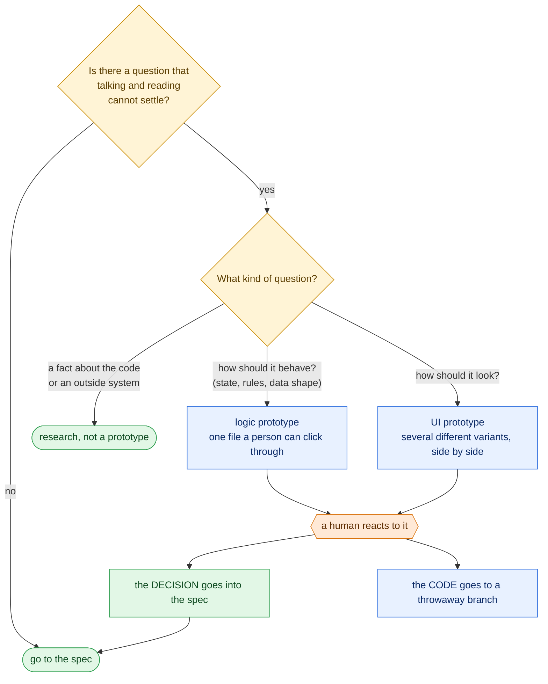

# Prototyping before building — what the literature supports, and whether it belongs in the factory

> **Written 2026-10-11.** Question: is a prototype step worth having in an agent-driven delivery pipeline, and under what conditions?
>
> **How this was researched.** A multi-agent research run searched, fetched and adversarially checked claims (three independent verifiers per claim). It covered part of the requested literature; several classic sources did not survive its verification. Three of those gaps were then closed by reading the papers directly. Each row below says how far it was checked:
>
> | Label | Meaning |
> |---|---|
> | `[read]` | The source text was opened and the quoted words found in it during this session. |
> | `[verified]` | Confirmed by the research run's three verifiers against the source. |
> | `[abstract]` | Only the abstract, or a table of contents, was confirmed. |
> | `[secondary]` | Known only through summaries by others. Treat as a pointer, not as evidence. |
> | `[inference]` | A conclusion of this document. No source states it. |
>
> **Not covered.** Schrage (*Serious Play*), Buxton (*Sketching User Experiences*), Beck's XP spikes, set-based design, and writing on prototypes by Böckeler, Willison or Horthy: no claim about them survived checking, so nothing is asserted about them here.

## 1. The short answer

**Yes, as an optional step, with conditions.** The literature does not support prototyping as a stage every change passes through. It supports it as one way to resolve a specific, named uncertainty, chosen when it is the cheapest way to do so.

Two things are true at once, and the rest of this document is about holding both:

- The **case for** is old, consistent across authors, and has some experimental support.
- The **evidence about coding agents is almost nil.** No study was found that measures prototyping with LLM coding agents. Everything said here about the agentic case is practitioner guidance or inference.

## 2. What a prototype is

Three definitions, which agree.

| Source | Definition | Check |
|---|---|---|
| Hunt & Thomas, *The Pragmatic Programmer* (1999), and a 2003 interview | "Prototypes are designed to be thrown away." "Prototyping is when there is a specific aspect of something ... that you want to investigate." "Prototypes are for your learning." | `[verified]` |
| Houde & Hill, "What do Prototypes Prototype?" (1997) | "We define a prototype as any representation of a design idea—regardless of medium." "Efficient prototypes produce answers to their designers' most important questions in the least amount of time." | `[read]` |
| Matt Pocock, `prototype` skill (2026) | "A prototype is **throwaway code that answers a question**. The question decides the shape." | `[read]` |

The common core: **a prototype exists to answer a question, and is judged by the answer, not by the code.**

### Prototype is not the same as tracer bullet

Hunt and Thomas separate the two, and the factory uses both `[verified]`:

| | Prototype | Tracer bullet |
|---|---|---|
| Purpose | Learn about one aspect | Get one thin line working end to end |
| Fate | Thrown away | Kept and built upon |
| In the factory | The optional step discussed here | What every ticket from `to-tickets` already is ([03](03-matt-pocock-skills-v1-3.md)) |

Their image for a prototype: "a town in a western movie. It's all facade."

### What a prototype can be *about*

Houde and Hill's contribution is to classify prototypes by the question, not by the tool or the polish `[read]`:

- **Role** — "the function that an artifact serves in a user's life".
- **Look and feel** — "the concrete sensory experience of using an artifact".
- **Implementation** — "the techniques and components through which an artifact performs its function".

Their warning applies directly to agent-made prototypes: "detail is not a sure indicator of completeness", and "prototypes are not self-explanatory: looks can be deceiving. Clarifying what aspects of a prototype correspond to the eventual artifact—and what don't—is a key part of successful prototyping."

Floyd's 1984 taxonomy (exploratory, experimental, evolutionary) is the other standard classification. It is known here only through later papers that cite it `[secondary]`.

## 3. The case for

### 3.1. It is a risk-resolution technique, chosen when warranted

Boehm's spiral model (1988) is often read as "prototype in every cycle". The text says otherwise `[verified]`:

> "Frequently, this process will identify areas of uncertainty that are significant sources of project risk. If so, the next step should involve the formulation of a cost-effective strategy for resolving the sources of risk. This may involve prototyping, simulation, benchmarking, reference checking, administering user questionnaires, analytic modeling, or combinations of these and other risk-resolution techniques."

Prototyping is one item in a list, picked for cost-effectiveness against a named risk. Boehm routes toward prototypes specifically when user-interface or performance risks dominate. This is an experience report from industrial practice, not an experiment.

### 3.2. The one controlled experiment on prototyping versus specifying

Boehm, Gray & Seewaldt, "Prototyping Versus Specifying: A Multiproject Experiment", *IEEE Transactions on Software Engineering* SE-10(3), 1984.

| | |
|---|---|
| Design | Seven teams built the same small application: four by specifying first, three by prototyping. `[abstract]`, as returned by a search of the abstract; the publisher's page could not be opened. |
| Result | Products of "roughly equivalent performance", with about **40% less code** and **45% less effort** in the prototyping teams. `[abstract]` |
| Trade-offs | Later summaries report the prototyped products as weaker on functionality, robustness and maintainability, and stronger on ease of use. `[secondary]` |

How much weight it bears: one experiment, seven student teams, one small product, forty years ago. It shows prototyping *can* reach a comparable product with less effort. It does not show that it always does, and the reported trade-offs point the same way as the classic warning about prototypes becoming products.

### 3.3. Several prototypes at once beat one refined in sequence

Dow et al., "Parallel Prototyping Leads to Better Design Results, More Divergence, and Increased Self-Efficacy", *ACM TOCHI* 17(4), 2010 `[read]`.

| | |
|---|---|
| Design | 33 participants each designed a web advertisement, making prototypes either **in parallel** (several before any feedback) or **serially** (feedback after each). The final ads ran in a real 15-day campaign. |
| Performance | Parallel ads got 445.0 clicks per million impressions against 397.9 for serial (F(1,30)=4.227, p<0.05), and scored higher with expert raters. |
| Diversity | Independent raters judged the parallel participants' prototypes more different from one another. |
| Confidence | Parallel participants reported a larger rise in task-specific self-efficacy. |

The authors' framing of the risk in iterating on a single design: it can "give rise to fixation — continuously refining one option without considering others."

Limits: one study, a graphic-design task, mostly novice designers. Applying it to software and to agents is analogy. It is nonetheless the best support for the UI branch of Pocock's skill, which asks for "several radically different UI variations", and for the related "design it twice" practice ([03](03-matt-pocock-skills-v1-3.md)).

Houde and Hill give the same advice from practice: "Build multiple prototypes ... Be prepared to throw some prototypes away" `[read]`.

### 3.4. Building and testing reduces fixation

From design-fixation experiments with engineering students `[abstract]`:

- Familiarity with a provided example increases fixation on its features (Viswanathan & Linsey, 2020).
- A designer's **own first idea** fixates them at least as much as a provided example does (Leahy et al., 2020).
- A build-and-test activity "allowed the students to understand the disadvantages of their designs" and reduced fixation (Viswanathan & Linsey, 2020).

The second point matters for the factory: withholding a prototype does not avoid anchoring. The spec written without one is anchored on whatever the first idea was. These studies used physical artifacts and students; their transfer to software is an analogy.

## 4. The case against, and the folklore

| Claim often repeated | What the source supports |
|---|---|
| "Plan to throw one away" (Brooks, 1975) | Brooks withdrew it. The 1995 anniversary edition has a section titled "Don't Build One to Throw Away—The Waterfall Model Is Wrong!", followed by "An Incremental-Build Model Is Better". Only these headings were checked, not the chapter text. `[abstract]` |
| "The spiral model requires a prototype every cycle" | It does not; see 3.1. `[verified]` |
| "Showing a prototype anchors people on it" | Partly. Examples can anchor; so does one's own first idea; and building and testing reduces it. See 3.4. `[abstract]` |
| "A prototype is a faster way to build the product" | The opposite of the definition. Hunt and Thomas: "Prototypes by their nature are not designed to be long lasting code." `[verified]` Pocock's UI branch: "The variant code was written under prototype constraints (no tests, minimal error handling). Rewrite it properly when you fold it in." `[read]` |

The durable risk across all the sources is the same one: **the prototype gets shipped.** Boehm's 1984 trade-offs, Hunt and Thomas's "facade", and Pocock's rule that only the validated decision reaches the main branch are three statements of it.

## 5. What changes when an agent writes the prototype

Nothing in this section is measured. No study of prototyping with coding agents was found.

**Practitioner and vendor guidance**

- **Pocock's `prototype` skill** restates the classic definition as operating rules `[read]`: throwaway from day one and named as such; trivial to run; no persistence; no tests or polish; surface the state after every action; and when done, fold the *decision* into the real code and keep the prototype "as a primary source" on a throwaway branch with a pointer from the implementation issue. "The main branch keeps only the validated decision."
- **Anthropic's Claude Code best practices** never mention prototypes `[verified]`. They do gate planning by uncertainty ("If you could describe the diff in one sentence, skip the plan") and describe try-and-rewind as cheap ("you can tell Claude to try something risky. If it doesn't work, rewind"). That supports the gating logic by analogy only.

**Thin evidence on the risks** `[verified]`, with the caveats the verifiers recorded:

- A 2026 mining study found agent-written pull requests contained more redundant code while reviewers expressed less negative sentiment toward them. The two measurements came from different sets of pull requests, and the link between them is the authors' interpretation.
- A 2025 experience report (not peer reviewed) states that vibe coding "works well for internal tools, prototypes, and experiments" but is treated as "unsafe by default for customer-facing systems without extra hardening and review".

**What plausibly follows** `[inference]`:

| When an agent can produce a prototype in minutes | Effect |
|---|---|
| The cost objection weakens | The classic reason to skip a prototype was the time it took. |
| Parallel variants become the default, not a luxury | Three structurally different versions cost about what one used to. Dow's result becomes easy to apply. |
| The human reaction becomes the scarce part | The agent can build ten variants; a person can meaningfully judge a few. |
| Disposal discipline becomes the critical control | Agent-written code looks finished. "Looks can be deceiving" (Houde & Hill) applies with more force. |
| A new leak path opens | The implementing agent may be handed the prototype and copy its shortcuts. Whether agents anchor on a prototype they are given is an open question no source answers. |

## 6. When to prototype: decision criteria

Synthesised from the sources above `[inference]`. Each row names where it comes from.

| Prototype when… | Basis |
|---|---|
| There is a **significant, named** uncertainty | Boehm 1988 |
| Conversation and reading **cannot** settle it | Pocock's wayfinder: grilling is "the default case"; a prototype is for when "how should it look or how should it behave is the key question" |
| The question is about **look and feel**, **behaviour or state**, or a risky **implementation** technique | Houde & Hill; Boehm singles out user-interface and performance risk |
| A **person is available to react** to it | Pocock: a prototype ticket "only resolves through that live exchange" |
| The outcome will be a **decision written into the spec**, with the code set aside | Hunt & Thomas; Pocock |

| Skip it when… | Basis |
|---|---|
| The change is small and its shape is clear | Anthropic: "If you could describe the diff in one sentence, skip the plan" |
| The uncertainty is a **fact**, not a design choice | That is research; Boehm lists other techniques for a reason |
| Nobody will look at the result | A prototype no one reacts to answers nothing |
| The real thing is as cheap to build and as easy to undo | A two-way door needs no rehearsal `[inference]` |

No source gives numeric thresholds. These are judgement criteria.

## 7. Verdict for the factory

**Include it, optional, placed inside the front half, and enforced by the harness.** `[inference]`

1. **Optional and gated.** It is invoked for a named question that passes section 6, never as a fixed stage. Most jobs skip it.
2. **It lives in alignment, not in the build.** It is a way of answering a question that arises while agreeing what to build, exactly as context gathering answers factual ones ([05](05-unified-factory-study.md), section 5a).
3. **The agent builds alone; a person resolves.** Building the artifact can be unattended. Choosing a variant, or accepting a state model, cannot. The agent does not close its own prototype question.
4. **For looks, build several different variants at once. For behaviour, build one thing a non-developer can click through.** The first follows Dow; the second is Pocock's logic branch.
5. **The decision goes forward; the code does not.** The spec receives the verdict and, at most, the decision-rich fragment (a state machine, a schema), which `to-spec` already allows as its one exception to "no code snippets". Implementers get the spec.
6. **The harness enforces disposal.** A prompt rule that says "throwaway" is not a control. The factory can make it one: prototype work happens on its own branch, and a deterministic check refuses a merge that carries prototype paths or a variant switcher into the main line.
7. **Record whether it paid off.** Each use logs the question, the answer and whether the answer changed the spec. That is the only way this library will ever have evidence about agents and prototypes, since the literature has none.

Rule 6 is what a factory adds over the skill. Rule 7 is how to find out whether the practitioner experience behind this document generalises.

## 8. Sources

| Source | Year | Kind | Check |
|---|---|---|---|
| Hunt & Thomas, [interview on tracer bullets and prototypes](https://www.artima.com/articles/tracer-bullets-and-prototypes) | 1999 / 2003 | Expert opinion | `[verified]` |
| Houde & Hill, [What do Prototypes Prototype?](https://creativetech.mat.ucsb.edu/readings/Prototypes_prototype.pdf) | 1997 | Expert framework with case examples | `[read]` |
| Boehm, [A Spiral Model of Software Development and Enhancement](https://faculty.washington.edu/hazeline/misc/reserve/boehm_spiralmodel.pdf) | 1988 | Experience report | `[verified]` |
| Boehm, Gray & Seewaldt, [Prototyping Versus Specifying](https://doi.org/10.1109/TSE.1984.5010238), IEEE TSE SE-10(3):290–303 | 1984 | Controlled experiment | `[abstract]`; trade-offs `[secondary]` |
| Dow et al., [Parallel Prototyping](https://hci.stanford.edu/publications/2010/parallel-prototyping/ParallelPrototyping2010-submitted.pdf), ACM TOCHI 17(4) (author's manuscript read) | 2010 | Controlled experiment | `[read]` |
| Brooks, [The Mythical Man-Month, anniversary edition](https://www.ciscopress.com/content/images/9780201835953/samplepages/0201835959.pdf) | 1995 | Expert retrospective | `[abstract]` (headings only) |
| Viswanathan & Linsey, [design fixation and familiarity](https://scholarworks.sjsu.edu/faculty_rsca/1570) | 2020 | Experiment | `[abstract]` |
| Leahy et al., [fixation from provided versus self-generated examples](https://pure.ul.ie/en/publications/design-fixation-from-initial-examples-provided-versus-self-genera/) | 2020 | Experiment | `[abstract]` |
| Pocock, [`prototype`](https://github.com/mattpocock/skills/blob/main/skills/engineering/prototype/SKILL.md) and [`wayfinder`](https://github.com/mattpocock/skills/blob/main/skills/engineering/wayfinder/SKILL.md) skills | 2026 | Practitioner guidance | `[read]` |
| Anthropic, [Claude Code best practices](https://code.claude.com/docs/en/best-practices) | 2026 | Vendor guidance | `[verified]` |
| Huang et al., [More Code, Less Reuse](https://arxiv.org/pdf/2601.21276) | 2026 | Repository mining study | `[verified]`, weak |
| Waseem et al., [Vibe Coding in Practice](https://arxiv.org/pdf/2512.11922) | 2025 | Experience report, preprint | `[verified]`, weak |

---

← [05 — Unified factory study](05-unified-factory-study.md) | [↑ index](README.md) | Next → [07 — Wayfinder assessment](07-wayfinder-assessment.md)
