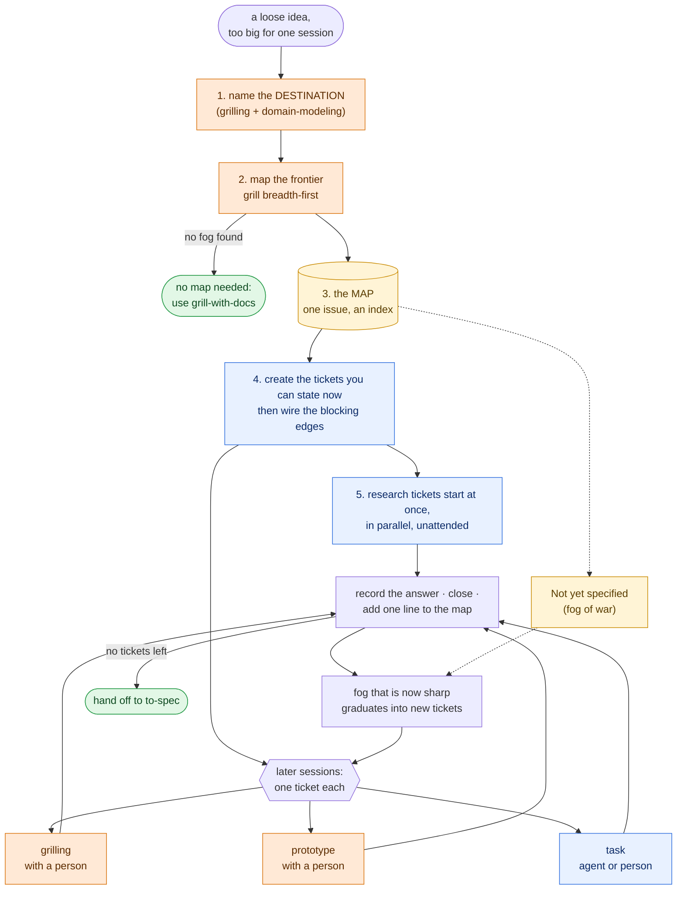
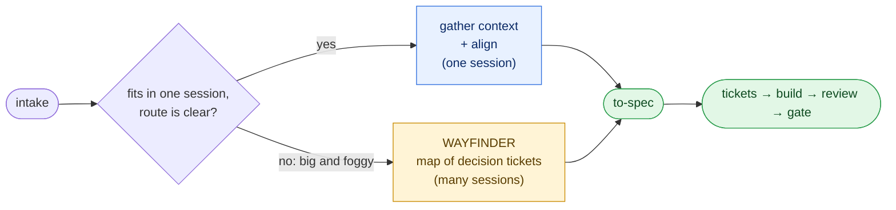

# Wayfinder — a full assessment, and what the factory should take from it

> **Written 2026-10-11.** Sources, all from <https://github.com/mattpocock/skills> at commit `49dd158` (version 1.3.1):
> - `skills/engineering/wayfinder/SKILL.md` — cited as `[skill]`
> - `docs/engineering/wayfinder.md`, the author's documentation page, including its "Common questions" drawn from user reports — cited as `[docs]`
> - `skills/engineering/prototype/` (`SKILL.md`, `LOGIC.md`, `UI.md`), `skills/engineering/research/SKILL.md`, the tracker templates in `setup-matt-pocock-skills/`, `CHANGELOG.md`
>
> **Labels.** Quoted text is the source's. `[assessment]` marks this document's judgement. `[proposal]` marks a design suggestion for the factory. Wayfinder was read, not run, for this document.
>
> **Companions.** The basic description is in [03](03-matt-pocock-skills-v1-3.md). The evidence on prototyping is in [06](06-prototyping-evidence.md).

## 1. What wayfinder is for

Wayfinder is planning for work that is **too big for one agent session and whose route is not yet visible**. You can name where you want to end up; you cannot yet list the steps.

The author's own test is about session count, not project size `[docs]`:

> "`/grill-with-docs` for single-session planning, `/wayfinder` for multi-session planning."

It is "the heaviest flow in the set, so the trigger is narrow", and "if you can hold the whole thing in one conversation, grilling is cheaper and better" `[docs]`. It is not only for new projects: on legacy code "much of the fog is 'what is already true here' rather than 'what should we do'" `[docs]`.

**It plans. It does not build.** Every ticket is a question whose answer is a decision. When no questions remain, it stops and hands off.

## 2. How it works

### The four ticket types

A point worth getting exact: **prototyping is not a phase of wayfinder. It is one of four types of ticket**, and the type is chosen per question `[skill]`.

| Type | Who | Use it when | Resolved by |
|---|---|---|---|
| **Grilling** | With a person | "The default case." The question can be settled by talking. | `grilling` + `domain-modeling` |
| **Prototype** | With a person | "How should it look" or "how should it behave" is the key question. | `prototype`; the artifact is linked from the ticket |
| **Research** | Agent alone | A fact outside the working directory blocks a decision. | A `research` subagent, on a throwaway `research/<name>` branch that is pushed and never merged |
| **Task** | Either | Manual work must happen before a decision can be made: signing up for a service, provisioning access, moving data to see its shape. | Doing it; the answer records what was done |

`task` is "the one type that *does* rather than decides", and "this type goes wrong most often in practice. Agents read it as an implementation step and start to write product code inside the map" `[docs]`.

### The vocabulary

| Term | Meaning |
|---|---|
| **Destination** | What reaching the end looks like: a spec, a locked decision, a proof of concept, a migration. Named first, because it fixes the scope every ticket is measured against. |
| **Map** | One issue. "An **index**, not a store": one line per decision, linking to the ticket that holds it. Loaded at low resolution; tickets are opened only when needed. |
| **Decision ticket** | A child issue holding one question, "sized to one 100K token agent session". |
| **Frontier** | Tickets that are open, unblocked and unclaimed: "the edge of the known". |
| **Fog of war** | Decisions you can tell are coming but cannot yet phrase. Kept in "Not yet specified", not turned into tickets. |
| **Out of scope** | Work ruled beyond the destination. Closed; it never graduates. |
| **Claim** | A session assigns the ticket to the driving developer before any work, so other sessions skip it. |

The test for fog versus ticket is precise: "whether you can state the question precisely now, *not* whether you can answer it now" `[skill]`.

## 3. What is strong about it

`[assessment]`

1. **It refuses to plan what cannot be seen yet.** Most planning methods ask for the whole plan up front. Wayfinder writes down only the questions it can state, and lets each answer reveal the next. That is its answer to the waterfall criticism, when it is followed.
2. **It types work by who must be present.** Marking every ticket as needing a person or not is what lets the unattended parts run in parallel while the rest waits in a visible queue.
3. **It raises the fidelity of a discussion on demand.** A prototype ticket exists for the moment when talking stops converging. This matches the literature: a prototype is one risk-resolution technique among several, chosen for a named uncertainty ([06](06-prototyping-evidence.md), section 3.1).
4. **The map scales.** Because it is an index of pointers, a session reads one short issue, not the history of every decision.
5. **State lives in the tracker.** With native blocking links, the frontier is visible in the tracker's own interface. Nobody has to open the map to see what can be picked up.
6. **A clean exit.** It ends at `to-spec`, which "collapses those linked decisions into one spec". The decisions do not go straight into code.

## 4. Where it breaks, by the author's own account

The documentation page reports these from users `[docs]`. They are the most useful part of the material for anyone building a harness around it.

| # | Failure | What happened | Cause named in the docs |
|---|---|---|---|
| 1 | **The agent builds mid-map** | "The most-reported failure with this skill". One agent wrote "this map carries execution" into its own Notes, then in later sessions "read that line back as permission and built on a live server". | "The constraint and its exemption live in a file that the constrained agent owns. ... The skill has no hard stop." |
| 2 | **The waterfall trap** | "I charted 27 tickets, and by the time I got to the thirteenth, the rest no longer made sense." | Later tickets rest on assumptions that earlier answers invalidate. Advice: scope to "one defined epic", and "prototype aggressively". |
| 3 | **The agent answers for the human** | An agent "built three UI variations, chose one itself, and closed the ticket". | "That choice is yours, and the skill does not yet say so clearly enough." |
| 4 | **Parallel grilling collides** | Two grilling sessions at once ask the same question, "because the sessions share no context". | No shared state between sessions. Advice: one ticket at a time. |
| 5 | **Decision exhaustion** | "Every question is three paragraphs long." "The sharpest open complaint ... nobody has fixed it yet." | Attributed to the current models, not the skill. |
| 6 | **A closed decision turns out wrong** | "There is no official guidance". The agent "tends to design around the bad decision instead of challenging it". | No reopening procedure. |
| 7 | **Tracker pollution, or repo pollution** | Public trackers "fill up with agent-generated planning tickets"; local markdown "tends to persist by accident". | Neither store is ideal for throwaway planning. |

`[assessment]` Failures 1 and 3 share one root: **a rule written in a prompt, addressed to the agent the rule constrains.** The author says as much. That is the gap a harness can close, because a harness can enforce a rule from outside the model.

## 5. Does it belong in the factory?

**Yes, as an optional on-ramp, not as a stage.** `[assessment]`

It applies to a minority of jobs: those that pass the session-count test. For everything else, single-session alignment is cheaper and better, by the author's own statement. A factory that sent every feature through a map would turn its strongest idea (do not plan what you cannot see) into overhead.

It also fits structurally. The stages added to the unified study map directly onto its ticket types:

| Factory stage ([05](05-unified-factory-study.md)) | Inside a wayfinder map |
|---|---|
| Gather context | `research` tickets (unattended) and `task` tickets |
| Align | `grilling` tickets |
| Optional prototype | `prototype` tickets |
| Specify | The hand-off to `to-spec` when the map clears |

So wayfinder is not a different process. It is the same front half, **spread across sessions and made resumable**.

## 6. What the factory should take from it

### 6.1. Ideas worth adopting even for jobs that never use a map

`[proposal]`

| Idea | How it generalises |
|---|---|
| **Type every unit of work as "needs a person" or "agent alone"** | Wayfinder does it for decision tickets; `triage` does it for implementation work (`ready-for-agent` / `ready-for-human`). One classification for both gives the factory a single rule for what may run unattended. |
| **Destination and out-of-scope, written first** | Every job, of any size, states where it ends and what it will not do. Zazen's spec has "Out of scope"; wayfinder makes it the first act. |
| **An index, not a store** | Any long-lived record (a map, a job folder, a handoff) holds one-line gists and pointers. This is the same rule as discovery notes ([05](05-unified-factory-study.md), section 5a). |
| **Do not ticket the fog** | When decomposing a spec, tickets are written only for what can be stated precisely. The rest is listed as unknown, not sliced speculatively. |
| **One unit per session, sized to fit** | "Sized to one 100K token agent session" is the same number HumanLayer now uses as its long-context warning ([state of practice](../analysis/state-of-practice-2026-10.md), section 3). |
| **Refer by name, not number** | Status lines and reports that a person reads use titles. "A wall of `#42, #43, #44` is illegible." |
| **Throwaway branches as primary sources** | Research and prototypes are kept on branches that are pushed and never merged, with a pointer from the issue. The main line holds only the decision. |
| **The frontier is visible in the tracker** | Native blocking links give observability for free, before any dashboard exists. |

### 6.2. One oracle for both kinds of ticket

`[proposal]` The frontier wayfinder computes (open, unblocked, unclaimed) is the same query `/run-spec`'s `tickets.py` already runs for implementation tickets ([04](04-run-spec-flow.md)). The difference is only the label set and what "done" means: a closed issue with a resolution comment, instead of a commit trailer. One script can serve both, which would give the planning phase the same determinism the build phase has: the script says which decision ticket is next, not the model.

### 6.3. Closing the documented failures from outside the model

`[proposal]` Each of the failures in section 4 that has a mechanical fix gets one. This is what a factory adds over the skill.

| Failure | Guard in the harness |
|---|---|
| 1. Agent builds mid-map | A hook that, while a session is working a decision ticket, blocks writes outside the prototype and research locations and blocks merges and deploy commands. Whether a map "carries execution" is a setting a person makes, stored where the agent cannot edit it. |
| 2. Waterfall trap | A cap on open tickets per map, and a rule that a destination is one epic. When the cap is hit, the oracle reports it instead of charting further. |
| 3. Agent answers for the human | Tickets typed as needing a person cannot be closed by the agent. The agent posts its recommendation and stops; a person closes. |
| 4. Parallel grilling collides | The oracle hands out at most one human-facing ticket at a time, while unattended research tickets run freely in parallel. |
| 6. Wrong closed decision | A defined reopening move: a new ticket that names the decision it supersedes, and the oracle marks every ticket that depended on the old one as needing review. |
| 7. Pollution | Planning state kept where the job state lives (outside the working tree), mirrored to the tracker only when the user asks for a shared map. |

Failure 5 (long, exhausting questions) has no mechanical fix. It is a prompting and model-effort matter, and the docs say nobody has solved it.

### 6.4. What not to take

- **Wayfinder as the default path.** Its author says it is slower and denser than grilling when the work fits one session.
- **Comprehensive up-front charting.** The 27-ticket report is what happens when the fog rule is ignored.
- **The Notes override.** Letting the constrained agent write its own exemption is the documented cause of the worst failure.

## 7. Open questions this adds

For the grilling session listed in [05](05-unified-factory-study.md), section 10:

1. **What sends a job to wayfinder?** A person's call at intake, or a rule (for example, alignment that exceeds a token budget escalates to a map)?
2. **Where does a map live?** The issue tracker (shared, visible, but noisy), or beside the job state (private, tidy, invisible to others)?
3. **Is the prototype step available outside a map**, as a single optional move during ordinary alignment? [06](06-prototyping-evidence.md) argues yes.
4. **How is "a person closed this" verified?** By who closed the issue, by a dashboard action, or by a signed-off comment?
5. **Does one oracle serve decision tickets and implementation tickets**, or are they two scripts?

---

← [06 — Prototyping evidence](06-prototyping-evidence.md) | [↑ index](README.md) | Next → [08 — Guardrails](08-guardrails.md)
