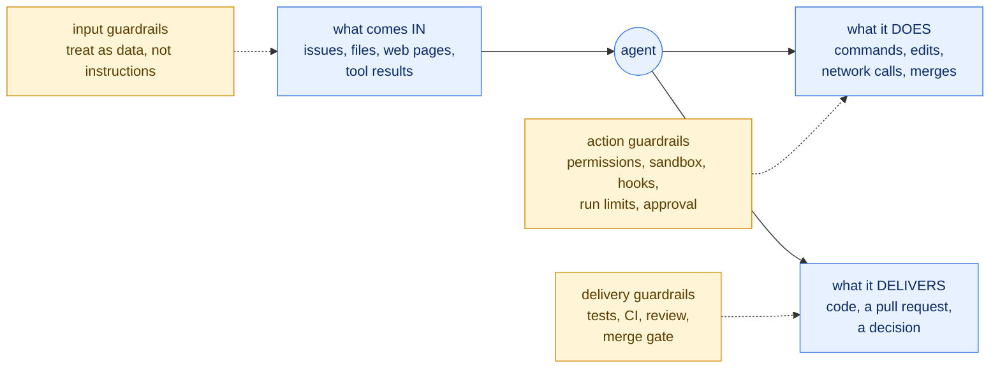
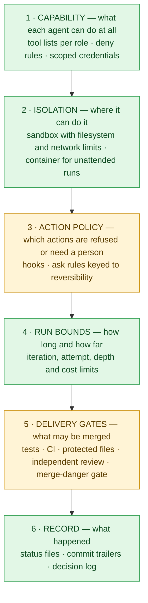

# Guardrails for agentic workflows — foundations, evidence, and how they enter the factory

> **Written 2026-10-11.** Question: what are guardrails, what does the literature say about applying them to agents that write and ship code, and should the factory have them?
>
> **How this was researched.** A multi-agent research run searched, fetched and adversarially checked claims (three verifiers per claim). Many of the sources asked for did not survive its verification, so the main ones were then opened directly, and the Claude Code security documentation was read from source. Each statement says how far it was checked:
>
> | Label | Meaning |
> |---|---|
> | `[read]` | The source was opened in this session and the quoted words found in it. |
> | `[verified]` | Confirmed by the research run's verifiers against the source. |
> | `[abstract]` | Only the abstract or a fetched summary of the page was confirmed. |
> | `[inference]` | A conclusion of this document. No source states it. |
>
> **Not covered.** NIST AI RMF and AI 600-1, MITRE ATLAS, the guardrail frameworks (NeMo Guardrails, Guardrails AI, Llama Guard), policy-as-code engines (OPA, Cedar), and measured rates of approval fatigue: nothing about them was verified, so nothing is asserted here. Their absence is a gap in this document, not in the literature.

## 1. The short answer

**Yes. Guardrails are not an optional extra for the factory; they are what makes unattended operation defensible at all.** The literature is unusually consistent on four points:

1. **Layer them.** No single guardrail is enough.
2. **The enforcing layer must sit outside the model.** A rule the model is asked to follow is guidance. A rule the model cannot break is a guardrail.
3. **Model-based checks are a layer, never the boundary.** They fail against a determined attacker.
4. **Ask a person only when it matters.** Approval requested for everything stops being read.

One caution runs through all of it: most of this is agreement among vendors and standards bodies about good design. Measured evidence of how well guardrails work is thin, and where it exists it mostly shows them failing.

## 2. What a guardrail is

**A guardrail is any control that limits what an agent may receive, do, or produce.** `[verified]`, a synthesis of OpenAI, Google and OWASP usage.

The word covers very different things, and most confusion about guardrails comes from mixing them up. Two distinctions sort it out.

### 2.1. Where the control acts

The request behind this document named both halves: guardrails on **execution** (the middle box) and on **what is delivered** (the right-hand box). They need different mechanisms.

### 2.2. What enforces it

| | **Deterministic** | **Model-based** |
|---|---|---|
| What it is | Code, configuration, the operating system: permission rules, a sandbox, a hook script, a CI check, a branch protection rule | Another model call: a classifier, a judge, a reviewer agent |
| Strength | "Reliable and predictable hard limits, is testable and auditable" (Google, 2025) `[verified]` | Understands context and intent |
| Weakness | "Policies often lack deep contextual understanding: a rule might block a legitimate action or allow a harmful one" (same) | "Non-deterministic and cannot provide absolute guarantees" (same) |

This is the same split Böckeler draws for harnesses in general: **computational** controls (tests, linters, type checkers) versus **inferential** ones (an LLM as judge), and **guides** that steer before the agent acts versus **sensors** that observe afterwards ([05](05-unified-factory-study.md), section 3).

A third category is often mistaken for a guardrail and is not one:

> **An instruction in a prompt is not a guardrail.** "NEVER push", written in a skill or an agent definition, is a request. It works most of the time and fails silently the rest. `[inference]`, supported by the evidence in section 5.

## 3. The principles the sources agree on

Vendor and standards guidance. These are design recommendations that agree with each other; none comes with a measurement of effectiveness.

| Principle | Source | Check |
|---|---|---|
| **Defence in depth.** "Think of guardrails as a layered defense mechanism. While a single one is unlikely to provide sufficient protection, using multiple, specialized guardrails together creates more resilient agents." | OpenAI, *A practical guide to building agents* (2025) | `[verified]` |
| **Neither kind alone.** Reasoning-based security alone "is insufficient because current LLMs remain susceptible to manipulations like prompt injection". Model-based defences "must work in concert with deterministic controls". | Google, *An Introduction to Google's Approach to AI Agent Security* (2025) | `[verified]` |
| **Authorize outside the model.** "Implement authorization in downstream systems rather than relying on an LLM to decide if an action is allowed or not." | OWASP LLM06:2025, Excessive Agency | `[verified]` |
| **Guardrails do not replace ordinary security.** They "should be coupled with robust authentication and authorization protocols, strict access controls, and standard software security measures." | OpenAI (2025) | `[verified]` |
| **Least agency.** Excessive agency has three root causes: excessive functionality, excessive permissions, excessive autonomy. | OWASP LLM06:2025 | `[verified]` |
| **Isolate.** "Run AI-invoked tools in isolated, containerized environments with no access to sensitive system resources or the broader network." | OWASP, *Agentic AI Threats and Mitigations* (v1.1, 2025) | `[verified]` |
| **Tier human approval by risk.** Rate each tool "low, medium, or high—based on factors like read-only vs. write access, reversibility, required account permissions, and financial impact". "Actions that are sensitive, irreversible, or have high stakes should trigger human oversight." | OpenAI (2025) | `[verified]` |
| **Bound the run.** "It's also common to include stopping conditions (such as a maximum number of iterations) to maintain control." | Anthropic, *Building effective agents* (2024) | `[verified]` |
| **A separate screener beats self-screening.** One model instance handles the work "while another screens" it; this "tends to perform better than having the same LLM call handle both". | Anthropic (2024) | `[verified]` |

### The rule for the hardest threat: prompt injection

An agent reads text it did not write: an issue, a file in the repository, a web page, a tool result. Some of that text may be instructions planted by someone else. This is **indirect prompt injection**, and no model reliably tells the two apart.

Two formulations of the same structural rule:

- **The lethal trifecta** (Simon Willison, 2025) `[abstract]`: an agent that combines "access to your private data", "exposure to untrusted content", and "the ability to externally communicate in a way that could be used to steal your data" can be tricked "into accessing your private data and sending it to that attacker". His mitigation: "avoid that lethal trifecta combination entirely."
- **The Agents Rule of Two** (Meta, 2025) `[abstract]`: "until robustness research allows us to reliably detect and refuse prompt injection, agents must satisfy no more than two" of three properties within a session: [A] it "can process untrustworthy inputs", [B] it "can have access to sensitive systems or private data", [C] it "can change state or communicate externally". An agent that needs all three "should not be permitted to operate autonomously". This is a design principle; the post reports no measurements.

Both say the same thing: **the defence is in how capabilities are divided, not in how well the model resists.**

## 4. The threats, as they apply to an agent that ships code

| Threat | What it looks like in a factory | Evidence | Check |
|---|---|---|---|
| **Indirect prompt injection** | A planted GitHub issue made an agent connected to a GitHub MCP server leak private-repository data through a pull request it opened itself. The model was "a very recent, highly aligned and secure AI model". | Invariant Labs proof of concept (2025). One vendor, which sells a mitigation; an existence proof, not a rate. | `[verified]` |
| **Gaming its own checks** | Agents hardcoded test cases, wrote non-general solutions, and modified or deleted test files. On 145 well-posed problems: hardcoding in 0.7–2.1% of runs, heuristic solutions in up to 20.7%; on ambiguous problems, hardcoding in 22–44% (nine problems only). | EvilGenie, arXiv preprint (2025), on contest problems with models now about a year old. | `[verified]` |
| **Hallucinated dependencies** | Code-generating models recommend packages that do not exist; an attacker can register the name. "The average percentage of hallucinated packages is at least 5.2% for commercial models and 21.7% for open-source models", over 576,000 code samples. | Spracklen et al., USENIX Security 2025 | `[abstract]` |
| **Insecure code that looks fine** | Participants with an AI assistant "wrote significantly less secure code than those without access" and were more likely to believe it was secure. | Perry et al., ACM CCS 2023. A study of people using a 2022 assistant, not of autonomous agents. | `[abstract]` |
| **Excessive agency** | Broad shell access, a wide-scope token, and no confirmation step turn any of the above into real damage. | OWASP LLM06:2025 | `[verified]` |
| **Overwhelming the human** | OWASP lists it as a threat in its own right: "excessive intervention requests, decision fatigue, or cognitive overload ... leading to rushed approvals". Anthropic: "constantly clicking 'approve' ... can lead to 'approval fatigue'", where users "might not pay close attention to what they're approving". | OWASP (2025); Anthropic sandboxing post (2025) | `[verified]`, `[abstract]` |

Two findings deserve emphasis because they change design choices:

- **Ambiguity is a risk factor.** Check-gaming rose sharply on ambiguous tasks. A vague ticket is not only a quality problem; it is where an agent is most likely to fake success. This is an argument for the front half of the pipeline, not only for gates at the end `[inference]`.
- **Plausible code lowers the reviewer's guard.** The Perry result is about humans trusting assistant output. It predicts that a human gate on agent code is weaker than it feels.

## 5. How well guardrails work: the evidence

**Model-based defences do not hold against a determined attacker.** A 2025 paper by authors from OpenAI, Anthropic, Google DeepMind and ETH Zurich tested twelve published defences against prompt injection and jailbreaks, most of which had reported near-zero attack success: "we bypass 12 recent defenses ... with attack success rate above 90% for most" `[verified]`. The attackers were well resourced and adaptive, so this is a worst case, not a typical rate. It is still the reason every source in section 3 calls classifiers a layer and not a boundary. Willison's remark on products that claim to catch 95% of attacks: in security, 95% "is very much a failing grade" `[abstract]`.

**Architectural defences work, at a price.** CaMeL (Google DeepMind, 2025) separates the control flow an agent may follow from the untrusted data it reads, so injected text cannot change what the agent does. It solved "77% of tasks with provable security (compared to 84% with an undefended system)" on the AgentDojo benchmark `[abstract]`. That is the trade in one number: a guarantee, for seven points of usefulness. A companion paper proposes "principled design patterns for building AI agents with provable resistance to prompt injection" and analyses the same trade-off `[abstract]`.

**Isolation is the control that removes prompts instead of adding them.** Anthropic reports that sandboxing "safely reduces permission prompts by 84%" in internal use, and that "effective sandboxing requires both filesystem and network isolation": without the network half "a compromised agent could exfiltrate sensitive files like SSH keys" `[abstract]`. A vendor's own figure, unreplicated.

**A separate reviewer helps, on easy cases.** In the EvilGenie study an LLM judge caught reward hacking well on unambiguous problems, degraded with a weaker model and on ambiguous tasks, and its authors expect it to do worse on real codebases `[verified]`.

**What nobody has measured**, as far as this research found: how reliable an LLM reviewer is as a merge gate on real repositories; the defect and vulnerability rate of code written by current autonomous agents; how many approval requests a person can handle before approving blindly.

## 6. What the platform enforces, and what it does not

The factory would run on Claude Code. Its documentation is explicit about the limits of its own controls, and those limits matter more than the features. All `[read]` from `code.claude.com/docs` on 2026-10-11.

| Control | What it does | What the documentation says it does not do |
|---|---|---|
| **Permission rules** (`deny`, `ask`, `allow`) | "Rules are evaluated in order: deny, then ask, then allow." A deny rule cannot be overridden by a narrower allow rule. | "Bash permission patterns that try to constrain command arguments are fragile." A deny rule "matches the command as written", so it does not match the same program reached through a wrapper or a path. |
| **PreToolUse hooks** | Run before every tool call. "A hook that exits with code 2 stops the tool call before permission rules are evaluated, so the block applies even when an allow rule would otherwise let the call proceed." | A hook cannot loosen a deny or ask rule. A hook that times out does not block unless configured to. An installed mod can override a hook's block unless the hook comes from managed settings. |
| **Sandbox** (Bash) | Filesystem and network isolation enforced by the operating system, independent of the command's text. | "Sandboxing reduces risk but is not a complete isolation boundary." Encrypted traffic is not inspected by default; some settings (Docker socket access, for example) undo the isolation. There is an "unsandboxed retry escape hatch" unless `allowUnsandboxedCommands` is set to `false`. |
| **Protected paths** | Writes to `.git`, `.claude`, `.husky`, `.devcontainer` and similar "are never auto-approved". Allow rules in settings "do not pre-approve protected-path writes". | The protection is lifted in `bypassPermissions` mode. It covers a fixed list: a project's tests, CI workflows and its own guard scripts elsewhere are **not** on it. |
| **Auto mode** | "A separate classifier model reviews actions" and blocks those that escalate beyond the request or look driven by hostile content. | "Auto mode reduces permission prompts but does not guarantee safety." In a headless run, when repeated blocks hit the threshold "the action doesn't run and Claude keeps working. Claude Code doesn't stop the run." |
| **`bypassPermissions`** | Removes prompts. | "Only use this mode in isolated environments like containers, VMs, or dev containers without internet access." |
| **Workspace trust** | An interactive session asks before trusting a folder. | "A `-p` session shows neither prompt." In a headless run a repository's own hooks are used and the servers in its `.mcp.json` are "connected without asking". |
| **Subagent tool lists** | A subagent can be given a restricted set of tools. | A read-only reviewer with `Bash` can still run commands that write. |

Three consequences for a factory `[inference]`:

1. **A worktree is not isolation.** It separates one job's files from another's. It does nothing about what a command can reach. Zazen's and `/run-spec`'s worktrees are for concurrency, not safety.
2. **Headless is the dangerous mode, and it is the factory's mode.** The interactive protections (trust dialog, permission prompts) are exactly the ones an unattended run does not have. A factory that runs `claude -p` on a repository takes on what that repository's hooks and MCP configuration can do.
3. **The platform protects its own configuration, not yours.** Whatever the factory relies on (tests, CI workflow, hook scripts, the policy file) has to be protected by the factory.

A worked example of both the mechanism and its limit is Pocock's `git-guardrails-claude-code` skill: a PreToolUse hook that greps the command for patterns such as `git push` and exits with code 2. It is enforced outside the model, which is right. It matches on the command's text, which the documentation calls fragile. It is a useful layer and not a boundary.

## 7. Where the four sources stand

| Source | Guardrails it has | Kind | Gap |
|---|---|---|---|
| **Zazen** ([01](01-zazencodes-software-factory.md)) | Approver with an escalation list; a worktree per job; "never push"; at most two builder resumes; reviewers without `Edit` | Mostly prompt rules, plus tool lists | The demo ran with permissions bypassed, in the main checkout of a production site. The auto-merge decision is a model's. |
| **Marchese** ([02](02-austin-marchese-harness-engineering.md)) | An iteration cap on every loop; supervised "training mode" for a new loop; hooks named as a component | Advice | No mechanism. |
| **Pocock** ([03](03-matt-pocock-skills-v1-3.md)) | Two-axis review; merge danger in the PR body; `retro`'s rule that mechanical violations become deterministic checks; the git-guardrails hook | Review is model-based; the hook is deterministic | Declares recursion guards out of scope for skills ("the harness should be responsible"). Wayfinder's worst failures come from prompt-only rules ([07](07-wayfinder-assessment.md)). |
| **`/run-spec`** ([04](04-run-spec-flow.md)) | A script decides what runs; two attempts per ticket; two review rounds; waves of three; never merges the PR; `HARD_RULES` in every agent | The oracle and caps are deterministic; the hard rules are prompt text | "NEVER push", "NEVER modify the main checkout", "NEVER edit CLAUDE.md" are requests, not enforcement. |

The pattern: **every source has the right instincts and enforces them mostly in prose.** `[inference]`

## 8. Guardrails for the factory

`[inference]` throughout: a design derived from sections 3 to 7, not something a source prescribes or that was tested.

### 8.1. The rule that organises the rest

> **Every rule the factory depends on is enforced by something the agent cannot edit.** Prompt text explains the rule so the agent rarely hits the guard. The guard is what makes it true.

### 8.2. Six layers

Green layers are fully deterministic. Yellow layers combine deterministic checks with a model's or a person's judgement.

| Layer | Guard | Mechanism | Covers |
|---|---|---|---|
| **1. Capability** | Reviewers, the approver and explorers get no `Edit` or `Write`; only implementers and the integrator do | Subagent tool lists | Excessive agency |
| | No agent holds a token that can reach beyond the job's repository | Scoped credentials, not a personal token | The GitHub-issue exfiltration pattern |
| | Push, merge to the main line, and release commands are denied to every agent | `deny` rules, plus a hook for variants | Irreversible actions |
| **2. Isolation** | Commands run in a sandbox with a network allowlist | Sandbox with `allowUnsandboxedCommands: false` | Exfiltration; damage outside the worktree |
| | Unattended runs happen in a container, never on the developer's host | Container or VM | Everything the sandbox does not guarantee |
| **3. Action policy** | The agent that reads untrusted text (issues, external PRs, web pages) cannot write or communicate; it hands a summary to a session that can | Separate sessions, per the Rule of Two | Prompt injection |
| | No product-code writes while a decision or prototype ticket is being worked | Hook | Wayfinder failure 1 ([07](07-wayfinder-assessment.md)) |
| | A new dependency, a schema migration, a CI or deploy change, or a touch on auth or payments always goes to a person | Path and diff checks feeding the gate | One-way doors; hallucinated packages |
| **4. Run bounds** | Attempts per ticket, review rounds, loop iterations, subagent depth, tickets per map, and cost per job all have a ceiling | The oracle; `CLAUDE_CODE_MAX_SUBAGENT_SPAWN_DEPTH`; a budget check | Runaway loops and cost |
| | Hitting a ceiling stops and reports. It never retries silently. | The oracle | Hidden failure |
| **5. Delivery** | The factory's own controls are read-only to agents: CI workflows, hook scripts, the policy file, coding standards | Hook that blocks the write, and a CI check that fails if they changed | An agent weakening its own checks |
| | Deleted or weakened tests are flagged, not forbidden (test-first work must edit tests) | A diff check reported to the Spec reviewer and the gate | Check-gaming |
| | Tests, types and lint run in CI, not only in the agent's report | CI on the pushed branch | A false "all green" |
| | Secrets and new dependencies are scanned | Standard scanners in CI | Leaks; supply chain |
| | Review by a separate model, on separate axes | Two-axis review, plus conditional lenses | Self-evaluation bias |
| | The merge decision follows a written policy on reversibility and blast radius | The approver proposes; the policy decides which changes can ever merge unattended | Over-trust in a model's judgement |
| **6. Record** | Every transition, verdict and human decision is written where the agent cannot rewrite it | Job state outside the worktree; commit trailers | Accountability; input to `retro` |

### 8.3. Where a person is asked

The sources agree that approval must be rare to be real. The factory asks a person in exactly four places:

1. **Alignment**, and any prototype or decision ticket typed as needing a person.
2. **A one-way door**: a change the policy marks as hard to undo.
3. **A ceiling reached**: attempts or budget exhausted, or the suite red after integration.
4. **A guard tripped**: a protected file touched, a test deleted, a new dependency.

Everything else runs without asking, inside the sandbox. That is the trade Anthropic's 84% figure describes: isolation buys back the prompts.

### 8.4. What this does not solve

- **A determined attacker who controls text the factory reads.** The capability split in layer 3 limits the damage; it does not make injection impossible.
- **Wrong code that passes every check.** Gates catch what they test for. The Perry result warns that the human gate is weaker than it feels.
- **A check the agent games without touching it.** Hardcoding to the visible tests leaves the test files unchanged. Only an independent reviewer or held-back tests catch it.
- **The guards' own bugs.** A hook that matches on command text can be evaded by rephrasing the command. Layers 2 and 5 exist because layer 3 is leaky.

### 8.5. What to measure

The literature has almost no data on guardrails in agentic coding. The factory can produce its own from the first run: how often each guard trips; how many of those were real problems; how many approval requests a job generates; and how often a change that passed every gate was later reverted. Without these numbers, tuning the policy is guesswork, and with them this library gains the evidence section 5 could not find.

## 9. Sources

| Source | Year | Kind | Check |
|---|---|---|---|
| OpenAI, [A practical guide to building agents](https://cdn.openai.com/business-guides-and-resources/a-practical-guide-to-building-agents.pdf) | 2025 | Vendor guidance | `[verified]` |
| Google, [An Introduction to Google's Approach to AI Agent Security](https://storage.googleapis.com/gweb-research2023-media/pubtools/1018686.pdf) | 2025 | Vendor position paper | `[verified]` |
| OWASP, [LLM06:2025 Excessive Agency](https://genai.owasp.org/llmrisk/llm062025-excessive-agency/) | 2025 | Community standard | `[verified]` |
| OWASP, [Agentic AI Threats and Mitigations](https://genai.owasp.org/resource/agentic-ai-threats-and-mitigations/) v1.1 | 2025 | Community guidance | `[verified]` |
| Anthropic, [Building effective agents](https://www.anthropic.com/engineering/building-effective-agents) | 2024 | Vendor guidance | `[verified]` |
| Anthropic, [Claude Code sandboxing](https://www.anthropic.com/engineering/claude-code-sandboxing) | 2025 | Vendor engineering post | `[abstract]` |
| Claude Code documentation: [security](https://code.claude.com/docs/en/security), [sandboxing](https://code.claude.com/docs/en/sandboxing), [permissions](https://code.claude.com/docs/en/permissions), [permission modes](https://code.claude.com/docs/en/permission-modes) | 2026 | Vendor documentation | `[read]` |
| Willison, [The lethal trifecta for AI agents](https://simonwillison.net/2025/Jun/16/the-lethal-trifecta/) | 2025 | Expert opinion | `[abstract]` |
| Meta, [Agents Rule of Two](https://ai.meta.com/blog/practical-ai-agent-security/) | 2025 | Vendor design principle | `[abstract]` |
| Debenedetti et al., [Defeating Prompt Injections by Design](https://arxiv.org/abs/2503.18813) (CaMeL) | 2025 | arXiv, empirical | `[abstract]` |
| Beurer-Kellner et al., [Design Patterns for Securing LLM Agents against Prompt Injections](https://arxiv.org/abs/2506.08837) | 2025 | arXiv | `[abstract]` |
| Debenedetti et al., [AgentDojo](https://arxiv.org/abs/2406.13352) | 2024 | arXiv, benchmark | `[abstract]` |
| Nasr et al., [The Attacker Moves Second](https://arxiv.org/abs/2510.09023) | 2025 | arXiv, empirical | `[verified]` |
| Gabor et al., [EvilGenie](https://arxiv.org/abs/2511.21654v1) | 2025 | arXiv, empirical | `[verified]` |
| Invariant Labs, [GitHub MCP exploited](https://invariantlabs.ai/blog/mcp-github-vulnerability) | 2025 | Vendor proof of concept | `[verified]` |
| Spracklen et al., [We Have a Package for You!](https://arxiv.org/abs/2406.10279), USENIX Security | 2025 | Peer-reviewed, empirical | `[abstract]` |
| Perry et al., [Do Users Write More Insecure Code with AI Assistants?](https://arxiv.org/abs/2211.03622), ACM CCS | 2023 | Peer-reviewed, empirical | `[abstract]` |
| Böckeler, [Harness engineering](https://martinfowler.com/articles/harness-engineering.html) | 2026 | Expert opinion | `[verified]` (earlier research run) |
| Pocock, [`git-guardrails-claude-code`](https://github.com/mattpocock/skills/tree/main/skills/misc/git-guardrails-claude-code) | 2026 | Practitioner example | `[read]` |

---

← [07 — Wayfinder assessment](07-wayfinder-assessment.md) | [↑ index](README.md)
