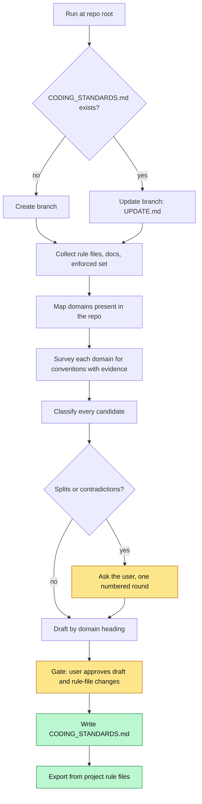
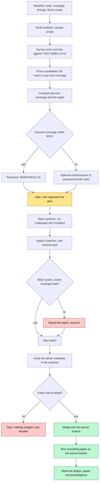
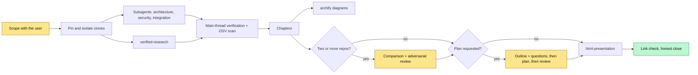

# Skills

Agent skills kept in this library. Each folder is a self-contained skill: a `SKILL.md` plus the reference files it points at.

| Skill | Invocation | What it does |
|---|---|---|
| [`coding-standards`](coding-standards/SKILL.md) | user-invoked | Generates or updates `CODING_STANDARDS.md` at a repo root from the conventions the codebase actually follows. |
| [`test-suite-review`](test-suite-review/SKILL.md) | user-invoked | Reviews a codebase's unit tests, cuts the ones that add volume without protecting the domain, reinforces where the domain is exposed, and ends green with at least 80% genuine coverage. |
| [`dream`](dream/SKILL.md) | model-invoked | Memory consolidation pass over session logs and transcripts. |
| [`memory-consolidation`](memory-consolidation/SKILL.md) | model-invoked | Spawns the background `dreamer` subagent for the same pass, with the spawn prompt it needs. |
| [`pdf`](pdf/SKILL.md) | model-invoked | Structure-aware PDF to Markdown extraction. See [`pdf/README.md`](pdf/README.md). |
| [`study-plan-generator`](study-plan-generator/SKILL.md) | model-invoked | Builds study plans and NotebookLM prompts for a topic. |
| [`repo-audit-study`](repo-audit-study/SKILL.md) | user-invoked | Audits agent-tooling repositories at a pinned commit (architecture, security, harness integration), compares them, plans enterprise adoption, and publishes a verified study with diagrams and a deck. |
| [`verified-research`](verified-research/SKILL.md) | model-invoked | Primary-source research where every quote is confirmed against a saved copy of its source. |
| [`html-presentation`](html-presentation/SKILL.md) | model-invoked | Standalone HTML deck from a study, following `DESIGN.md` when present; persists a claude.ai Design canvas as HTML. |

The rest of this page documents `coding-standards`, `test-suite-review` and the audit trio (`repo-audit-study`, `verified-research`, `html-presentation`).

## Where the two skills come from

Both are built on the concepts that run through Matt Pocock's engineering skills (`tdd`, `code-review`, `codebase-design`, `retro`, `improve-codebase-architecture`) and the literature those skills draw on:

| Concept | Source | Used in |
|---|---|---|
| Deep modules, interface as the thing callers must know | John Ousterhout, _A Philosophy of Software Design_ | both |
| Seams, and tests living at them | Michael Feathers, _Working Effectively with Legacy Code_ | both |
| The code-smell baseline | Martin Fowler, _Refactoring_ (2nd ed., ch. 3) | `coding-standards` |
| Mechanical rules become checks, judgement calls become standards; the reviewer enforces standards | the `retro` skill | `coding-standards` |
| Behaviour through public interfaces, mocks only at system boundaries, tautological and implementation-coupled tests | the `tdd` skill | `test-suite-review` |
| The four properties of a valuable test | Vladimir Khorikov, _Unit Testing: Principles, Practices, and Patterns_ (an addition, not cited by the source skills) | `test-suite-review` |

They were written with the `writing-for-agents` reference: steps that end on a checkable completion criterion, reference pushed behind pointers when only one branch needs it, leading words (`evidence`, `carrier`, `padding`, `genuine coverage`) in place of repeated explanations.

Both are **harness-agnostic**. They carry their own vocabulary and call no other skill, so they run the same in Claude Code, Codex, Cursor, or any harness that loads `SKILL.md` folders.

## Installing

Keep the real directory in `~/.agents/skills/`, which Codex and Cursor read natively, and symlink it for Claude Code:

```bash
cp -r ai/skills/coding-standards ai/skills/test-suite-review ~/.agents/skills/
ln -s ../../.agents/skills/coding-standards ~/.claude/skills/coding-standards
ln -s ../../.agents/skills/test-suite-review ~/.claude/skills/test-suite-review
```

| Harness | How it finds the skill | Checked against official docs |
|---|---|---|
| Claude Code | `~/.claude/skills/<name>` (the symlink) | yes |
| Codex | `~/.agents/skills/<name>`; `agents/openai.yaml` sets `allow_implicit_invocation: false` | yes |
| Cursor | `~/.agents/skills/<name>`; it also reads `~/.claude/skills`, so the skill may be listed twice | yes |
| Copilot, Gemini CLI, Windsurf | not checked | no |

Both skills set `disable-model-invocation: true`: they fire only when you type the name (`/coding-standards`, `/test-suite-review`), because one rewrites a root file and the other deletes tests.

## `coding-standards`

Run it at the root of a repository. It writes `CODING_STANDARDS.md`, the file a reviewer (human or agent) reads when reviewing a diff.

### What decides the content

- **Evidence.** Every rule comes from what the code does today, with a count of sites and an exemplar `path:line`. Where the code disagrees with itself, the skill asks you instead of picking.
- **Mechanical or judgement.** What a linter, formatter, or CI job already enforces stays in its config and is only named. A mechanical rule nothing enforces yet goes in tagged `[check candidate]` and is proposed to you as a check. Judgement calls are the file's real content.
- **One home per rule.** Standards declared in project rule files are exported into `CODING_STANDARDS.md` and removed from where they were. User-level rules stay where they are and are pointed at.

### Flow



### How rule files are treated

| Where the standard was declared | What happens |
|---|---|
| User-level rule (`~/.claude/rules/`, `~/.codex/AGENTS.md`, `~/.gemini/GEMINI.md`, Cursor User Rules) | Left untouched. The domain section points at it with its path and a one-line description. |
| Always-loaded project file (`AGENTS.md`, `CLAUDE.md`, `GEMINI.md`, `copilot-instructions.md`) | The standards are exported and removed. Everything else stays, plus one pointer line to `CODING_STANDARDS.md`. |
| Scoped project rule file, short | Everything in it fits as rule lines, so the file is deleted. |
| Scoped project rule file, detailed (examples, procedures, tables) | The rule goes into `CODING_STANDARDS.md` in one line. The detail stays in the rule file, which is switched to on-demand activation, and the rule gets a `_Detail:_` pointer saying when to read it. |

On-demand activation uses each harness's documented mechanism: Cursor `alwaysApply: false` with a `description`, Windsurf `trigger: model_decision`, glob scoping (`paths:` / `applyTo:`) in Claude Code and Copilot. Where a harness has none, the detail moves to `docs/standards/<name>.md`, which is read only when a model follows the pointer.

Nothing in a rule file is changed before you approve the change list, and `CODING_STANDARDS.md` is written first so no standard is ever absent from both places.

### Updating an existing file

When `CODING_STANDARDS.md` already exists, each rule in it gets a verdict against the current codebase: holds, drift, enforced, restated, user-level, duplicate, unverifiable, or no-op. Rules that hold keep their wording, and you get a change list before anything is written.

### Files

| File | Read when |
|---|---|
| `SKILL.md` | always: the nine steps |
| `UPDATE.md` | the file already exists |
| `HARNESS-RULE-FILES.md` | collecting rule files, and choosing on-demand activation. Paths fetched from official docs on 2026-10-11 |
| `DOMAINS.md` | mapping and surveying domains |
| `BASELINE.md` | filling the `## Baseline` section |

## `test-suite-review`

Run it at the root of a repository with a unit suite. It removes **padding** (tests that could never fail on a domain regression) and merges repetition, and it writes tests where the domain is unprotected.

### Guarantees

- **Target.** Final coverage is the higher of 80% and the **genuine coverage**, which is the coverage left once padding is gone. A suite at 90% with 88% genuine ends at 88% or above. A suite at 80% with 70% genuine is reinforced up to 80%.
- **Carrier.** A test is removed only when a named test that stays still fails on the same behaviour.
- **Green.** The suite is green at baseline, after every batch, and after the merge.
- **Tests only.** Production code is never edited. A missing seam is reported as a finding.
- **Excluded means untouched.** Paths excluded from Sonar analysis, test analysis, or coverage are outside the review, and coverage is measured from the same reports the quality gate reads.
- **Worktree.** Every edit happens in a git worktree based on the branch checked out when the skill starts.

### Flow



### What counts as a smell

| Family | Examples | Usual action |
|---|---|---|
| Padding | no assertion, trivial target (getter, generated code, framework feature), tautological expected value, mock echo | delete |
| Coupled to implementation | interaction-only assertions, mocks of the team's own classes, reaching into private state | rewrite at the seam, or delete when a carrier exists |
| Redundant | duplicate behaviour, same shape with different data, subsumed by a higher-seam test | delete, or parameterize (`@ParameterizedTest`, `test.each`, `pytest.mark.parametrize`, table tests, `[Theory]`) |
| Obsolete | disabled with no issue, dead target, stale expectation | delete or rewrite |
| Slow for no reason | heavy fixture for pure logic, repeated setup, real waiting | speed finding; the test stays |

A keep-list overrides all of it: the sole killer of a mutant, a boundary value of a domain rule, a regression test tied to a bug, a worked example of a documented rule, and a test of promised error behaviour all stay.

### How removal is proved

Where the stack's mutation tool reports which tests kill each mutant (PIT with `fullMutationMatrix`, Stryker with `coverageAnalysis: "perTest"`), one scoped run per module produces a kill matrix, and a candidate is proved when its carrier kills every mutant it kills. Elsewhere the skill falls back to per-test coverage plus a read of the carrier's assertions and marks the candidate **lower confidence**, listed separately at the gate so you can strike it.

### Worktree, merge, and ledger

- The worktree goes where the harness and the repo put worktrees (`WORKTREES.md`): configuration first, then the harness default, then the repo's existing habit. If none settles it, the skill asks you where before starting.
- Before anything else runs there, the skill checks for CodeGraph and runs `codegraph init` at the worktree root when it is installed, so the code graph is available for discovery.
- After the whole codebase is green and at target in the worktree, the branch is merged into the source branch and everything runs once more there. A conflict, a dirty source checkout, or a red post-merge run goes to you.
- The final report opens with three statements backed by that last run (every test passes, coverage of the whole codebase from baseline to final, the merge), followed by a ledger with one row per removed, merged, or added test.

### Speed recommendations

With the baseline timings in hand, the skill recommends only the levers the measurements justify, per stack (`ECOSYSTEMS.md` covers Java and Kotlin, JavaScript and TypeScript, Python, Go, and .NET). They change build and CI configuration, so they are reported and applied only on request.

### Files

| File | Read when |
|---|---|
| `SKILL.md` | always: guardrails and the twelve steps |
| `TEST-SMELLS.md` | surveying and proving |
| `SONAR-SCOPE.md` | the repo configures Sonar or coverage exclusions |
| `ECOSYSTEMS.md` | finding the stack's tools, and recommending speed levers |
| `REINFORCE.md` | genuine coverage is under 80% |
| `WORKTREES.md` | opening and removing the worktree. Conventions fetched from official docs on 2026-10-11 |

## Status

Both skills were checked for structure only (links resolve, frontmatter and `openai.yaml` present). Neither has been run end to end on a real repository yet. The tool options in `ECOSYSTEMS.md` are a cache of each tool's documentation: only the PIT options and Stryker's `coverageAnalysis` were confirmed against the docs, and the file tells the agent to confirm each option against the installed version.

## The audit trio

`repo-audit-study`, `verified-research` and `html-presentation` encode the process used to produce
[`ai/docs/agent-memory/`](../docs/agent-memory/README.md): pinned clones read as untrusted data, parallel
subagent briefs, main-thread verification, OSV.dev supply-chain scan, chapters with Mermaid, archify
diagrams with `path:line` sources, an adversarially reviewed comparison, an adoption plan reviewed before it is
called ready, and a deck kept in the repository.



| Skill | Files | Scripts |
|---|---|---|
| `repo-audit-study` | `SKILL.md` (ten steps), `ARCHITECTURE-BRIEF.md`, `SECURITY-BRIEF.md`, `INTEGRATION-BRIEF.md` (subagent prompts), `VERIFY.md`, `REPORT.md`, `DIAGRAMS.md`, `COMPARE.md`, `PLAN.md` | `osv_scan.py` (OSV.dev over lockfiles), `check_links.py` (links and anchors) |
| `verified-research` | `SKILL.md` | `verify_quotes.py` (quotes against saved sources) |
| `html-presentation` | `SKILL.md`, `DECK.md` | `export_canvas.py` (Design canvas → standalone HTML) |

`repo-audit-study` is user-invoked (`/repo-audit-study`): it fans out several subagents and is expensive. The
other two are model-invoked so the audit, or any other task, can reach them.

**Status:** the three scripts were run against the data of the `agent-memory` study and reproduce its
results (108 of 110 quotes matched automatically, the other 2 confirmed by hand; 97 links, 0 broken; the
exported deck reproduces the committed deck byte for byte). The skills as a whole have not yet been run end to end on
a new repository. Diagrams need the `archify` skill; the comparison and plan reviews need an advisor or a critic
subagent.

