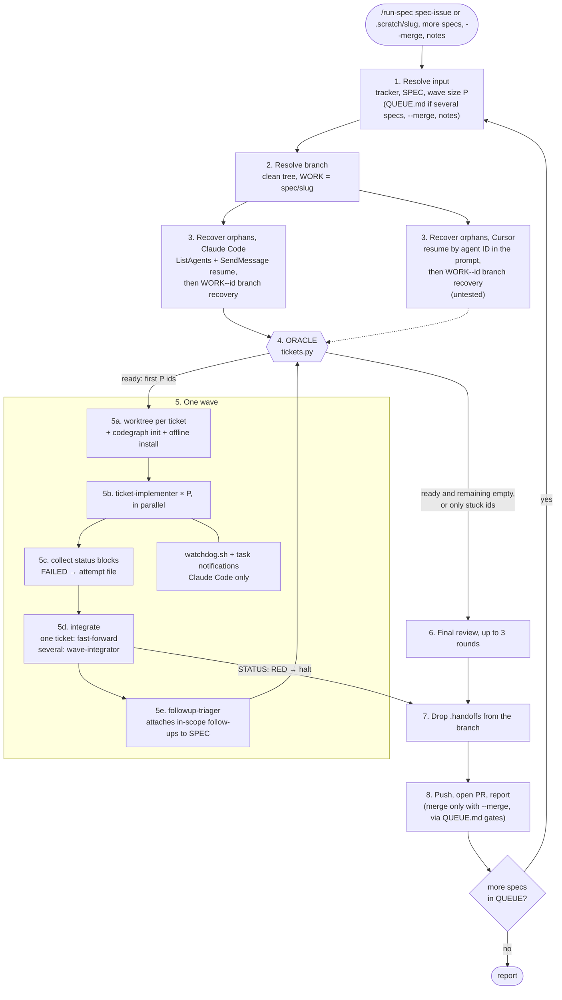
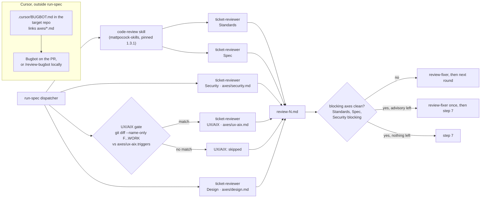

# run-spec — the whole flow in one place

`/run-spec` implements every ticket of a spec while nobody watches. The spec comes from `mattpocock-skills` `/to-spec`, and `/to-tickets` splits it into tickets. `/run-spec` runs one subagent per ticket, in parallel waves inside git worktrees. It folds follow-ups back into the spec, runs a five-axis final review, and opens a PR.

This folder is the **source of truth** for the flow. The copy under `~/.claude` is an install of it. Earlier write-ups of the flow are historical snapshots: [`ai/docs/software-factory/04-run-spec-flow.md`](../../docs/software-factory/04-run-spec-flow.md) (2026-10-11, two-axis review, before the queue and resume rules) and [`ai/docs/run-spec-review-axes/`](../../docs/run-spec-review-axes/README.md) (pt-BR research behind the Security, UX/AIX and Design axes).

## Flow



### Step 6: the five-axis final review



| Axis | Brief | Blocks the loop | Severity | Runs when |
|---|---|---|---|---|
| Standards | `code-review` skill + Fowler smell baseline | yes | hard violation / judgement call | always |
| Spec | `code-review` skill | yes | missing / scope creep / wrong | always (skipped when no spec) |
| Security | [`axes/security.md`](axes/security.md) | yes (HIGH/MEDIUM, confidence ≥ 8/10); `needs-human` findings are advisory | HIGH / MEDIUM | always |
| UX/AIX | [`axes/ux-aix.md`](axes/ux-aix.md) | no | critical / warning / info | only when the diff touches a file matching [`axes/ux-aix.triggers`](axes/ux-aix.triggers) |
| Design | [`axes/design.md`](axes/design.md) | no | Strong / Worth exploring / Speculative | always |

Rounds 1 and 2 review the whole branch. Round 3 checks only round 2's fix commits. An advisory-only round runs the fixer once and ends the review. The per-ticket review inside `ticket-implementer` stays two-axis (Standards and Spec).

## Artifacts needed to run it

### In this folder (installed by `install.sh`)

| File | Installed to | Role |
|---|---|---|
| [`SKILL.md`](SKILL.md) | `~/.claude/skills/run-spec/` | The dispatcher: a passive router bound by a contract (only listed commands, subagent spawns, and its own STATE files; never reads code) |
| [`QUEUE.md`](QUEUE.md) | same | Several specs in one run, `--merge` gates (run, CI, merge), owner notes, a skill to run after the queue |
| [`tickets.py`](tickets.py) | same | The **oracle**. It reads ticket metadata, `Ticket:` commit trailers and attempt files, and prints `ready`/`remaining` as JSON. A script, not the model, decides what runs next. At most 2 attempts per ticket. |
| [`watchdog.sh`](watchdog.sh) | same, **at this exact path**: step 5b calls `~/.claude/skills/run-spec/watchdog.sh` | Exits with `stalled: <id>` when a ticket worktree has had no file change for 120 min and no process names it. This catches dead subagents, which send no notification. |
| [`axes/`](axes/) | same | Security, UX/AIX and Design briefs, plus the UX/AIX trigger patterns |
| [`agents/ticket-implementer.md`](agents/ticket-implementer.md) | `~/.claude/agents/` | One ticket end to end in its worktree: TDD, full suite, two-axis review, follow-ups, handoff. Sonnet 5.5, xhigh effort. |
| [`agents/ticket-reviewer.md`](agents/ticket-reviewer.md) | same | One review axis, read-only. Opus 5.5, medium effort. |
| [`agents/wave-integrator.md`](agents/wave-integrator.md) | same | Merges a wave's branches into WORK, resolves conflicts, runs the suite, removes worktrees |
| [`agents/followup-triager.md`](agents/followup-triager.md) | same | Attaches in-scope, agent-ready follow-ups to SPEC, so the oracle schedules them; labels the rest |
| [`agents/review-fixer.md`](agents/review-fixer.md) | same | Fixes final-review findings: one commit per fix, the suite green at the end, dismissals justified, `needs-human` kept for a person |
| [`../follow-up-issue/SKILL.md`](../follow-up-issue/SKILL.md) | `~/.claude/skills/follow-up-issue/` | The gate and template that `ticket-implementer` and `review-fixer` use to file a follow-up |

### Outside this repository

| Prerequisite | Why |
|---|---|
| `mattpocock-skills` plugin, **pinned to v1.3.1** from the author's marketplace (`mattpocock-skills@mattpocock`) | `/to-spec`, `/to-tickets` and `/setup-matt-pocock-skills` produce the input. `tdd` and `code-review` are preloaded by the agents. The flow was patched for 1.3.x (`GLOSSARY.md`, heading regex, removed skill), so re-check those points before moving the pin. |
| In the target repo: `docs/agents/issue-tracker.md` | Its heading picks the tracker: `# Issue tracker: GitHub` or `# Issue tracker: Local Markdown`. Written by `/setup-matt-pocock-skills`. |
| In the target repo, optional: `docs/agents/run-spec.md` | A `max-parallel: <N>` line sets the wave size (default 3). |
| In the target repo, local tracker: the spec's `issues/` committed | Worktrees see only committed files. |
| `git`, `python3`; `gh` for the GitHub tracker and for PRs | Branches, worktrees, the oracle, the tracker |
| Optional: `codegraph`, `pnpm` | Step 5a indexes each worktree and installs offline. Both are skipped when absent. |
| A permission mode that does not prompt (for example `"defaultMode": "auto"` in `~/.claude/settings.json`) | The run is AFK: a permission prompt for `git`, `gh`, `python3`, `pnpm`, `codegraph` or a test command stalls a subagent until the watchdog fires. |

No hook, MCP server or `settings.json` entry is specific to this flow.

### Run records (`$STATE` = `<git-common-dir>/run-spec/<slug>`, untracked)

| File | Written by | Meaning |
|---|---|---|
| `wt/<id>/` | step 5a | ticket worktrees, inside `.git` so they never show in `git status` |
| `status-<id>.md` | step 5c | the implementer's status block |
| `<id>-attempt<k>.md`, `<id>-resume<j>.md` | implementer / step 3 | failures (counted by the oracle) and resumes (not counted) |
| `wave-NN.md`, `triage-N.md` | 5d / 5e | integrator and triager status blocks |
| `review-N.md`, `review-N-base`, `review-N-fix.md` | step 6 | the five-axis report, the fixer's base SHA, the fixer's status block |
| `owner-<k>.md`, `user-<k>.md`, `probes.md`, `learnings.md`, `pr-body.md` | dispatcher | the owner's messages, stall probes, learnings, the PR body |
| `<git-common-dir>/run-spec/queue.md` | `QUEUE.md` | queue state across specs |

## Install

From the repository root, after committing (the script installs `HEAD`, not the working tree):

```bash
ai/skills/run-spec/install.sh
```

```bash
diff -r --exclude=__pycache__ --exclude=agents --exclude=install.sh --exclude=README.md ai/skills/run-spec ~/.claude/skills/run-spec
```

Edit the files here, commit, then re-run `install.sh`. An edit made directly under `~/.claude` is lost on the next install.

## Claude Code and Cursor

| Aspect | Claude Code | Cursor | Gap |
|---|---|---|---|
| Install path | `~/.claude/skills/run-spec/`, `~/.claude/agents/` | Loads skills from `~/.claude/skills/` and subagents from `~/.claude/agents/` for compatibility ([skills](../../docs/cursor/skills/agent-skills-guide.md), [subagents](../../docs/cursor/subagents/subagents-guide.md)) | Same files, no second copy |
| Invocation | `/run-spec` (`disable-model-invocation: true`) | `/` in Agent chat, then the skill name; attaches to one message | Not tested in Cursor |
| How context reaches each agent | `KEY: value` prompts; `skills:` preloads `tdd` and `code-review` | Subagent prompt; `skills:` preloading is not documented for Cursor subagents | Implementers in Cursor may lack the preloaded skills |
| Read-only reviewer | `tools: Read, Grep, Glob, Bash` | `readonly: true` (Cursor has no `tools:` field) | Both fields set in `ticket-reviewer.md`; Cursor's `readonly` also blocks state-changing shell commands. `readonly` is not a Claude Code field, and its docs do not say whether file-based subagents ignore unknown keys: check the first run's agent list |
| Models | `claude-opus-5-5`, `claude-sonnet-5-5` with `effort:` | `inherit` or a Cursor model id (`claude-opus-5[effort=high]` form) | Claude Code model ids may not resolve in Cursor |
| Resume, stall probe | `ListAgents`, `SendMessage`, background task notifications | A subagent is resumed by its agent ID in the parent's prompt ("Resume agent abc123 …"); no listing of running agents or message-to-running-agent tool is documented | Step 3's same-conversation resume (`ListAgents`) and the stall probe (`SendMessage` mid-run) are Claude Code-only |
| Hooks | none used | none used | — |
| MCP | none used | none used | — |
| PR review in CI | — | Bugbot reads only Team Rules, `.cursor/BUGBOT.md` (root and nested) and files linked from it; not `.cursor/rules/*.mdc` ([bugbot](../../docs/cursor/bugbot/bugbot.md)) | A target repo can link `axes/*.md` from its `.cursor/BUGBOT.md` (30,000 characters per rule, 100,000 in total) to get the same criteria in Bugbot |

## Status

- **Never run end to end after the 2026-11-12 changes** (review rounds, resume, queue) **or after the 2026-11-15 axes.** The first real `/run-spec` is the test.
- Fixes from an advisory-only round (UX/AIX, Design, Security `needs-human`) ship without a review of their own. Only the fixer's full-suite run checks them.
- The UX/AIX gate looks only at file paths. A user-facing string changed in a backend file does not trigger it.
