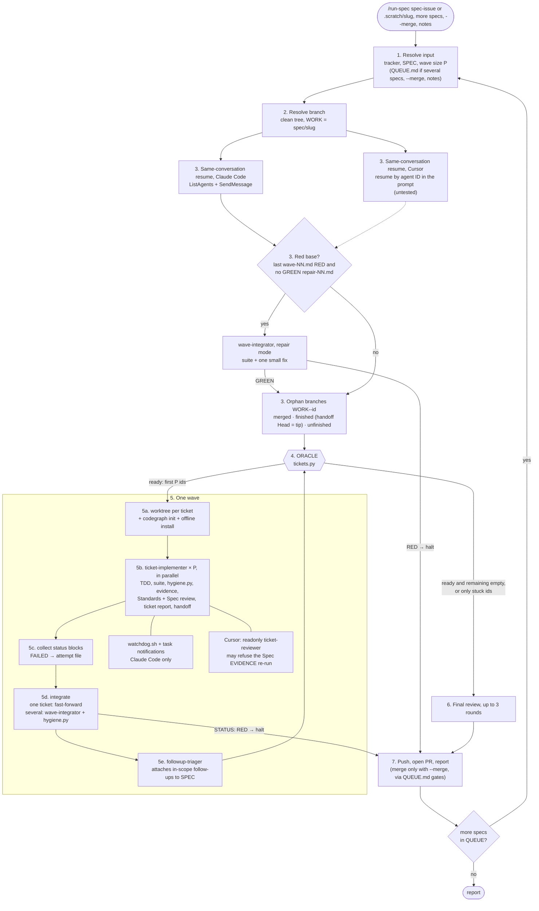
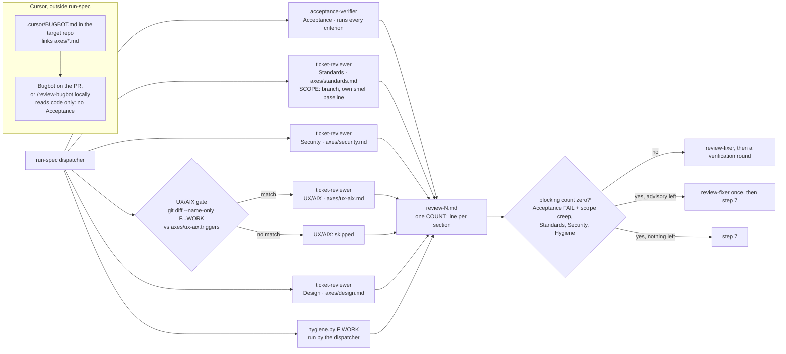

# run-spec — the whole flow in one place

`/run-spec` implements every ticket of a spec while nobody watches. The spec and its tickets live on a GitHub issue tracker or in a local `.scratch/<slug>/` folder, in the [input format](#input-format) this kit defines. `/run-spec` runs one subagent per ticket, in parallel waves inside git worktrees; each implementer proves its criteria by running the code and posts a ticket report on the issue. The run folds follow-ups back into the spec, runs a final review whose main axis executes every acceptance criterion, and opens a PR.

This folder is the **source of truth** for the flow. The copy under `~/.claude` is an install of it. Earlier write-ups of the flow are historical snapshots: [`ai/docs/software-factory/04-run-spec-flow.md`](../../docs/software-factory/04-run-spec-flow.md) (2026-10-11, two-axis review, before the queue and resume rules) and [`ai/docs/run-spec-review-axes/`](../../docs/run-spec-review-axes/README.md) (pt-BR research behind the Security, UX/AIX and Design axes).

## Flow



### Step 6: the final review



| Axis | Run by | Brief | Blocks the loop | Verdict or severity | Runs when |
|---|---|---|---|---|---|
| Acceptance | `acceptance-verifier` | [`agents/acceptance-verifier.md`](agents/acceptance-verifier.md) | yes: FAIL and scope creep. UNVERIFIED never starts a round, but holds `--merge` and is listed under `Not verified` in the PR | PASS / FAIL / UNVERIFIED, evidence tier S / A / B | always; every round re-runs every criterion |
| Standards | `ticket-reviewer` | [`axes/standards.md`](axes/standards.md), with its own smell baseline | yes | hard / judgement | always |
| Security | `ticket-reviewer` | [`axes/security.md`](axes/security.md) | yes (HIGH/MEDIUM, confidence ≥ 8/10); `needs-human` findings are advisory | HIGH / MEDIUM | always |
| UX/AIX | `ticket-reviewer` | [`axes/ux-aix.md`](axes/ux-aix.md) | no | critical / warning / info | only when the diff touches a file matching [`axes/ux-aix.triggers`](axes/ux-aix.triggers) |
| Design | `ticket-reviewer` | [`axes/design.md`](axes/design.md) | no | Strong / Worth exploring / Speculative | always |
| Hygiene | the dispatcher | [`hygiene.py`](hygiene.py) | yes | one line per comment line or Markdown file the range adds | always |

Round 1 reviews the whole branch. Rounds 2 and 3 are verification rounds: the code-reading axes and Hygiene read only the commits since the previous fixer started, and Acceptance re-runs every criterion. An advisory-only round runs the fixer once and ends the review. The per-ticket review inside `ticket-implementer` stays two-axis: it spawns two `ticket-reviewer` agents, one on [`axes/standards.md`](axes/standards.md) with `SCOPE: ticket` and one on [`axes/spec.md`](axes/spec.md), whose Spec reviewer re-runs the implementer's evidence commands.

## Artifacts needed to run it

### In this folder (installed by `install.sh`)

| File | Installed to | Role |
|---|---|---|
| [`SKILL.md`](SKILL.md) | `~/.claude/skills/run-spec/` | The dispatcher: a passive router bound by a contract (only listed commands, subagent spawns, and its own STATE files; never reads code) |
| [`QUEUE.md`](QUEUE.md) | same | Several specs in one run, `--merge` gates (run, CI, merge), owner notes, a skill to run after the queue |
| [`tickets.py`](tickets.py) | same | The **oracle**. It reads ticket metadata, `Ticket:` commit trailers and attempt files, and prints `ready`/`remaining` as JSON. A script, not the model, decides what runs next. A ticket is done only when a commit with its `Ticket:` trailer reaches WORK. At most 2 attempts per ticket. |
| [`hygiene.py`](hygiene.py) | same | The **hygiene gate**: `hygiene.py <base> <head> [--allow <path>]...` prints each comment line and Markdown file the range adds and exits 1, or exits 0 silently. Run by the implementer, the integrator, the fixer, and step 6's Hygiene axis. |
| [`test_tickets.py`](test_tickets.py), [`test_hygiene.py`](test_hygiene.py) | not installed | Standard-library tests of the two scripts: `python3 -I ai/skills/run-spec/test_<name>.py` |
| [`watchdog.sh`](watchdog.sh) | same | Exits with `stalled: <id>` when a ticket worktree has had no file change for 120 min and no process names it. This catches dead subagents, which send no notification. |
| [`axes/`](axes/) | same | Review briefs: Standards (per ticket and final, with its own smell baseline), Security, UX/AIX and Design, plus the UX/AIX trigger patterns |
| [`axes/spec.md`](axes/spec.md) | same | The per-ticket Spec brief: missing, partial, wrong and out-of-scope behaviour against the ticket, and a re-run of the implementer's `EVIDENCE` commands |
| [`guides/tdd.md`](guides/tdd.md) | same | The test-first guide that `ticket-implementer` and `review-fixer` read: seams, vertical slices, good tests, anti-patterns, test doubles at system boundaries |
| [`agents/ticket-implementer.md`](agents/ticket-implementer.md) | `~/.claude/agents/` | One ticket end to end in its worktree: TDD, full suite, hygiene gate, evidence for every criterion, two-axis review, follow-ups, ticket report on the issue, handoff in STATE. Sonnet 5.5, xhigh effort. |
| [`agents/acceptance-verifier.md`](agents/acceptance-verifier.md) | same | The Acceptance axis: runs every user story and done-ticket criterion through the public entry point and reports PASS / FAIL / UNVERIFIED with the command and its output, plus scope creep. Opus 5.5, medium effort, not read-only. |
| [`agents/ticket-reviewer.md`](agents/ticket-reviewer.md) | same | One code-reading review axis, read-only; carries the reviewer side of the no-comment rule. Opus 5.5, medium effort. |
| [`agents/wave-integrator.md`](agents/wave-integrator.md) | same | Merges a wave's branches into WORK, resolves conflicts, runs the suite, removes worktrees; in repair mode, makes a red WORK green after a halt |
| [`agents/followup-triager.md`](agents/followup-triager.md) | same | Attaches in-scope, agent-ready follow-ups to SPEC, so the oracle schedules them; labels the rest |
| [`agents/review-fixer.md`](agents/review-fixer.md) | same | Fixes final-review findings: an Acceptance FAIL test-first, one commit per fix, the suite green at the end, dismissals justified, `needs-human` kept for a person |
| [`../follow-up-issue/SKILL.md`](../follow-up-issue/SKILL.md) | `~/.claude/skills/follow-up-issue/` | The gate and template that `ticket-implementer` and `review-fixer` use to file a follow-up |

### Outside this repository

| Prerequisite | Why |
|---|---|
| In the target repo: `docs/agents/issue-tracker.md` | Its heading picks the tracker: `# Issue tracker: GitHub` or `# Issue tracker: Local Markdown`. See [Input format](#input-format). |
| In the target repo, optional: `docs/agents/run-spec.md` | A `max-parallel: <N>` line sets the wave size (default 3). |
| In the target repo, local tracker: the spec's `issues/` committed | Worktrees see only committed files. |
| `git`, `python3`; `gh` for the GitHub tracker and for PRs | Branches, worktrees, the oracle, the tracker |
| Optional: `codegraph`, `pnpm` | Step 5a indexes each worktree and installs offline. Both are skipped when absent. |
| A permission mode that does not prompt (for example `"defaultMode": "auto"` in `~/.claude/settings.json`) | The run is AFK: a permission prompt for `git`, `gh`, `python3`, `pnpm`, `codegraph` or a test command stalls a subagent until the watchdog fires. |

No hook, MCP server or `settings.json` entry is specific to this flow.

### Input format

The kit defines the input it reads. Any process that writes this format can feed it.

| Part | GitHub tracker | Local tracker |
|---|---|---|
| Tracker choice | `docs/agents/issue-tracker.md` headed `# Issue tracker: GitHub` | `docs/agents/issue-tracker.md` headed `# Issue tracker: Local Markdown` |
| Spec | issue `#N` | `.scratch/<slug>/spec.md`, committed |
| Tickets | the sub-issues of `#N`, and every issue whose `## Parent` section names `#N` first or that has a `Part of #N` line | `.scratch/<slug>/issues/NN-<title>.md`, committed, first line `# NN — <title>` |
| A ticket runs when | it carries the `ready-for-agent` label | its one `Status:` line reads `ready-for-agent` |
| A ticket is done when | it is closed, or a commit with its `Ticket: #M` trailer is on the work branch | its `Status:` is `resolved`, `done` or `closed`, or a `Ticket: NN` commit is on the work branch |
| Blockers | native blocked-by links, and the `#refs` in a `## Blocked by` section or a `Blocked by:` line | one `Blocked by:` line with ticket numbers, or `Blocked by: none` |

What the agents read from that input:

- every ticket's acceptance criteria: the implementer proves them, the Spec reviewer checks them, the acceptance verifier runs them;
- the spec's `Testing Decisions` section, when present: the seams the implementer and the fixer test at;
- the spec's user stories: the acceptance verifier runs each one as a scenario;
- the spec's out-of-scope list: the triager's scope check;
- optional `docs/agents/triage-labels.md`: maps the triage verdicts to label strings; without it, each verdict's name is its label.

### Run records (`$STATE` = `<git-common-dir>/run-spec/<slug>`, untracked)

| File | Written by | Meaning |
|---|---|---|
| `wt/<id>/` | step 5a | ticket worktrees, inside `.git` so they never show in `git status` |
| `handoffs/<id>.md` | implementer, last | the agent-facing handoff, read by dependent tickets and the integrator; its `Status:` and `Head:` lines mark a finished orphan in step 3 |
| `reports/<id>.md` | implementer | the ticket report body posted on the issue (local tracker: appended to the ticket file) |
| `status-<id>.md` | implementer, then step 5c | the implementer's status block |
| `<id>-attempt<k>.md`, `<id>-resume<j>.md` | implementer / step 3 | failures (counted by the oracle) and resumes (not counted) |
| `wave-NN.md`, `repair-NN.md`, `triage-N.md` | 5d / step 3 / 5e | integrator, repair and triager status blocks |
| `review-N.md`, `review-N-base`, `review-N-fix.md`, `verify-N/` | step 6 | the six-section report, the fixer's base SHA, the fixer's status block, the verifier's probe scripts and output |
| `owner-<k>.md`, `user-<k>.md`, `probes.md`, `learnings.md`, `pr-body.md` | dispatcher | the owner's messages, stall probes, learnings, the PR body |
| `<git-common-dir>/run-spec/queue.md` | `QUEUE.md` | queue state across specs |

## Install

From the repository root, after committing (the script installs `HEAD`, not the working tree):

```bash
ai/skills/run-spec/install.sh
```

```bash
diff -r --exclude=__pycache__ --exclude=agents --exclude=install.sh --exclude=README.md --exclude='test_*.py' ai/skills/run-spec ~/.claude/skills/run-spec
```

Edit the files here, commit, then re-run `install.sh`. An edit made directly under `~/.claude` is lost on the next install.

## Claude Code and Cursor

| Aspect | Claude Code | Cursor | Gap |
|---|---|---|---|
| Install path | `~/.claude/skills/run-spec/`, `~/.claude/agents/` | Loads skills from `~/.claude/skills/` and subagents from `~/.claude/agents/` for compatibility ([skills](../../docs/cursor/skills/agent-skills-guide.md), [subagents](../../docs/cursor/subagents/subagents-guide.md)) | Same files, no second copy |
| Invocation | `/run-spec` (`disable-model-invocation: true`) | `/` in Agent chat, then the skill name; attaches to one message | Not tested in Cursor |
| How context reaches each agent | `KEY: value` prompts; agents read `guides/tdd.md` and `axes/*.md` by path, from the `KIT` key | Same prompts and paths | None: no agent preloads a skill, and reading a file by path works in both harnesses |
| Skill directory | Claude Code substitutes `${CLAUDE_SKILL_DIR}` in `SKILL.md`, which sets `ORACLE`, `HYGIENE`, `KIT` and the watchdog path | The Cursor docs mirrored in this repository do not document `${CLAUDE_SKILL_DIR}` or an equivalent | Untested: if Cursor leaves it unexpanded, those four paths break; the installed directory is `~/.claude/skills/run-spec/` |
| Read-only reviewer | `tools: Read, Grep, Glob, Bash` | `readonly: true` (Cursor has no `tools:` field) | Both fields set in `ticket-reviewer.md`; Cursor's `readonly` also blocks state-changing shell commands, so the per-ticket Spec reviewer's re-run of the evidence commands may be refused there. `readonly` is not a Claude Code field, and its docs do not say whether file-based subagents ignore unknown keys: check the first run's agent list |
| Acceptance verifier | `tools: Bash, Read, Grep, Glob, Write`, no `readonly` | no `readonly`, so it can build, start servers and write probes | Writing only under `OUT_DIR` is a prompt rule in both harnesses: neither field scopes paths |
| Hygiene gate | `python3 hygiene.py`, standard library only | same | none |
| Models | `claude-opus-5-5`, `claude-sonnet-5-5` with `effort:` | `inherit` or a Cursor model id (`claude-opus-5[effort=high]` form) | Claude Code model ids may not resolve in Cursor |
| Resume, stall probe | `ListAgents`, `SendMessage`, background task notifications | A subagent is resumed by its agent ID in the parent's prompt ("Resume agent abc123 …"); no listing of running agents or message-to-running-agent tool is documented | Step 3's same-conversation resume (`ListAgents`) and the stall probe (`SendMessage` mid-run) are Claude Code-only |
| Hooks | none used | none used | — |
| MCP | none used | none used | — |
| PR review in CI | — | Bugbot reads only Team Rules, `.cursor/BUGBOT.md` (root and nested) and files linked from it; not `.cursor/rules/*.mdc` ([bugbot](../../docs/cursor/bugbot/bugbot.md)) | A target repo can link `axes/*.md` from its `.cursor/BUGBOT.md` (30,000 characters per rule, 100,000 in total) to get the same code-reading criteria in Bugbot. Bugbot reads code and executes nothing, so Acceptance and Hygiene have no Bugbot equivalent |

## Status

- **Never run end to end since these changes**: the 2026-11-12 rules (review rounds, resume, queue), the 2026-11-15 axes, the 2026-11-15 (2) Acceptance axis, hygiene gate, ticket report and handoffs in STATE, and the 2026-11-15 (3) self-contained kit (own test-first guide, Standards and Spec briefs, per-ticket reviewers spawned directly). A smoke run in a throwaway repo is planned before this work merges.
- Fixes from an advisory-only round (UX/AIX, Design, Security `needs-human`) ship without a review of their own. Only the fixer's full-suite run and hygiene gate check them.
- The UX/AIX gate looks only at file paths. A user-facing string changed in a backend file does not trigger it.
