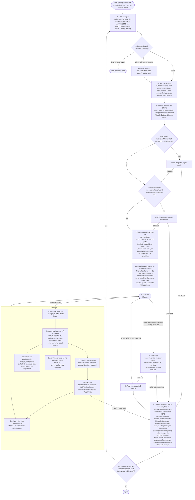
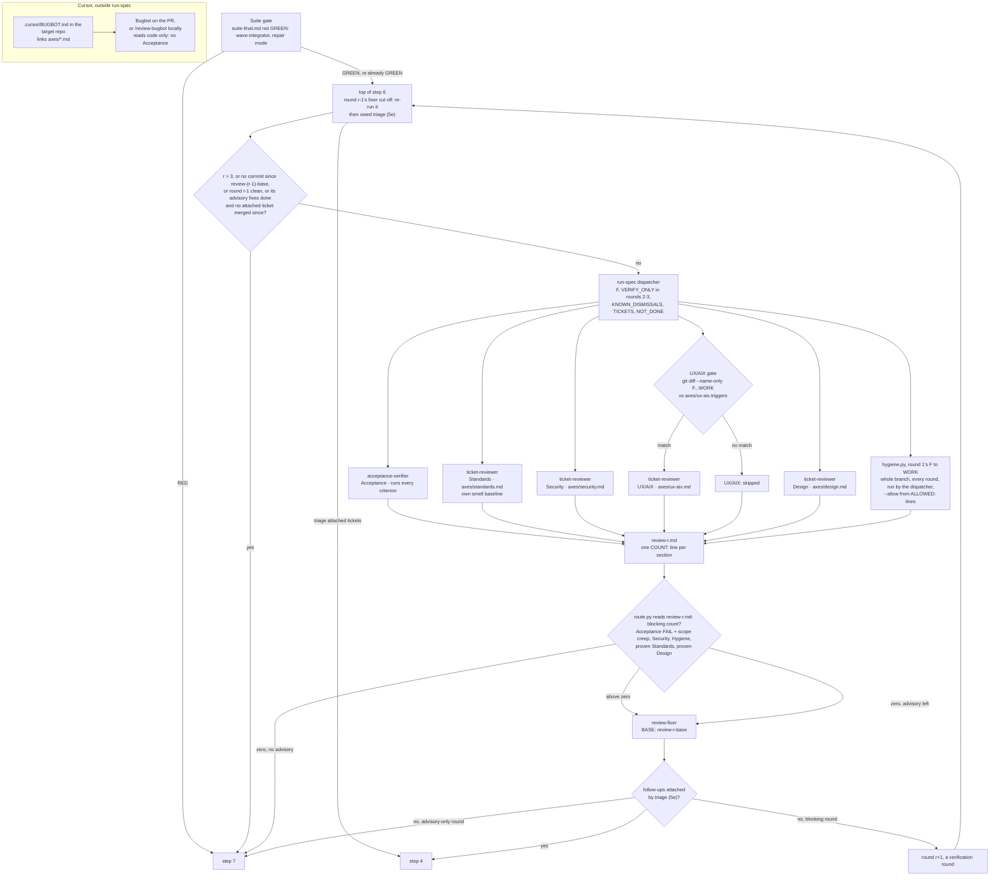

# run-spec — the whole flow in one place

`/run-spec` implements every ticket of a spec while nobody watches. The spec and its tickets live on a GitHub issue tracker or in a local `.scratch/<slug>/` folder, in the [input format](#input-format) this kit defines. `/run-spec` runs one subagent per ticket, in parallel waves inside git worktrees; each implementer proves its criteria by running the code and posts a ticket report on the issue. The run folds follow-ups back into the spec, runs the whole test suite once over the finished branch (the **Suite gate**), runs a final review whose main axis executes every acceptance criterion, executes them once more on the last HEAD when the branch moved, and opens a PR.

This folder is the **source of truth** for the flow. The copy under `~/.claude` is an install of it. Earlier write-ups of the flow are historical snapshots: [`ai/docs/software-factory/04-run-spec-flow.md`](../../docs/software-factory/04-run-spec-flow.md) (2026-10-11, two-axis review, before the queue and resume rules) and [`ai/docs/run-spec-review-axes/`](../../docs/run-spec-review-axes/README.md) (pt-BR research behind the Security, UX/AIX and Design axes).

## Flow



Every agent except `ticket-implementer` gets a `$STATE/running/<label>` marker at spawn, which the watchdog reads. A **MAIN-side agent** (`wave-integrator`, `followup-triager`, `review-fixer`, and `acceptance-verifier`, whose runs leave untracked output) writes in the main checkout, so its spawn also writes `$STATE/main-owner`, and a dead one's leftovers are stashed, never taken for the user's work. Both markers go when its status block or section is recorded. The watchdog runs until this spec's step 7 report in this invocation; the queue's next spec, and any new `/run-spec`, starts it again. A stalled ticket gets the stall probe once, and its second stall is a FAILED attempt. An overdue agent that stopped is respawned once; the next time, its marker is deleted and the run halts with `agent <label> lost`.

### Step 6: the final review

Step 6 opens with the **Suite gate**: the one run of the whole test suite over the finished work branch, before any reviewer is spawned. The dispatcher writes the spawn records (the `running/suite-final` marker and `main-owner`, since the integrator writes in the main checkout), spawns `wave-integrator` in repair mode (empty `MERGE` and `DISCARD`), and writes its status block verbatim to `$STATE/suite-final.md`. `STATUS: GREEN` continues to round 1, which reads the branch after the gate's fixes. `STATUS: RED` halts the run with the gate's `SUMMARY:` as the halt reason, skips the review and goes to step 7. Step 3 runs the gate again when the run reached step 6 and `suite-final.md` is missing or RED. A run that halts before step 6 never runs it, and its PR body says `full suite: not run (halted)`. The dispatcher never re-runs a suite itself: the gate's status block is its only evidence.



| Axis | Run by | Brief | Blocks the loop | Verdict or severity | Runs when |
|---|---|---|---|---|---|
| Acceptance | `acceptance-verifier` | [`agents/acceptance-verifier.md`](agents/acceptance-verifier.md) | yes: FAIL and scope creep. UNVERIFIED never starts a round, but holds `--merge` and is listed under `Not verified` in the PR | PASS / FAIL / UNVERIFIED, evidence tier S / A / B | every round, re-running every criterion; once more in step 7 when WORK moved past its `HEAD:` line |
| Standards | `ticket-reviewer` | [`axes/standards.md`](axes/standards.md), with its own smell baseline | yes, when proven; unproven findings are advisory | hard / judgement | always |
| Security | `ticket-reviewer` | [`axes/security.md`](axes/security.md) | yes (HIGH/MEDIUM, confidence ≥ 8/10); `needs-human` findings are advisory | HIGH / MEDIUM | always |
| UX/AIX | `ticket-reviewer` | [`axes/ux-aix.md`](axes/ux-aix.md) | no | critical / warning / info | only when the diff touches a file matching [`axes/ux-aix.triggers`](axes/ux-aix.triggers) |
| Design | `ticket-reviewer` | [`axes/design.md`](axes/design.md) | yes, when proven; unproven findings are advisory | Strong / Worth exploring / Speculative | always |
| Hygiene | the dispatcher | [`hygiene.py`](hygiene.py) | yes | one line per comment line or Markdown file the range adds | always |

#### Proven and Unproven findings

Only a **Proven** finding of the Standards or Design axis can block. A finding is Proven when it ends in a `Proof:` field the review-fixer can re-run:

- Standards: a quote of the written rule line it breaks and the file that states it (`Proof: "<rule line>" (<file>)`), or a command and its decisive output. The smell baseline is not a written rule, so a smell needs a command.
- Design: a command and its decisive output, such as the `grep` that counts the callers of a shallow module.
- A finding without the field is **Unproven**. It is advisory and never starts a round.

Each of the two axes ends its section in `COUNT: <p> proven, <u> unproven`, which must equal the number of findings with and without a `Proof:` field. `route.py` reads the six `COUNT:` lines of `review-r.md` and prints the dispatcher's routing: the **blocking count** is Acceptance's and Security's first number, Hygiene's number, and the proven counts of Standards and Design; the **advisory count** is Security's `needs-human`, UX/AIX's number, and the unproven counts of Standards and Design. A proven Design finding therefore blocks and starts a round. Security, UX/AIX and Hygiene keep their rules and counts. The per-ticket review (Standards and Spec inside `ticket-implementer`) is unchanged: the implementer still absorbs, files or dismisses every finding.

The review-fixer re-runs each Standards and Design proof from the main checkout under `timeout 120` before it decides. A rule quote is looked up with `grep -nF`. A proof that reproduces is fixed or dismissed as before. A proof that does not reproduce, times out, or is missing gives the outcome `unproven`: `- <id> unproven — <command> → <output it saw>`, or `- <id> unproven — no proof field — <file:line>`. The finding is neither fixed nor dismissed, and it never blocks. Later rounds receive `unproven` lines with the `dismissed` ones as `KNOWN_DISMISSALS` and reopen one only with a new proof. Step 7 lists every `unproven` line in the PR body (`## Unproven findings`) and in the report, and records their count in the run's metrics record (`unproven=<n>`).

Round 1 reviews the whole branch. Rounds 2 and 3 are verification rounds: the code-reading axes read only the commits since the previous fixer started (`VERIFY_ONLY`); Acceptance re-runs every criterion and Hygiene re-checks the whole branch. A fixer's follow-ups go through 5e's triage. When it attaches tickets, the run goes back to step 4, and the next pass reviews them as round `r`+1, after an advisory-only round too. No code-reading axis reads round 3's fixes, the tickets round 3's triage attaches, or an advisory-only round's fixes when its triage attaches nothing: each fixer's hygiene gate, each ticket's own review, and step 7's closing acceptance cover them.

The per-ticket review inside `ticket-implementer` stays two-axis: it spawns two `ticket-reviewer` agents, one on [`axes/standards.md`](axes/standards.md) with `SCOPE: ticket` and one on [`axes/spec.md`](axes/spec.md), whose Spec reviewer re-runs the implementer's evidence commands and checks their tier: a criterion with no evidence line, or a command that does not run the code through its public entry point, is a finding.

### Step 7: closing acceptance and the PR

The **newest Acceptance** is `$STATE/acceptance-final.md` when it exists, else the Acceptance section of the last `review-N.md`. Its `HEAD:` line names the WORK it ran on. Except on a halt, and always when step 7 runs again after a GREEN `user-k` fix, `acceptance-verifier` runs once more with `ROUND: final` when WORK has moved past that line, when the line is missing, or when the newest fix file (`review-N-fix.md` or `user-k-fix.md`) dismisses an Acceptance finding (scope creep included) after the newest Acceptance was written. Each closing run gets its own `verify-final-m/`, reads the newest Acceptance's directory as `PREVIOUS`, and replaces `acceptance-final.md`; a run cut off before its section was written leaves its directory to the next one, which stops what it left. A `user-k` fix's follow-ups go through 5e's triage, and its block is relayed verbatim; when it returns GREEN, step 7 runs again, without the merge. A FAIL there is not delivered: the PR lists it, it holds `--merge`, and it starts no round.

The PR body uses the ticket report's sections, less Commits: `## Summary` (the SUMMARY and report link of each merged ticket: one the oracle lists as done whose status file reads `STATUS: DONE`; then `git diff --stat F...WORK`), `## Evidence` (first the `full suite:` line, from `suite-final.md` or `not run (halted)`; then the newest Acceptance verbatim, so each criterion keeps its verdict, command, `needs:` and screenshot path, with no image uploaded; then **Not verified**), `## Unproven findings` (every `unproven` line of the fixers' status blocks, or `none`), `## Merge Danger` (**Door:** one-way with each one-way merged ticket and why, else two-way; **Blast Radius:** each merged ticket's `BLAST:` line), `## Readiness` (the run's `$STATE/readiness.md` verbatim, or `not run`). Follow-ups, triage verdicts, skipped and stuck tickets, remaining findings, the halt reason and the owner's code-changing decisions follow.

## Artifacts needed to run it

### In this folder (installed by `install.sh`)

| File | Installed to | Role |
|---|---|---|
| [`SKILL.md`](SKILL.md) | `~/.claude/skills/run-spec/` | The dispatcher: a passive router bound by a contract (only listed commands, subagent spawns, and its own STATE files; never reads code) |
| [`QUEUE.md`](QUEUE.md) | same | Several specs in one run, `--merge` gates (run, CI, merge), owner notes, a skill to run after the queue |
| [`tickets.py`](tickets.py) | same | The **oracle**. It reads ticket metadata, `Ticket:` commit trailers and attempt files, and prints `ready`/`remaining` as JSON. A script, not the model, decides what runs next. A ticket is done when its tracker marks it done, or when a commit with its `Ticket:` trailer is on WORK and not on the default branch: a trailer already on the default branch belongs to an earlier, merged run. A `Ticket:` trailer counts only when the commit's `Spec:` trailer is absent (older commits) or equals this spec's slug, so a branch stacked on another spec's unmerged commits does not borrow its local ids. At most 2 attempts per ticket. `tickets.py --tracker <T> --spec <SPEC> --criteria` prints, instead of that JSON, `{slug, spec, tickets[{id, in_scope, criteria}]}` and needs no `--work-branch` or `--failures-dir`; `readiness.py` is its one caller, so ticket bodies are read in one place. A ticket's criteria are its checkbox bullets (`- [ ]`, `- [x]`, `* [ ]`, `+ [ ]`), each with the box dropped and the lines indented under it joined by a space: on GitHub the bullets under its `## Acceptance criteria` heading, up to the next `##` heading; locally the bullets of the whole ticket file. The default JSON carries no criteria, so the dispatcher never reads a ticket body. |
| [`hygiene.py`](hygiene.py) | same | The **hygiene gate**: `hygiene.py <base> <head> [--allow <path>]...` prints each comment line the range adds, and each Markdown file it adds, including one renamed from a non-Markdown file, and exits 1, or exits 0 silently. An added Markdown file is reported in any directory, except a local tracker file under `.scratch/**/issues/`. Comments are not checked under a `node_modules/`, `vendor/` or `dist/` directory, nor in lockfiles. Tool directives are code, matched by family (`eslint-`, `@ts-`, `noqa` and the like): a directive's arguments are bare words that come first or right after `,`, `:` or `=`; any other bare word, and any text after ` -- `, ` - `, `—`, ` // ` or ` # `, is prose, which gets the line reported. Biome's required `biome-ignore …: <explanation>` is the one exception, and `//go:` and `/// <reference` lines are exempt in full. A notice at the top of a file is code too: a copyright line through its first sentence, each later sentence only when it is notice text, an SPDX, `@license` or `@copyright` tag, `All rights reserved.`, and verbatim MIT, BSD, Apache or Go notice text, or Meta's `This source code is licensed under the MIT license found in the LICENSE file in the root directory of this source tree.` A pragma line is code only when it holds nothing but pragma tokens, each with at most one argument (`@flow strict`, `@jest-environment jsdom`). Prose beside a directive or a notice on its line is still reported, and so is the opener of a block comment that holds a pragma plus prose; prose on a later line of a directive's block comment is not, and the Standards reviewer reports it. In a file it checks by line-start markers, a marker line inside string data (a heredoc body, a multi-line literal) is reported like any comment. In a Python file that parses, the gate reports `#` comments and the docstring that is the first statement of a module, class or function; in one that does not parse, only a `#` comment that starts a line. The Standards reviewer reports every other comment and string statement that stands alone. Run by the implementer, the integrator, the fixer, and step 6's Hygiene axis, which passes `--allow` for each path on an `ALLOWED:` line: a Markdown file its ticket or spec names, or the owner asked for, or a file whose every line the gate still reports is string data, which the implementer, integrator or fixer that wrote it allowed; the Standards reviewer then owns that file's comments. |
| [`runlog.py`](runlog.py) | same | The **Run metrics** log and the **Findings buffer**, standard library only. `runlog.py record --slug <slug> --head <sha> [--pr <url>] [--rounds N] [--findings acceptance=N standards=N security=N uxaix=N design=N hygiene=N] [--dismissals N] [--unverified N] [--unproven N] [--done N] [--skipped N] [--stuck N]` appends one tab-separated line of `key=value` fields to `<git-common-dir>/run-spec/metrics.tsv` and creates the file when it is missing. `--state <state>` replaces `--rounds`, `--findings` and `--unverified`: it reads every `review-<N>.md` of a run through `route.py` and sums their `COUNT:` lines, so the per-axis `COUNT:` format is parsed only in `route.py`, and the axis keys of `--findings` come from its `SECTIONS` table; a missing or malformed report exits 2 with one stderr line and records nothing. `unproven=<N>` is the one optional field: a record written before it existed still loads, and a present one must be a number. `runlog.py reverts` scans the default branch (`refs/remotes/origin/HEAD`, else `main`, else `master`, local and `origin/` refs) for `This reverts commit <sha>` against each unmarked record's `head` and against the merge commits that took that head in as a parent, and appends `reverted=<sha>` to each record it finds. A corrupt `metrics.tsv` (a line that is not a record, a bad count, invalid UTF-8, or no final newline) is moved to `metrics.tsv.corrupt-<time>`, a new file is started, and the command prints one line saying so and exits 0. `python3 -I ai/skills/run-spec/test_runlog.py` tests it through subprocess on temporary git repositories, including the `--state` sums over numbered reports (fix files and partial reports ignored) and `findings` on fixture reports and fix blocks. `runlog.py findings --state <state> [--head <sha>]` appends one line per finding to `<git-common-dir>/run-spec/findings.tsv`, the Findings buffer, and creates the file when it is missing; its line format is under *Run records* below. It reads each `review-<N>.md` through `route.py`, so a report that `record --state` rejects is skipped here too, and pairs its findings with the outcomes of `review-<N>-fix.md` by the ids the fixer numbers them with (`A1…` Acceptance FAIL and scope-creep lines in file order, `S1…`, `SEC1…` blocking then `needs-human`, `UX1…`, `D1…`, `H1…`); each outcome of a `user-<k>-fix.md` is a line of its own, with the fixer's note as the finding text. A report or fix file it cannot read, a fix block that repeats an id, and a pair whose findings and outcomes do not match are each reported in one line naming the file, and that round is skipped; the exit code stays 0. A line the buffer already holds for the same slug, round, axis, location, text and outcome is not appended again, so a second step 7 after a `user-<k>` fix adds only that fix's lines. A corrupt `findings.tsv` (a line that is not a finding record, an unknown axis, outcome or round, a bad head, invalid UTF-8, or no final newline) is moved to `findings.tsv.corrupt-<time>`, a new file is started, and the command prints one line saying so and exits 0; an unreadable `--state` directory exits 2 with one stderr line |
| [`route.py`](route.py) | same | The **routing read** of step 6, standard library only, tested by `test_route.py` (not installed). `route.py <review-r.md>` reads the `COUNT:` line of the `## Acceptance`, `## Standards`, `## Security`, `## UX/AIX`, `## Design` and `## Hygiene` sections and prints `counts: …`, `blocking: <n>`, `advisory: <m>` and `route: clean`, `advisory-only` or `blocking`, so the dispatcher routes on a deterministic read of the status blocks and adds nothing up itself. Its `SECTIONS` table is the one place a review section is defined: its `COUNT:` form, its axis key in `metrics.tsv` and `findings.tsv`, and the id prefix the fixer numbers its findings with. The blocking count is Acceptance's and Security's first number, Hygiene's number, and the proven counts of Standards and Design; the advisory count is Security's `needs-human`, UX/AIX's number, and the unproven counts of Standards and Design. It exits 2, with one stderr line and no stdout, for a missing file, a missing or repeated section, or a `COUNT:` line that does not match its axis, which includes the `COUNT: <n>` form Standards and Design used before proven counts. |
| [`findings.py`](findings.py) | same | What `runlog.py findings` reads from `$STATE`, standard library only: `state_findings(state)` returns the findings of every numbered review round and `user-<k>` fix block, and one message per round it could not read. It takes the report format from `route.py` (`read_review`, `sections`, `round_numbers`, and each section's axis key and finding-id prefix from `SECTIONS`) and owns the outcome vocabulary (`fixed`, `dismissed`, `follow-up`, `needs-human`, `unproven`) and the `user` axis. Tested through `runlog.py findings` in `test_runlog.py` |
| [`gitcmd.py`](gitcmd.py) | same | The command runner and the default-branch lookup that `tickets.py` and `runlog.py` share: `default_refs` resolves `refs/remotes/origin/HEAD`, else `main`, else `master`. Both scripts import it from their own directory, since `python3 -I` leaves that directory off `sys.path`. |
| [`readiness.py`](readiness.py) | same | The **Readiness report**, standard library only, tested by `test_readiness.py` (not installed). `readiness.py --repo <path> --spec <ref>` prints one summary line, then the sections `### Check commands`, `### App recipe` and `### Surface`, and exits 0 whatever it finds. It exits 2, with a stderr line and no stdout, only on a usage error: a missing `--repo`, not exactly one of `--spec`, `--check-commands` and `--app-recipe`, an empty `--spec`, or a `--repo` that is not a directory. `readiness.py --repo <path> --check-commands` prints only the three prompt lines `TYPECHECK: <command>`, `LINT: <command>` and `TEST: <command>`, `none` for a key not declared: step 1 passes them to the agents, so the report and the prompts share one parser. `readiness.py --repo <path> --app-recipe` prints only the one prompt line `APP_RECIPE: <path>`, or `APP_RECIPE: none`, from the discovery `### App recipe` uses, so the line and the section never disagree; step 1 passes it to `ticket-implementer` and `acceptance-verifier`, and no agent searches for a recipe. `### Check commands` lists `typecheck`, `lint` and `test` as `declared (<command>)` or `missing`, read from the target's `docs/agents/run-spec.md` by the rule of the [Check commands](#check-commands). `### App recipe` names the first App recipe found, searching `.claude/skills/verify*/`, then `.claude/skills/run-*/`, then `.cursor/skills/verify-*/`, in name order inside one location. A recipe is a directory that holds a `SKILL.md`. With none found, the section lists the three searched locations and suggests Claude Code's `/run-skill-generator`. `### Surface` reads the criteria of the spec's in-scope tickets through `tickets.py --criteria` (a `--spec` of `#N` or `N` is the GitHub tracker, any other value a local spec path, resolved from `--repo`) and lists one `<id>: <criterion>` line for each criterion without a backticked span, which is the Surface rule, and for each in-scope ticket with no criteria at all. With none listed it says `every criterion names a surface`. When the criteria cannot be read, or no ticket is in scope, it says why, and the summary line ends `surface unchecked`. The summary line ends `surface ok` or `surface warnings: <n>` otherwise. The report informs and never stops a run. |
| [`watchdog.sh`](watchdog.sh) | same | `watchdog.sh <STATE> [idle=120] [deadline=240] [interval-seconds=600]`. It sleeps one interval before each check, then exits with `stalled: <id>` for a ticket worktree with no `status-<id>.md`, no file change for `idle` minutes and no process naming the worktree (a live process mutes a stall only until 3 × `idle`, 360 min by default), or with `overdue: <label>` for a `running/<label>` marker untouched for `deadline` minutes. It also exits with `stalled: <id>` when every worktree has its `status-<id>.md`, none of those files or their `stalled-` markers changed for `idle` minutes, and `running/` is empty: implementers that wrote their status file and died before their final message, which the dispatcher then collects from those files. A `stalled-<id>` marker the dispatcher writes mutes that id for `idle` minutes. A dead subagent sends no notification, so this exit is the only signal. |
| [`test_route.py`](test_route.py) | not installed | Subprocess tests of `route.py` on generated review reports: a round with only unproven Standards or Design findings routes `advisory-only` and starts no round, one proven Design finding routes `blocking`, the sums over all six axes, and the malformed reports it rejects. It also reads the `COUNT:` line each axis brief and `acceptance-verifier.md` write, so a brief that drifts from the parser fails the test. |
| [`test_tickets.py`](test_tickets.py), [`test_hygiene.py`](test_hygiene.py) | not installed | Standard-library tests of `tickets.py` (its criteria output on a GitHub-shaped body through a fake `gh`, and on local ticket files, included) and `hygiene.py` only (no watchdog test is committed): `python3 -I ai/skills/run-spec/test_<name>.py`. Both end with seeded property tests of 300 generated cases each; `test_tickets.py` runs one per tracker, checking that a ticket's status, blockers and criteria do not change under bold markers, reordered blocks, extra blank lines and the accepted `Blocked by:` forms. A failure prints its seed, and `RUN_SPEC_PROPERTY_SEED=<seed>` reproduces it |
| [`test_support.py`](test_support.py) | not installed | What the test files share, imported from the kit directory as `gitcmd.py` is: the property harness (`RUN_SPEC_PROPERTY_SEED`, the 300-case count, the seed-naming failure report), the review-report builder `review_report` that `test_route.py` and `test_runlog.py` both write their reports with (its `findings` argument puts finding lines into a section), and the one fake `gh`, a `/bin/sh` script fed from fixture files that `with_fake_gh_issues` writes. |
| [`GLOSSARY.md`](GLOSSARY.md), [`docs/adr/`](docs/adr/) | not installed | The kit's glossary and ADRs. They describe the kit and the running flow never reads them, so `install.sh` leaves them out, and removes a copy an earlier install left in `~/.claude/skills/run-spec/` |
| [`test_install.py`](test_install.py) | not installed | Standard-library test of `install.sh`: `python3 -I ai/skills/run-spec/test_install.py` installs into a temporary home and checks that no `GLOSSARY.md` and no `docs/` arrives, that every runtime file and the six agents do, and that a second install over an old copy removes the leftovers |
| [`../run-spec-dev/fixture/`](../run-spec-dev/fixture/) | not installed | A template, never a live repository: a tiny todo command line app (`todo.py`), an App recipe with a Feature map of three features (`dot-claude/skills/verify-todo/`), `docs/agents/issue-tracker.md` headed `# Issue tracker: Local Markdown`, and a local-tracker spec of three tickets (`.scratch/todo-housekeeping/`): one that uses the recipe, one that makes a recipe step stale, and one with a criterion that needs a Windows host, so a run produces recipe use, recipe drift and an unverified row for the acceptance section of the PR body. The spec also holds a decision no ticket criterion states (an id is never reused after `clear`, while the shipped `add` takes the highest remaining id plus one), so a final-review finding about a reused id is Proven by a command and an opinion-only finding stays Unproven. The recipe is stored as `dot-claude/` because Claude Code and Cursor both load nested `.claude/skills/` and `.cursor/skills/` folders. `python3 -I ai/skills/run-spec-dev/materialize_fixture.py` copies the template into a new temporary directory, renames `dot-claude` to `.claude`, runs `git init`, makes the first commit and prints that directory's path, the repository to run `/run-spec` against. `python3 -I ai/skills/run-spec-dev/test_fixture.py` tests the command, the fixture and the install by subprocess; the declared test line does not run it |
| [`axes/`](axes/) | same | Review briefs: Standards (per ticket and final, with its own smell baseline) and Design, each with its `Proof:` field and `COUNT: <p> proven, <u> unproven` line, Spec (per ticket: missing, partial, wrong and out-of-scope behaviour, a re-run of the implementer's `EVIDENCE` commands, and their evidence tier), Security and UX/AIX, plus the UX/AIX trigger patterns |
| [`guides/tdd.md`](guides/tdd.md) | same | The test-first guide that `ticket-implementer` and `review-fixer` read: seams, vertical slices, good tests, anti-patterns, test doubles at system boundaries |
| [`agents/ticket-implementer.md`](agents/ticket-implementer.md) | `~/.claude/agents/` | One ticket end to end in its worktree: TDD, Scoped tests (whole-project typecheck and lint; `TEST` narrowed to the test files its diff adds or changes plus the existing ones that exercise the modules it changes, so the whole suite waits for the Suite gate), hygiene gate, evidence for every criterion (through the target's App recipe when `APP_RECIPE` names one; a stale recipe step becomes a follow-up, and the recipe is never edited), two-axis review, follow-ups, ticket report on the issue, handoff in STATE whose `Scoped tests:` line lists those files, then its status block (`TESTS: scoped — <command with file args> → <pass/fail line>`, `DOOR:`, `BLAST:`, `ALLOWED:`) written to STATUS_OUT as its last file action. Every commit carries `Ticket:` and `Spec: <slug>` trailers. It records each container and process it starts in the `started-<id>` registry, whose format this file defines. Sonnet 5.5, xhigh effort. |
| [`agents/acceptance-verifier.md`](agents/acceptance-verifier.md) | same | The Acceptance axis: runs every user story and done-ticket criterion through the public entry point and reports PASS / FAIL / UNVERIFIED with the command and its output, plus scope creep and the `HEAD:` it ran on. It writes its scope-creep lines to `OUT_DIR/scope-creep`; the next run re-checks each one across the whole tree. A story that needs a `NOT_DONE` ticket is UNVERIFIED. With `APP_RECIPE` a path it follows the recipe's start, check, drive, evidence and stop steps, uses the Feature map entry of each criterion's feature, and names the recipe and entries on a `recipe:` line; with `none` it behaves as before. A screenshot is listed by its local path on its criterion's line and never uploaded. Its probes carry no comments. Opus 5.5, medium effort, writes under `OUT_DIR`. |
| [`agents/ticket-reviewer.md`](agents/ticket-reviewer.md) | same | One code-reading review axis, read-only by its rules; carries the reviewer side of the no-comment rule. Opus 5.5, medium effort. |
| [`agents/wave-integrator.md`](agents/wave-integrator.md) | same | Merges a wave's branches into WORK, resolves conflicts, removes worktrees. In merge mode it runs whole-project typecheck and lint plus only the Scoped tests: the union of the `Scoped tests:` lines of the merged tickets' handoffs and the test files that exercise each conflict-resolved file, with `TEST` narrowed to them; its `TESTS:` line reads `scoped — <command with file args> → <pass/fail line>`, and it never runs the whole suite. A branch already gone counts as merged when its handoff's `Head:` is on WORK, else as `MERGE_FAILED`. In repair mode (empty `MERGE` and `DISCARD`) it runs the whole suite and fixes red: it makes a red WORK green after a halt and serves as the Suite gate |
| [`agents/followup-triager.md`](agents/followup-triager.md) | same | Attaches in-scope, agent-ready follow-ups to SPEC, so the oracle schedules them; labels the rest. Its first write to an attached body is the line `Replaced by the implementation brief from triage.`, which marks a cut-off attach for the next triager to finish |
| [`agents/review-fixer.md`](agents/review-fixer.md) | same | Fixes final-review findings: an Acceptance FAIL test-first, one commit per fix, hygiene gate and suite green on the HEAD it returns, dismissals that quote what they dismiss, `needs-human` kept for a person, and the `unproven` outcome for a Standards or Design finding whose proof it re-ran and could not reproduce. Its `ALLOWED:` line feeds step 6's Hygiene `--allow`; a learning ends its status line as `— learning: <text>`, which step 7 collects |
| [`../run-spec-correct/SKILL.md`](../run-spec-correct/SKILL.md) | `~/.claude/skills/run-spec-correct/` | The user-invoked `/run-spec-correct`, never run by the dispatcher: it reads the Findings buffer, lists the mistake classes with at least two occurrences (a `dismissed` or `unproven` line counts for none) with their buffer lines as evidence and the highest fix level that works with the reason each higher level does not, and files a follow-up issue through `follow-up-issue` only for the classes the owner selects, each with the criterion that the new check fails on the recorded past mistake. With an empty or missing buffer it says so and files nothing. A ticket that changes it passes `--allow ai/skills/run-spec-correct/SKILL.md` to the hygiene gate. |
| [`../follow-up-issue/SKILL.md`](../follow-up-issue/SKILL.md) | `~/.claude/skills/follow-up-issue/` | The gate and template that `ticket-implementer` and `review-fixer` use to file a follow-up |

### Outside this repository

| Prerequisite | Why |
|---|---|
| In the target repo: `docs/agents/issue-tracker.md` | Its heading picks the tracker: `# Issue tracker: GitHub` or `# Issue tracker: Local Markdown`. See [Input format](#input-format). |
| In the target repo, optional: `docs/agents/run-spec.md` | A `max-parallel: <N>` line sets the wave size (default 3). The optional lines `typecheck: <command>`, `lint: <command>` and `test: <command>` declare the [Check commands](#check-commands). |
| In the target repo, local tracker: the spec's `issues/` committed | Worktrees see only committed files. |
| `git`, `python3`; `gh` for the GitHub tracker and for PRs | Branches, worktrees, the oracle, the tracker |
| `rsync`, on the machine that runs `install.sh` | The install copies the skill with `rsync --delete` |
| Optional: `codegraph`, `pnpm` | Step 5a indexes each worktree and installs offline. Both are skipped when absent. |
| A permission mode that does not prompt (for example `"defaultMode": "auto"` in `~/.claude/settings.json`) | The run is AFK: a permission prompt for `git`, `gh`, `python3`, `pnpm`, `codegraph` or a test command stalls a subagent until the watchdog fires. |

No hook, MCP server or `settings.json` entry is specific to this flow.

### Input format

The kit defines the input it reads. Any process that writes this format can feed it.

| Part | GitHub tracker | Local tracker |
|---|---|---|
| Tracker choice | `docs/agents/issue-tracker.md` headed `# Issue tracker: GitHub` | `docs/agents/issue-tracker.md` headed `# Issue tracker: Local Markdown` |
| Spec | issue `#N` | `.scratch/<slug>/spec.md`, committed |
| Tickets | the sub-issues of `#N`, and every issue whose `## Parent` section names `#N` first or that has a `Part of #N` line | `.scratch/<slug>/issues/NN-<title>.md`, committed, first line `# NN — <title>` |
| A ticket runs when | it carries the `ready-for-agent` label | its one `Status:` line reads `ready-for-agent` |
| A ticket is done when | it is closed, or a commit with its `Ticket: #M` trailer is on the work branch and not on the default branch | its `Status:` is `resolved`, `done` or `closed`, or a `Ticket: NN` commit is on the work branch and not on the default branch |
| Blockers | native blocked-by links, and the `#refs` in a `## Blocked by` section or a `Blocked by:` line | one `Blocked by:` line with ticket numbers, or `Blocked by: none` |

The oracle reads a `Status:` or `Blocked by:` line only at the start of a line (`**Status:**` and `**Blocked by:**` bold allowed, on both trackers).

The default branch is `origin/HEAD`, else `main`, else `master`. A `Ticket:` trailer counts only on a commit whose `Spec:` trailer is absent or names this spec's slug. A merged run's tickets count as done through the tracker: the PR's `Closes #N` closes them, and a local ticket reads `Status: resolved`.

What the agents read from that input:

- every ticket's acceptance criteria: the implementer proves them, the Spec reviewer checks them, the acceptance verifier runs them;
- the spec's `Testing Decisions` section, when present: the seams the implementer and the fixer test at;
- the spec's user stories: the acceptance verifier runs each one as a scenario;
- the spec's out-of-scope list: the triager's scope check;
- optional `docs/agents/triage-labels.md`: maps the triage verdicts to label strings; without it, each verdict's name is its label;
- optional `docs/agents/run-spec.md`: the [Check commands](#check-commands) every implementer, integrator, verifier and fixer runs.

#### Check commands

The repository owner declares the typecheck, lint and test commands once, as lines of `docs/agents/run-spec.md` that start at the first column:

```
typecheck: npm run typecheck
lint: npm run lint
test: npm test
```

Each line is optional, and a repository without lint declares only the other two. The dispatcher reads them in step 1 with `readiness.py --repo <target> --check-commands`, the parser the Readiness report uses: the first line that starts with `typecheck:`, `lint:` or `test:` gives that key's command, with its line ending and surrounding spaces dropped. It passes them to every `ticket-implementer`, `wave-integrator`, `acceptance-verifier` and `review-fixer` it spawns as the prompt lines `TYPECHECK: <command>`, `LINT: <command>` and `TEST: <command>`.

An agent runs a declared command exactly as given, unfiltered, as the check it names. The one exception is `test` in `ticket-implementer` and in `wave-integrator`'s merge mode: each narrows the command to its Scoped tests through the test runner's own file arguments, while typecheck and lint stay whole-project. `wave-integrator`'s repair mode and `review-fixer` run it unfiltered. A key that is not declared, or has no command after its colon, is passed as `none`, and the agent derives that command from the package manifest, the Makefile and the agent docs, as before; a `none` lint means no separate lint run. A target without `docs/agents/run-spec.md` passes `none` for all three, and runs as before.

### App recipe use

When the target has an App recipe, step 1 runs `readiness.py --repo <target> --app-recipe` once and passes its one line, `APP_RECIPE: <path>` or `APP_RECIPE: none`, to every `ticket-implementer` and `acceptance-verifier` it spawns, resumes and respawns included. Discovery is the Readiness report's: the first recipe in `.claude/skills/verify*/`, then `.claude/skills/run-*/`, then `.cursor/skills/verify-*/`.

With a path, `acceptance-verifier` follows the recipe's start, check, drive, evidence and stop steps and uses the Feature map entry of the feature each criterion touches. `ticket-implementer` proves its criteria the same way. Both read the recipe and never edit it: an implementer files a stale step as a follow-up. With `none`, both behave as before. The Acceptance section names the recipe and the entries it used, and a screenshot is a local path next to its criterion that the PR body carries without uploading anything.

### Readiness report

Before the first wave, step 2 runs `readiness.py` on the target repository and the spec, keeps its output as `$STATE/readiness.md`, and prints its first line in chat, for example `readiness #6: check commands 2 of 3 declared (missing: lint); app recipe .claude/skills/verify-app/; surface warnings: 2`. Step 7 copies the whole report into the PR body as `## Readiness` and into the final report. The report never stops a run.

Its Check commands section reports each of `typecheck`, `lint` and `test` as declared, with the command, or missing. Its App recipe section reports the first App recipe found, or suggests Claude Code's `/run-skill-generator`. A recipe is a directory with a `SKILL.md` in the first of `.claude/skills/verify*/`, `.claude/skills/run-*/` and `.cursor/skills/verify-*/` that has one.

Its Surface section warns about each acceptance criterion that names no Surface. An acceptance criterion has a Surface when it contains at least one backticked span, such as a command, a route or a file: a form check, never a judgement of the criterion. The criteria are the checkbox bullets that `to-tickets` writes: under `## Acceptance criteria` for a GitHub ticket, anywhere in the file for a local one. A criterion without a Surface is a warning, never an error, so a judgement criterion still runs. A ticket with no criteria at all is a warning too, so an unreadable layout cannot pass as a clean report.

### Run records (`$STATE` = `<git-common-dir>/run-spec/<slug>`, untracked)

| File | Written by | Meaning |
|---|---|---|
| `wt/<id>/` | step 5a | ticket worktrees, inside `.git` so they never show in `git status` |
| `handoffs/<id>.md`, `reports/<id>.md` | implementer | the agent-facing handoff, whose `Head:` the integrator reads for a branch already gone; the ticket report body posted on the issue (local tracker: appended to the ticket file) |
| `status-<id>.md`, `started-<id>` | implementer, then step 5c | the status block, the implementer's last file action, so `STATUS: DONE` marks a finished orphan in step 3; the registry of containers and processes it started (`container <name>`, `pid <pid> <args>`), which its next run stops, and which step 5c's FAILED path, `stalled twice` included, stops and deletes |
| `started-fix-<round>` | review-fixer | what the fixer started, in the `started-<id>` format; its respawned successor stops it |
| `<id>-attempt<k>.md`, `<id>-resume<j>.md` | implementer, dispatcher | failures, counted by the oracle, and resumes, not counted |
| `stalled-<id>` | dispatcher, step 5b | the ticket's first stall; a second stall is a FAILED attempt, `stalled twice` |
| `running/<label>`, `main-owner` | dispatcher, at spawn | one marker per running non-ticket agent, reading `respawned` after its one respawn; the MAIN-side agent writing in the main checkout (the acceptance verifier included), as `<agent> <record path>` |
| `suite-final.md` | step 6 / step 3 | the Suite gate's status block: the whole suite over WORK before the first review round. `STATUS: GREEN` lets round 1 start, `STATUS: RED` halts the run to step 7. Step 7's PR body reads its `STATUS:` and `TESTS:` lines for `full suite:`, and says `full suite: not run (halted)` when the file is missing |
| `wave-NN.md`, `repair-NN.md` | step 5d / step 3 | integrator and repair status blocks; step 3 also writes `MERGED: <ids> (recovered)` for DONE tickets the oracle counts as done that no `MERGED:` line names |
| `triage-N.in`, `triage-N.md` | step 5e | the triager's input (FOLLOWUPS paths, then `SOURCE: wave-<n>`, `review-<r>-fix` or `user-<k>-fix`) and its status block. An `.in` without its `.md` is owed triage. |
| `review-N.partial`, `review-N.md`, `review-N-base`, `review-N-fix.md` | step 6 | the report while its sections arrive (moved to `review-N.md` once all six are in, so no temporary file is ever removed), the six-section report, the fixer's base SHA, the fixer's status block |
| `verify-N/`, `verify-final-m/` | acceptance-verifier | probe scripts and output; `scope-creep`, which the next run re-checks as `PREVIOUS`; and `started`: what it started, which a cut-off verifier's successor in the same directory stops |
| `acceptance-final.md` | step 7 | the newest closing acceptance; each closing run replaces it |
| `owner-<k>.md`, `probes.md`, `learnings.md`, `pr-body.md` | dispatcher | the owner's mid-run messages, stall probes and respawns, learnings, the PR body |
| `readiness.md` | step 2 | the Readiness report of the run, rewritten at every start; step 7 copies it into the PR body (`## Readiness`) and the final report |
| `user-<k>.md`, `user-<k>-base`, `user-<k>-fix.md` | dispatcher, after the report | the owner's later request, WORK when its fixer first started, the fixer's status block; a `user-<k>.md` without its `-fix.md` is respawned by step 3 |
| `<git-common-dir>/run-spec/metrics.tsv` | `runlog.py`, step 2 (`reverts`) and step 7 (`record`) | One Run metrics record per step 7 report, shared by every spec of the repository: `at`, `slug`, `pr`, `head`, `rounds`, `findings.<axis>` for the six axes, `dismissals`, `unverified`, `done`, `skipped`, `stuck`, `unproven` (optional: records written before it existed lack it), and `reverted=<sha>` once the pull request is found reverted. Step 7 shows the last five of earlier runs. A revert is found only when it is on a local ref of the default branch (fetch first for one merged on GitHub), and only for a merge commit or a fast-forward: a squash merge has no link to the record's `head` |
| `<git-common-dir>/run-spec/findings.tsv` | `runlog.py`, step 7 (`findings`) | The **Findings buffer**: one line per final-review finding, shared by every spec of the repository and read later to find mistake classes that recur across runs. Tab-separated `key=value` fields in this order: `slug` (the name of the run's STATE directory), `head`, `round` (`<N>` for `review-<N>.md`, `user-<k>` for a `user-<k>-fix.md`), `axis` (`acceptance`, `standards`, `security`, `uxaix`, `design`, `hygiene`, or `user`), `location` (`file:line`, or `-` when the finding names none: an Acceptance FAIL, a Hygiene `markdown:` line, a user request), `finding` (the finding line as the reviewer wrote it, without its bullet, on one line) and `outcome` (`fixed`, `dismissed`, `follow-up`, `needs-human` or `unproven`). An Acceptance PASS or UNVERIFIED verdict is no finding. Step 7 appends only the lines the buffer lacks, and a finding whose round has no `review-<N>-fix.md` is not recorded. Never tracked: `git status` stays clean |
| `<git-common-dir>/run-spec/queue.md` | `QUEUE.md` | `MERGE: true\|false`, `OWNER_NOTES:`, then one line per spec: `<spec> pending`, `<spec> merging <PR URL> <WORK>` (set before `gh pr merge`, `done` right after it succeeds), `<spec> held <PR URL> <WORK>` (a halt or a held merge: the queue stops, and a later run resumes it) or `<spec> done <PR URL> <WORK>`. A resumed queue marks a `merging` spec done when its PR reads `MERGED`, and runs it again otherwise |

## Install

From the repository root, after committing (the script installs `HEAD`, not the working tree):

```bash
ai/skills/run-spec/install.sh
```

```bash
diff -r --exclude=__pycache__ --exclude=agents --exclude=install.sh --exclude=README.md --exclude=GLOSSARY.md --exclude=docs --exclude='test_*.py' ai/skills/run-spec ~/.claude/skills/run-spec
```

Edit the files here, commit, then re-run `install.sh`. An edit made directly under `~/.claude` is lost on the next install.

## Claude Code and Cursor

| Aspect | Claude Code | Cursor | Gap |
|---|---|---|---|
| Install path | `~/.claude/skills/run-spec/`, `~/.claude/agents/` | Loads skills from `~/.claude/skills/` and subagents from `~/.claude/agents/` for compatibility ([skills](../../docs/cursor/skills/agent-skills-guide.md), [subagents](../../docs/cursor/subagents/subagents-guide.md)) | Same files, no second copy |
| Invocation | `/run-spec` (`disable-model-invocation: true`) | `/` in Agent chat, then the skill name; attaches to one message | Not tested in Cursor |
| How context reaches each agent | `KEY: value` prompts; agents read `guides/tdd.md` and `axes/*.md` by path, from the `KIT` key | Same prompts and paths. The mirrored Cursor docs document skills for the main agent (`/` invocation, Agent Decides), not a Skill tool inside a subagent | Reading a file by path works in both. `ticket-implementer` and `review-fixer` reach the `follow-up-issue` skill through the Skill tool; its Cursor equivalent is unverified, so filing a follow-up from a Cursor subagent is untested |
| Skill directory | Claude Code substitutes `${CLAUDE_SKILL_DIR}` in `SKILL.md`, which sets `ORACLE`, `HYGIENE`, `RUNLOG`, `READINESS`, `ROUTE`, `KIT` and the watchdog path | The Cursor docs mirrored in this repository do not document `${CLAUDE_SKILL_DIR}` or an equivalent | Untested: if Cursor leaves it unexpanded, those seven paths break; the installed directory is `~/.claude/skills/run-spec/` |
| Read-only reviewer | `tools: Read, Grep, Glob, Bash` in `ticket-reviewer.md`; Bash can still write, so the rest is its prompt rule | No `tools:` field, and `ticket-reviewer.md` sets no `readonly` on purpose: Cursor's `readonly` blocks state-changing shell commands, and the per-ticket Spec reviewer re-runs the implementer's evidence commands | No enforced read-only reviewer in Cursor: only the prompt keeps a reviewer from editing |
| Acceptance verifier | `tools: Bash, Read, Grep, Glob, Write`, no `readonly` | no `readonly`, so it can build, start servers and write probes | Writing only under `OUT_DIR` is a prompt rule in both harnesses: neither field scopes paths |
| Hygiene gate | `python3 hygiene.py`, standard library only | same | none |
| Check commands | The dispatcher runs `readiness.py --check-commands` through `${CLAUDE_SKILL_DIR}`, which reads `typecheck:`, `lint:` and `test:` from the target's `docs/agents/run-spec.md`, and passes the printed `TYPECHECK`, `LINT` and `TEST` lines into each prompt | Same file, command and prompt lines; inherits the `${CLAUDE_SKILL_DIR}` caveat above | Untested in Cursor |
| Run log | `python3 runlog.py`, standard library only, run by the dispatcher through `${CLAUDE_SKILL_DIR}`; `metrics.tsv` lives in the git common directory | same files and paths; inherits the `${CLAUDE_SKILL_DIR}` caveat above | Untested in Cursor |
| Findings buffer | `python3 runlog.py findings --state $STATE`, run by the dispatcher in step 7 next to `record` through `${CLAUDE_SKILL_DIR}`; `findings.tsv` lives in the git common directory beside `metrics.tsv`, and no hook or agent writes it | same command, files and paths, because the step is a dispatcher command and not a harness feature; inherits the `${CLAUDE_SKILL_DIR}` caveat above | Untested in Cursor |
| `run-spec-correct` | `install.sh` installs `ai/skills/run-spec-correct/SKILL.md` to `~/.claude/skills/run-spec-correct/`; the owner types `/run-spec-correct` (`disable-model-invocation: true`) in a repository with a Findings buffer; it reads `findings.tsv` in the git common directory, prints the report, asks which classes to file, and files through the `follow-up-issue` skill | Loads skills from `~/.claude/skills/` for compatibility ([skills](../../docs/cursor/skills/agent-skills-guide.md)); `/` in Agent chat, then the skill name; the question to the owner is plain text and the reply is the next message, so no harness tool is needed to ask | Not tested in Cursor: whether its agent reaches `follow-up-issue` for the filing is unverified, so the report works there and the filing is untested |
| Routing read | `python3 route.py`, standard library only, run by the dispatcher through `${CLAUDE_SKILL_DIR}`; it reads only `review-r.md`, whose `Proof:` fields and `COUNT:` lines are prompt and status-block text | same files and paths; the proof fields and counts work the same in both harnesses; inherits the `${CLAUDE_SKILL_DIR}` caveat above | Untested in Cursor |
| Readiness report | `python3 readiness.py`, standard library only, run by the dispatcher through `${CLAUDE_SKILL_DIR}`; it reads the target's `docs/agents/run-spec.md` and the project skill folders `.claude/skills/` and `.cursor/skills/` | same files and paths; inherits the `${CLAUDE_SKILL_DIR}` caveat above | Untested in Cursor |
| App recipe use | The dispatcher runs `readiness.py --app-recipe` through `${CLAUDE_SKILL_DIR}` and passes the `APP_RECIPE:` line to each `ticket-implementer` and `acceptance-verifier`; the recipe is a skill folder under `.claude/skills/verify*/` or `.claude/skills/run-*/` of the target | The recipe is a skill folder under `.cursor/skills/verify-*/` of the target, found after the two `.claude/skills/` locations; the same command and the same `APP_RECIPE:` line; inherits the `${CLAUDE_SKILL_DIR}` caveat above | Untested in Cursor |
| Models | `claude-opus-5-5`, `claude-sonnet-5-5` with `effort:` | `inherit` or a Cursor model id (`claude-opus-5[effort=high]` form) | Claude Code model ids may not resolve in Cursor |
| Resume | Step 3's recovery from git and STATE (red base, Suite gate, orphans, `main-owner`, owed triage), on every start | same: it uses only git and files | none |
| Stall and overdue probes | `ListAgents`, `SendMessage`, background task notifications, `run_in_background` for the watchdog | A subagent is resumed by its agent ID in the parent's prompt ("Resume agent abc123 …"); no listing of running agents or message-to-running-agent tool is documented | The 5b probes and respawns are Claude Code-only, and `SKILL.md` has no Cursor branch for them |
| Hooks | none used | none used | — |
| MCP | none used | none used | — |
| PR review in CI | — | Bugbot reads only Team Rules, `.cursor/BUGBOT.md` (root and nested) and files linked from it; not `.cursor/rules/*.mdc` ([bugbot](../../docs/cursor/bugbot/bugbot.md)) | A target repo can link `axes/*.md` from its `.cursor/BUGBOT.md` (30,000 characters per rule, 100,000 in total) to get the same code-reading criteria in Bugbot. Bugbot reads code and executes nothing, so Acceptance and Hygiene have no Bugbot equivalent |

## Status

- **Smoke run** on a795fa1, in a throwaway repo with the local tracker and no remote: 2/2 tickets done, 7/7 criteria PASS at tier A, Hygiene clean. It found three defects, all fixed in c7dfe8a. It filed no follow-up and had no remote, so the local follow-up path, the GitHub tracker, push, PR and `--merge` have not run.
- **Unmeasured:** every fix wave after c7dfe8a has had critic rounds but no run, so none of the mechanisms they added has run. The followup-triager has never run: the smoke run filed no follow-up.
- No code-reading axis reads the fixes of round 3, or of an advisory-only round whose triage attaches nothing (UX/AIX, unproven Standards and Design findings, Security `needs-human`). The fixer's full suite and hygiene gate check them, and the closing acceptance re-runs every criterion on them.
- The UX/AIX gate looks only at file paths. A user-facing string changed in a backend file does not trigger it.

### Open findings at release (2026-11-15)

The gauntlet loop that hardened this kit stopped after round 10 by the owner's decision. Its critics still reported these defects. Each one names the path that triggers it and what to do until it is fixed.

- **Malformed block from a non-ticket agent.** Only `ticket-implementer` has a "missing or malformed status block" rule (SKILL.md 5c). A wave-integrator, triager, fixer, verifier or reviewer that returns without its status or `COUNT:` line is recorded as is. Check the record, and rerun `/run-spec` if it is incomplete.
- **Merge gate and Acceptance blocking disagree.** The `--merge` gate holds only on FAIL or UNVERIFIED. Scope-creep lines in the newest Acceptance are blocking for rounds, but they neither hold the merge nor appear in the remaining findings. Read the PR's Evidence before merging.
- **Owner fix and a RED halt.** An owner's `user-<k>` fix that dies after a RED integration halt is not re-run, because step 3 halts on the red repair first. Ask for the fix again after the next `/run-spec`.
- **"Continue" while the CI gate runs.** A mid-run "continue" while the `--merge` CI gate waits (no subagent running) is read as a dropped session and re-enters step 3. Wait for the gate instead of typing "continue".
- **`--merge` with no `origin` remote.** The spec's queue line never leaves `pending`, so the queue repeats the first spec. Do not combine `--merge` with a repo that has no remote.
- **Reviewer and implementer coordination.** A per-ticket reviewer that runs a long evidence command in the background ends its turn, and the implementer has no rule for that interim notification. The stall-probe re-spawn of a missing reviewer also cannot tell a dead reviewer from a live one. Expect an occasional duplicate reviewer.
- **Known-dismissal ids.** Known dismissals on the code-reading axes are matched by per-round ids (`S1`, `SEC1`), which restart every round, so a dismissal can be applied to the wrong finding in a later round.
- **Triager.**
  - A split whose triage is already complete gets no ISSUES line.
  - The triager runs reproductions with no wait-by-notification and no cleanup rule.
- **Verifier.**
  - Its cleanup can delete a tracked file that a build rewrote.
  - It has no wait-by-notification rule for commands longer than the Bash timeout.
- **README and the mid-run "continue" rule.** This README's step-3 node and its Cursor "Resume" row predate that rule.

The full verdicts are kept with the loop's handoff, outside this repository.

### Known limitations

These need a subagent to die at one instant inside its own work; generic detection and step 3's re-run do not cover them.

- A `ticket-implementer` that dies after its `fix(<scope>): address review findings` commit and before its report: the resumed run skips phase 4, so the report and handoff lose that review's `absorbed:` items and its queued follow-ups are never filed. Compare the ticket report with that commit, and file any missing follow-up by hand.
