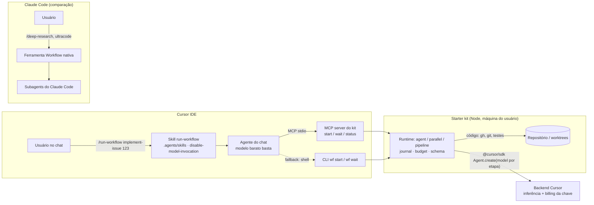

# Cursor SDK como motor de workflows determinísticos: relatório de pesquisa

> **Data:** 2026-11-11 · **Escopo:** Cursor SDK (`@cursor/sdk`), Cursor CLI headless, Cloud Agents. Comparação
> com os *dynamic workflows* do Claude Code. Viabilidade de um harness próprio, invocável do chat do Cursor IDE
> e usável em contexto empresarial.
>
> **Como foi feito**
> - `/deep-research`: 5 ângulos, 22 fontes, 25 afirmações e 3 votos adversariais por afirmação. 23 foram
>   confirmadas e 2 refutadas.
> - Leitura direta dos pacotes publicados: `@cursor/sdk@1.3.1`, que inclui `.d.ts` e README, e `cursor-sdk@1.3.1`
>   do PyPI.
> - Leitura dos repositórios oficiais `cursor/cookbook` (HEAD de 2026-11-09) e `cursor/sdk-bridge`.
> - Revisão independente do relatório e do starter kit contra os `.d.ts` do SDK, com as correções aplicadas.
>   Exemplo: a "detecção de fallback de modelo" foi retirada, porque o SDK não expõe o modelo efetivamente usado.
> - Documentação oficial de workflows do Claude Code, espelhada em
>   [`ai/docs/claude-code/workflows/workflows.md`](../../docs/claude-code/workflows/workflows.md).
> - Espelhos locais da doc do Cursor em [`docs/cursor/`](../../../docs/cursor/).
>
> **Limitação:** nesta sessão `cursor.com` estava inacessível (proxy 403/DNS). As afirmações sobre o SDK vêm do
> **pacote publicado** (a fonte mais forte, porque é o código que você vai instalar), do cookbook oficial e de
> espelhos locais da documentação (SDK de 2026-05-28; hooks e subagents de 2026-10-11).
>
> **Marcas de confiança:**
> - **[PKG]**: lido no pacote publicado.
> - **[GH]**: lido no repositório oficial.
> - **[DOC]**: espelho local da doc oficial.
> - **[S]**: resumo de busca, ainda a confirmar.
> - **[I]**: inferência minha.

---

## Resposta curta

**Dá para fazer, mas o Cursor não entrega isso pronto.** O Claude Code tem um runtime de workflows embutido:
`/deep-research` é um deles, e `ultracode` é o gatilho que faz o Claude escrever um. O Cursor **não tem um
equivalente nativo**. Não existe ferramenta "Workflow", nem DSL `pipeline`/`phase`, nem resume por journal, nem
saída estruturada validada por schema.

O que o Cursor tem é **todas as primitivas para construir esse runtime**:

- agentes criados por código, com modelo escolhido por chamada;
- streaming, cancelamento e retomada de conversa;
- custom tools no processo e MCP;
- subagents inline;
- consulta de custo por agente.

O próprio Cursor publicou um protótipo do padrão: o `dag-task-runner` do cookbook oficial. É uma skill do Cursor
que dispara um script TypeScript, e esse script executa um DAG de agentes do SDK, escolhendo o modelo pela
complexidade de cada nó.

**Recomendação:** um *starter kit* com quatro peças.

1. Um runtime pequeno em TypeScript com a mesma forma do Workflow do Claude Code: `agent`, `parallel`,
   `pipeline`, `phase`, `budget` e journal.
2. Um MCP server, para invocar os workflows do chat do Cursor.
3. Um CLI, para terminal e CI.
4. Skills do Cursor para rodar, escrever e **converter** fluxos de skills e subagents em workflows.

A [pasta `starter-kit/`](starter-kit/README.md) traz esse esqueleto. O typecheck passa contra o
`@cursor/sdk@1.3.1` real e há testes offline do controle de fluxo. **Ele ainda não foi executado contra a API
do Cursor.**

---

## 1. O que é um "workflow" no Claude Code (a referência)

A doc oficial ([`workflows.md`](../../docs/claude-code/workflows/workflows.md)) define bem o que muda em relação
a skills e subagents. A diferença está em **quem decide o próximo passo**:

| | Subagents | Skills | Agent teams | Workflows |
|---|---|---|---|---|
| O que é | Um worker que o Claude cria | Instruções que o Claude segue | Um líder supervisionando pares | **Um script que o runtime executa** |
| Quem decide o que roda a seguir | Claude, turno a turno | Claude, seguindo o prompt | O líder, turno a turno | **O script** |
| Onde ficam os resultados intermediários | Contexto do Claude | Contexto do Claude | Lista de tarefas compartilhada | **Variáveis do script** |
| O que é repetível | A definição do worker | As instruções | A definição do time | **A própria orquestração** |
| Interrupção | Reinicia o turno | Reinicia o turno | Teammates continuam | **Retomável na mesma sessão** |

### 1.1 Anatomia

Um workflow é um arquivo `.js` com `export const meta = {name, description, phases}` seguido de um corpo com
`await` no nível de topo. O que segue foi lido no script do `/deep-research` que rodou nesta pesquisa e na
referência de autoria de workflows (skill `workflow-authoring` do Claude Code). `budget`, `isolation: 'worktree'`
e `workflow(name)` aparecem nessa referência, não na página pública de workflows:

- `agent(prompt, {schema, model, effort, label, phase, isolation: 'worktree', agentType})`: cria um subagent.
  - Com `schema`, o subagent é **forçado** a responder pela tool StructuredOutput, validada com até 5 tentativas.
  - Devolve `null` se o subagent morrer.
- `parallel(thunks)` é uma barreira. `pipeline(items, ...stages)` não tem barreira: cada item avança sozinho.
- `phase()` e `log()` alimentam o progresso. `args` é a entrada. `budget` é o teto de tokens do turno.
- `workflow(name)` chama outro workflow, com um nível de aninhamento.
- O runtime:
  - roda o script isolado, sem filesystem, `import()`, `Date.now()` ou `Math.random()`, para garantir o resume;
  - limita a 16 agentes concorrentes e 1.000 por run;
  - grava um journal que torna o run **retomável**.
- Workflows salvos ficam em `.claude/workflows/` (projeto) ou `~/.claude/workflows/` (usuário), ou vêm em
  plugins, e viram `/<nome>`.
- `ultracode` é só o gatilho: faz o Claude escrever um workflow para a tarefa em vez de trabalhar turno a turno.

### 1.2 Por que isso resolve o problema descrito

O pedido é "garantir a execução completa sem depender de o modelo inferir quando cada passo roda, e permitir
modelos menores". No workflow, o **controle de fluxo é código**. Cada agente recebe uma tarefa pequena, fechada e
com schema, e tarefas assim são justamente as que modelos menores executam bem. O modelo grande fica só onde
agrega: planejamento difícil e revisão.

---

## 2. O que o Cursor SDK oferece (nov/2026)

### 2.1 Pacotes e runtimes

- **TypeScript:** `npm i @cursor/sdk`. Requer Node ≥ 22.13. Versão 1.3.1 de 2026-11-03, em beta pública desde
  2026-04-29. [PKG][DOC]
- **Python:** `pip install cursor-sdk`, com clientes síncrono e assíncrono. A versão sai do mesmo commit do TS,
  porque a wheel embute a *bridge* local. [PKG]
- **Bridge** `cursor/sdk-bridge`: servidor local Connect/gRPC (`sdk.v1`) que expõe o SDK para outras
  linguagens. Há um adapter Perl de exemplo. [GH]
- **Runtimes:** `Agent.create({ local: {cwd} })` roda o loop do agente na máquina. `{ cloud: {repos} }` roda
  numa VM da Cursor, num pool self-hosted ou num worker *My Machines*. **A inferência é sempre hospedada pela
  Cursor**: "local" só define onde o loop roda. [PKG][DOC]

### 2.2 API essencial [PKG]

```ts
import { Agent, Cursor } from "@cursor/sdk";

const agent = await Agent.create({
  model: { id: "composer-2" },              // obrigatório no local
  local: { cwd: process.cwd(), settingSources: ["project"] },
});
const run = await agent.send("Explique este projeto.", { model: { id: "auto-low" } }); // modelo por chamada
for await (const ev of run.stream()) { /* system | assistant | tool_call | thinking | status | usage ... */ }
const result = await run.wait();             // { status, result: string, model, usage, durationMs, git }
const cost = await agent.getUsage();         // { usage: {totalTokens...}, cost: { chargedCents, rawCostCents } }
```

Ainda segundo o pacote [PKG]:

- **Retomar e cancelar:** `Agent.resume(id)`, `run.cancel()`, `run.steer(text)`, `agent.summarize()`.
- **Busy:** só uma run ativa por agente; uma segunda lança `AgentBusyError`.
- **Escolha de modelo:** `ModelSelection { id, params?, maxMode? }` vale em `create`, em cada `send` e em cada
  subagent inline (`agents: { nome: { description, prompt, model } }`). `Cursor.models.list()` mostra o que o
  plano libera.
- **Tools e MCP:**
  - `mcpServers` aceita stdio e http/sse com OAuth.
  - `tools` e `disallowedTools` são allowlist e denylist das tools nativas.
  - `local.customTools` são callbacks no processo, expostos como o MCP server `custom-user-tools` e **sem pedido
    de aprovação**.
  - `resourceProviderOptions` troca os executores de Read, Write, Shell e Delete.
  - `sandboxOptions` e `autoReview` também estão disponíveis.
- **Contexto do projeto é opt-in no local.** `local.settingSources: ["project","user","team","mdm","plugins","all"]`
  controla se `AGENTS.md`, `.cursor/rules`, skills e hooks entram. Na nuvem, `project`, `team` e `plugins` estão
  sempre ligados.
- **Sem saída estruturada.** `RunResult.result` é `string`, e o `outputSchema` das custom tools é "puramente
  descritivo: os resultados não são validados contra ele". É a maior lacuna em relação ao `agent({schema})` do
  Claude Code.
  - Contorno usado no kit: uma custom tool `submit_result` cujo `inputSchema` é o schema. O callback valida com
    Ajv e devolve erro para o modelo corrigir.
  - Com a allowlist de tools, inclua `"mcp"`, senão a tool não aparece para o modelo.
- **Erros:** `RateLimitError` (429) cobre "too many requests" **e** "usage limits exceeded".
  `ConfigurationError` cobre modelo inválido e violação de política. `AuthenticationError` cobre 401.

### 2.3 Primitivas vizinhas no ecossistema Cursor

| Peça | O que é | Papel no tema |
|---|---|---|
| `cookbook/sdk/dag-task-runner` [GH] | Skill + runner TS. O agente pai escreve um DAG em JSON e o runner executa por ranks topológicos com `Promise.all`. Cada nó tem complexidade HIGH, MED ou LOW, mapeada para um modelo (exemplos oficiais: `gpt-5.3-codex`, `composer-2`, `auto-low`). Tem timeout, cancelamento e progresso ao vivo num Canvas | **Prova do padrão.** Só que o *plano* (o DAG) continua escrito pelo modelo, e não há schema, journal nem teto de custo |
| Hooks `stop`/`subagentStop` com `followup_message` e `loop_limit` [DOC] | Reenviam automaticamente uma mensagem de "continue" até um teto (default 5) | Determinismo **fraco** dentro do chat: força continuar, mas o modelo ainda decide o que fazer |
| `subagentStart` (allow/deny), `sessionStart`/`postToolUse` com `additional_context` [DOC] | Governança e injeção de contexto | Bloqueiam ou orientam delegações, mas não ordenam etapas |
| Cursor CLI `agent -p --model X --output-format stream-json --force` [DOC] | Agente headless, chamável por shell | Alternativa ao SDK como motor de cada etapa, com menos controle (sem custom tools, só JSON de envelope) |
| Cloud Agents API `/v1` + Automations [DOC][S] | Agentes na nuvem por REST, com gatilhos (cron, webhook, GitHub, Linear) | Para fluxos **disparados por evento** (ex.: issue rotulada). Cobrança como cloud agent |
| `@cursor/bdk` (*agents-as-code*) [PKG] | Framework de deploy de bots (`defineAgent`, `tools/`, `skills/`, `subagents/`, `schedules/`, `evals/`) "por trás do Bugbot" | É o equivalente mais próximo de "agente salvo e reutilizável", mas é um bot implantado, não um runtime chamado do chat |

---

## 3. Comparação 1:1: Workflow do Claude Code × Cursor

| Capacidade | Claude Code (nativo) | Cursor SDK (nativo) | Como o starter kit cobre |
|---|---|---|---|
| Ferramenta "Workflow" / `ultracode` | Sim | **Não** | MCP `start_workflow` + skill `/run-workflow` |
| `agent()` | Subagent com modelo, effort e tipo | `Agent.create` + `send` + `wait` | `ctx.agent()` |
| `parallel()` / `pipeline()` / `phase()` | Sim | Não; `Promise.all` manual | `ctx.parallel` / `ctx.pipeline` / `ctx.phase` |
| Modelo por etapa | `opts.model` (+ substituição pela allowlist da org) | `ModelSelection` em create/send/subagent. No local, o SDK valida o ID contra o catálogo da conta e falha se não existir. `RunResult.model` devolve o **pedido**, então uma substituição feita pelo servidor não é visível | `opts.model` por etapa; ID inválido faz a etapa falhar |
| Saída estruturada | `schema` forçado e validado (5 tentativas) | **Não** | Tool `submit_result` + Ajv + re-prompt na mesma conversa |
| Resume | Journal automático por prefixo | `Agent.resume` só retoma a *conversa* | Journal por hash de prompt e opções (`--resume <runId>`) |
| Isolamento de escrita | `isolation: 'worktree'` | Não (a CLI tem `-w`) | O workflow cria `git worktree` e passa em `cwd` |
| Teto de custo | `budget` (tokens do turno) + aviso "Large workflow" | `getUsage()` em centavos; `RateLimitError` no teto da conta | `--max-cents` / `--max-tokens`; aborta o run |
| Concorrência | 16 por padrão, 1.000 agentes por run | Não documentada | Semáforo (default 4) |
| Cache de prompt | Irmãos com mesmo modelo, tools, schema e cwd compartilham o prefixo; o runtime os escalona para ler o cache (`CLAUDE_CODE_WORKFLOW_PREFIX_STAGGER_MS`); TTL 5 min ou 1 h | Automático e sem controle no SDK; só medido (`cacheReadTokens`/`cacheWriteTokens`) [PKG]. Relato de que irmãos não compartilham prefixo [S] | Mede `cacheHitRatio`; prefixo estável; contexto mínimo por etapa; **memo** entre runs para etapas de leitura |
| Aprovação | Prompt por run conforme o modo; regras `Workflow(<nome>)` | Local roda tools **sem aprovação** por padrão; sandbox, autoReview e hooks são opcionais | Allowlist de tools por etapa + hooks do projeto (`settingSources`) |
| Contexto do projeto | CLAUDE.md injetado nos agentes | Opt-in via `settingSources` | O engine liga `["project","team","mdm"]`; instruções em `AGENTS.md` |
| Progresso | `/workflows` (TUI) | Stream de eventos | Arquivo de job + `wait_workflow` / `wf wait` |
| Salvar e distribuir | `.claude/workflows/`, `~/.claude/workflows/`, plugin `workflows/` | — | `workflows/` do kit + `.agents/workflows/` do repositório (este vence em nome repetido) |
| Script isolado (sem fs/rede) | Sim | — | **Não**: roda em Node normal, o que é mais poderoso (git, gh, testes no próprio script) e exige disciplina para o resume |

---

## 4. Como invocar de dentro do Cursor IDE



| Caminho | Como funciona | Prós | Contras |
|---|---|---|---|
| **MCP server** (recomendado) | `.cursor/mcp.json` sobe `src/mcp-server.ts`. Tools `start_workflow` → `jobId`; `wait_workflow` espera ≤ 50 s por chamada | Descoberta pelo agente (`whenToUse`), sem depender do shell, funciona também no Claude Code | O job morre se o Cursor reiniciar o servidor MCP (o resume pelo journal reduz o dano). O timeout de chamada de tool MCP no Cursor **não é documentado**, daí o start/wait |
| **CLI pelo shell do agente** | `npm run wf -- start ...` e `wf wait <id> --timeout 240` | Processo destacado sobrevive ao chat; serve igual em CI | Fórum relata timeout de ~300 s no shell do agente [S]; exige aprovação de comando conforme o modo |
| **Skill explícita** | `/run-workflow` com `disable-model-invocation: true` [DOC] | O usuário dispara; o modelo não "decide" se roda | A skill só instrui; quem executa é o MCP ou o CLI |
| **Hooks** | `stop` com `followup_message` | Sem infraestrutura | Não ordena etapas nem troca modelos: determinismo fraco |
| **Cloud / Automations** | Gatilho por label de issue → cloud agent | Sem máquina local | Cada cloud agent é um agente só; para multi-etapa, ponha o runtime numa Action/worker que chame o SDK |

**Custo do polling:** cada `wait_workflow` é uma chamada de tool do agente do chat e consome tokens do modelo do
chat. Use um modelo barato no chat que dispara o workflow e esperas longas (45–50 s por chamada, ou `wf wait`
com timeout maior).

---

## 5. Autenticação e billing no contexto empresarial

| Opção | Como | Debita de quem | Observações |
|---|---|---|---|
| **Login do SDK pelo usuário** (recomendado) | `npm run wf -- login` → `Cursor.auth.login()` abre o navegador e cria uma **chave de usuário nomeada, com validade de 90 dias**, em `~/.cursor/sdk/auth.json` [PKG] | A conta do próprio usuário ("user keys bill the user" [DOC]) | Uma vez por máquina. O MCP server, iniciado pelo IDE como processo do usuário, lê o mesmo arquivo. **O arquivo fica em texto puro** |
| Chave de usuário do dashboard | `CURSOR_API_KEY` no ambiente ou `${env:CURSOR_API_KEY}` no `mcp.json` | A conta do usuário | Bom para quem não quer login por navegador |
| Service account (Enterprise) | Chave da conta de serviço | **O time** ("service-account keys bill the team" [DOC]) | Ideal para CI e Automations. Perde a atribuição por usuário. `SDKUser.userId` vem indefinido [PKG] |
| Chave Team Admin | — | — | **Não aceita** pelo SDK [S, confirmado 3-0] |
| Ler o token da IDE ou da CLI | Keychain `cursor-access-token` ou `~/.cursor/auth.json` | — | **Não suportado**: o SDK não lê esses lugares [PKG], e esses locais só aparecem em relatos de fórum. Não use: é frágil e é ruim para segurança e conformidade |

**Como o uso conta:**

- O uso aparece com a tag **SDK** no dashboard de uso; chaves de usuário cobram o usuário e de service account
  cobram o time. [DOC]
- Que as runs locais seguem **as mesmas regras de plano, pools e Privacy Mode do IDE** vem de um resumo da página
  do SDK, sem espelho local. [S]
- `getUsage().cost.chargedCents` traz o valor cobrado e é **0 para uso incluído no plano** [PKG]. Por isso o kit
  também aceita teto por tokens.
- O `RateLimitError` do SDK (429) cita "usage limits exceeded" [PKG]. O kit converte o não retentável em falha
  explícita do workflow. Se o teto da conta aparece como exceção ou como run com `status: "error"` não foi
  verificado [I]; nos dois casos a etapa falha.
- Modelos de terceiros em Teams e Enterprise pagam a Cursor Token Rate. N agentes em paralelo custam ~N vezes os
  tokens. [DOC]
- Para subagents do IDE, a doc diz que um modelo bloqueado pelo admin ou pelo plano **cai em outro sem erro**
  [DOC]. No SDK local, um ID fora do catálogo da conta faz a run falhar ("Cannot use this model") [PKG]. Uma
  substituição feita pelo servidor não aparece em `RunResult.model`, que devolve o modelo pedido [PKG].
- Os limites de gasto do time e por membro ficam no dashboard e na Admin API. **Pergunta em aberto:** confirmar
  com o admin que o uso da chave de usuário do SDK entra no mesmo limite individual em dólares do IDE.

**Governança disponível:**

- Hooks Enterprise (MDM) e Team. Um deny em qualquer fonte vence. O cookbook traz hooks de auditoria e de
  bloqueio de modelo por repositório. [DOC][GH]
- Políticas do admin para MCP, rede e tools: um comentário interno do SDK sugere que valem nas runs locais, mas
  não há doc pública. [I]
- Pools self-hosted mantêm checkout e execução na sua infraestrutura, mas a **inferência continua na Cursor**. [GH]

### 5.1 Custos e cache: o que dá para controlar

O detalhamento, com checklist, está em
[`starter-kit/docs/08-custos-e-cache.md`](starter-kit/docs/08-custos-e-cache.md). Em resumo:

- **O cache de prompt do Cursor não é configurável pelo SDK** [PKG]. Ele é automático, e cache read custa cerca de
  5× menos que input no modo Auto [S]. O que está ao alcance do workflow é favorecê-lo:
  - instruções fixas no começo do prompt, dados no fim;
  - um agente por etapa (conversa curta);
  - re-prompts na mesma conversa.
- **A maior economia é não chamar o modelo:** decisões objetivas em código, etapas condicionais, journal no resume
  e **memo** (`memo: true`), que reaproveita o resultado de etapas de leitura entre runs enquanto o repositório não
  muda.
- **O contexto fixo é pago em toda chamada.** A camada `project` carrega descrições de skills, regras e tools do MCP
  do projeto. A camada `user` traz os subagents e skills pessoais, com relatos de cerca de 10 mil tokens a mais
  por conversa [S]. A tool `task` lista todos os subagents [S]. O kit permite `settingSources` e `tools` por etapa
  para cortar isso.
- **Skills e subagents no IDE custam contexto fixo repetido.** A cada delegação, o subagent paga o contexto fixo
  de novo e roda no modelo herdado. Convertidos em workflow, viram etapas com modelo, tools e contexto mínimos. Por
  isso a `/skill-to-workflow` tem uma etapa **obrigatória** de otimização de custo, com estimativa por caminho.

---

## 6. Paridade Cursor × Claude Code (para um harness portátil)

| Eixo | Claude Code | Cursor | Lacuna e tratamento |
|---|---|---|---|
| Caminho de instalação | `.claude/workflows/`, `~/.claude/workflows/`, plugin `workflows/`; subagents em `.claude/agents/` | Sem pasta de workflows. Subagents em `.cursor/agents/`, com leitura também de `.claude/agents/` e `.codex/agents/` [DOC] | O kit traz `workflows/` + `.agents/workflows/`, `.agents/skills/`, `.cursor/mcp.json` e `.mcp.json`. O MCP server serve aos dois |
| Eventos de hook | `PreToolUse` pode aprovar `Workflow`; agentes do workflow seguem regras de permissão | `stop`, `subagentStart`, `subagentStop`, `sessionStart`, `postToolUse`, `beforeMCPExecution` etc. Hooks do Claude Code também são carregados, com `loop_limit` `null` em vez de 5 [DOC]. Em cloud não disparam `sessionStart`, `sessionEnd` nem os hooks de MCP | Nas runs do SDK, hooks só com `settingSources` e sem `fs` [PKG]. Uma nota de release diz que um deny de `PreToolUse` do Claude Code bloqueia agentes locais [S]. Se os hooks do Claude Code valem dentro das runs do SDK não foi verificado [S] |
| Como o contexto chega | CLAUDE.md injetado em todo subagent do workflow | `AGENTS.md` + `.cursor/rules` só com `settingSources: ["project"]`. `additional_context` via hooks | O engine liga `project`, `team` e `mdm`; instruções em `AGENTS.md` (o `CLAUDE.md` do kit só faz `@AGENTS.md`). Prompts de etapa autocontidos |
| MCP | Agentes do workflow alcançam o MCP da sessão via ToolSearch | `mcpServers` por create/send. Local: send → create → plugins → `.cursor/mcp.json` → `~/.cursor/mcp.json`. Cloud: servidores do time [DOC] | Passe `mcpServers` por etapa quando a etapa precisar |
| Saída estruturada | Nativa | Ausente | `submit_result` (só local; custom tools não rodam em cloud) |
| Modelos | Aliases (`sonnet`, `opus`, `haiku`) + IDs | IDs do Cursor (`composer-2`, `auto-low`, modelos de terceiros) via `models.list()` | Mapa de tier por ambiente (`WF_MODEL_*`) |
| Pasta neutra `.agents/` | **Não lê nada** sob `.agents/`; lê `AGENTS.md` só se não houver `CLAUDE.md` [DOC] | Skills em `.agents/skills/` e `~/.agents/skills/` são nativas [DOC] e também carregadas pelas runs do SDK (first-party no bundle) [PKG]. Subagents não têm `.agents/agents/` [DOC] | Skills do kit em `.agents/skills/`; `scripts/link-claude-skills.sh` cria links em `.claude/skills/` para o Claude Code (o Cursor pode listar duas vezes). Instruções em `AGENTS.md` + `CLAUDE.md` com `@AGENTS.md` |

---

## 7. Exemplos existentes (o que há de concreto)

| Projeto | O que mostra | Observação |
|---|---|---|
| [`cursor/cookbook`](https://github.com/cursor/cookbook) `sdk/dag-task-runner` | Orquestração por código, modelo por complexidade, skill que dispara o runner | Oficial e o melhor ponto de partida conceitual |
| `cursor/cookbook` `sdk/quickstart`, `app-builder`, `agent-kanban`, `coding-agent-cli`, `hooks/` | Uso local e cloud, UI de cloud agents, hooks de auditoria e bloqueio | Oficial |
| [`cursor/sdk-bridge`](https://github.com/cursor/sdk-bridge) | Protocolo `sdk.v1` para outras linguagens | Oficial |
| [`6e6p1k/cursor-agents-mcp`](https://github.com/6e6p1k/cursor-agents-mcp) | MCP server para o **Claude Code** delegar trabalho a agentes do Cursor SDK (spawn, follow_up, steer, jobs destacados) | Terceiro. Confirma que o login do SDK é separado do login da CLI |
| [`tuannvm/cursor-demo`](https://github.com/tuannvm/cursor-demo) | GitHub Actions: issue com label `ready-to-implement` → `cursor-agent -p` → PR draft | Pequeno, arquivado e com modelo fixo. Serve de esqueleto para CI |
| `@ai-sdk/harness-cursor` (Vercel), `@traceai/cursor-sdk`, `pi-cursor-sdk` | Integrações e observabilidade | Terceiros |

Não encontrei um orquestrador de terceiros maduro que faça **roteamento de modelo por label com review
condicional** sobre o Cursor SDK. Esse é o espaço que o starter kit ocupa.

---

## 8. O que foi refutado e o que segue incerto

**Refutado na verificação adversarial:**

- "No Cursor, o modelo pai decide sozinho se delega a um subagent; só `/nome` força." (1-2) Não use isso como
  premissa absoluta.
- "O SDK não tem nenhum controle programático de tools." (0-3) A versão 1.3.1 tem allowlist e denylist de tools,
  custom tools, troca de executores (`resourceProviderOptions`), sandbox e autoReview.

**Incertezas para validar no seu ambiente antes de produção:**

1. Se o uso da chave de usuário do SDK entra no **limite individual em dólares** do membro, como o uso do IDE.
2. O timeout de uma chamada de tool MCP no Cursor IDE (o kit evita depender disso com start/wait).
3. Se os hooks do projeto disparam nas runs locais do SDK com `settingSources: ["project"]`.
4. Se uma política de modelo do admin gera erro ou substituição silenciosa do lado do servidor nas runs do SDK.
   A substituição não seria visível: `RunResult.model` devolve o modelo pedido.
5. O limite prático de agentes simultâneos por usuário (a doc só diz "rate limits por time, por minuto"). Comece
   com concorrência 2–4.
6. Se o Cursor deduplica uma skill que aparece em `.agents/skills/` e em `.claude/skills/` ao mesmo tempo (relevante
   para quem usa o script de links para o Claude Code).
7. Se o teto de uso da conta chega como `RateLimitError` ou como run com `status: "error"`.

---

## 9. Recomendação

1. **Adote o padrão "runtime em código + MCP + skill explícita"** ([starter kit](starter-kit/README.md)). É o
   único caminho que entrega, ao mesmo tempo, ordem garantida, modelo por etapa, verificação por código, teto de
   custo e invocação pelo chat.
2. **Autenticação por `wf login` do próprio usuário.** O uso fica na conta dele, coerente com o orçamento
   individual do Enterprise. Para CI e Automations, use service account.
3. **Migre de forma incremental:** escolha um fluxo de skills e subagents que hoje "às vezes pula etapas" e rode
   `/skill-to-workflow` sobre ele. Compare custo e taxa de conclusão com teto baixo (`--max-cents`) antes de
   ampliar.
4. **Mantenha os fluxos abertos e exploratórios em skills.** Workflows servem para processos repetíveis com
   critério de pronto objetivo.

---

## Fontes

- Claude Code: *Orchestrate subagents at scale with dynamic workflows*,
  `code.claude.com/docs/en/workflows` (espelho local:
  [`ai/docs/claude-code/workflows/workflows.md`](../../docs/claude-code/workflows/workflows.md)).
- `@cursor/sdk@1.3.1` (npm): README, `dist/esm/agent/options.d.ts`, `agent.d.ts`, `run.d.ts`, `errors.d.ts`,
  `auth/*.d.ts`, `agent/usage-types.d.ts`.
- `cursor-sdk@1.3.1` (PyPI).
- `github.com/cursor/cookbook` (`sdk/dag-task-runner`, `sdk/quickstart`, `hooks/`, `self-hosted-cloud-agent/`) e
  `github.com/cursor/sdk-bridge`.
- Espelhos locais da doc do Cursor:
  - SDK/API/CLI: [`docs/cursor/sdk/cursor-agent-sdk-reference.md`](../../../docs/cursor/sdk/cursor-agent-sdk-reference.md)
    e [`docs/cursor/cli/cursor-agent-cli-reference.md`](../../../docs/cursor/cli/cursor-agent-cli-reference.md)
  - Hooks: [`docs/cursor/hooks/hooks-guide.md`](../../../docs/cursor/hooks/hooks-guide.md)
  - Subagents: [`docs/cursor/subagents/subagents-guide.md`](../../../docs/cursor/subagents/subagents-guide.md)
  - Skills: [`docs/cursor/skills/agent-skills-guide.md`](../../../docs/cursor/skills/agent-skills-guide.md)
  - MCP: [`docs/cursor/mcp/mcp-guide.md`](../../../docs/cursor/mcp/mcp-guide.md)
- Páginas oficiais citadas por resumo de busca, a confirmar ao vivo: `cursor.com/docs/sdk/typescript`,
  `/docs/sdk/python`, `/docs/account/pricing`, `/docs/account/enterprise/service-accounts`,
  `/docs/cloud-agent/automations`, `/docs/cli/reference/parameters`.
- Terceiros: `6e6p1k/cursor-agents-mcp`, `tuannvm/cursor-demo`, `fitchmultz/pi-cursor-sdk`,
  `@ai-sdk/harness-cursor`.
