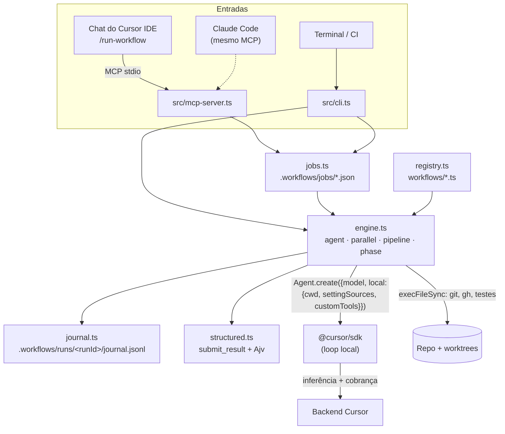

# 03 · Arquitetura

## Visão geral

## Ciclo de uma etapa (`ctx.agent`)

1. **Chave do journal:** `sha256(prompt + {model, schema, cwd, tools, agents})` mais o número da ocorrência.
   - Se a chave já estiver no journal, devolve o resultado salvo sem chamar a API.
2. **Teto:** se `spentCents ≥ maxCents` ou `spentTokens ≥ maxTokens`, lança `BudgetExceededError`.
3. **Agente novo:** `Agent.create` com o modelo da etapa, a allowlist de tools, os subagents e MCP servers
   inline, e `settingSources: ["project","team"]`.
   - Com `schema`, registra a custom tool `submit_result` e garante `"mcp"` na allowlist.
4. **Run:** `send(prompt)` e `wait()` com timeout. Ao estourar o timeout, chama `run.cancel()`.
5. **Schema:** se a run terminou e o agente não chamou `submit_result` com JSON válido, o engine reenvia o
   pedido na mesma conversa (`schemaRetries`, default 2). O Ajv valida dentro do `execute()`, e o erro volta para
   o modelo corrigir.
6. **Custo:** `agent.getUsage()` soma `chargedCents` e `totalTokens`.
7. **Modelo:** compara `RunResult.model.id` com o pedido. Se divergir, emite `warning`; com `strictModel`, falha.
8. **Sucesso:** grava no journal e devolve o valor.
9. **Falha** (status `error`/`cancelled`, schema não entregue): repete até `retries` (default 1) com um agente
   novo e então lança `StepFailedError`.
10. **`RateLimitError` não retentável** (teto da conta): vira `BudgetExceededError`.

## O que o runtime garante

| Garantia | Mecanismo |
|---|---|
| Toda etapa do código roda, na ordem do código | O fluxo é TypeScript; não há "o modelo decidiu pular" |
| Etapa concluída tem saída no formato esperado | `submit_result` + Ajv + re-prompt; senão a etapa falha |
| Falha é explícita | `agent()` lança erro. `parallel`/`pipeline` transformam a falha de um item em `null` e registram `warning`, mas o teto de custo sempre aborta |
| O modelo de cada etapa é o escolhido, ou você fica sabendo | Comparação com `RunResult.model` |
| Gasto limitado | Teto por run + `RateLimitError` |
| Retomar sem repetir etapas | Journal |

## O que ele não garante

- **Qualidade da etapa.** Um modelo pequeno pode entregar um JSON válido e errado. Por isso as verificações
  objetivas (testes, lint, diff) ficam no código, e as etapas críticas ganham review.
- **Determinismo do modelo.** Dois runs podem gerar código diferente. O determinismo está no *processo*.
- **Isolamento de segurança.** As runs locais executam tools sem aprovação. Veja
  [07 · Governança](07-governanca-e-custos.md).
- **Sobreviver a reinício do MCP server.** O job em andamento morre junto. Relance com `--resume <runId>` (CLI);
  o journal evita refazer o que já terminou. Para runs longos, use `wf start`, que roda destacado.
- **Pausar para perguntar ao humano.** Igual ao Claude Code: divida em dois workflows ou receba a decisão por
  `args`.

## Diferenças deliberadas em relação ao Claude Code

| Tema | Claude Code | Este kit | Motivo |
|---|---|---|---|
| Sandbox do script | Isolado (sem fs, rede, `Date.now`) | Node completo | Permite `git`, `gh` e testes no próprio workflow, sem gastar tokens. Em troca, a disciplina de determinismo é sua |
| Chave de resume | Maior prefixo inalterado na ordem de início | Hash de prompt e opções + ocorrência | `pipeline` muda a ordem de conclusão; o hash tolera isso |
| `agent()` com falha | Devolve `null` | **Lança erro** | "Garantir execução completa": falha precisa ser visível. Em `parallel`/`pipeline` vira `null`, como no Claude Code |
| Concorrência | 16 | 4 (configurável) | O Cursor não documenta o rate limit por usuário |
