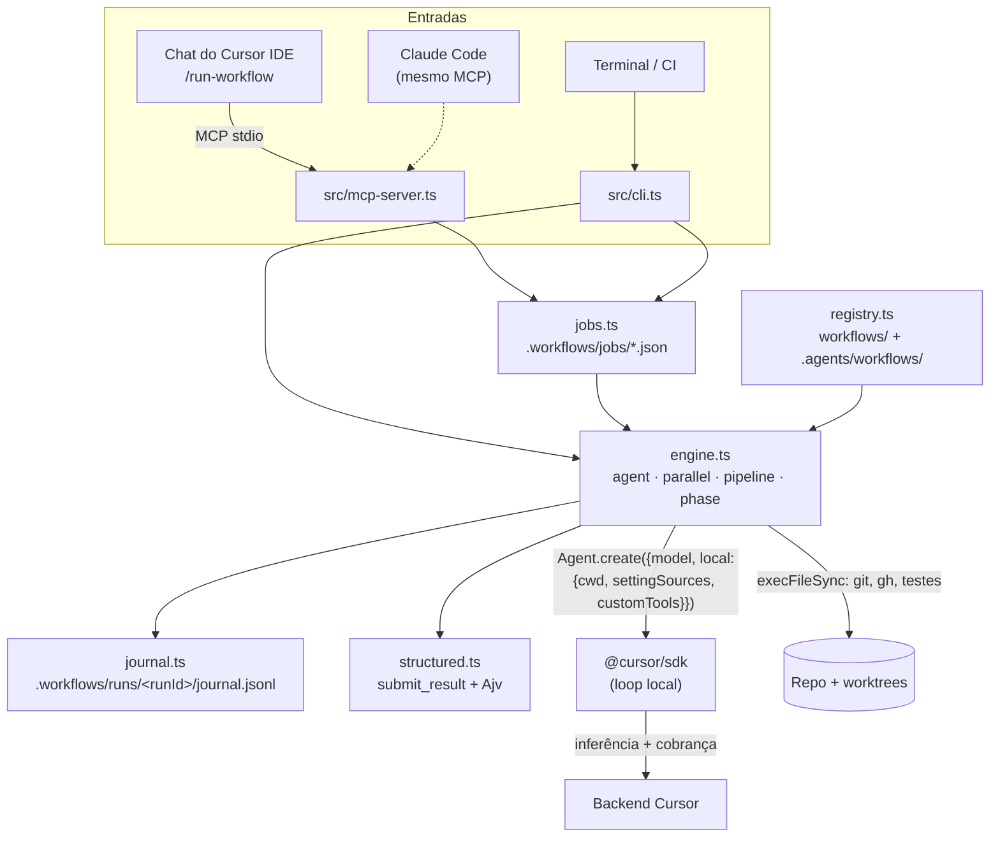

# 03 · Arquitetura

## Visão geral

## Ciclo de uma etapa (`ctx.agent`)

0. **Antes do run:** `args` são validados contra `meta.argsSchema` (Ajv), e o ambiente recebe
   `WF_INSIDE_WORKFLOW=1`, para que MCP servers e shells iniciados pelas etapas não disparem outro workflow.
1. **Chave do journal:** `sha256(prompt + {model, schema, cwd, tools, agents, settingSources})` mais o número da
   ocorrência.
   - Se a chave já estiver no journal, devolve o resultado salvo sem chamar a API.
   - Com `memo: true` (só etapas de leitura), consulta também `.workflows/memo/`, com chave na etapa e no estado do
     repositório (HEAD + mudanças locais + arquivos novos). Um acerto vale entre runs diferentes.
2. **Validação local:** etapa sem modelo, ou com `schema` cuja raiz não é `type: "object"`, falha antes de criar
   o agente.
3. **Teto** (antes de cada tentativa): se `spentCents ≥ maxCents` ou `spentTokens ≥ maxTokens`, lança
   `BudgetExceededError`.
4. **Agente novo:** `Agent.create` com o modelo da etapa, a allowlist de tools, os subagents e MCP servers
   inline, o sandbox (se pedido) e `settingSources: ["project","team","mdm"]`.
   - Com `schema`, registra a custom tool `submit_result` e garante `"mcp"` na allowlist.
   - O SDK valida o modelo contra o catálogo da conta; um ID inválido faz a etapa falhar ("Cannot use this
     model").
5. **Run:** `send(prompt)` (tolera `AgentBusyError` com espera curta) e `wait()` com timeout. Ao estourar o
   timeout, o engine **aguarda** `run.cancel()` antes de seguir, para a próxima tentativa não editar o mesmo cwd
   em paralelo.
6. **Schema:** se a run terminou e o agente não chamou `submit_result` com JSON válido, o engine reenvia o
   pedido na mesma conversa (`schemaRetries`, default 2). O Ajv valida dentro do `execute()`, e o erro volta para
   o modelo corrigir.
7. **Custo:** `agent.getUsage()` soma `chargedCents` e os tokens por tipo (input, output, cache read, cache
   write), também quando a tentativa falha ou estoura o tempo, e tenta de novo se o custo ainda não chegou. O
   resultado do run traz `usage.cacheHitRatio`.
8. **Sucesso:** grava no journal e devolve o valor.
9. **Falha** (status `error`/`cancelled`, timeout, schema não entregue): repete até `retries` (default 1) com
   um agente novo e então lança `StepFailedError`. `RateLimitError` retentável espera com backoff exponencial;
   o não retentável (teto da conta) vira `BudgetExceededError`.
10. **Descarte:** o agente é fechado com `await agent[Symbol.asyncDispose]()`, como no cookbook oficial.

## O que o runtime garante

| Garantia | Mecanismo |
|---|---|
| Toda etapa do código roda, na ordem do código | O fluxo é TypeScript; não há "o modelo decidiu pular" |
| Etapa concluída tem saída no formato esperado | `submit_result` + Ajv + re-prompt; senão a etapa falha |
| Falha é explícita | `agent()` lança erro. `parallel`/`pipeline` transformam a falha de um item em `null` e registram `warning`, mas o teto de custo sempre aborta |
| O modelo de cada etapa é o do código, e um ID não liberado falha | Validação do SDK contra o catálogo da conta |
| Gasto limitado (com folga de até concorrência × uma etapa) | Teto por run + `RateLimitError` |
| Retomar sem repetir etapas | Journal + `runId` gravado no job desde o início |
| Workflow não dispara workflow | `WF_INSIDE_WORKFLOW` + recusa no MCP server e no CLI |

## O que ele não garante

- **Qualidade da etapa.** Um modelo pequeno pode entregar um JSON válido e errado. Por isso as verificações
  objetivas (testes, lint, diff) ficam no código, e as etapas críticas ganham review.
- **Determinismo do modelo.** Dois runs podem gerar código diferente. O determinismo está no *processo*.
- **Que o modelo que rodou é o pedido.** Substituição por política do admin, do lado do servidor, não é visível
  ao SDK (`RunResult.model` devolve o pedido).
- **Isolamento de segurança.** As runs locais executam tools sem aprovação. Veja
  [07 · Governança](07-governanca-e-custos.md).
- **Sobreviver a reinício do MCP server.** O job em andamento morre junto e, na próxima consulta, aparece como
  `failed` com o `runId` (o pid gravado no job não existe mais). Relance com `start_workflow {resumeRunId}` ou
  `wf run --resume <runId>`; o journal evita refazer o que já terminou. Para runs longos, use `wf start`, que roda
  destacado e grava o log em `.workflows/jobs/<jobId>.log`.
- **Imunidade a promises rejeitadas do SDK.** O cookbook avisa que o SDK dispara promises não aguardadas na
  inicialização. O kit instala `unhandledRejection` (registra e segue) e `uncaughtException` (marca os jobs
  ativos como `failed` e sai).
- **Pausar para perguntar ao humano.** Igual ao Claude Code: divida em dois workflows ou receba a decisão por
  `args`.

## Diferenças deliberadas em relação ao Claude Code

| Tema | Claude Code | Este kit | Motivo |
|---|---|---|---|
| Sandbox do script | Isolado (sem fs, rede, `Date.now`) | Node completo | Permite `git`, `gh` e testes no próprio workflow, sem gastar tokens. Em troca, a disciplina de determinismo é sua |
| Chave de resume | Maior prefixo inalterado na ordem de início | Hash de prompt e opções + ocorrência | `pipeline` muda a ordem de conclusão; o hash tolera isso |
| `agent()` com falha | Devolve `null` | **Lança erro** | "Garantir execução completa": falha precisa ser visível. Em `parallel`/`pipeline` vira `null`, como no Claude Code |
| Concorrência | 16 | 4 (configurável) | O Cursor não documenta o rate limit por usuário |
