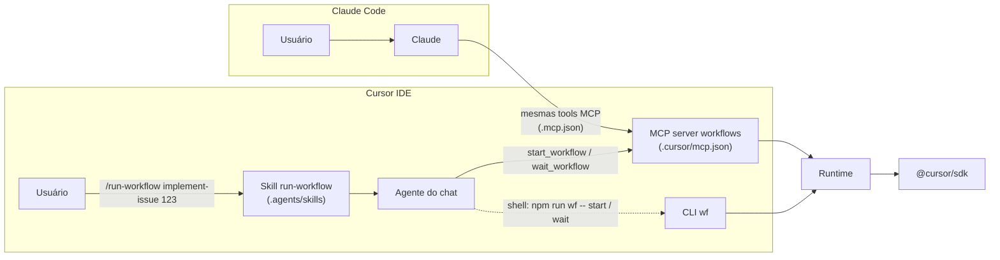

# 04 · Invocação no Cursor IDE (e no Claude Code)

## Caminhos de invocação



### 1. MCP server (principal)

O servidor `workflows` é registrado em `.cursor/mcp.json` (Cursor) e em `.mcp.json` (Claude Code). Ele expõe:

| Tool | Entrada | Saída |
|---|---|---|
| `list_workflows` | — | `name`, `description`, `whenToUse`, `phases`, `argsSchema` de cada workflow |
| `start_workflow` | `{ name, args, resumeRunId? }` | `{ jobId, runId }`. O workflow roda em segundo plano dentro do processo do servidor |
| `wait_workflow` | `{ jobId, timeoutSec ≤ 50 }` | Estado do job: `status`, `phase`, `recent` (últimos eventos), `result`, `error`, `spentCents` |
| `get_workflow_status` | `{ jobId }` | Estado, sem esperar |

**Por que start/wait e não uma tool que bloqueia até o fim?** Um workflow de implementação leva minutos, e o
Cursor não documenta o timeout de chamada de tool MCP. Com start/wait, cada chamada dura no máximo 50 s e o
agente do chat repete a espera.

**Se o servidor reiniciar no meio** (o Cursor recarrega MCP servers ao mudar a configuração, por exemplo): o job
aparece como `failed` com o `runId`. Chame `start_workflow` com o mesmo `name` e `args` e com
`resumeRunId: "<runId>"`; as etapas já concluídas saem do journal.

**Custo do polling:** cada `wait_workflow` é uma chamada de tool do agente do chat e consome tokens do modelo
que está no chat. Duas formas de reduzir:

- dispare `/run-workflow` com um modelo barato selecionado no chat (o trabalho pesado é do workflow);
- use esperas longas (`timeoutSec: 45–50`).

### 2. CLI pelo shell do agente

Fallback quando o MCP não está habilitado, e caminho preferido em CI e em runs longos:

```bash
npm run wf -- start implement-issue --args '{"issue":123}'   # processo destacado; log em .workflows/jobs/<id>.log
npm run wf -- wait <jobId> --timeout 240
```

`start` valida o nome do workflow e o JSON dos args **antes** de destacar o processo e grava o job (com `runId`)
na hora. Há relatos de timeout de cerca de 300 s no shell do agente do Cursor e de falhas em execuções headless
iniciadas quase ao mesmo tempo. Por isso `wait` usa um timeout menor que esse, e `start` roda destacado.

### 3. Skill explícita

`.agents/skills/run-workflow/SKILL.md` usa `disable-model-invocation: true`. Ela só entra no contexto quando o
usuário digita `/run-workflow`, então o modelo não decide sozinho se o workflow roda. A skill instrui o agente a
apenas disparar e acompanhar: não refazer etapas nem editar arquivos enquanto o job roda.

### 4. Hooks (complementares, opcionais)

- `beforeMCPExecution` com `failClosed: true`: auditar ou bloquear `start_workflow` por repositório ou por
  workflow.
- `stop` com `followup_message`: **não** é necessário aqui, porque o laço está no workflow. Ele serve apenas
  para fluxos que continuam em skill.

## Onde cada harness procura cada coisa

O kit usa `.agents/` como local neutro e mantém só o que é específico de cada harness em `.cursor/` e `.claude/`.

| Artefato | `.agents/` | `.cursor/` | `.claude/` | `.codex/` | Fonte |
|---|---|---|---|---|---|
| Skills: Cursor IDE | ✅ nativo (`.agents/skills/`, `~/.agents/skills/`) | ✅ nativo | ✅ compat. | ✅ compat. | doc de skills do Cursor |
| Skills: runs do Cursor SDK (`settingSources: ["project"]`) | ✅ (first-party) | ✅ | ✅ (third-party) | ✅ (third-party) | bundle do `@cursor/sdk@1.3.1` |
| Skills: Claude Code | ❌ não lê nada sob `.agents/` | ❌ | ✅ | ❌ | doc de memória do Claude Code |
| Subagents: Cursor | ❌ não documentado | ✅ | ✅ compat. | ✅ compat. | doc de subagents do Cursor |
| Subagents: Claude Code | ❌ | ❌ | ✅ | ❌ | doc de subagents do Claude Code |
| Instruções | `AGENTS.md` na raiz: lido pelo Cursor e pelas runs do SDK; o Claude Code só o lê **se não houver `CLAUDE.md`**, ou via `@AGENTS.md` | `.cursor/rules/` | `CLAUDE.md` | — | docs |
| MCP | — | `.cursor/mcp.json` | `.mcp.json` (raiz) | — | docs |
| Workflows deste kit | `.agents/workflows/` (lido pelo runtime) | — | — | — | este kit |

Consequências no kit:

- **Skills em `.agents/skills/`.** Funcionam no Cursor IDE, nas etapas dos workflows e no Codex.
  Para o Claude Code, `scripts/link-claude-skills.sh` cria links em `.claude/skills/`. A ressalva é que o Cursor
  também lê `.claude/skills/`, então a skill pode aparecer duas vezes no Cursor (a deduplicação não está
  documentada). Rode o script só se o time usa Claude Code no repositório.
- **Instruções em `AGENTS.md`.** `CLAUDE.md` contém apenas `@AGENTS.md`.
- **Subagents continuam em `.cursor/agents/` ou `.claude/agents/`.** Não há `.agents/agents/` documentado. Num
  fluxo convertido em workflow, os subagents viram etapas (`ctx.agent`) ou `agents` inline, então deixam de
  depender da pasta.

## Usar o kit em outros repositórios

Há duas formas.

**A. Copiar o kit para dentro do repositório** (mais simples). Os workflows ficam em `workflows/`, versionados
junto com o código.

**B. Instalar o kit uma vez e apontar cada repositório para ele.** No repositório alvo, crie
`.cursor/mcp.json`:

```json
{
  "mcpServers": {
    "workflows": {
      "command": "${userHome}/tools/cursor-workflows/node_modules/.bin/tsx",
      "args": ["${userHome}/tools/cursor-workflows/src/mcp-server.ts"],
      "env": { "WF_CWD": "${workspaceFolder}", "WF_MAX_CENTS": "500" }
    }
  }
}
```

Depois, copie `.agents/skills/run-workflow/` para o repositório alvo. Com o Cursor isso basta. Para o Claude Code,
replique o servidor no `.mcp.json` do repositório com caminhos absolutos.

Os workflows do repositório alvo ficam em `.agents/workflows/*.ts`. O runtime carrega essa pasta automaticamente
(além dos workflows do kit) e, em nome repetido, a do repositório vence. Escreva-os sem importar o runtime por
caminho relativo: `export default { meta, defaults, async run(ctx) { ... } }`. Imports só de tipo
(`import type ...`) são apagados pelo `tsx` e não quebram. Para ter typecheck e testes, desenvolva o workflow
dentro do kit e depois copie.

> `${workspaceFolder}` é "a pasta que contém o `.cursor/mcp.json`". Num `~/.cursor/mcp.json` global, ele não
> aponta para o projeto aberto. Por isso a forma B usa o `mcp.json` **do projeto**.

## Paridade Cursor × Claude Code

| Eixo | Cursor | Claude Code |
|---|---|---|
| Onde registrar o MCP server | `.cursor/mcp.json` (projeto) ou `~/.cursor/mcp.json` | `.mcp.json` (projeto) ou `claude mcp add` |
| Disparo explícito | Skill com `disable-model-invocation: true` (`/run-workflow`) | Idem (via `.claude/skills/`), ou chamada direta da tool MCP |
| Workflow nativo | **Não existe**. Este kit preenche a lacuna | Ferramenta `Workflow`, `/deep-research`, `ultracode`, `.claude/workflows/` |
| Como o contexto chega aos agentes das etapas | `settingSources: ["project","team","mdm"]` carrega `AGENTS.md`, `.cursor/rules`, skills, hooks e MCP do projeto | Os agentes das etapas são do Cursor mesmo quando o Claude Code dispara. O `CLAUDE.md` não é lido por eles; por isso as regras ficam em `AGENTS.md` |
| Hooks que alcançam as etapas | Hooks do projeto, do time e MDM (via `settingSources`). A doc diz que o Cursor carrega hooks do Claude Code, com `loop_limit` `null` [DOC]. Se isso vale dentro das runs do SDK não foi verificado [S] | Os hooks do Claude Code valem para a chamada da tool MCP. Nas runs do SDK, só se o Cursor os carregar (ver coluna ao lado) |
| Quem paga | A chave do Cursor usada pelo runtime | Idem: o modelo do Claude Code só paga o disparo e o polling |

> Para usar o *runtime nativo* do Claude Code em vez deste kit, escreva o fluxo como workflow do Claude Code
> (`.claude/workflows/<nome>.js`). A estrutura `meta` + `agent/parallel/pipeline/phase` é praticamente a mesma,
> então um workflow deste kit converte para lá com poucas mudanças: troque `ctx.agent` por `agent`, e passe
> `git`/`gh` para uma etapa de agente, porque o sandbox do Claude Code não tem shell.
