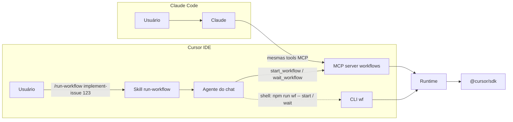

# 04 · Invocação no Cursor IDE (e no Claude Code)

## Caminhos de invocação



### 1. MCP server (principal)

O `.cursor/mcp.json` do kit registra o servidor `workflows`, que expõe quatro tools:

| Tool | Entrada | Saída |
|---|---|---|
| `list_workflows` | — | `name`, `description`, `whenToUse`, `phases`, `argsSchema` de cada workflow |
| `start_workflow` | `{ name, args }` | `{ jobId }`. O workflow roda em segundo plano dentro do processo do servidor |
| `wait_workflow` | `{ jobId, timeoutSec ≤ 50 }` | Estado do job: `status`, `phase`, `recent` (últimos eventos), `result`, `error`, `spentCents` |
| `get_workflow_status` | `{ jobId }` | Estado, sem esperar |

**Por que start/wait e não uma tool que bloqueia até o fim?** Um workflow de implementação leva minutos, e o
Cursor não documenta o timeout de chamada de tool MCP. Com start/wait, cada chamada dura no máximo 50 s e o
agente do chat repete a espera.

**Custo do polling:** cada `wait_workflow` é uma chamada de tool do agente do chat e consome tokens do modelo
que está no chat. Duas formas de reduzir:

- dispare `/run-workflow` com um modelo barato selecionado no chat (o trabalho pesado é do workflow);
- use esperas longas (`timeoutSec: 45–50`).

### 2. CLI pelo shell do agente

Fallback quando o MCP não está habilitado, e caminho preferido em CI:

```bash
npm run wf -- start implement-issue --args '{"issue":123}'   # processo destacado, sobrevive ao chat
npm run wf -- wait <jobId> --timeout 240
```

Há relatos de timeout de cerca de 300 s no shell do agente do Cursor e de falhas em execuções headless iniciadas
quase ao mesmo tempo. Por isso `wait` usa um timeout menor que esse, e `start` roda destacado.

### 3. Skill explícita

`.cursor/skills/run-workflow/SKILL.md` usa `disable-model-invocation: true`. Ela só entra no contexto quando o
usuário digita `/run-workflow`, então o modelo não decide sozinho se o workflow roda. A skill instrui o agente a
apenas disparar e acompanhar: não refazer etapas nem editar arquivos enquanto o job roda.

### 4. Hooks (complementares, opcionais)

- `beforeMCPExecution` com `failClosed: true`: auditar ou bloquear `start_workflow` por repositório ou por
  workflow.
- `stop` com `followup_message`: **não** é necessário aqui, porque o laço está no workflow. Ele serve apenas
  para fluxos que continuam em skill.

## Usar o kit em outros repositórios

Há duas formas.

**A. Copiar o kit para dentro do repositório** (mais simples). Os workflows ficam em `workflows/`, versionados
junto com o código.

**B. Instalar o kit uma vez e apontar cada repositório para ele.** No repositório alvo, crie
`.cursor/mcp.json`:

```json
{
  "mcpServers": {
    "workflows": {
      "command": "npx",
      "args": ["tsx", "${userHome}/tools/cursor-workflows/src/mcp-server.ts"],
      "env": {
        "WF_CWD": "${workspaceFolder}",
        "WORKFLOWS_DIR": "${workspaceFolder}/.cursor/workflows",
        "WF_MAX_CENTS": "500"
      }
    }
  }
}
```

Depois copie `run-workflow/` para `.cursor/skills/` do repositório.

Em B, os workflows do repositório alvo ficam em `.cursor/workflows/*.ts`. Escreva-os sem importar o runtime por
caminho relativo: `export default { meta, defaults, async run(ctx) { ... } }`. Imports só de tipo
(`import type ...`) são apagados pelo `tsx` e não quebram. Para ter typecheck e testes, desenvolva o workflow
dentro do kit e depois copie.

> `${workspaceFolder}` é "a pasta que contém o `.cursor/mcp.json`". Num `~/.cursor/mcp.json` global, ele não
> aponta para o projeto aberto. Por isso a forma B usa o `mcp.json` **do projeto**.

## Paridade Cursor × Claude Code

| Eixo | Cursor | Claude Code |
|---|---|---|
| Onde registrar o MCP server | `.cursor/mcp.json` (projeto) ou `~/.cursor/mcp.json` | `.mcp.json` (projeto) ou `claude mcp add` |
| Disparo explícito | Skill com `disable-model-invocation: true` (`/run-workflow`) | Skill ou comando com `disable-model-invocation`, ou chamada direta da tool MCP |
| Workflow nativo | **Não existe**. Este kit preenche a lacuna | Ferramenta `Workflow`, `/deep-research`, `ultracode`, `.claude/workflows/` |
| Como o contexto chega aos agentes das etapas | `settingSources: ["project","team"]` carrega `AGENTS.md`, `.cursor/rules` e skills | Os agentes deste kit são do Cursor mesmo quando o Claude Code dispara; o `CLAUDE.md` **não** é lido por eles. Mantenha as regras do repositório também em `AGENTS.md` |
| Hooks que alcançam as etapas | Hooks do projeto e do time (via `settingSources`). Hooks do Claude Code também são carregados pelo Cursor, com `loop_limit` `null` | Hooks do Claude Code **não** se aplicam às runs do Cursor SDK, só à chamada da tool MCP |
| Quem paga | A chave do Cursor usada pelo runtime | Idem: o modelo do Claude Code só paga o disparo e o polling |

> Para usar o *runtime nativo* do Claude Code em vez deste kit, escreva o fluxo como workflow do Claude Code
> (`.claude/workflows/<nome>.js`). A estrutura `meta` + `agent/parallel/pipeline/phase` é praticamente a mesma,
> então um workflow deste kit converte para lá com poucas mudanças: troque `ctx.agent` por `agent`, e passe
> `git`/`gh` para uma etapa de agente, porque o sandbox do Claude Code não tem shell.
