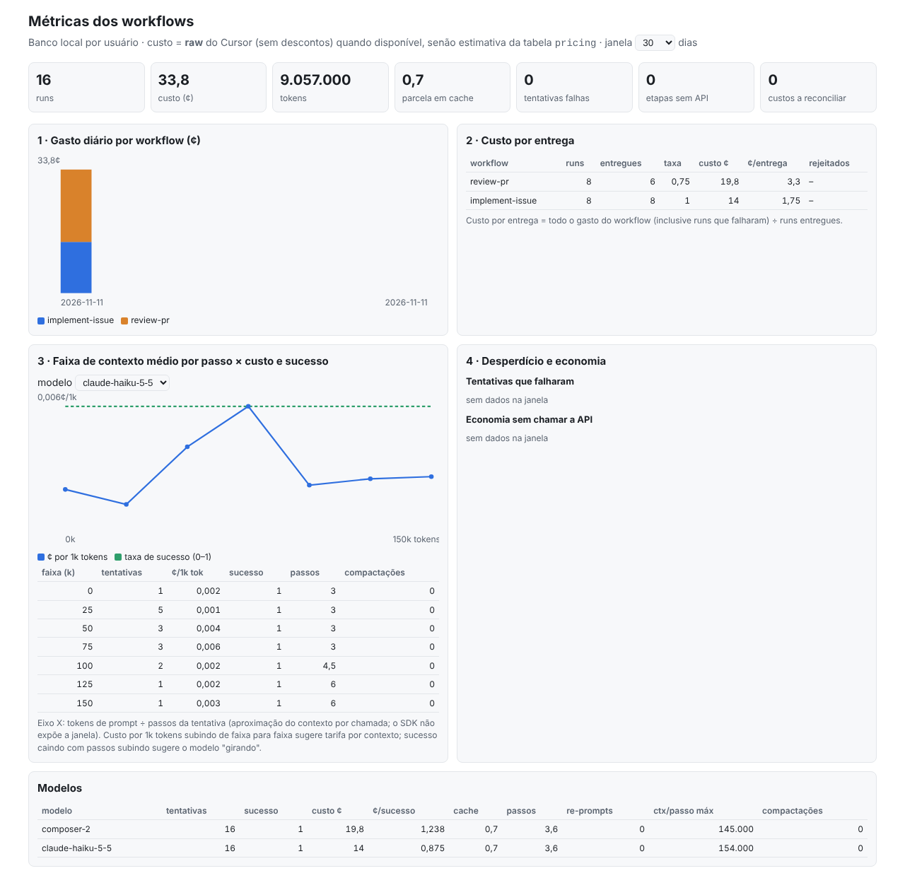

# 09 · Observabilidade: custo, tokens, contexto e eficiência

Todo run grava suas métricas num **banco SQLite local, por usuário**: `~/.cursor-workflows/metrics.db`. A partir
dele você tem `wf stats` no terminal, um **dashboard em localhost** e um export CSV/JSON para consolidar no time.

O objetivo é responder com dados:

- quanto custa cada workflow, cada modelo e cada esforço;
- quanto custa uma **entrega** (não uma chamada);
- a partir de que tamanho de contexto o custo sobe ou o modelo passa a girar sem entregar;
- onde está o desperdício: retries, re-prompts, falhas.

> **Marcas de confiança:** [PKG] = lido no `@cursor/sdk@1.3.1`; [I] = inferência; [S] = resumo de busca.

## 1. Começo rápido

```bash
npm run wf -- run implement-issue --cwd ../meu-repo --args '{"issue":12}'   # grava métricas automaticamente
npm run stats                         # resumo dos últimos 30 dias no terminal
npm run dash                          # http://127.0.0.1:4317
npm run wf -- metrics export --days 90 --format csv --out ./metrics-export   # anonimizado por padrão
npm run wf -- metrics reconcile       # completa custos que o Cursor reportou com atraso
npm run wf -- metrics mark <runId> rejected   # veredito humano (ex.: PR recusado)
sqlite3 ~/.cursor-workflows/metrics.db 'SELECT * FROM v_model_summary'      # análise livre
```

Configuração por variáveis de ambiente:

| Variável | Efeito |
|---|---|
| `WF_METRICS=off` | Desliga a gravação. O `node:sqlite` nem é carregado |
| `WF_METRICS_DB` | Muda o caminho do banco |
| `WF_METRICS_STORE_PROMPTS=1` | Grava também o texto dos prompts. **Só para depuração local**: o banco passa a conter código e dados de issues |
| `WF_DASH_PORT` | Porta do dashboard (default 4317) |

## 2. O que é medido, e o que não dá para medir

| Medida | Fonte | Observação |
|---|---|---|
| Tokens por tentativa: input, output, cache read, cache write, raciocínio | `agent.getUsage()` [PKG] | Fonte da verdade da tentativa |
| **Custo bruto** (`raw_cents`) | `getUsage().cost.rawCostCents` [PKG] | Custo do Cursor **sem descontos**. É o **sinal principal** de eficiência |
| Custo cobrado (`charged_cents`) | `getUsage().cost.chargedCents` [PKG] | **0 para uso incluído no plano**, BYOK e créditos. Por isso não é o sinal principal |
| Custo por grupo de uso do Cursor | `getUsage().runs[]` → `usage_runs` [PKG] | Guardado como veio. **Não** é ligado aos turnos por posição, porque não há id em comum |
| Turnos, passos, tool calls por nome, compactações | `onDelta`: `turn-ended`, `step-completed`, `tool-call-started`, `summary-completed` [PKG] | `turn-ended` cobre **um turno inteiro do agente**, com vários passos |
| Re-prompts de schema, tentativas, tipo de erro, duração | runtime | `error_kind`: timeout, run-error, schema, rate-limit, exception |
| Modelo e parâmetros | `ModelSelection` | `model_key` = id + params ordenados (ex.: `composer-2[reasoning_effort=low]`), então esforço e contexto viram "braços" distintos |
| Resultado do run | `result.status` do workflow + `ctx.metric()` | `outcome_class`: delivered, failed, error, unknown |
| Versão do workflow | hash de `meta` + `defaults` + código de `run` | Compare só runs da mesma versão |

### A janela de contexto

O SDK **não informa** o tamanho da janela usado em cada chamada ao modelo. O que ele expõe é o uso **somado** do
turno, que inclui todos os passos [PKG].

O kit usa como aproximação o `avg_prompt_per_step`: tokens de prompt (input + cache read + cache write) ÷ passos da
tentativa. É um **limite inferior** do contexto médio por chamada [I]. Em um agente o contexto cresce a cada passo,
então as últimas chamadas são maiores que a média.

As faixas de 25 mil tokens (`ctx_bucket_k`) usam essa medida.

### Faixas de preço por contexto

Na API da Anthropic, o Claude Haiku 5.5 custa US$ 0,10/0,50 por milhão (input/output) **até 100 mil tokens de
prompt** e US$ 0,50/2,50 acima disso. Se o Cursor repassa essa faixa não está confirmado.

O banco permite descobrir empiricamente:

- `v_context_buckets` mostra o **custo bruto do Cursor por mil tokens** em cada faixa de contexto, por modelo;
- um salto de faixa para faixa é a evidência.

## 3. Modelo de dados

```
runs (uma linha por execução; um resume = nova execução do mesmo run_id)
 ├── attempts (uma linha por tentativa de etapa; hits de journal/memo = linhas de custo zero com `cached`)
 │    ├── turns       (uso de cada turno do agente, com nº de passos)
 │    └── usage_runs  (grupos de uso como o Cursor reportou)
 └── metrics          (ctx.metric: tier, testes, achados de review, tamanho do diff…)
pricing (tarifas de referência, só para estimar quando o Cursor não reporta custo)
```

Regras que mantêm as somas corretas:

- **Tentativas são só inseridas, nunca atualizadas por soma.** Um run retomado vira nova execução, e somar as
  tentativas não conta duas vezes.
- **`cost_final = 0`** indica que o custo ainda não tinha chegado ao fim da etapa (o custo do Cursor é
  "eventualmente consistente" [PKG]). Rode `wf metrics reconcile`.
- **Origem do custo:** `v_attempts.cost_source` vale `cursor` (raw do Cursor), `estimate` (tabela `pricing`,
  aplicando a faixa pelo `avg_prompt_per_step`) ou `none`.

### Views prontas

| View | Pergunta que responde |
|---|---|
| `v_attempts` | Base enriquecida: `prompt_tokens`, `avg_prompt_per_step`, `ctx_bucket_k`, `cost_cents`, `cost_source` |
| `v_runs` | Custo e resultado por run lógico (todas as execuções somadas) |
| `v_workflow_summary` | **Custo por entrega**: todo o gasto, inclusive dos runs que falharam, ÷ entregas. Também taxa de entrega e rejeições humanas |
| `v_model_summary` | Por modelo e params: taxa de sucesso, custo por tentativa bem-sucedida, parcela em cache, passos, re-prompts, compactações |
| `v_context_buckets` | Por modelo e faixa de contexto: ¢/1k tokens, sucesso, passos, saída média |
| `v_savings` | Economia de journal e memo: hits × custo médio da mesma etapa quando rodou de verdade |
| `v_waste` | Custo das tentativas que falharam, por etapa e tipo de erro |
| `v_daily` | Gasto diário por workflow e modelo |
| `v_unreconciled` | Tentativas com custo ainda não consolidado |

## 4. Receitas de análise (SQL)

**A partir de que contexto o custo dispara?** Custo por mil tokens por faixa, para um modelo:

```sql
SELECT ctx_bucket_k, attempts, cents_per_1k_tokens, ok_rate, avg_steps
FROM v_context_buckets WHERE model_key LIKE 'claude-haiku%' ORDER BY ctx_bucket_k;
```

**Quando o modelo fica ineficiente** (mais gasto que entrega). Custo por tentativa bem-sucedida e passos, por faixa:

```sql
SELECT model_key, ctx_bucket_k, COUNT(*) n, ROUND(AVG(ok),2) ok_rate, ROUND(AVG(steps),1) steps,
       ROUND(SUM(cost_cents)/NULLIF(SUM(ok),0),2) cents_per_ok, SUM(summaries) compactions
FROM v_attempts WHERE cached IS NULL GROUP BY 1,2 ORDER BY 1,2;
```

Sinais de alerta:

- `cents_per_ok` subindo mais rápido que o tamanho do contexto;
- `ok_rate` caindo;
- `steps` e `compactions` subindo.

Nessa faixa vale dividir a etapa, reduzir o contexto (`settingSources`, `tools`) ou trocar o modelo.

**Esforço vale a pena?** Compare o mesmo modelo com params diferentes, **dentro do mesmo tier** (a dificuldade
confunde a comparação):

```sql
SELECT a.model_key, t.tier, COUNT(*) n, ROUND(AVG(a.ok),2) ok_rate, ROUND(AVG(a.cost_cents),2) avg_cents
FROM v_attempts a
JOIN (SELECT DISTINCT x.run_id, m.value_text tier FROM runs x JOIN metrics m ON m.exec_id = x.exec_id AND m.name = 'tier') t
  ON t.run_id = a.run_id
WHERE a.cached IS NULL AND a.label = 'implementar' GROUP BY 1,2 ORDER BY 2,1;
```

**Custo por entrega, por tier:**

```sql
SELECT t.tier, COUNT(*) runs, SUM(r.outcome_class='delivered') delivered,
       ROUND(SUM(r.cost_cents)/NULLIF(SUM(r.outcome_class='delivered'),0),2) cents_per_delivery
FROM v_runs r
JOIN (SELECT DISTINCT x.run_id, m.value_text tier FROM runs x JOIN metrics m ON m.exec_id = x.exec_id AND m.name = 'tier') t
  ON t.run_id = r.run_id                     -- DISTINCT: um run retomado emite o tier em cada execução
GROUP BY 1;
```

**Quanto o memo e o journal economizaram:** `SELECT * FROM v_savings;`

**O custo do Cursor bate com os grupos de uso?** O resumo `attribution` do `wf stats` compara a soma das
tentativas com a soma dos grupos de uso. Uma diferença grande (acima de cerca de 10%) indica uso não atribuído,
por exemplo de subagents ou de compactação.

## 5. Dashboard



*Captura com dados sintéticos (SDK falso), não com uso real.*

`npm run dash` abre `http://127.0.0.1:4317`, com:

- **KPIs:** runs, custo, tokens, parcela em cache, tentativas falhas, etapas sem API, custos a reconciliar;
- **Painel 1:** gasto diário por workflow;
- **Painel 2:** custo por entrega;
- **Painel 3:** faixa de contexto × ¢/1k tokens × taxa de sucesso, por modelo;
- **Painel 4:** desperdício e economia;
- **Tabela de modelos.**

Segurança:

- escuta só em `127.0.0.1`;
- recusa `Host` diferente de localhost (proteção contra DNS rebinding);
- não envia cabeçalhos CORS;
- abre o banco em modo leitura;
- não usa CDN nem bibliotecas: funciona offline e em rede corporativa restrita.

## 6. Instrumentando um workflow

O runtime grava automaticamente tudo o que é do agente. O workflow acrescenta **o que significa entregar**:

```ts
ctx.metric("tier", tier);                    // covariável de dificuldade: compare modelos dentro do tier
ctx.metric("tests_passed", tests.ok ? 1 : 0);
ctx.metric("diff_lines", diffLines);
ctx.metric("review_blocking", blocking.length);
return { status: "done", ... };              // "done" (ou delivered/ok/success) = entregue
return { status: "tests-failed", ... };      // qualquer outro status = o workflow decidiu que não entregou
```

`outcome_class` é derivado assim:

- run que lançou erro ou estourou o teto → `error`;
- `status` em `done/delivered/ok/success/succeeded` → `delivered`;
- outro `status` → `failed`;
- sem `status` → `unknown`.

Para validar a entrega depois, por exemplo quando o PR é aceito ou recusado, use
`wf metrics mark <runId> accepted|rejected`.

**Labels:** dê `label` explícito às etapas (`"planejar"`, `"implementar"`). Sem label, o runtime usa
`etapa-<hash>`, para não vazar conteúdo do prompt. Mas aí as análises por etapa ficam ilegíveis.

## 7. Privacidade e uso no time

- **O que fica no banco:**
  - prompts só como **hash e tamanho**;
  - args como hash;
  - repositório como nome da pasta + hash do remote;
  - **nenhum e-mail**: o banco é do próprio usuário.
- **Permissões:** pasta `0700`, arquivo `0600`.
- **Export anonimizado por padrão:** sem nome de repositório, sem `agent_id`, sem prompt, com erros redigidos. Use
  `--no-anonymize` só para análise local.
- **Consolidação do time (V1):** cada pessoa roda `wf metrics export` e o time junta os CSVs num BI. A atribuição
  por pessoa, se necessária, fica a cargo do processo que coleta os arquivos.
- **Disco:** mantenha o banco em disco local. O modo WAL do SQLite não funciona bem em disco de rede nem em
  `/mnt/c` no WSL.

## 8. Limites da V1 e próximos passos

- **Sem contexto por chamada:** só a média por passo (§2). Uma V2 pode estimar o crescimento por passo, se o SDK
  passar a expor uso por chamada.
- **Custo atrasado:** `reconcile` depende de `Agent.getUsage(agentId)` funcionar para agentes locais já
  descartados. Isso não foi verificado contra a API real, e o comando informa quantos falharam.
- **Tabela `pricing`:** é só referência para estimativa. Edite com `sqlite3` quando os preços mudarem
  (`effective_from` permite manter o histórico).
- **V2 sugerida:**
  - export OpenTelemetry para o coletor do time;
  - banco central;
  - alertas, por exemplo custo por entrega acima de X ou faixa de contexto com ¢/1k saltando;
  - `wf metrics purge --before <data>`.
